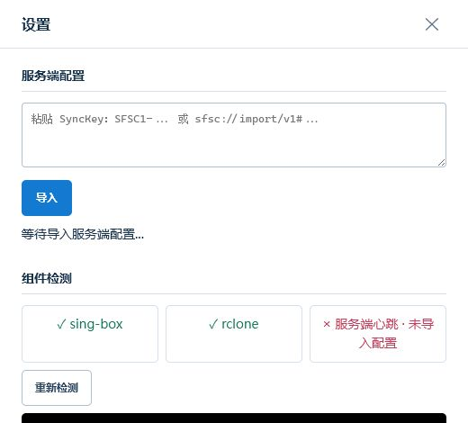

# Syncraft

> 基于 VLESS 隧道和 S3 兼容存储的自托管 Windows 文件夹同步工具。

Syncraft 把 `sing-box`、`rclone` 和 MinIO/S3 组合成一套可管理的同步服务：管理员在服务端管理设备并签发一次性 SyncKey，Windows 客户端导入后即可创建同步任务。同步流量只交给 rclone 进程走本地代理，不会修改系统代理、路由、DNS、TUN 或防火墙。

当前版本为 **0.3.0-rc.1 产品候选版**，以已验证的产品化基线为起点。它提供 Windows 桌面包、便携包和 Docker 服务端部署包；桌面 ZIP 是默认交付形态，便携 ZIP 用于兼容回退，目前不提供安装程序。

## 适合谁使用

- 想在自己的服务器、NAS 或 N1 上部署私有同步服务的个人或小团队。
- 希望让 Windows 文件夹通过 VLESS 安全访问 MinIO/S3 存储的人。
- 需要由管理员控制设备、同步空间和一次性授权，而不是把存储密钥散落到客户端的人。

## 你会得到什么

- Docker Compose 服务端：管理控制台、sing-box、MinIO、HTTPS 入口。
- Windows 客户端：内置 `sing-box.exe` 和 `rclone.exe`，支持上传、下载、双向同步和定时任务。
- SyncKey 一次性导入：客户端不需要手工填写 S3 密钥或 VLESS 参数。
- 同步进度、最近历史、脱敏日志和诊断包。
- 发布包 SHA-256、`release-manifest.json` 和 CI/preflight 校验。

## 使用教程

下面的流程按“管理员先部署服务端，Windows 用户再接入客户端”设计。第一次使用时，先从管理员处获取一个新的 SyncKey；不要把完整 SyncKey、VLESS URI、管理 Token 或存储密钥发到聊天群、Issue 或截图中。

### 1. 管理员部署服务端

准备一台能够运行 Docker Compose 的 Linux 服务器，并确保域名已解析到服务器、`80`、`443` 和 VLESS 端口可从客户端网络访问。

```bash
cd server
cp .env.example .env
```

编辑 `server/.env`，至少设置以下值：

```text
SFSC_PUBLIC_HOST=sync.example.com
SFSC_ADMIN_TOKEN=请替换为高强度随机值
MINIO_ROOT_PASSWORD=请替换为高强度随机值
```

然后启动服务：

```bash
docker compose up --build -d
```

访问 `https://sync.example.com/`，使用管理 Token 进入控制台，完成隧道和存储设置后，为设备创建 SyncKey。服务端的完整部署、备份、升级和恢复流程见 [部署与迁移指南](docs/DEPLOYMENT_AND_MIGRATION_GUIDE.md)。

### 2. 校验并启动 Windows 客户端

从 Release 获取 `SyncraftDesktop.zip` 和同名 `.sha256` 文件。先在 PowerShell 中核对 ZIP 的 SHA-256 首列，再解压到用户可写且不会被清理的目录，例如 `C:\Tools\Syncraft\`；不要直接在 ZIP、下载临时目录或系统受保护目录中运行。

```powershell
Get-FileHash -LiteralPath .\SyncraftDesktop.zip -Algorithm SHA256
```

解压后运行：

```text
SyncraftDesktop\Syncraft.exe
```

首次启动时，客户端会显示等待导入状态。这是正常的：它还没有任何服务器配置或同步权限。


### 3. 导入管理员签发的 SyncKey

点击右上角的“设置”，在“服务端配置”中粘贴管理员提供的完整 SyncKey，然后点击“导入”。成功后页面会显示“配置已导入”，并自动保存必要的本地安全配置。



请只在本机粘贴 SyncKey。导入失败时，不要反复复制完整密钥到日志或聊天窗口；优先记录页面显示的稳定错误码，并使用“导出诊断包”生成脱敏信息。

### 4. 创建同步任务

导入成功后，在主界面填写：

1. “本地文件夹”：选择或输入需要同步的目录。
2. “同步方向”：上传、本地下载或双向同步。
3. “同步空间”和“远端子目录”：按管理员授权范围选择；设备空间中的子目录可以留空。
4. “计划任务”、并行文件和单文件线程：先用默认值完成小文件验证，再按网络和磁盘性能调整。
5. 点击“保存任务”。需要先确认执行参数时，在“设置”中生成 rclone 命令预览；确认后再点击“开始同步”。


默认上传和下载使用 `copy`，不会删除目标端多余文件。开启“镜像同步”会删除目标端多余文件，客户端会要求再次确认；双向同步会使用 rclone bisync，首次执行前建议先用少量测试文件验证。

### 5. 查看进度与排障

主界面显示速度、传输量、当前文件和最近同步状态。点击“设置”可查看组件检测、协议兼容性、同步历史和日志，并导出脱敏诊断包。

遇到问题时按这个顺序处理：

1. 确认 ZIP SHA-256 与 `.sha256` 文件一致。
2. 确认 `sing-box` 和 `rclone` 在“组件检测”中正常。
3. 查看同步历史和日志中的稳定错误码。
4. 导出诊断包，备份本地 `data` 后再处理状态损坏或密钥库缺失。

常见错误码和恢复步骤见 [部署与迁移指南](docs/DEPLOYMENT_AND_MIGRATION_GUIDE.md#4-windows-客户端本地状态恢复) 与 [试点支持指南](docs/PILOT_SUPPORT_GUIDE.md)。

## 开发与构建

开发环境需要 Windows、Node.js 24、pnpm 9；只有部署服务端时才需要 Docker Desktop。

```powershell
pnpm install
pnpm test
pnpm run client:start      # 启动本地客户端服务，访问 http://127.0.0.1:5188/
pnpm run client:desktop    # 启动 Electron 桌面窗口
```

构建 Windows 桌面包：

```powershell
pnpm install
pnpm run client:download-binaries
pnpm run client:desktop-package
```

构建输出：

```text
dist/SyncraftDesktop/Syncraft.exe
dist/SyncraftDesktop/release-manifest.json
dist/SyncraftDesktop.zip
dist/SyncraftDesktop.zip.sha256
```

旧式 Node 便携包仍可用 `pnpm run client:package` 生成。下载的 `sing-box.exe` 和 `rclone.exe` 不纳入源码仓库；构建时会按照 `client/resources/bin/win32/binaries.lock.json` 下载并校验 SHA-256。

## 发布前检查

提交前运行：

```powershell
pnpm run ci:verify
```

它会执行发布审计和全量 Node 测试。需要验证已经构建的双客户端包时，再运行：

```powershell
pnpm run preflight:release
```

严格预检要求 `dist\SyncraftDesktop` 与 `dist\SyncraftClient` 都存在且通过客户端包 smoke；它会生成可追溯的 JSON 报告。发布、N1 部署和验收证据的完整流程见 [部署与迁移指南](docs/DEPLOYMENT_AND_MIGRATION_GUIDE.md)。

已启动的客户端可执行只读 smoke：

```powershell
pnpm run smoke:client
node scripts/smoke-client.mjs --base-url http://127.0.0.1:5188 --json-report reports/client-smoke.json
```

`smoke:client` 检查已经运行的客户端本地服务；`smoke:client-package` 检查已经构建出的发行包目录。

### 发布交付与验证

需要将源码、文档、双客户端 ZIP、manifest 和预检报告收集为本地交付包时，运行：

```powershell
pnpm run bundle:release
```

输出位于 `dist/release-bundles/`，包含 `release-bundle-manifest.json`、同名 ZIP 和 `.sha256`。bundle 会排除 `.env`、`server/data`、真实 `server/sing-box/config.json`、客户端运行态 `data/`、`.tmp` 和 `node_modules`。

manifest 的 `preflightVerified` 和 `preflightVerification` 字段是发布放行判断入口。`preflightVerification.mode: "external"` 表示 release workflow 已注入上游严格预检证据；该证据会作为交付自证明进入 bundle。

GitHub 的 `.github/workflows/ci.yml` 执行发布审计与全量测试；`.github/workflows/release.yml` 构建桌面包和便携包、运行严格预检，并显式检查 `releaseOk: true`、`skipped: 0` 和双包 smoke 报告。release workflow 会上传 ZIP、`.sha256`、`release-manifest.json`、`reports/release/**` 和 `dist/release-bundles/**`。

## 项目结构

```text
src/                 服务端 API 与共享核心逻辑
public/              服务端管理控制台
client/              Windows 本地 API、Electron、客户端 UI 与构建脚本
server/              Docker Compose、Caddy 和 sing-box 部署配置
tests/               Node 合同与行为测试
docs/                协议、设计、部署、试点与交接文档
scripts/             CI、smoke、发布与 N1 自动化
```

## 文档导航

- [接口合同](docs/INTERFACE_CONTRACT.md)：客户端和服务端 API、SyncKey、profile、心跳与稳定错误码的唯一基线。
- [API 矩阵](docs/API_MATRIX.md)：双端路由与调用方。
- [部署与迁移指南](docs/DEPLOYMENT_AND_MIGRATION_GUIDE.md)：Docker、N1、客户端状态恢复、升级和发布。
- [SyncKey 协议](docs/T_KEY_PROTOCOL.md)：一次性授权的格式和生命周期。
- [软件设计说明](docs/SOFTWARE_DESIGN_SPEC.md)：整体设计。
- [内部试运行清单](docs/INTERNAL_TRIAL_CHECKLIST.md) 与 [试点运行手册](docs/PILOT_RUNBOOK.md)：面向小范围试用。

修改任一 `/api/*` 路由、SyncKey/profile/heartbeat 字段、稳定错误码、诊断字段或发布包结构时，必须同步更新 `docs/INTERFACE_CONTRACT.md`、`docs/API_MATRIX.md` 和对应合同测试。

## 安全边界

- 不提交 `.env`、`server/data/`、真实 sing-box 配置、本地客户端数据、下载的二进制文件或 `dist/` 产物。
- 管理 Token、SyncKey、VLESS URI、S3/MinIO 密钥和私钥不得进入 `reports/`、Issue、聊天记录或截图。
- 客户端本地状态默认位于 `%LOCALAPPDATA%\Syncraft\data`；排障前先导出诊断包并备份，不要直接删除状态文件。
