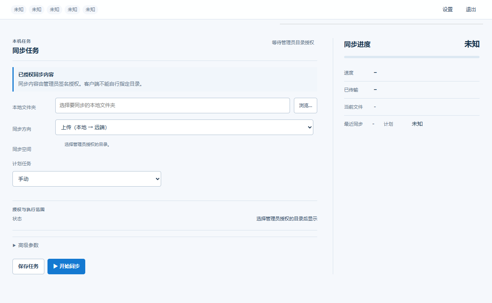
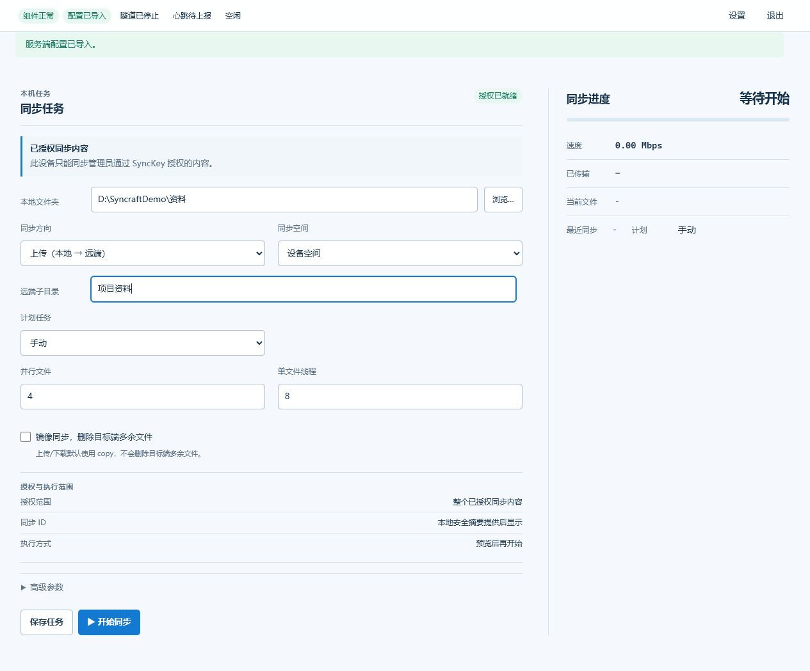

# Syncraft

> 将 Windows 普通目录与自托管 N1/Linux 目录双向同步的工具，连接配置码与设备身份验证码分步使用。

普通目录模式面向 N1/Linux 主机上由管理员开放的既有目录。客户端先导入管理员签发的通道配置码，再提交设备身份申请；管理员独立签发身份验证码后，用户选择获授权的目录和本地文件夹，确认首次双向冲突，再启用自动同步。通道配置码建立接入通道，身份验证码验证设备身份，两者不可互换。同步流量只由受管理的同步进程通过本地数据通道传输，不修改系统代理、路由、DNS、TUN 或防火墙。

当前工作以产品化基线为基础，处于产品验收候选阶段，尚不能据此判断已发布或生产就绪。Windows 客户端当前以 ZIP 包形态交付；本仓库没有 Windows 安装程序。N1 普通目录部署入口见 [`server/DEPLOYMENT.md`](server/DEPLOYMENT.md)，其安装脚本为 `server/install-n1-directory-appliance.sh`。本 README 不提供新的公网性能结论。

本版在 rc.1 基线上完成了一轮完整的白盒安全审查与加固：管理 Token 默认强制、凭证不再经命令行传递、密钥文件写入前先收紧 ACL、心跳与 SyncKey 兑换限速、本地接口读写均拒绝跨站浏览器请求、二进制与容器镜像按哈希/digest 钉定。审查结论与逐项实施记录见 [`SECURITY_REVIEW_2026-07-25.md`](SECURITY_REVIEW_2026-07-25.md) 与 [`SECURITY_HARDENING_CLOSEOUT_2026-07-26.md`](SECURITY_HARDENING_CLOSEOUT_2026-07-26.md)。

MinIO/S3 仍作为兼容模式保留，可从 [`server/DEPLOYMENT_AND_MIGRATION_GUIDE.md`](docs/DEPLOYMENT_AND_MIGRATION_GUIDE.md) 查阅旧部署与迁移说明；普通目录模式不要求配置 MinIO。两种 appliance 模式共享状态和端口，不能同时运行，切换前请按部署文档核对服务状态。

## 用户交付入口

本仓库是开发主仓库，统一维护客户端、服务端、共享协议和测试。普通使用者按目标选择独立交付仓库：

- [Syncraft-server](https://github.com/beizhi97/Syncraft-server)：服务端交付仓库入口；请核对对应版本是否已发布普通目录部署资产。
- [Syncraft-client](https://github.com/beizhi97/Syncraft-client)：Windows 客户端交付仓库入口；本候选尚不能据此认定已有公开下载包。

Windows 客户端当前构建形态是 ZIP，不是安装程序。发布状态须以对应 Release 页面和候选验收记录为准；不要把本地构建产物视为已发布版本。

## 适合谁使用

- 想在 N1/Linux 主机上开放普通目录，并从 Windows 设备双向同步的个人或小团队。
- 需要分开管理通道接入与设备身份授权，并保留已有任务目录和双向基准的人。
- 需要保留 MinIO/S3 部署的现有用户；该路径仍作为兼容模式提供。

## 你会得到什么

- 普通目录 appliance：管理员登记主机上已存在的目录，服务端按授权目录为设备提供数据通道。
- Windows 客户端：支持普通目录上传、下载、双向同步和定时任务；可用目录与方向由服务端授权决定。
- 分步首次接入：通道配置码与身份验证码分别导入/输入，身份验证后再选择授权目录和本地文件夹。
- 首次双向冲突保护：用户预览并保存冲突副本，显式确认后才初始化双向同步。
- 连接修复和重新配置：客户端可修复连接；服务端一键重配可沿用现有设备、任务目录和同步基准。
- 同步进度、最近历史、脱敏日志和诊断包。
- 发布候选使用 ZIP、SHA-256、`release-manifest.json` 和 CI/preflight 校验；每个候选包仍需独立验收。

## 使用教程

下面按“管理员部署 N1 普通目录服务，Windows 用户完成两码接入”说明。不要把完整通道配置码、身份验证码、管理 Token 或通道连接信息发到聊天群、Issue 或截图中。

### 1. 管理员部署服务端

准备一台能够运行 Docker 和 systemd 的 N1/Linux 服务器，并由管理员预先创建要开放的主机目录。按 [普通目录部署文档](server/DEPLOYMENT.md) 准备 `.env.directory`，并使用实际脚本 `server/install-n1-directory-appliance.sh` 安装；可先使用脚本的 `SFSC_DIRECTORY_CHECK_ONLY=1` 检查路径和部署输入。该部署说明描述安装操作，不代表此候选已在用户环境安装或发布。

```bash
sudo install -d -m 0750 /srv/syncraft-shares
sudo cp server/.env.directory.example server/.env.directory
sudoedit server/.env.directory
```

设置非占位管理 Token 和客户端可访问的服务端地址。不要把 S3/MinIO 密钥加到普通目录配置中。安装命令示例：

```sh
sudo sh server/install-n1-directory-appliance.sh /srv/syncraft-shares
```

登录管理控制台后按顺序完成：

1. 开放管理员预先创建的目录。
2. 填写外部连接地址，应用连接设置并生成通道配置码。
3. 在 Windows 客户端导入通道配置码并提交设备身份申请。
4. 为申请选择获授权的目录，签发独立的一次性身份验证码。
5. 在客户端输入身份验证码，再选择目录和本地文件夹。

普通目录安装不会停止或删除 MinIO。若旧 S3 appliance 已启用，切换时需遵循部署文档的显式替换步骤，不要同时启动两种 appliance unit。

### 2. 校验并启动 Windows 客户端

使用经过验收并实际发布的 Windows ZIP；若当前只有本地候选包，则从验收交付目录获取 ZIP 和同名 `.sha256` 文件。先在 PowerShell 中核对 ZIP 的 SHA-256，再解压到用户可写且不会被清理的目录，例如 `C:\Tools\Syncraft\`；不要直接在 ZIP、下载临时目录或系统受保护目录中运行。当前没有 Windows 安装程序。

```powershell
Get-FileHash -LiteralPath .\SyncraftDesktop.zip -Algorithm SHA256
```

解压后运行：

```text
SyncraftDesktop\Syncraft.exe
```

首次启动时，客户端会显示等待导入状态。这是正常的：它还没有任何服务器配置或同步权限。



### 3. 导入通道配置码并完成身份验证

客户端首次运行时先粘贴通道配置码并提交身份申请。管理员在设备申请列表中选择目录并签发身份验证码；用户再将该验证码输入客户端。通道配置码用于建立连接，身份验证码用于验证设备，不要把身份验证码当作连接配置码导入。

身份验证本身不表示目录授权或同步已成功。客户端只显示服务端已授予的目录；用户再选择该目录和 Windows 本地文件夹。

### 4. 创建同步任务

授权就绪后，选择获授权目录和 Windows 本地文件夹，再设置同步方向与计划：

1. “本地文件夹”：选择或输入需要同步的目录。这是唯一必填项。
2. “同步目录”：只显示管理员授权的目录，不允许填写或切换未授权的服务端路径。
3. “同步方向”：只列出当前目录授权允许的方向。
4. “计划任务”：首次建议先手动验证。确认目录和首次同步结果无误后，可选择间隔、每日或启动时自动同步；危险同步计划需要明确授权。
5. 双向同步首次运行前，先查看冲突预览并保存冲突副本，再明确确认初始化。已有 relation/baseline 的任务应继续复用；修复连接或签发新通道码不会要求删除任务或重新建立同步基准。



> 上图摄于早期 S3/SyncKey 界面，可能与当前两码接入和目录选择界面不同；以当前候选客户端实际界面和合同为准。重截流程见 [截图说明](docs/images/README.md)。

自动同步按用户选择的 schedule 运行；每次执行前重新验证当前任务授权、安全计划、目录 marker 和既有双向基准。任何需人工确认的首次初始化都不会由调度器自动执行。

### 5. 查看进度与排障

主界面显示速度、传输量、当前文件和最近同步状态。点击“设置”可查看组件检测、协议兼容性、同步历史和日志，并导出脱敏诊断包。

遇到问题时按这个顺序处理：

1. 确认 ZIP SHA-256 与 `.sha256` 文件一致。
2. 确认 `sing-box` 和 `rclone` 在“组件检测”中正常。
3. 查看同步历史和日志中的稳定错误码。
4. 导出诊断包，备份本地 `data` 后再处理状态损坏或密钥库缺失。

常见错误码和恢复步骤见 [部署与迁移指南](docs/DEPLOYMENT_AND_MIGRATION_GUIDE.md#4-windows-客户端本地状态恢复) 与 [试点支持指南](docs/PILOT_SUPPORT_GUIDE.md)。

## 开发与构建

开发环境需要 Windows、Node.js 24、pnpm 9；只有部署服务端时才需要 Docker Desktop。

```powershell
pnpm install
pnpm test
pnpm run client:start      # 启动本地客户端服务，访问 http://127.0.0.1:5188/
pnpm run client:desktop    # 启动 Electron 桌面窗口
```

改动 UI 后如需重截 README 截图，见 [截图说明](docs/images/README.md)；`pnpm docs:seed-screenshot` 会把客户端送进截图所需状态，不必先跑一台服务端。

构建 Windows 桌面包：

```powershell
pnpm install
pnpm run client:download-binaries
pnpm run client:desktop-package
```

构建输出：

```text
dist/SyncraftDesktop/Syncraft.exe
dist/SyncraftDesktop/release-manifest.json
dist/SyncraftDesktop.zip
dist/SyncraftDesktop.zip.sha256
```

旧式 Node 便携包仍可用 `pnpm run client:package` 生成。下载的 `sing-box.exe` 和 `rclone.exe` 不纳入源码仓库；构建时会按照 `client/resources/bin/win32/binaries.lock.json` 下载并校验 SHA-256。

## 发布前检查

提交前运行：

```powershell
pnpm run ci:verify
```

它会执行发布审计和全量 Node 测试。需要验证已经构建的双客户端包时，再运行：

```powershell
pnpm run preflight:release
```

严格预检要求 `dist\SyncraftDesktop` 与 `dist\SyncraftClient` 都存在且通过客户端包 smoke；它会生成可追溯的 JSON 报告。发布、N1 部署和验收证据的完整流程见 [部署与迁移指南](docs/DEPLOYMENT_AND_MIGRATION_GUIDE.md)。

已启动的客户端可执行只读 smoke：

```powershell
pnpm run smoke:client
node scripts/smoke-client.mjs --base-url http://127.0.0.1:5188 --json-report reports/client-smoke.json
```

`smoke:client` 检查已经运行的客户端本地服务；`smoke:client-package` 检查已经构建出的发行包目录。

### 发布交付与验证

需要将源码、文档、双客户端 ZIP、manifest 和预检报告收集为本地交付包时，运行：

```powershell
pnpm run bundle:release
```

输出位于 `dist/release-bundles/`，包含 `release-bundle-manifest.json`、同名 ZIP 和 `.sha256`。bundle 会排除 `.env`、`server/data`、真实 `server/sing-box/config.json`、客户端运行态 `data/`、`.tmp` 和 `node_modules`。

manifest 的 `preflightVerified` 和 `preflightVerification` 字段是发布放行判断入口。`preflightVerification.mode: "external"` 表示 release workflow 已注入上游严格预检证据；该证据会作为交付自证明进入 bundle。

GitHub 的 `.github/workflows/ci.yml` 执行发布审计与全量测试；`.github/workflows/release.yml` 构建桌面包和便携包、运行严格预检，并显式检查 `releaseOk: true`、`skipped: 0` 和双包 smoke 报告。release workflow 会上传 ZIP、`.sha256`、`release-manifest.json`、`reports/release/**` 和 `dist/release-bundles/**`。

## 项目结构

```text
src/                 服务端 API 与共享核心逻辑
public/              服务端管理控制台
client/              Windows 本地 API、Electron、客户端 UI 与构建脚本
server/              appliance、systemd、Compose 兼容配置和 sing-box 部署文件
tests/               Node 合同与行为测试
docs/                协议、设计、部署、试点与交接文档
scripts/             CI、smoke、发布与 N1 自动化
```

## 文档导航

- [接口合同](docs/INTERFACE_CONTRACT.md)：客户端和服务端 API、SyncKey、profile、心跳与稳定错误码的唯一基线。
- [API 矩阵](docs/API_MATRIX.md)：双端路由与调用方。
- [部署与迁移指南](docs/DEPLOYMENT_AND_MIGRATION_GUIDE.md)：Docker、N1、客户端状态恢复、升级和发布。
- [SyncKey 协议](docs/T_KEY_PROTOCOL.md)：旧 S3/MinIO 兼容模式的一次性授权格式和生命周期。
- [软件设计说明](docs/SOFTWARE_DESIGN_SPEC.md)：整体设计。
- [内部试运行清单](docs/INTERNAL_TRIAL_CHECKLIST.md) 与 [试点运行手册](docs/PILOT_RUNBOOK.md)：面向小范围试用。

修改任一 `/api/*` 路由、SyncKey/profile/heartbeat 字段、稳定错误码、诊断字段或发布包结构时，必须同步更新 `docs/INTERFACE_CONTRACT.md`、`docs/API_MATRIX.md` 和对应合同测试。

## 安全边界

- 不提交 `.env`、`server/data/`、真实 sing-box 配置、本地客户端数据、下载的二进制文件或 `dist/` 产物。
- 管理 Token、SyncKey、VLESS URI、S3/MinIO 密钥和私钥不得进入 `reports/`、Issue、聊天记录或截图。
- 客户端本地状态默认位于 `%LOCALAPPDATA%\Syncraft\data`；排障前先导出诊断包并备份，不要直接删除状态文件。
- 客户端本地 API 只绑定 loopback，并校验 Host 头以阻断 DNS 重绑定；读写接口都拒绝 `Sec-Fetch-Site: cross-site` 的浏览器请求。它**刻意不使用鉴权令牌**——已能在本机执行代码的进程可以直接读取本地凭据文件，令牌无法防御该路径，因此防线是进程边界与文件 ACL，而非 HTTP 层令牌。
- 服务端管理面应置于 HTTPS 反代之后，并始终设置强随机 `SFSC_ADMIN_TOKEN`；MinIO 的 API 与控制台端口默认只绑定 localhost。
