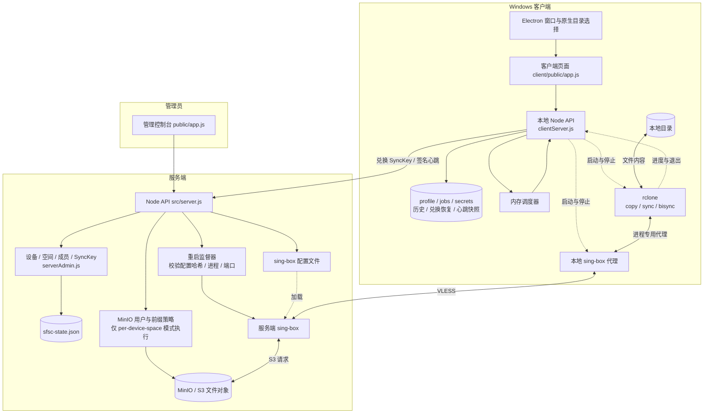
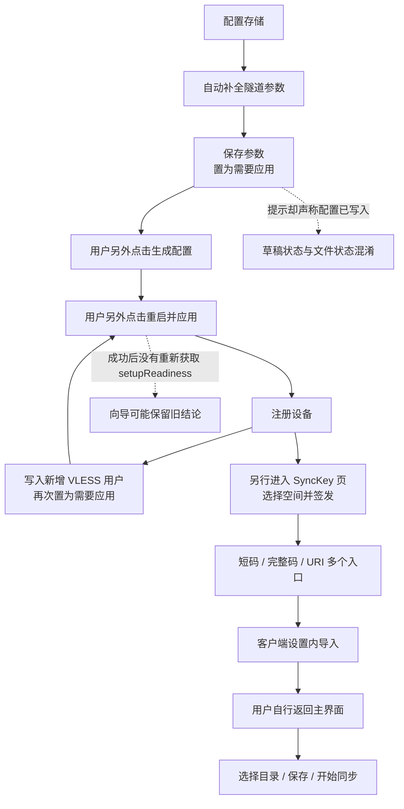
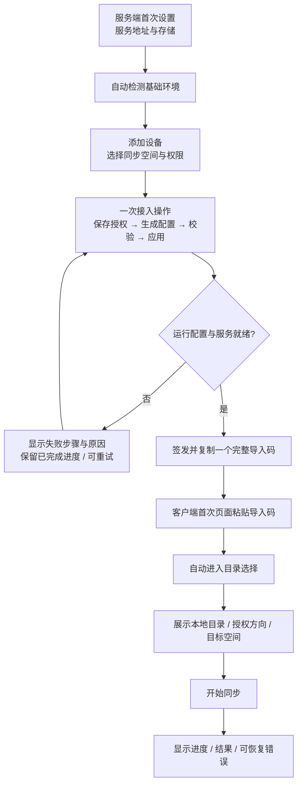

# Syncraft 项目逻辑框图与架构评估

日期：2026-09-16。分析对象：迁移后的 `work/singbox-folder-sync-mvp` 工作区，HEAD 为 `a4c948d`，包含分析开始前已有的 9 个修改文件。

证据标记：**已确认事实**来自当前源码或本次执行；**合理推断**指具备触发路径、尚未在真实部署复现；**建议**是待实现的设计，不是现有功能。

本次是阅读、绘图和诊断，没有修改业务源码，没有部署或操作真实同步数据。未连接用户当前运行的服务端与桌面客户端，因此不能把代码缺口直接等同于某次现场故障的唯一根因。

## 1. 结论与用户反馈

**合理推断：主要问题在于产品流程与运行状态没有形成闭环。** 存储、隧道、设备、授权码各自有接口和页面，但跨步骤的推进、状态刷新、失败恢复仍由用户承担。底层已有不少保护，不能归结为完全缺少校验或测试。

| 用户反馈 | 当前实现的事实 | 判断 |
| --- | --- | --- |
| 短码、长码令人困惑 | 长码编码了 `version/type/server/code`，其中 code 就是短码；短码导入必须另填服务端地址；另有 URI 表示 | 两种输入对应同一个一次性兑换资格，不是两次授权。建议普通入口只展示完整导入码 |
| 点击后无明显反应、不跳转 | 服务端通用 runAction 只写全局消息；创建设备仅预填发码表单，未切换页面；客户端导入成功只刷新状态，未关闭设置进入选目录步骤 | 缺少流程衔接已确认；具体哪次点击没有发请求或请求失败，尚未现场复现 |
| 自动配置一直提示需要应用 | autofill 保存参数并设置 restartRequired，但不写 sing-box 配置；提示却统一声称配置已写入；创建设备再次把隧道标成待应用 | 当前状态模型与文案不一致，且首次向导存在回头步骤 |
| 两端操作过于复杂 | 服务端把参数补全、生成配置、应用配置、建设备、建空间和发码暴露为分散操作；客户端把首次导入放在设置内 | 建议围绕“接入一台设备”和“开始同步一个目录”组织流程 |

短码与长码的依据：`src/core/claimProtocol.js:10,47`、`client/public/app.js:277`。服务端签发的长码本身不包含完整 S3 凭据；客户端兑换后才取得 profile。系统另外兼容离线完整 profile，不能把它与在线一次性码混为一谈。

## 2. 当前总体逻辑框图

实线是调用或数据流；虚线是控制和状态。Node 服务管理同步，文件内容主要由 rclone 直接经隧道访问存储。



源码依据：`src/server.js:152,509,530,541`，`client/src/clientServer.js:382,890,1189,1541,1932`，`src/core/rclone.js:5`，`client/electron/main.cjs:59`，`src/core/singbox.js:4`。

注意：VLESS 是此处的协议名称；是否使用 TLS/REALITY 取决于配置，不能仅凭使用 VLESS 就断言所有部署链路均已加密。

## 3. 当前操作流程及断点



这里的 F→G→E 是新增设备造成的回退，不是指应用后必须再次注册同一设备。服务端还允许签发新设备的 SyncKey 时隐式创建设备，因此相同的待应用问题也可能在发码动作中出现。

### 3.1 自动补全与“配置已写入”相矛盾

**已确认事实：** `/api/admin/tunnel/autofill` 只调用 `autoFillTunnelConfig` 和 `saveAdminState`，没有调用写 sing-box 配置函数。`updateTunnelConfig` 无条件设置 `restartRequired: true`。`renderApplyNotice` 在这一布尔值为真时统一显示“配置已写入但尚未生效”。

位置：`src/server.js:265`，`src/core/serverAdmin.js:478,506`，`public/app.js:1483`。

**合理推断：** 用户以为自动配置已经生成运行配置，直接点击应用时，磁盘配置可能仍是旧版本。监督器有哈希校验，所以此时可能拒绝应用；不是简单把提示清零就能修好。

### 3.2 向导顺序与真实依赖不一致

**已确认事实：** 首次步骤顺序是存储→隧道→设备→SyncKey；创建设备会令隧道重新待应用。这条回退甚至已被现有测试明确记录。

位置：`src/core/setupReadiness.js:22`，`src/core/serverAdmin.js:626`，`tests/setup-readiness.test.js:173`。

**建议：** 在设备登记完成后统一生成并应用配置；已有服务新增设备时由同一业务操作负责应用、确认和发码，避免用户来回切页。

### 3.3 操作成功与向导状态脱节

**已确认事实：** `loadState` 会请求 `/api/admin/setup`；`applySingbox`、`createDevice` 等成功后只替换 state 并 renderState。5 秒轮询 `refreshLiveDevices` 也不刷新 setupReadiness。

位置：`public/app.js:142,165,174,419,607`。

**合理推断：** 同屏的应用提示可能已更新，而概览/向导仍在使用旧探针结论。需要刷新或重新检测才能纠正，表现为操作后没变化。

### 3.4 操作反馈与下一步没有统一约定

**已确认事实：** 服务端 runAction 只设置全局 pending/success/error 消息，没有统一的按钮忙碌状态。createDevice 会预填发码设备名，但未调用 switchTab。客户端 saveProfile 成功后未调用 closeSettings。

位置：`public/app.js:607,844,1338`，`client/public/app.js:277,2172`。

客户端已有 withBusyAction，不能把服务端缺少忙碌控制概括为双端所有按钮都没有防重复提交。常规设置保存也不一定应跳页；应在首次导入、创建设备等有明确后继步骤的操作中推进。

### 3.5 请求超时边界不一致

**已确认事实：** 管理页面默认请求超时 15 秒；重启监督器请求默认等待 20 秒。applySingbox 未指定更长前端超时，且等待全局写锁的时间也计入前端请求时间。

位置：`public/app.js:55,419,1874`，`src/core/singboxControl.js:16`。

**合理推断：** 较慢重启或排队期间，页面可能先报告超时，后台仍在继续处理。没有现场日志，尚不能确定用户那次点击是否走了此路径。

## 4. 更深层的逻辑与架构问题

### 4.1 方向授权未落实到任务执行入口

**已确认事实（函数级核查）：** 一个 directions=[download] 的 v2 profile，传给实际导出的 buildJobFromProfile，仍能生成 direction=upload 的任务；clientServer 的 normalizeJob/buildSyncRunPlan 使用这个函数。界面方向限制不等于执行入口限制。

位置：`src/core/profileProtocol.js:200`，`client/src/clientServer.js:2550,2563`，`client/public/app.js:674`。

另一个函数级核查发现 UI 会把显式空方向集合 `[]` 当成 legacy 未知授权 null。正常签发能否到达该状态需要单独验证。

默认存储模式是 shared；per-device-space 才真正调用 MinIO 的按设备空间授权。实际部署使用哪种模式本次未读取，不能直接宣称线上发生了越权。应将方向、删除权限、空间目标统一在执行入口校验，并验证存储策略与产品授权一致。

### 4.2 调度器刷新保留了过时的运行决定

**已确认事实（实际函数提取核查）：** 修改 interval 为 60 分钟后，buildScheduledJob 仍保留已有 1 分钟后的 nextRun；已经消费、nextRun 为 null 的 startup 任务，在普通刷新中又得到 on-startup。

位置：`client/src/clientServer.js:1153,1168,1189`。

这些核查使用真实函数体与注入的时钟/内存状态，没有实际等待定时任务执行。建议明确区分修改计划、刷新展示、启动时触发，并保存足够的已执行信息。

### 4.3 隧道复用只判断进程存在

**已确认事实（实际函数提取核查）：** startSingbox 在进程运行时立即返回，未对照本次 URI 与代理端口。runSyncExclusive 也只在隧道未运行时调用启动。重新导入 profile 不会主动切换现有隧道。

位置：`client/src/clientServer.js:890,1051,1541`。

**合理推断：** 更换服务器/profile/代理端口后，任务可能沿用旧隧道。模拟核查证明早退分支，不代表已验证真实网络故障。建议按配置指纹管理进程，明确切换时机和运行中导入策略。

### 4.4 全局写锁同时覆盖慢操作和心跳

**已确认事实：** 管理写请求、兑换、心跳共用 adminStateWriteQueue；MinIO 操作与重启等待处于锁内；心跳成功也写整份状态 JSON。

位置：`src/server.js:209,396,413,485,541,743,757,1168`。

**合理推断：** 某个慢存储操作可以拖延其他设备心跳，形成多个页面同时状态异常的表象。已有单次 S3 超时不能消除排队和批量操作延迟。

### 4.5 回滚边界没有覆盖全部外部副作用

**已确认事实：** 服务端会回滚内存快照，状态写失败时还尝试恢复 sing-box 配置；但启停 MinIO 账号等外部动作在持久化之前执行，对这些副作用没有相应补偿。客户端 profile/jobs/secrets 是分文件写入、依靠内存快照恢复。

位置：`src/server.js:396,413,610,1200`，`src/minioProvisioner.js:79`，`client/src/store.js:166`，`client/src/clientServer.js:890`。

**合理推断：** 外部操作成功后本地写失败，或导入中进程崩溃，可能留下部分提交。建议采用持久操作记录、幂等重试和启动恢复；单独换成数据库也无法把 MinIO 与进程重启自动变成同一个事务。

### 4.6 同步启动互斥没有覆盖所有数据操作

**已确认事实：** runSync 有启动中的 Promise 与进程互斥；双向初始化使用独立 runBuffered 执行，安全计划也会写同一 rclone.conf，这两条路径没有共用该互斥边界。

位置：`client/src/clientServer.js:1263,1302,1409,1541`。

**合理推断：** 并发 API 请求或不同页面操作可能造成配置/工作目录竞争。尚未以真实 rclone 并发复现。建议普通同步、初始化、隧道切换共用资源管理器，明确哪些只读操作可并发。

## 5. 建议的简化操作框图（尚未实现）



日常打开直接显示任务与进度。短码、URI、原始配置、手动重启、协议诊断放入高级区域。长码底层仍可包含短码，简化用户入口不必立刻破坏兼容协议。

不建议一上来改微服务或全部重写。先在现有单体内建立以下边界：

- **接入流程服务**：统一拥有设备登记、授权准备、隧道应用、就绪确认、发码进度；页面调用业务操作并展示步骤。
- **配置生命周期服务**：区分“参数草稿、文件已生成、版本已应用、运行健康”；沿用现有哈希核验，去掉一个 restartRequired 布尔值承担多种含义的情况。
- **同步运行服务**：一次构建授权校验后的不可变运行计划，统一处理任务互斥、初始化、停止、隧道复用和历史。
- **状态存储与外部适配器**：分离配置、设备在线状态和操作记录；把 S3、mc、进程控制从 HTTP 路由中移出，缩短写锁持有时间。
- **页面流程控制**：统一按钮执行态、结果刷新和下一步；正常流程不要求用户理解配置文件与后台进程的区别。

实施顺序建议：先修状态刷新与首次流程衔接 → 统一配置应用流程及完整导入码入口 → 校准授权/调度/进程生命周期 → 处理跨资源恢复与锁粒度。危险同步仍保留必要确认，不用删掉保护来换取表面简洁。

## 6. 验证记录及边界

现有测试命令：

```powershell
node --test --test-reporter=spec tests/core.test.js tests/profile-v2.test.js tests/sync-space-mode.test.js tests/sync-direction-authorization.test.js tests/client-live-state.test.js tests/setup-readiness.test.js
```

结果：**242 通过，0 失败，0 跳过**。首次尝试被沙箱以 spawn EPERM 阻止，获准运行子进程后完成。这个结果仅覆盖列出的六个测试文件，不是全量测试或真实设备验收。

另有隔离核查脚本 `.tmp/architecture-review-2026-09-16/probe.mjs`：调用实际导出函数，或从当前源码提取实际函数体并注入模拟依赖。脚本断言的是“问题行为当前确实存在”，退出成功不表示问题已修好。

多数现有方向授权测试验证 profile 摘要、推导规则或 UI 源码锚点；首次配置测试也明确接受注册设备后回退。这解释了为什么已有测试可以全部通过，同时操作流程仍不符合用户期待。

下一轮验收应直接走完整用户旅程：新部署接入第一台设备、已有部署新增设备、导入后选择目录、修改计划、重导入时切换隧道、慢重启与失败重试。真实服务端版本、supervisor 日志、浏览器请求错误和现场配置未核查，不能给出“线上问题全部定位/修复”的结论。

### 本次补充的流程核查

```powershell
node .tmp/architecture-review-2026-09-16/probe.mjs
node .tmp/architecture-review-2026-09-16/workflow-probe.mjs
```

两条命令均退出 0。第一条确认上文列出的五项隔离逻辑行为；第二条确认：有效隧道配置未变化时 autofill 仍设置待应用；模拟成功的 applySingbox 只调用应用接口和 renderState，未刷新 setupReadiness 或跳页；完整在线导入码解码字段是 version/type/server/code。第二条首次文件写入申请遇到自动审批超时且未执行，重试一次后成功。
