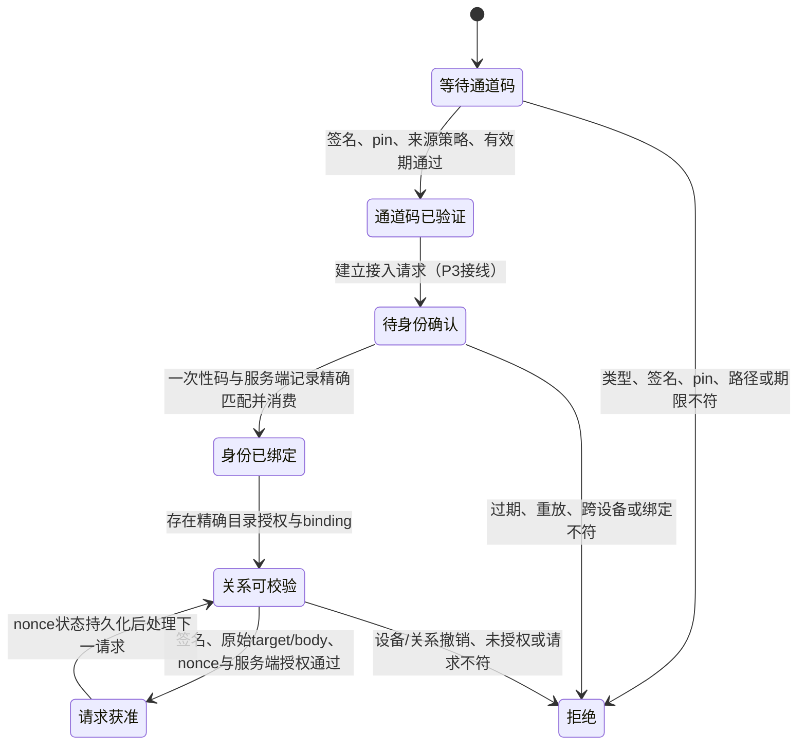
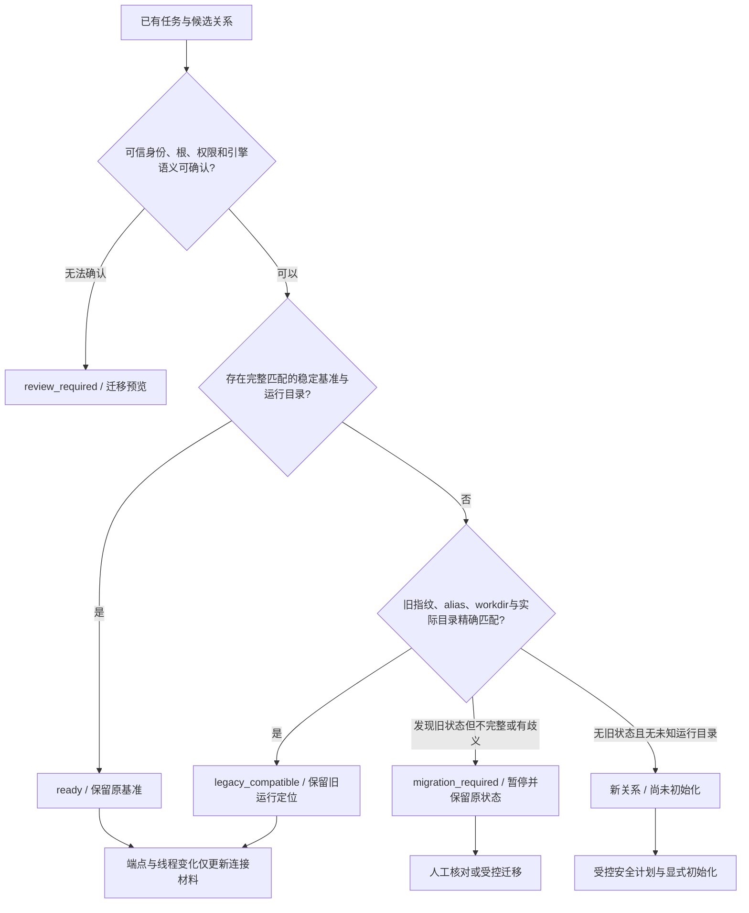

# Syncraft 开发执行与阶段审核记录

日期：2026-10-19

## 授权与边界

- 用户已要求按 DEVELOPMENT_PLAN_2026-10-19.md 继续分派开发任务，主智能体推进并阶段审核，DeepSeek V4.1 Flash 编码，GPT-6 Luna 独立预审。
- 开发计划仍保留原始评审稿，本文记录后续实施授权，不把待验证方案写成实现事实。
- R01–R09 为需求依据，P0–P7 和 A01–A20 为完整交付范围。D01–D08 按计划建议作为当前实现起点；技术选择必须通过阶段闸门，不作为已实测结论。
- 不自动提交、推送、部署、发布、删除历史数据或迁移唯一真实数据。

## P0 当前证据

- 唯一源码：C:\Users\Tong_hp\Projects\Syncraft\work\singbox-folder-sync-mvp；HEAD a4c948d。
- 开始前 9 个 modified 文件、3 个 untracked 文档；已保存既有改动 patch、文件哈希和状态。
- 证据目录：.tmp/development-2026-10-19（已被 .gitignore 忽略；不是发布材料）。
- Node v24.18.0；当前 pnpm v11.25.0，仓库 packageManager 指定 9.15.4。pnpm test 在进入测试前联网/非TTY依赖检查失败，未安装或升级依赖；改跑 package.json 等价 node --test 命令。
- 本地锁文件指定 sing-box 1.13.14、rclone 1.74.3，两个 Windows 二进制存在。运行版本、SHA256 和实际行为仍需分别核对。
- 用户已确认真实链路可行，不重新要求证明。当前未采集部署中的工作配置、数据集与性能记录，不虚构 P0 性能基线。

## 工作分派

| 编号 | 编码负责 | 范围与文件归属 | 预审 | 状态 |
|---|---|---|---|---|
| P1-A | deepseek-v4.1-flash / p1_implementation | client 稳定关系与 bisync 基准、相关测试；不动现有 core/UI | gpt-6-luna / p1_prereview | Luna预审及主审验收通过，见后续P1验收记录 |
| P1-B | deepseek-v4.1-flash / p1_protocol | 独立新版本 enrollment 协议、两码与绑定验证、专属测试及合同；不动 client/现有 server API | gpt-6-luna / p1_prereview | 修复后Luna复审及主审验收通过，见后续P1验收记录 |

## 阶段状态与闸门

| 阶段 | 当前状态 | 必须提供的证据 |
|---|---|---|
| P0 | 进行中 | 工作区保护、测试基线、隔离样例、实际配置与性能基线采集状态明确 |
| P1 | 已验收（模型与合同层） | 关系身份/两码合同、兼容行为、端点与线程重配真实引擎续接、换根阻断；Luna预审与主智能体验收 |
| P2 | 真实 ARM64 启动/重启与单关系目录读写/停用已分段验收；通道隔离、SFTP引擎和其余适配闸门进行中 | 锁定工具的普通目录读写、mtime/并发/完整性/写完成、隔离、挂载检查 |
| P3 | 未开始 | 两端UI首次两码接入到双向样例；未授权不可读写 |
| P4 | 未开始 | 持久幂等修复、掉响应/崩溃/回滚、同关系换码续接 |
| P5 | 未开始 | 冲突、可恢复删除、异常阈值、断电/掉盘安全矩阵 |
| P6 | 未开始 | 自动调度/托盘/简化UI、旧任务受控迁移与回退 |
| P7 | 未开始 | A01–A20逐项证据、真实N1/工作电脑验证、包与发布审计 |

## 审核规则

1. 编码者先报接口和文件范围；共享目录有其他任务时先协调，不覆盖已有改动。
2. Luna只读独立预审，列出风险和行号；编码者修正后重新预审。
3. 主智能体核对实际diff和测试，不仅依据子智能体自报。参数构造单测不能替代真实rclone状态续接实验。
4. 阶段不满足闸门则保留未完成状态；不把代码框架、mock通过或测试数量写成整项产品完成。
5. 旧任务不得因换码自动 --resync；未知状态暂停并保留原状态，数据根变更必须明确迁移。

## 验收矩阵

A01–A20 均尚未在本轮完整验收。逐项定义见开发计划第12节，后续在本记录追加证据；不得因P1单项通过提前标记全产品完成。

## P0 验证更新

- 等价测试命令：node --test --test-reporter=tap "tests/*.test.js"。
- 已完成：481 tests / 481 pass / 0 fail / 0 skipped / exit 0；duration_ms 146529.951。
- 完整输出：.tmp/development-2026-10-19/p0-tests.tap。
- 运行实际版本 rclone v1.74.3、sing-box 1.13.14，SHA256 分别为 3ac0dba3a883555f0c0daabc8a87c8f78e531f339780335e07beadf77734b5bc、db0d779948214cf761011d154c3a5da36df20394fa01a9fc798f1dc39fe9d183，均与 binaries.lock.json 相符。
- 本次未读取或输出已部署通道私密配置，未声称完成真实N1/工作电脑验收。

## P1-B 设计审查

- 已审查独立新协议与可序列化授权状态设计，允许开始实施。
- 通道码可在设备未配对时生成，只承载serverId/channelRevision/连接/有限bootstrap，不强制已有share或relation。
- 验证码绑定具体接入请求、设备公钥及目录授权；消费和nonce写入必须置于调用方持久锁/原子事务，不把JSON对象本身当成并发安全。
- 新模块不得宣称已接通API或已完成bootstrap数据面隔离。相关端到端闸门保留P3/P4。

## P2 预审准备（尚未实施适配器）

Luna 已用锁定 Windows rclone 的实际帮助核对：默认匿名服务不可用于产品；默认ETag依据mtime+size，不应冒充内容hash；WebDAV默认不跟随symlink/junction；写缓存启用后存在延迟回写。帮助信息不证明原子完成或N1 ARM64行为。

P2必须实测六组隔离行为：外部进程修改的可见时效；中断上传/持续写入/服务重启的完成语义；mtime与端到端SHA256；symlink/mount/编码越界；凭据轮换撤销含在途请求；仅bootstrap时数据目录/内网均不可达。无法满足时应提交适配方案变更，不能以能列目录放行。

## P1-A 提前审核反馈（草稿，待修正）

已向编码者指出：URL或自报serverId不能被表述为已验证服务身份；旧基准只凭bucket/prefix/clientName匹配可能误认不同N1；显式rootId场景也必须检查实际远端路径；基准记录应完整验证epoch及绑定语义。Luna正在独立预审草稿；本包尚未验收。

## 追加早期审查记录（P1未放行）

- 协议草稿缺少通道签名材料却能返回verified；编码者已开始改为带签名的通道信封与可信公钥验证，待正式预审与测试。
- 主智能体试跑协议中间态11项，1通过10失败，暴露严格wire时间戳与内部nowMs转换、Node public KeyObject处理等集成问题；已反馈修正。此结果不是终稿验收。
- 原真实rclone草稿实验只用local remote alias；不能证明换网络endpoint。尤其local backend root配置是否有效必须核实。要求补loopback真实服务端点更换实验和应用生成参数关联。
- 全局bisync runtime目录计数可能误拦第二组新关系；要求按相关任务/本地根判定并测试两组目录。
- 对未改变的旧双向任务应保留旧alias/workdir/fingerprint兼容运行；不能以全面review/409替代兼容。无法安全迁移与正常兼容运行应分开。
- 当前四个新增/改造JS文件 node --check 已通过；语法通过不代表功能完成。
- audit:compose 已通过。audit:release在client导入重构中触发两项静态顺序检查，要求保持原恢复记录清理顺序并同步合同；另存在未提供可信发布公钥的警告，不能伪造密钥消除警告。

## P1-B 正式预审输入

- 编码者已提交 ready-for-review 四文件包：src/core/enrollmentProtocol.js、src/core/enrollmentAuthority.js、tests/enrollment-protocol.test.js、docs/protocol/07-enrollment-v1.md。
- 主智能体实跑 node --test --test-reporter=tap tests/enrollment-protocol.test.js：13 pass / 0 fail / 0 skip / exit 0，108.2232ms。证据 .tmp/development-2026-10-19/p1-protocol-parent.tap。
- Luna 正式预审已分派；尚未签发包放行结论，更不代表P1整体完成。
- API、客户端导入、真实持久锁/原子落盘、实际request-target/body接入、错误映射、bootstrap隔离和根目录证明仍未贯通。

## P2-PROBE 研究任务分派

- p1_protocol（DeepSeek V4.1 Flash）在不改动正式预审四文件的条件下，准备可重复的普通目录WebDAV探针；P1-B阻断修复优先。
- 拟归属 scripts/probe-webdav-adapter.mjs 与独立事实报告；只使用仓内.tmp隔离样例与loopback、随机测试认证、受管子进程。
- 实测可见时效、mtime、并发Range+内容hash、实际rclone写入、未认证拒绝、链接边界和中断写入；区分raw PUT与实际rclone上传语义。
- 属于选型证据准备，不作为P1过闸/P2完成；Windows结果不等同N1 ARM64或真实外网验收。

## 首次信任设计决策（后续P3集成要求）

- 依据开发计划4.1：首次信任来源为用户从自己已信任的N1管理页面主动取得通道码。首次主动添加N1时，可将其中服务公钥保存为用户批准的首次信任pin（first-use-user-approved）。签名本身只证明内容完整性与密钥一致性，不能表述为码自行证明预期N1身份。
- 不增加手填公钥、证书、URL的第三项配置。当前P1-B仍要求调用方传入可信pin；码内首次公钥材料、首次添加路径与受保护pin存储尚待集成，不提前宣称可首接。
- 已绑定serverId后必须使用原pin验证新码；普通重导入、自动修复和换码均不得隐式TOFU或覆盖pin。身份密钥变化/丢失进入独立恢复流程，记录身份变更。
- Luna已确认该决策在明确可信取码前提下可接受。P3须验证首次添加的用户动作、原子pin持久化、旧pin不被新码覆盖与错误来源拒绝。

## 模型权限与用户决定

- Luna正式预审请求被模型服务拒绝：upstream 400，gpt-6-luna not allowed for user type personal_free_user。属于模型访问限制，不是代码测试失败。
- 用户明确选择调整权限后继续使用GPT-6 Luna；不替换预审模型，不因等待此审核而自动暂停整个开发目标。
- 编码与隔离验证继续；正式预审及阶段放行待权限恢复。

## P1-B 主智能体补测

- 最新硬化版本协议测试仍13 pass / 0 fail / 0 skip / exit0，121.1011ms；日志p1-protocol-parent-after-hardening.tap。
- 已成功签名并记录nonce后，JSON重载将该device nonce数组改成对象，或把既有nonce时间戳改为坏字符串；两种状态损坏均被enrollment_state_invalid拒绝。此为独立内存复现，不替代待完成的Luna正式预审。

## P2 首轮探针观察（待修正/复跑）

- 脱敏首轮输出已保留在.tmp/development-2026-10-19/p2-webdav/observed-first-probe.json；运行起点2026-10-20T04:31:49Z。
- 锁定Windows二进制版本/哈希符合；受认证loopback服务。外部修改可见、CRUD内容哈希、无认证401、junction根外目标不返回等局部探针通过。
- mtime读写体现秒级截断（样例789ms/456ms偏差）；容差通过不证明同size同秒覆盖能被bisync发现。
- 真实rclone copy上传时最终名出现部分内容；此为写入完成语义风险，需要临时写入/原子替换或其他受验证方案，当前不能放行。
- Range fixture PUT409与bisync根目录不存在首先属于探针准备/缓存可见性问题，正在排查，不能直接判定后端能力不支持。
- raw PUT中断未观察到最终名不代表已证明原子性；需证明请求实际进入写入及足够观察窗口。
- 首轮子进程已退出、隔离运行目录已校验并清除。上述是Windows本地证据，不是N1 ARM64或公网链路结果。

## P1-A 主智能体验证更新

- node --test --test-reporter=tap tests/client-sync-relation.test.js：9 pass / 0 fail / 0 skip / exit0；2848.9428ms，日志p1-relation-parent.tap。
- 真实CLI实验已改为两个loopback WebDAV端点指向同一个真实目录，使用模型产生的alias/workdir；端点来回切换后非resync双向新增均完成，原listing文件保留。
- 该实验手动构造CLI和WebDAV配置，尚未走客户端完整导入/存储适配路径；不能据此宣称整个产品换码成功。
- client-http/client-live-state/client相关回归：154 tests /147 pass /7 fail /exit1；72718.6167ms，日志p1-client-regression-parent.tap。该运行加载测试文件时，编码者随后仍在添加新HTTP用例，故不是终稿全套。
- 5项HTTP失败涉及remote alias/存储秘密调用契约/导入回滚等；另外2项源码形状断言需随重构更新但保持行为证据。已要求首先修复单向任务不必要的alias变更，不允许只改断言掩盖回归。

## P2 第二轮实测更新

- 修正fixture准备后，Range、CRUD、无认证拒绝、junction边界等局部检查通过；真实rclone普通copy、显式--inplace=false/partial-suffix、bisync上传均观察到最终名部分内容可见。
- raw PUT中断现已确认实际写入，断连后最终名残留部分数据；替代此前“未观察到写入”的不足证据。
- 先上传到隔离staging再MOVE的实验中未观察到最终名部分内容，最终SHA256匹配；这仅是可行修正方向，不是完整受控网关已实现或持久落盘保证。
- mtime为秒级截断，当前同size同秒修改可能漏检属于待实测风险；要求补真实bisync与hash能力的最小验证后提交替代设计，不无限扩展探针。

## 接续核验与合同对齐

- 继续保留 GPT-6 Luna 为正式独立预审模型；用户尚未说明权限已经恢复，不擅自替换或把主审等同独立预审。
- 主智能体再次复跑 enrollment-protocol 与 profile-v2：22 tests / 22 pass / 0 fail / 0 skipped / exit 0，126.6651ms。证据：.tmp/development-2026-10-19/p1-protocol-checkpoint-parent.tap。
- 原始9个 modified 文件重新计算 SHA256，全部与 initial-hashes.json 相符；未覆盖原有改动。
- P2 最终 Windows 本机证据起止：2026-10-20T04:38:14.484Z 至 04:38:36.266Z；13组探针，6 passed / 7 blocked / 0 harness failures。已形成 docs/WEBDAV_ADAPTER_PROBE_2026-10-19.md，不作为N1或公网验收。
- 同尺寸、同整秒mtime改写现已通过真实普通bisync复现漏检：退出0，但本地保留旧SHA256、远端为新SHA256。此前待实测风险现有局部证据支持。
- P2替代方向修订：rclone仍向普通最终路径PUT，由受控网关内部写隐藏staging，完整接收、校验并提交后才返回成功；不能要求现有bisync自行调用新的staging API。hash变化检测和N1原子性仍待实现/验证。
- 已批准DeepSeek实施独立P1合同适配包：统一epoch最小1；新enrollmentRelation模块把已验证新grant与精确binding绑定的目录授权投影到关系模型；不写入旧profile，不把形状校验当成密码学验证或端到端接入成功。
- P1-A继续处理客户端回归，要求单向任务保持原兼容行为，并将新migration错误纳入统一错误映射与合同；正式阶段仍未放行。

## P1 冻结包完整回归结果

- DeepSeek交付稳定关系包、新enrollment协议包及独立客户端关系投影包；新增错误已同步共享映射、错误码schema、客户端文案和接口合同。
- 主智能体定向复跑原7项失败回归：7 pass / 0 fail / exit0，8990.1659ms，日志p1-client-targeted-checkpoint-parent.tap。
- 新enrollment投影、稳定关系及协议联合独立复跑：31 pass /0 fail /0 skip /exit0，2835.9054ms，日志p1-aligned-contracts-parent.tap。
- 冻结后完整命令：node --test --test-reporter=tap "tests/*.test.js"。结果513 tests /513 pass /0 fail /0 cancelled /0 skipped /exit0；136933.3333ms。日志.tmp/development-2026-10-19/p1-full-suite-parent.tap。终端session 55655已结束。
- audit:compose通过；audit:release通过，仍提示没有可信发布公钥，未伪造密钥抑制警告。未执行部署、发布或真实数据迁移。
- 待正式预审文件的17项SHA256清单：.tmp/development-2026-10-19/p1-frozen-review-hashes.json。完整测试期间复核无变化；其范围不包含仅研究用的P2探针。
- 正式GPT-6 Luna预审仍待用户恢复模型权限；完整测试通过不替代独立预审，也不表示P1全部产品接线完成。新协议尚无真实API、pin持久化、响应签名和bootstrap数据隔离证据。
- P2额外安排锁定rclone serve sftp隔离候选探针：帮助明确支持受限hash命令及SFTP backend socks代理配置，但实际hash/部分写入/根隔离/性能行为均待实测，不能据帮助认定已解决WebDAV问题。P1生产文件保持冻结，不因候选研究跳过阶段闸门。

## P2 SFTP候选主审中的实验纠正

- 前一目标回合分类为progress：完成513项完整回归、冻结17项P1文件并更新执行记录；不是仅复述状态。
- 当前已取得锁定rclone serve sftp的Windows loopback证据。真实MD5/SHA1与样例相符；copy及初次bisync观察到临时名，未观察到部分最终名。仍不能据25ms采样证明所有场景原子性，未验证N1或代理路由。
- 04:54:00一轮的checksum bisync实验先以size,modtime初始化，随后改比较模式；且把远端恢复旧内容当成功标准。主审判定其“checksum要求resync”不能作为候选不兼容结论，要求保留报告并纠正。
- 04:57:34一轮已统一比较模式和双向期望；checksum发现变化后因只有一个文件而触发all files were changed安全保护（exit1）。这不同于后端无法计算hash或内容未被发现；正在用额外不变样例区分安全保护与传播能力，不允许--force或自动--resync绕过。
- 外部改写后的1秒目录缓存读取出现checksum错误，重启同时改cache-time0后读取正确；该实验混合两个变量，尚不能证明cache-time0单独修复。已要求独立cache0从启动即生效的改写复测，或将结论限定为重启后恢复。
- P1文件仍冻结。本回合对原GPT-6 Luna预审agent作一次正式重试，以检查访问是否恢复；当前请求在处理，尚未有正式结论，不将running当模型权限确认。

## GPT-6 Luna 正式预审与修复分派（2026-10-20）

- 原 GPT-6 Luna agent 已实际完成只读预审，17 项冻结 SHA256 全部匹配；此前“等待权限恢复”的记录仅描述当时状态，现已被本条更新。
- 正式结论：需修正，P1 不放行。发现持久授权状态仅校验顶层，设备 revokedAt=false/缺失、已消费 consumedAt=false、设备 nonce 数组被删除，分别可能导致已撤销身份放行、一次性码重复消费、已签请求重放。主审与预审已分别复现。
- 次要问题：bootstrapPathPrefix 无尾斜线时，startsWith 会错误接受 v1evil 等相邻路径。此处 P2 指问题严重度，不表示开发阶段 P2 已完成。
- 明确解冻范围仅为 src/core/enrollmentAuthority.js、src/core/enrollmentProtocol.js、tests/enrollment-protocol.test.js、docs/protocol/07-enrollment-v1.md。交原 DeepSeek 协议 agent 修复嵌套 schema、显式状态判断、nonce 初始化与保留、路径段边界；完成后主审复跑并交 Luna 复审新快照。
- 原 513 项通过发生在这些修复之前，不能作为修复后回归或授权安全验收。其他 P1 生产文件继续冻结。

## P2 SFTP 最终局部证据与决策边界（2026-10-20）

- 最终证据：.tmp/development-2026-10-19/p2-sftp/2026-10-20T050030-437Z/report.json；永久报告 docs/SFTP_ADAPTER_PROBE_2026-10-19.md。主审已读取报告及对应 bisync 参数、预期哈希和 canary 判定。
- 两次运行均采用 size,modtime,checksum 及 --checksum 的三文件样例中，远端唯一同尺寸同秒改写成功传播至本地，两端哈希均为新内容，两个不变文件未变化。默认 size,modtime 仍漏检。
- cache0 从新服务启动即生效，A 读取、外部同尺寸覆盖 B、无重启再次读取均匹配；这是 Windows loopback 的配置证据，不推广为 N1 或其他 SFTP 服务结论。
- 不把是否使用 checksum 再交用户作底层配置选择。主审将结合 Luna 对隔离、授权和实际命令的复核作内部技术决策；适配器尚未选定，P2 仍未放行。
- 已安排 DeepSeek 只读准备目录注册/根标记/挂载健康保护的最小接口与文件范围，待主审评定后实施；未授权扩展生产协议或真实数据操作。

## P1 修复快照复审通过（2026-10-20）

- DeepSeek 确认四个修复文件及文档完整落盘，无未完成编辑；主审重新冻结17项清单为 .tmp/development-2026-10-19/p1-repaired-review-hashes.json，相对原清单仅约定4文件变化。
- 主审定向命令：node --test --test-reporter=tap tests/enrollment-protocol.test.js tests/client-enrollment-relation.test.js tests/client-sync-relation.test.js。37 pass /0 fail /0 skip /exit0；3852.8463ms。日志 p1-state-repair-targeted-parent.tap。
- 主审独立使用真实 Ed25519 签名、JSON roundtrip 检查：正常授权allow；revokedAt=false/缺失、consumedAt=false、删除设备nonce数组后的同签名重放均enrollment_state_invalid。首轮主审脚本协议名写错，改用导出常量后通过，不计为产品失败。
- Luna 独立复审17项哈希全匹配，独立协议测试20/20通过，正式结论为通过该冻结快照；结构校验、nonce历史和路径段边界问题关闭。结论仅覆盖模块，不包含尚未完成的HTTP API、客户端导入或存储授权集成。
- 主审修后全量测试已启动，日志 p1-state-repair-full-parent.tap；运行完成前不将此前513项结果套用至修后代码。
- 普通目录技术决定已记录于 docs/P2_DIRECTORY_ADAPTER_DECISION_2026-10-20.md；SFTP+checksum为优先补证路线，不等于P2放行。

## P1 状态迁移图与阶段验收（2026-10-20）

下图是现有模块合同的状态关系说明，不表示这些状态已经接入两端界面或HTTP路由。首次信任pin存储、受限通道、实际目录授权和修复事务继续由P3/P4完成。

上图中“通道码已验证”本身不授予数据权限；“请求获准”只是授权模块判定，实际HTTP处理和文件操作仍未接线。持久状态损坏在各入口统一拒绝，不转为新设备或空nonce历史。

该图概括当前迁移判定；新关系不因epoch有值而变成已初始化。换根/权限/引擎语义后不得复用旧基准。SFTP checksum改变引擎语义的旧关系识别与迁移门控列入P2实现，不在旧任务上全局切换。

验收证据：

| P1要求 | 当前证据 | 主审结论 |
|---|---|---|
| 稳定关系与连接材料分离 | syncRelation模型、endpoint/tuning模型测试、真实锁定rclone双loopback端点切换后双向继续且listing保留 | 通过 |
| 换根/epoch/授权语义不能复用原基准 | client-sync-relation与client-enrollment-relation相关测试 | 通过 |
| 旧任务兼容与迁移预览 | 精确旧执行指纹/alias/workdir验证；歧义显示state/reasons；单向任务兼容回归 | 通过 |
| 两码、设备身份及严格状态合同 | enrollment协议、authority、独立投影与文档；Luna修后复审20/20 | 通过（模块边界） |
| 协议合同、状态图、模型/迁移预览交付 | protocol/07-enrollment-v1.md；本节双图；模型与客户端关系摘要 | 齐备 |
| 修复后完整回归与冻结一致性 | 519 tests /519 pass /0 fail /0 cancelled /0 skipped /exit0；129199.8336ms；p1-state-repair-full-parent.tap | 通过 |
| 原有工作区保护 | initial-hashes.json 9/9不变；repaired-review-hashes 17/17不变 | 通过 |

主审结论：P1模型与合同阶段验收通过，可以进入P2。全产品A01–A20未因此验收，P2及后续阶段继续保持未完成。

## 编码模型临时限流

- 新P2编码任务的DeepSeek agent返回429 Too Many Requests并结束该次调用；这与Luna此前权限问题不同。没有替换用户指定的编码模型。
- P1修复已完整交付，不受此次新任务限流影响。主审完成复审收口、全量回归和P2技术决定后继续准备下一包；模型恢复后沿原agent接续，不重做已通过工作。

## P2 根保护最小包开工（2026-10-20）

- DeepSeek已恢复并提交具体接口/record提案；主审与Luna在编码前发现并关闭设计缺口：最终marker不能直接写半成品却承诺可重试；改为stage完整刷新后原子no-replace安装，不完整中间态明确阻断。
- marker读取和身份检查须绑定同一个open handle，Linux no-follow；Windows边界明确，不冒称完整TOCTOU沙箱。
- 主审已更新 docs/DIRECTORY_ROOT_CONTRACT.md 并授权原DeepSeek agent编码；仅新增 src/core/directoryRootGuard.js、tests/directory-root-guard.test.js并校准合同。P1冻结17文件保持不变。
- 这是P2的根保护切片，不把普通目录服务、N1挂载实测或端到端授权标为已完成。候选SFTP+checksum和旧engine迁移门控仍待接续。

## P2 接续检查点（2026-10-20）

- DeepSeek在提交接口提案后再次遇到429并终止本次编码回合。主审已重新核对当前文件：src/core/directoryRootGuard.js 与 tests/directory-root-guard.test.js 均尚不存在；仅设计合同落盘。不能将“已授权开工”写成“已实现”。
- root guard待实现导出：DIRECTORY_ROOT_MARKER_NAME、DirectoryRootGuardError、prepareDirectoryRootRegistration、commitDirectoryRootRegistration、checkDirectoryRoot。接口及pending/active合同已由主审确认；Luna要求的stage/no-replace与同handle校验也已确认，恢复后直接按此包编码，不重复早期候选探针。
- 原p1_implementation仍为该3文件编码负责人，原p1_prereview为后续只读预审负责人。当前无P2代码候选可正式审；不继续等待不存在的交付。
- 主审再次核对修复后的17项P1文件SHA256，全部匹配。未改用户原始生产文件，未提交/推送/部署/发布或迁移真实数据。
- 主审只读查看锁定rclone 1.74.3的serve sftp帮助：声明支持auth-proxy按输入user/pass或public_key生成backend _root；与authorized-keys不能同时生效；内部按user缓存，帮助说明凭据变更需等5分钟缓存过期。此为当前二进制帮助声明，尚未实测撤销行为。
- 该缓存对即时撤销构成待验证风险：不能把只在auth-proxy里改授权记录视为已经即时撤销；已有会话的终止也需单独证明。已向DeepSeek安排最小双用户/双根、helper调用计数与撤销后新连接的隔离计划任务，但该调用同样429，尚未形成脚本或运行结果。
- 下一步顺序：恢复root guard最小包编码→定向测试→Luna预审→主审验收；再补SFTP授权/撤销和旧engine迁移门控。P2及P3–P7保持未完成，整体目标保持active。

## 连续限流受阻审计（2026-10-20）

- 指定DeepSeek V4.1 Flash编码请求在连续三个目标回合遇到相同429 Too Many Requests。当前回合沿原p1_implementation重新派发后，先确认running并等待；最终agent权威状态为errored/exceeded retry limit/429，非观察超时。
- 当前P2 root guard源码和测试仍未生成；P1冻结17项在本回合复核无漂移。既有修复已验收519/519，不重跑或改写它们来制造进度。
- 下一包的接口、故障恢复合同和预审意见已齐备，尚无代码候选可审；新编码依赖指定模型服务恢复。未经用户授权不更换编码模型，也不由主智能体替代完成产品代码。
- 已满足连续同一阻碍的审计条件，整体开发目标标记blocked。目标未完成，P2至P7及A01–A20验收范围不变。恢复后沿原编码任务按合同接续，交原GPT-6 Luna预审，再由主智能体独立验证。

## 受阻审计事实更正：发现已落盘P2代码（2026-10-20）

- 上一节“P2源码和测试仍未生成”的陈述撤回。该节写入命令的最新文件检查实际返回两个文件均exists=true；主审未先检查该结果就调用update_goal(blocked)，属于主审过早判断。
- 当前已读取：src/core/directoryRootGuard.js（39256 bytes，写入时间2026-10-20 02:44:10本机时间）；tests/directory-root-guard.test.js（18818 bytes，02:45:27）。DeepSeek虽最终429，仍已产出代码，不能只按agent终止状态判断工作区无变化。
- node --check两文件通过。主审独立定向测试18项：5 pass/13 fail/exit1/179.8683ms；日志p2-root-guard-targeted-parent.tap。因此这是未验收的代码候选，不能把设计或落盘当完成。
- 共同失败点已定位：readVerifiedFile返回{identity, contentSha256}，commit把整个结果传给期待dev/ino/size的assertPathIdentity。已交原DeepSeek编码者修复返回类型错配并检查剩余失败，不重写整包、不触动P1冻结文件。
- 当前仍有可执行的修复和预审工作，前述“无意义可推进而受阻”的审计结论撤回。goal元数据已被主审标为blocked，工具不支持自行恢复；已向用户说明并请求仅恢复目标状态，不重新索取既有开发授权。
- 在本轮已有授权范围内继续完成候选检查和修复；后续自动推进须目标状态恢复。P1已验收范围和P2–P7未完成范围不变。

## P2 根保护候选定向通过并提交正式预审（2026-10-20）

- 已检查实际落盘内容：DeepSeek在最终429之前完成了mountinfo夹具修复与合同状态校准。不能用模型最终错误覆盖已存在的交付事实。
- 主审独立执行 node --test --test-reporter=tap tests/directory-root-guard.test.js：18 tests /18 pass /0 fail /0 cancelled /0 skipped /exit0，263.3485ms。日志 .tmp/development-2026-10-19/p2-root-guard-targeted-parent-3.tap；前两轮失败证据保留。
- 三文件候选冻结为 .tmp/development-2026-10-19/p2-root-guard-review-hashes.json；P1修复快照17项本轮复核全部匹配。
- 已向原GPT-6 Luna预审agent提交该快照，等待真实代码审查与独立证据。主审提出stage清理前身份重验及directorySync合并证据两项待核实观察，尚不将其写成已确认缺陷。
- 已恢复原DeepSeek协议研究agent，继续本机隔离auth-proxy授权/缓存/撤销探针；尚无本轮报告，不宣称已完成。
- 本地根保护定向通过不等于P2验收；目录服务隔离、撤销、N1 ARM64和P3至P7仍需完成。goal元数据目前仍为blocked；更正与恢复请求见上一节，未绕过用户控制的恢复机制。

## P2 主审独立故障注入与后续约束（2026-10-20）

- 主审在隔离Windows临时根中复现stage替换：注入link完成真实hard-link后，把原stage改名为known-backup，在原stage路径写入无关内容；commit返回active且无关对象被删除，known-backup保留。报告 .tmp/development-2026-10-19/root-stage-replacement-parent-FrLHM9/report.json。此为真实文件操作加明确注入的局部证据，不代表实际攻击或线上损失；已交Luna正式判断和界定修复要求。候选源码未修改。
- 两个DeepSeek后续任务本轮再次以429结束；主审核对scripts和任务临时目录，未发现新的auth-proxy探针交付。只读引擎迁移方案亦未返回，不将派发本身记作完成。
- 主审只读查询锁定rclone1.74.3 help backend sftp：有独立socks_proxy、RCLONE_SFTP_SOCKS_PROXY与--sftp-socks-proxy。后续SFTP接线应显式设置并以拒绝直连的样例核实实际数据路由；当前HTTP_PROXY/ALL_PROXY的存在不能作为SFTP已经走VLESS的实证。

## GPT-6 Luna正式预审不放行与最小修订决定（2026-10-20）

- 用户调整模型权限后，原GPT-6 Luna agent本轮已实际完成只读代码预审，不再是先前“当前账号不支持”的拒绝。三文件SHA256匹配、独立18/18通过，正式结论仍为暂不放行：测试覆盖不替代合同正确性。
- Luna独立复现：stage在link前被替换，可把UNKNOWN内容链接到原本空的marker名；清理阶段按路径unlink可删除替换对象；清理期间marker替换后仍返回active。主审亦独立复现stage误删。
- 主审指出“unlink前再lstat”仍有check-use窗口；Luna补充确认，不能将其写成原子删除保证。双方确定最小可验证修订：commit完全取消自动stage删除，保留内部stage；新安装marker与已验证stage身份/内容绑定，最终root/目录刷新后再同handle验证marker，任何不符均需review且不激活，不覆盖或删除对象。
- 纯Node路径hard-link仍不能原子绑定已验证句柄。合同接受该非jail切片的明确边界：竞态可能在原本空的marker名称留下不匹配hardlink，必须阻断激活并保留对象人工复核；不能声称注册零副作用。若未来必须阻止该alias创建，则需fd-based link或受保护父目录的独立系统边界。
- directorySync只说明marker安装目录项的刷新。取消stage自动清理后不再合并清理持久性；保留marker/stage均必须由后续目录适配器排除。
- 已向原DeepSeek V4.1 Flash编码agent派发精确三文件修复和必要回归；当前仅已授权修复，尚未确认修复落盘或通过。P2仍未验收。

## P2 根保护修复已部分落盘，主审补充验证（2026-10-20）

- DeepSeek精确修复回合虽再次429，但源码已完成保留stage、安装身份绑定和最终marker重验；现有18项测试预期亦已按保留stage调整。主审独立18/18通过，267.5893ms，日志p2-root-guard-repair-parent-1.tap。
- 本次检查时专属tests仍为18项，未加入新增竞态回归，合同仍有旧清理文字。已向原编码者派发仅补正式回归和校准合同的剩余小包；不把部分落盘当完整交付。
- 主审另独立运行四组故障注入，报告 .tmp/development-2026-10-19/root-repair-independent-parent-40QL7S/report.json，passed=true：link前换UNKNOWN、link前同内容不同inode均reviewRequired且保留替换对象；link后仅stage路径被换时marker仍可信、允许active但保留未知stage；目录刷新时替换marker被阻断且保留对象。
- 以上是Windows局部注入证据。尚待正式回归、合同校准和Luna修后复审，不提前验收；SFTP授权缓存研究本轮再次429且尚无新脚本。

## P2 根保护完整修复提交复审（2026-10-20）

- DeepSeek已完整交付三文件修订，专属回归增至23项，新增stage未知内容/同内容不同inode替换、link后替换保留、刷新时marker替换和marker-only恢复覆盖。合同已校准，不再保留旧自动清理语义。
- 主审独立23/23通过：0 fail /0 cancelled /0 skipped /exit0，312.1247ms。日志 .tmp/development-2026-10-19/p2-root-guard-repair-parent-2.tap。
- 修后三文件冻结 .tmp/development-2026-10-19/p2-root-guard-repaired-review-hashes.json；原失败快照保留。P1冻结17/17、用户原始9/9本轮核对无漂移。
- 原GPT-6 Luna已收到修后正式复审任务，尚待结论，不提前将代码标记验收。未重新跑519项全量，因为本切片独立新增、尚未接入生产路径，P1冻结无漂移。
- 原DeepSeek编码者完成root guard后接手auth-proxy最小实证；原protocol agent为errored且不再并行编辑，避免文件归属冲突。研究有界，不等待5分钟，不在此阶段建设替代网关。

## P2 根保护局部验收通过（2026-10-20）

- GPT-6 Luna已实际完成修后正式只读复审：修后三文件哈希全匹配，独立23/23通过；P1冻结17项及用户原9项无漂移。确认此前stage误删与基于陈旧marker返回active的问题已关闭，无其他已确认放行阻断。
- 主审验收依据：23项专属回归、四组独立故障注入、已读取源码与合同、Luna独立复审以及冻结一致性。通过范围仅src/core/directoryRootGuard.js、tests/directory-root-guard.test.js、docs/DIRECTORY_ROOT_CONTRACT.md的本地模块合同。
- 当前模块具备只读prepare/check、稳定rootId与挂载身份核验、pending恢复和安全失败；不自动重建丢失根/marker，不自动删除未知stage，不在标记身份或内容失配时激活。
- 对纯Node路径link的剩余TOCTOU边界按合同保留；可能留下需人工复核的非活动marker别名。后续目录服务必须排除marker/stage保留名；本模块不是目录jail或设备授权。
- 本地模块验收不等于P2通过。剩余：SFTP逐设备/关系授权与撤销、checksum比较及同关系旧engine迁移门控、真实代理隔离、中断/重启、N1 ARM64样例与资源证据。P3–P7与全产品A01–A20仍未完成。

## SFTP授权探针首次运行中断，尚无授权结论（2026-10-20）

- DeepSeek已生成scripts/probe-sftp-auth-proxy.mjs（本次检查SHA256 4B0EAD524217842CEC7FCA614D558A8055A3155C116E34C8E607DD127AAE15DD），证据根实际采用.tmp/development-2026-10-20/p2-sftp-auth-proxy。
- 首次run为2026-10-20T081129-520Z。主审观察主probe与helper持续超过预期超时，rclone尚未启动，helper调用日志0条、无report.json。生成的Windows C# wrapper未显式转发stdin，runProcess只kill直接子进程并等待close；这些是需要修复的具体候选原因，尚未通过修后重跑证明全部根因。
- 该编码回合最终429。主审核对相关probe进程均已退出；尝试仅停止已验证helper时它已退出，主审未实际停止任何进程。再次核对无进程后，盘点精确.work路径和无reparse属性，删除本次自行生成的fixture及随机测试私钥；保留诊断源码/清单和interrupted-supervisor-receipt.json。未删除用户文件或生产数据。
- 当前没有数据目录隔离、错误key或撤销缓存的实测结论，不能把帮助声明或脚本生成当通过。已沿原DeepSeek agent分派仅修wrapper输入输出转发、有界超时子树收口、并补成功认证后的热缓存错误key测试。root guard已验收快照不改。

## 本轮接续检查点（2026-10-20）

- 已完成：GPT-6 Luna权限恢复后实际完成正式预审、缺陷拒绝和修后复审；P2 root guard局部由DeepSeek修复，主审与Luna分别23/23通过，局部验收成立。最新P1+root guard共20项冻结哈希本轮终检无漂移。
- 未完成：auth-proxy探针的Windows wrapper/超时修复请求再次429，主审检查scripts/probe-sftp-auth-proxy.mjs SHA256仍为4B0EAD524217842CEC7FCA614D558A8055A3155C116E34C8E607DD127AAE15DD，没有新补丁或新run。不能因已派发而记为已修。
- 当前不能继续取得新编码交付的外部阻碍是指定DeepSeek模型连续429，未经用户授权不更换编码模型。没有后台研究仍在等待；唯一run已安全收口，无有效授权结果。goal原blocked状态尚未恢复，本轮没有伪造active或标记整体complete。
- 服务恢复后的精确入口：沿原p1_implementation，仅修probe-sftp-auth-proxy.mjs的C# stdin/stdout/stderr转发和runProcess有界子树超时收口，补冷缓存成功后同user错误key的新连接验证。先helper自测再生成新run；禁止未修复就反复运行已知挂起版本。
- 然后主审独立重跑、Luna核对真实报告，再决定逐关系独立SFTP进程或其他授权隔离方案。checksum/SFTP引擎接线与同relation旧baseline迁移门控尚待单独方案与实施；不改旧S3任务语义、不自动resync。
- 整体范围仍是P0–P7及A01–A20；P2未放行、P3至P7未开始。未提交、推送、部署、发布或迁移真实数据。

## 用户明确恢复并继续原分工（2026-10-20）

- 用户回复“恢复目标，继续原分工”，本轮据此继续开发，DeepSeek V4.1 Flash编码、GPT-6 Luna预审、主智能体验证和阶段验收的分工不变。模型受阻审计从本次恢复重新开始，不沿用恢复前次数直接判定本轮受阻。
- 当前get_goal元数据仍返回blocked；现有工具无active/resume入口。记录状态差异，不通过新建/完成目标绕过恢复机制，也不重复索取已有开发授权。
- 主审重新核对P1 17项、root guard 3项和用户原9项SHA256全部无漂移。授权探针仍是未修复快照；已向原DeepSeek agent重新派发wrapper/有界超时及热缓存错key的最小修复，不重跑已知挂起脚本。

## 同模型精简上下文接续与主审补证（2026-10-20）

- 原DeepSeek会话在用户恢复后的首次请求仍429且无新补丁；主审保持指定模型，改为新建仅携带当前任务的deepseek-v4.1-flash子agent p2_probe_fix。该方法没有更换模型。新会话在最终429之前实际写入修复，脚本变为SHA256 61736F0959E2104FF4D32C825730803291C6BBB316E135CF3A6574856396375B，语法检查通过。
- 主审独立验证新增runProcess超时：生成真实挂起父子fixture，1500ms期限后1650ms返回ETIMEDOUT，taskkill仅针对本次spawn PID子树，退出0，父/子均不存活。报告 .tmp/development-2026-10-20/p2-sftp-auth-proxy/parent-timeout-check-J9tgwJ/report.json，passed=true。
- wrapper正常输入独立自测尚未通过：C# StreamWriter转发加入UTF8 BOM，Node helper返回exit3/JSON输入无效；主审另以假测试JSON确认前字节efbbbf7b2275，证据parent-repair-check-DloPmG/wrapper-input-inspection.json。未输出或使用真实密钥材料。
- 已沿精简DeepSeek会话派发精确字节转发修复：复制stdin BaseStream并flush/close，不在JS剥BOM掩盖协议被改写。热缓存错误key测试已加入候选；尚无完整SFTP授权结果，不能提前决定缓存是否绕过撤销。

## 目标已恢复与SFTP授权实测结果（2026-10-20）

- 本轮get_goal已实际返回active，修正此前blocked状态差异；用户“恢复目标，继续原分工”的授权继续有效。DeepSeek编码、GPT-6 Luna预审、主审独立验证不变。
- DeepSeek虽部分回合最终429，实际落盘C#无BOM InputEncoding和auth-proxy无位置参数启动修复，不能按最终模型错误推断未交付。主审语法检查和helper字节自测通过；原BOM失败报告保留为verification-2026-10-20/helper-wrapper-selftest-result-failed-bom.json，自测标准结果文件已由新的运行更新。
- 主审首次完整run 2026-10-20T084407-449Z因auth-proxy模式附带位置参数而启动失败，报告保留，随机私钥和fixture已自动清理。修后run 2026-10-20T084604-534Z实际完成8组探针，无harness failures，状态passed-with-findings。
- 实测：两user分别读取其文件且哈希匹配；冷缓存错key经helper拒绝，成功认证后同user错key亦拒绝但helper不再调用；对方唯一文件名在当前根不可读。该简单文件名验证不等于路径逃逸、symlink或完整目录jail验收。
- 实测：helper授权撤销后，A的新连接仍成功读取原内容，helperInvocationDelta=0；B继续可读。共享auth-proxy动态撤销不能据此满足A13。未等5分钟缓存过期、未验证已有会话撤销、N1或真实代理。
- run报告确认服务进程退出、隔离work root删除、cleanup无失败。候选脚本与报告冻结auth-proxy-review-hashes.json，提交Luna复核后再作生产授权决定；P2仍未通过。

## Luna局部复核与新引擎前置缺口（2026-10-20）

- Luna已实际重算auth-proxy-review-hashes.json三项SHA256均匹配，脚本与主审run的撤销结论一致；允许把本机缓存阻碍即时撤销作为适配决策依据，不代表P2通过。
- 对探针祖先路径的鲁棒性finding，主审已保存当前全祖先检查current-ancestor-check.json，当前均非reparse。它是带时间的检查，不证明历史不存在竞态，也不把词法路径检查提升为realpath安全保证。主审CIM核对未发现本次auth-proxy探针残留进程，run目录仅保留report/README。
- 主审与Luna分别实际复现未来新引擎迁移缺口：同relationId旧初始化记录仍在state.baselines，人工候选更改engine.semanticsVersion/baselineId/alias后resolveBisyncMigration返回ready。证据p2-engine-migration/parent-future-engine-gate-diagnostic.json。该输入是内存构造的未来引擎候选，不是当前S3生产自动切换引擎的证据。
- Luna确认前置修复：legacyJob早返回前检查候选exact key存在但记录无效、同relation其他已初始化baseline失配，分别阻断为迁移/人工审核；完整exact续接和不同relation不受影响。DeepSeek已收到仅修改syncRelation.js的最小包，尚未交付，不将派发当完成。
- 后续设计已写docs/P2_SFTP_RELATION_SERVICE_CONTRACT.md，Luna只读预审补充五项P3前置要求：唯一公钥与权限矩阵、停用重启持久状态机、保留名及碰撞规则、代理故障无直连回退、基准创建/损坏与同关系互斥。文档是设计，不是已有功能。
- 本轮后续两个编码任务（新独立服务探针、迁移前置检查）再次多次429。主审已核查文件：probe-sftp-relation-isolation.mjs不存在，syncRelation.js仍为P1冻结065ECF7BDD9BD520E772C266736C17FC9704009CEAB11738363758EDBAFA7F2A。没有将模型错误误记成代码缺陷，也未换模型或由主审代写产品代码。
- 精确接续：p2_engine_design先落迁移前置检查一个文件，之后补定向回归；p2_probe_fix先落单relation静态key读回及精确cleanup探针，再增双relation/已认证会话停用验证。之后交原Luna预审，主审独立验证。root guard/原用户修改保持冻结。
- goal本轮已恢复active；恢复后的受阻审计从本次重新计数，本轮不沿用旧次数标记blocked。P2–P7及A01–A20未完成；没有后台编码仍在等待，也未提交、推送、部署或发布。

## 终检更正：单关系静态授权探针已落盘并独立通过（2026-10-20）

- 上节“probe-sftp-relation-isolation.mjs不存在”的记录仅对应当次检查，随后的git终检发现已生成13269 bytes候选。主审已读取完整脚本并独立node --check通过；不以agent最终429覆盖实际文件交付。
- 主审运行前逐级确认任务证据目录全部祖先当前无reparse point，启动shell剔除RCLONE/SSH_AGENT继承项并将配置/缓存/temp隔离后运行。真实run .tmp/development-2026-10-20/p2-sftp-relation-isolation/2026-10-20T085524-272Z/report.json：passed、读回hash匹配、serverExited=true、workRootRemoved=true、failures=0。
- 当前只证明一个Windows本机静态key只读关系可访问，不证明双向写入、两关系授权、撤销、已有会话、路径边界、代理或N1行为。后续仍待实现和验证。
- 已向原编码者提交第二小包：双关系独立key/root/process与交叉key拒绝，脚本自身隔离继承环境。已有会话停用留第三小包。迁移保护另收窄为先落exact-key损坏阻断一条，再补同relation旧baseline保护及正式回归。

## 迁移保护修订与独立会话停止样例（2026-10-20）

- DeepSeek已交付两项前置迁移保护，位于legacyJob可能提前返回之前：exact key存在但记录失配时阻断；无有效exact且同relation已有初始化baseline时阻断。旧engine常量未改，无关relation及完整exact正常续接。
- 四项正式回归由DeepSeek补齐；主审独立13/13通过（含原真实rclone续接），migration-guards-parent-3.tap；两文件冻结p2-engine-migration/migration-guard-review-hashes.json，已交Luna正式预审。尚未把待审改动记为已验收。
- 独立双关系run2026-10-20T090114-220Z通过两方读回与交叉key SSH认证拒绝。主审在运行前发现并要求修复cross config alias错配及任意非0错误被计为拒绝的问题；实际通过版本使用对应alias且明确authenticationDenied，不能用配置错误冒充授权隔离。
- DeepSeek随后补充已认证会话停用样例，主审真实run2026-10-20T090417-026Z通过：A的ssh -N已认证且停用前PID仍存活；停止A受控服务后会话退出、监听关闭、新A访问失败，B再次读回hash匹配。两方错误key仍明确认证拒绝。
- 测试ssh使用-F NUL隔离用户配置，rclone配置/缓存/temp隔离并剔除继承RCLONE/SSH_AGENT项。报告保留ssh与filesystem cleanup，服务/SSH进程无残留，随机测试私钥与work root清理，failures=0。
- 这是Windows loopback只读的停止进程样例，不包含持久停用、监督器重启、产品授权接线、双向写入、路径jail、代理、N1或资源成本验收。候选冻结session-stop-review-hashes.json后提交Luna。P2整体仍未通过。

## 客户端兼容回归与Luna复核收口（2026-10-20）

- 主审对受影响客户端共享路径执行4文件回归：client-sync-relation、client-enrollment-relation、client、client-http；169/169通过，0 fail/0 skipped/exit0，79375.0013ms。实际日志client-compatibility-parent.tap含锁定rclone真实endpoint切换续接，不只是参数构造测试。
- Luna已核对迁移保护冻结哈希和四项新增用例，确认逻辑覆盖；其首次独立完整13项复跑中，真实rclone测试因默认sandbox超长临时路径ENAMETOOLONG未完成，不将环境失败写成产品缺陷或独立全通过。已提供require_escalated的正确核验入口及主审169项实证供进一步复核。
- 主审当前保护回执post-guard-protection-receipt.json：原P1冻结17项中15项未变、2项是本次授权迁移增量；root guard3/3、原用户9/9均匹配，无未授权漂移。
- Luna已核对静态关系探针与090417报告哈希，认可本次机制结论；明确ssh -N只是存活的已认证SSH transport，不等于正在进行文件操作的SFTP channel。后续必须另测写入中断及数据安全，不能用该probe替代。
- Luna指出正式回归谓词必须验证A服务停前存活、stop实际attempted。DeepSeek已补丁，主审090953-990Z真实重跑通过：serverAliveBeforeStop/sshAliveBeforeStop/stopAttempted/sshExited/newADenied/BMatched/cleanup均true，受控stop耗时6ms。边界文案同步明确非在途文件操作。
- 新候选冻结session-stop-repaired-review-hashes.json，原报告和快照保留；已交Luna只读复核小修，不扩大可选试验。主审CIM核对无本次probe进程遗留。尚待最终局部复审结论，不标P2通过。

## 本轮局部验收通过与后续入口（2026-10-20）

- GPT-6 Luna已使用require_escalated独立重跑完整13/13（含锁定rclone endpoint-switch续接），此前默认sandbox临时路径限制已排除；独立核对P1其余15项无漂移、两项授权修改哈希匹配、root guard3/3及原用户9/9匹配。迁移保护逻辑增量正式局部放行。
- 主审验收：client/src/syncRelation.js两项前置保护和tests/client-sync-relation.test.js四项回归通过。依据为独立缺口复现、13项定向回归、169项客户端兼容回归、Luna独立审查及完整冻结保护核查。旧S3 engine常量和生成语义未改，没有执行真实数据迁移或自动resync。
- 原P1冻结不覆盖；接受后的17项新基线为p2-engine-migration/p1-with-migration-guard-accepted-hashes.json。后续同时遵守root guard已验收三文件及原9项保护。
- Luna已核对修后session-stop脚本与090953报告SHA，确认新增存活/attempted谓词与真实记录一致，可局部放行作为每关系独立进程候选机制的证据。范围仅Windows loopback静态key读回/交叉key拒绝及关闭已认证空闲SSH transport；不是在途文件操作、持久撤销或产品接线验收。
- 下一实施入口：按docs/P2_SFTP_RELATION_SERVICE_CONTRACT.md落实服务生命周期与可恢复停用、保留名/路径/SSH能力边界、新SFTP checksum引擎及显式代理接线；同relation旧baseline门控已先补齐，不能因此跳过引擎合同或N1实证。
- P2整体仍未通过，P3–P7及A01–A20未完成。goal保持active，DeepSeek编码/GPT-6 Luna预审/主审验收分工不变；本轮没有后台模型仍在运行，没有提交、推送、部署、发布或改动真实同步数据。

## 保留路径写入反例与持久停用模块接续（2026-10-20）

- 目标本轮实际为active；继续DeepSeek V4.1 Flash编码、GPT-6 Luna预审、主审独立验证分工。已批准独立持久停用模块最小切片，尚未接入生产服务。
- 主审读取并运行新探针scripts/probe-sftp-reserved-paths.mjs。第一次run 2026-10-20T092014-045Z：普通canary读写成功；marker的rclone copyto退出4，但本地SHA256改变，服务日志明确Deleted及Moved，不能把操作失败等同未改动。stage在该copyto样例未改变。Luna独立核对首次快照与固定报告后确认此反例成立。
- DeepSeek保留首次候选快照candidate-first-run.mjs并新增系统OpenSSH sftp batch get/put。主审第二次run 2026-10-20T092315-990Z：原生get两保留路径均返回路径拒绝；原生put对marker和stage均使本地直接读取的SHA256改变。普通canary成功，服务进程退出、随机密钥及隔离work root清理完成，failures=0。两次总状态passed-with-findings表示探针取得反例，绝非目录保护验收通过。
- 结论限Windows loopback、锁定rclone 1.74.3及本次参数：serve端exclude不能作为保留文件写保护。当前不允许据此接线普通目录生产适配器；需另行落实服务端写入口或文件系统权限边界，不以扩大过滤规则冒称修复。未外推N1、别名、路径竞态或完整jail。
- 两次报告、首次候选、当前原生SFTP脚本冻结reserved-paths-review-hashes.json，证据根.tmp/development-2026-10-20/p2-sftp-reserved-paths。当前原生探针尚待Luna独立复核。
- 持久停用模块和测试已落盘；模块已补可信runtime回执的ownership及进程/监听/会话关闭字段。测试更新仍在进行，尚无测试或验收结论。原子JSON rename不宣称掉电持久性，当前模块不包含真实监督器。

## 持久停用模块局部验收与 Linux 隔离验证接续（2026-10-20）

- 已读取 DeepSeek 修复交付及既有 `luna-repaired-review.md`：不同 handle 在写状态前拒绝，不丢失 pending 旧 handle；损坏 operation 组合在重开时拒绝，保留原状态字节。复核报告仅放行这两项修复，不包含真实监督器。
- 本轮主审独立执行 `node --test --test-reporter=tap tests/relation-file-service-manager.test.js`：14 tests / 14 pass / 0 fail / 0 skipped / exit0，176.2824ms。证据为 `.tmp/development-2026-10-20/p2-service-manager/parent-accepted.tap`。接受冻结仍为 `service-manager-accepted-hashes.json`，未修改模块或测试。
- 本轮重新核对 P1 含迁移保护17项、root guard3项、用户原始9项、manager接受快照3项，全部匹配；证据 `p2-linux-marker-immutable/protection-receipt-before.json`。`git diff --check` 通过。
- N1 只读检查当前 SSH alias N1 指向192.168.1.254，aarch64、Python3.12.3、`/ssd` ext4，有 chattr/lsattr/setpriv。host PATH 未找到 rclone；现有 sfsc-appliance 内为 rclone1.71.1、linux arm64 static，不能当成锁定1.74.3实验或产品兼容证据。未替换远端程序或改动服务。
- Linux immutable 探针已生成并冻结，初始 SHA256 为 `0F3CB5D77D38EA4935CCF5AD167EFBB9551C2C97C8905ADED2110EF2BC83BC07`，主脚本和内嵌 worker AST 通过。本轮尚未运行远端实验；显式指定 GPT-6 Luna 的独立预审正在进行。
- 接续会话无法核实旧 agent 当前采样模型，因此其本轮预览不计正式 Luna 审查；后续以 `fork_turns=none` 显式指定 DeepSeek V4.1 Flash 编码、GPT-6 Luna 预审，维持用户分工。旧 marker agent 确认其当前模型不符后未继续写文件；新 DeepSeek 仅准备后续 SFTP 实验方案。
- 下一步先审核随机临时目录 immutable 原语实验，取得结果后才决定与锁定 SFTP 写操作结合的最小样例。过滤缺陷仍未修复，普通目录生产适配器、P2及P3–P7不因此放行。

## N1 原语实测通过，接续真实 SFTP 写入验证（2026-10-20）

- 显式 GPT-6 Luna 拒绝初版实验判据后，DeepSeek 完成精确修订；主审和Luna均检查模块及内嵌worker AST，Luna修后静态放行。旧候选与失败预审保留，没有绕过审核直接使用旧脚本运行。
- 主审N1真实run `n1-primitive-ZwdSYJ`，exit0，18/18（4项正对照、14项EPERM拒绝）。worker清除immutable失败、相关capability位缺失；每步marker/stage身份及内容不变，fixture精确清理。主审独立核对原始报告后冻结 `primitive-run-review-hashes.json`，Luna核对4项哈希并局部确认。
- 已验收范围仅本次N1 `/ssd` ext4上的immutable inode原语，不包含SFTP或P2。详细证据及接续决定见 `P2_DIRECTORY_ADAPTER_DECISION_2026-10-20.md` 新增章节。
- 主审从官方downloads.rclone.org取得1.74.3 ARM64归档，经官方SHA256SUMS比对为 `8f8d47446e061f80c3256659fe8e21f56d72d96aaefe1275d088ea5eb6b42aa7`。本地只提取指定rclone文件，验证ELF64/AArch64、无PT_INTERP；二进制SHA256 `646d2db7e701a4d41d39ed38a71f63373ab051b270ee5f0d6ae14b24cc17c923`。
- 为下一隔离实验，仅上传到新随机 `/ssd/.syncraft-p2-runtime-u_qw2p89/rclone`，父0700、文件0500、root拥有；远端重新计算SHA并实际确认1.74.3/linux/arm64/static。没有替换生产程序。该临时runtime由主审在实验结束后核对身份和哈希精确清理，不能因上传或version成功记成SFTP通过。
- DeepSeek正在编制最小SFTP put集成探针，暂不扩大路径及SSH能力矩阵；候选仍需Luna静态审核、主审运行和结果复核。整体目标active，P2及后续未验收。

## N1 SFTP 精确写入样例通过与远端清理（2026-10-20）

- DeepSeek交付新Linux SFTP put探针，主审AST编译通过；Luna核对候选哈希、谓词和清理后静态放行。异常停服路径的注意保留在预审报告；异常结果不能视为通过。
- 主审run `p2-linux-sftp-marker-protection/n1-put-8xXLNk`，2026-10-20T14:59:43.260Z开始，14:59:53.441Z返回，exit0/statuspassed/failures=[]。未保护marker/stage均成功改写；保护组canary读写正确，两个保留名put均真实权限拒绝且物理文件身份和内容不变。
- 主审另一次SSH核对测试PID 3282059/3282081均不存在、loopback35249/34377关闭、primitive与SFTP fixture均不存在；原随机runtime经过目录身份及文件SHA核对后精确unlink/rmdir，`runtimeRemoved=true`。临时密钥无留存，没有修改生产服务或同步数据。
- 原始报告中rclone存在虚拟Remove成功日志，不能据此推定物理删除；主审以每次put后的直接文件证据核对。主审独立检查回执 `n1-put-8xXLNk/parent-report-check.json` 为passed/errors=[]，七项证据冻结并交Luna结果复核。
- 本轮已取得N1 immutable原语及真实SFTP精确put两层局部证据。正式生产保护接线、完整路径/SSH边界、新SFTP checksum引擎和显式代理仍需完成；P2未通过。DeepSeek正只读准备下一引擎小包方案，不修改已验收旧S3语义，不自动resync。

## 本轮局部复核收口与下一实施入口（2026-10-20）

- 显式GPT-6 Luna已完成N1 put结果复核：七项SHA匹配，原始记录支持对照改写、canary读写、保护组put拒绝且文件不变、服务和fixture清理。主审局部采纳该机制；完整P2、生产接线及P3–P7继续未验收。
- 清理审计边界不隐去：runtime清理JSON未持久保存目录身份前后观测值。主审实际SSH代码已先断言身份及文件SHA后精确删除；Luna只能据冻结文件确认清理声明和binary SHA，不能独立复算目录身份比较。后续清理实现应直接保存实际观测，不反填本次事实。
- DeepSeek只读引擎方案已交付 `.tmp/development-2026-10-20/p2-engine-migration/sftp-engine-next-slice.md`，SHA256 `3143E0C4FC86C9D697FE082B5DDA58C4C2BA32473A6E225C0E9F774ED80837E5`；它提出独立engine descriptor与SFTP transport builder分包、复用迁移门控、显式SOCKS和主机公钥固定。该文档是候选建议，尚未正式预审或编码，不直接冻结新的engine语义。
- 接续先明确保护启动门及失败收口，再按候选分包审核新引擎与显式代理接线；保留旧S3行为、同relation迁移阻断和换通道不换基准约束。剩余SFTP路径/SSH能力、写入中断、N1 checksum双向样例及资源成本仍是P2闸门。
- 本轮没有提交、推送、部署产品、修改生产服务或真实同步目录。所有N1实验资源已清理；无后台编码或预审仍在等待。目标保持active，后续继续DeepSeek编码、GPT-6 Luna预审、主审验证分工。

## 目录保护产品模块与 ARM64 实机验证（2026-10-20）

- DeepSeek V4.1 Flash 编制五个新文件：`native/sfsc-root-guard/main_linux.go`、对应 Go 测试、`scripts/build-root-guard.mjs`、`src/core/linuxImmutableHandle.js` 和对应 Node 测试。GPT-6 Luna 分别完成接口、源码、修订及实测材料预审，主审独立构建、运行和核验。证据根为 `.tmp/development-2026-10-20/p2-root-protection-start/`。
- 原生程序只提供 `protect-fd`：从继承 fd 3 校验文件身份、长度及 SHA，查询或设置 immutable，并严格保留其他 flags。没有清除保护、任意路径、shell 或启动文件服务的接口。Node 在同一已打开 helper 句柄上校验摘要，通过 fd 4 的 `/proc/self/fd/4` 执行；marker 使用 fd 3。前后调用真实 root guard，复核 marker 和 stage；marker-only 合法，stage 若存在则须同 inode 且前后稳定。
- 管理 Node 是被信任的特权控制面；本次实验允许它持有 `CAP_LINUX_IMMUTABLE`。helper 的接口限制不构成抵御该管理进程被攻陷的边界。实际 SFTP/rclone 的 capability 清除、NoNewPrivs、自检和进程生命周期仍待下一包实现；当前不得据此开放新可写服务。
- 主审重新构建与作者产物逐字节一致：ARM64 helper SHA `3E95BB733154C5E6B083BAD7CCF2851B7CA672DC1BE5A1F714636CF3753F1E63`，ARM64 test SHA `1BDF6BE8E024810C41699675DA7D0555EB888F793E8502F04D20C5BD5525AAB0`。amd64 仅交叉编译，未运行该架构二进制。
- N1 随机隔离目录 `/ssd/.syncraft-p2-start-3ubro09m`，ext4；只使用既有 Node ARM64 镜像启动临时容器，网络关闭、容器根只读。Go 测试在全 capability 移除的容器内实际通过 9 个顶层测试（包含子用例共 34 条 PASS 记录），详见 `n1-native-unit.log`。
- 主审原生程序实测 `n1-native-live.json`：15 项检查通过、无失败；未保护查询、错误身份/摘要/协议拒绝、缺 capability 拒绝、首次设置、重复设置、无 capability 查询已保护文件均符合预期。flags `524288 → 524304`，其他位保留；marker/stage 直接写均为 EPERM，普通 canary 写入成功。无 capability 分支实际记录 Eff/Prm/Bnd 的目标位全无且 NNP 为 true。该原语 fixture 已精确清理。
- 真实 Node `22.23.1` / Linux ARM64 集成：正向运行 4 pass / 1 skip，验证首次保护、重复核验、marker-only 和错误 helper 摘要/stage inode/marker 内容拒绝；无 capability 对照 1 pass / 4 skip，先实际 inspect 确认能力位缺失，再要求明确 `set_flags_failed` 且 flags 不变。两次均 exit0；五个 Linux 用例在两个运行中均已执行。NNP 来自运行配置，正向 receipt 也实际记录为 true；不把它写成无 capability 用例自身的断言。
- 最终候选本机定向回归 38 pass / 5 Linux skip / 0 fail，见 `parent-final-node-unit.tap`。N1 结果证明 fd 3/4 映射与本次实际 helper 调用有效；未单独完成继承描述符泄漏矩阵、Linux Node 24 或 amd64 runtime 验证。
- 两个 immutable Node fixture 的创建记录及成功 receipt 保存在 TAP。host-only 清理脚本核对 root/marker/stage 身份、内容、flags 和精确文件集合，清除测试保护后逐项删除；`n1-node-fixture-cleanup.json` 保存真实 before/afterClear，两个 root 均 removed=true。这不是产品重连或修复流程的清除接口。
- 所有临时容器已退出并移除；最终 `n1-runtime-cleanup.json` 保存 11 个文件及 7 个目录的删除前实际身份/摘要，逐项 unlink/rmdir 后 rootRemoved=true。清理前归档身份另存 `n1-archive-before-cleanup.json`，没有追补创建时未记录的观测。
- 既有 P1 含迁移保护、root guard、原用户文件和 disable manager 共 32 项冻结保护全部匹配，`git diff --check` 通过。本轮没有提交、推送、产品部署或真实同步数据变动。
- 当前局部结论：目录保护模块在上述 ARM64/Node 22 场景可采纳；它还没有接入服务/API。P2、P3–P7 和 A01–A20 仍未完成，goal 保持 active。下一实施包为原生服务启动器、manager 的 additive start/query/fencing（单一 desired 状态）、启动与停用共锁、失败进程精确回收；其后继续 SFTP 引擎、路径/SSH 边界、代理及双向写入证据。换码不换关系/根/可信基准的约束不变。

## 目录保护局部接受冻结与启动器设计复核（2026-10-20）

- 主审接续时独立复算 `p2-root-protection-start/run-review-hashes.json`，34/34 匹配；读取 GPT-6 Luna 的 `luna-runtime-review.md`，正式局部采纳 ARM64 helper 原语与 Node 22 Linux 模块证据。`accepted-hashes.json` 保存该接受清单，`parent-local-acceptance.json` 绑定原清单与 Luna 复核 SHA；本次不是完整 P2 接受。
- 为允许后续原生入口最小增量而保持历史可复查，另将五项源码及三个二进制逐字节保存到 `accepted-baseline/`，八项副本 SHA 与原接受版本全部一致，见 `accepted-baseline-hashes.json`。既有 32 项保护再次全部匹配，见 `parent-resume-protection-receipt.json`。
- 原生 `exec-service` 方案正由 Luna 只读复核。下一实施拟先限定 native-only：严格 fd 校验、清空 capability、NNP、父进程死亡保护、ready/go 及同 PID exec；Node supervisor、manager start/query/fencing 和 API 不在该最小包冒称完成。单一 manager 继续作为 desired 状态唯一来源，provisional 持久化回调和精确失败回收必须在接线前完成。
- 当前尚未修改 launcher 源码、重建已冻结二进制或运行新 N1 实验。目标保持 active，后续继续 DeepSeek 编码、GPT-6 Luna 预审、主审独立验证。

- 启动器原整包及第一版收窄稿分别被 Luna 标为 NEEDS REVISION。DeepSeek 修订为 SHA `4BF27CABB0F821ED22FE1F024EE958190730AB7643062FA9ED620CC46BF21E69` 的三文件合同；主审读取修订并依据 Luna 条件意见放行实现，详见 `launcher-native-implementation-approval.json`。该批准不是源码或运行验收。
- 允许的冻结增量仅 `main_linux.go` 中 `main()` 的提前分派，`run()`、原保护测试和已接受 binary 不动；新增 launcher 与对应测试。候选构建独立输出，历史八文件副本继续保留。
- 最终 exec 在同一锁定 thread 使用 `close_range` 的 UNSHARE 与 CLOEXEC 组合，避免 Go 其他线程并发打开 fd 的枚举竞态；Luna 已明确确认该条件方案。fd2 保留诊断，exec 失败走独立 control fd；后续必须用真实 child 验证成功、失败、无 go 及父死亡，不能以 mock 或编译成功替代。

## 原生文件服务启动器候选与首轮 Linux gate（2026-10-20）

- 已批准最小三文件切片：`main_linux.go` 仅增加 `exec-service` 分派；新增启动器及其 Go 测试。没有接入 manager、API、UI 或生产文件服务。原目录保护历史版本另存于 `accepted-baseline/`，不覆盖旧接受快照。
- GPT-6 Luna 完成正式源码预审，并指出 setid 测试使用 Go FileMode 的缺口；DeepSeek 修复为显式 ModeSetuid/ModeSetgid，加入实际 Stat 断言，Luna 只读复核通过。主审重新核对三源码与四产物 SHA，并独立重建最新 ARM64 test，和候选 A09325C4E47651C2B6F31F93B50992F36A3717CF25DA24FA6C0DA58065E72A71 逐字节一致。证据 `parent-launcher-repaired-build.json`、`launcher-native-repaired-review.md`。
- 主审在新建 `/ssd/.syncraft-p2-launcher-dzp6xyqk` 暂存已校验 ARM64 程序，用固定镜像、独立 PID namespace、`--init`、network none、只读容器根、cap-drop ALL + SETPCAP、NNP=1 和独立 TMPDIR 运行完整 Go test binary，显式要求真实用例不得 skip。
- 首轮 exit1：真实 gated exec、execve 失败 JSON、无 go 不执行通过；父身份 mock、可执行文件验证、两个父死亡用例失败。完整原始日志保存在 `launcher-n1-unit-execution.json`。已交 DeepSeek 诊断，失败原因尚待核实；未把三个正例扩大为整包通过。
- 主审另用同一固定镜像的 Node v22.23.1 直接观察默认 `spawn` stdio，fd0/1/2 实际为 Unix socket，非 Linux pipe；证据 `launcher-node-stdio-observation.json`。已要求入口 probe 对比真实继承端点，不能强制 pipe 前缀。该诊断容器已退出并移除，unit-tmp 为空。
- Node 生产 main 入口 probe 已由 DeepSeek 冻结，首版 SHA106769F12422C7EB572E64EBF6454F7DB8A9B607F5E2332C5412D18EC309488B；尚在 Luna 只读预审，尚未运行。N1 新暂存根保留供修复验证，后续须精确清理；未改生产服务或真实同步数据。P2 及总体目标继续未完成。

## 首轮失败修复交付与模型服务中断（2026-10-20）

- DeepSeek 保留 `launcher-candidate-before-linux-gate-fixes/` 历史候选后交付修复：父进程 stat fixture 的 starttime 字段位置修正；parent-death fixture 发送 launch request 后再等待 ready；产品 hash 前后稳定性由完整 Stat_t 比较改为设计规定的 dev/ino/size/mode 比较，内容摘要、setid 与 file-capability 拒绝保留。新增 atime-only、四个身份字段变化及 Pread EOF=0,nil 回归。首轮文件身份失败的具体变化字段未在日志中保存，atime 是有代码依据的解释，不能声称当次已观测到 atime 值。
- 新三源码和四产物的 SHA/size 已由主审独立核对；主审另建 ARM64 helper 和 test 均与新候选逐字节一致。证据 `parent-launcher-gatefix-build.json`，新候选目录 `.tmp/build-service-launcher-candidate-linux-gate-fixes/`。尚未运行新候选 Linux gate，不能把交叉编译写成修复验证通过。
- Node 入口 probe 修订 SHA 为 7A63B359E7BE041521FB4C2853E7B32D78EB9CEB6DC2682BD2D662FBFB803375，Luna 在 `launcher-entry-probe-repaired-review.md` 确认前三项阻断已修复，可进入受控 Linux 验证。fixtureEntries 仅是报告清单，脚本实际删除仍为已核身份自建目录的递归删除，此边界保留。
- 随后 GPT-6 Luna 服务返回 upstream400/code11158，称 `gpt-6-luna` 不允许当前 `personal_free_user` 账号类型。原生修复的正式报告 `launcher-linux-gate-fixes-review.md` 未生成，不能以入口 probe 复核替代它；已向用户异步请求恢复 Luna 权限或授权替代模型。没有擅自更换预审模型，没有标记 goal complete/blocked。
- 主审确认本轮专用容器均不存在；核对实际 dev/ino/uid/mode、两二进制 SHA 和精确目录集合后，逐文件 unlink、逐空目录 rmdir，`launcher-n1-first-gate-cleanup.json` 保存全部删除前观测，filesRemoved=2、directoriesRemoved=4、rootRemoved=true。旧 `/ssd/.syncraft-p2-launcher-dzp6xyqk` 不再存在，后续 gate 必须建立新随机根。
- 原冻结32项及历史副本8项本轮全匹配，见 `parent-launcher-frozen-protection.json`。已另安排 DeepSeek 只读准备 manager additive start/query 最小提案，尚未授权改动被冻结 manager。P2、后续P3–P7/A01–A20继续未完成。

## manager 后续提案留档（2026-10-20）

- DeepSeek 交付只读 `p2-service-manager/manager-start-query-proposal.md`，SHA AB815D73AAD0A92A68AF6061F5DA383E2849C96680A063DA01681F2C05658CB8，未改产品文件。主审完整读取并在 `manager-start-query-parent-review.md` 记录初核：采纳单一账本与共同锁方向；持久化承诺、可信运行身份、历史非十进制 generation、失败与幂等规则须先定稿。未批准 start 编码，未把提案记为实现。
- 当前无编码/预审代理继续运行；模型权限问题已向用户提出，原生修复正式预审和新 Linux gate 待接续，目标继续 active。

## Luna 恢复与修后 Linux / Node 实测（2026-10-20）

- 本次重新调用 GPT-6 Luna 成功，完成 `launcher-linux-gate-fixes-review.md` 原生修复正式预审；没有改用其他预审模型。此前模型权限异步问题在本次调用后已不构成本切片当前阻碍，不据此标 blocked。
- 主审新建随机 `/ssd/.syncraft-p2-launcher-g10wgn61`，记录根/子目录身份，上传已独立重建的 ARM64 helper/test 与已预审入口 probe。远端 SHA、ELF、uid/mode 均核对，固定镜像、独立 PID namespace、--init、network none、readonly 根及 runtime、仅 SETPCAP、NNP1；`SFSC_LAUNCHER_REQUIRE_REAL=1` 完整 Go gate exit0，23顶层/76含子测试 PASS，0fail/0skip。两种 parent-death 用例本轮均实际通过。
- Node22.23.1通过生产 main /proc/self/fd/4 入口、fd3为Go test目标，success/no-go/no-cap三个模式 outer exit0/failures[]。success观测capability五集合0、NNP1、fd0/1null、fd2与exec前同一socket、无额外继承fd；no-go明确go_invalid/helper exit2且无目标stderr；no-cap确认Eff/Prm/Bnd均缺SETPCAP、NNP1、cap_last_cap40，明确capability_drop_failed且无ready。
- 本地exec会话9245后来已missing；主审读取完整落盘原始报告，并SSH核对专用容器不存在、probe-tmp为空，未因句柄消失重启实验。证据 `launcher-n1-second-unit-execution.json`、`launcher-n1-node-entry-execution.json`、`parent-launcher-runtime-check.json`；accepted:false字段表示复核前未正式验收，非运行失败。范围仍为native+Node入口/Go fixture目标，不是rclone生产接线。
- 主审核对专用容器、精确3文件/4目录集合、dev/ino/uid/mode及SHA后逐项清理，`launcher-n1-second-gate-cleanup.json`记录删除前完整观测，rootRemoved=true；新随机根也已不存在。
- Luna 正在只读复核运行及清理证据。主审回查批准设计13节发现digest/xattr及若干syscall失败矩阵尚缺专项测试，已安排DeepSeek仅补exec_service_linux_test.go，产品源码保持冻结。当前76PASS不等于必测清单已全满足，尚不正式接受整个native切片。
- manager提案继续只做设计修订：bootId不能按decimal校验；N1只读观测确认boot_id为lowercase UUID，namespace link另为pid:[...]，见p2-service-manager/n1-identity-format-observation.json。新V2 lifecycle全写路径需durable，旧V1数据/公开行为继续兼容，避免weak V2 disable覆盖durable账本。

## 补充测试矩阵与 manager 设计复核（2026-10-20，接续）

- 主审重新核对既有40项冻结保护全部匹配，git diff --check通过，见p2-root-protection-start/parent-matrix-before-frozen-check.json。manager源码、测试和合同继续冻结，尚未批准start/query编码。
- DeepSeek交付test-only矩阵：exec_service_linux_test.go SHA8723070F2694D6C5E70FFD06708D72848DF897962BA55566D0E9C0498DCF1E65，ARM64候选66F6C9CCB7E2D45C3B8FE42063E346FAAEB7EB890A5ADA284CEA9A02BD203671，manifest FC8E369D3E12DB592CBFAF2ECFFECCDAFB93595B5D983A7050DC3D6F159784D5；产品源码未改变。新增测试尚未在Linux运行，不沿用旧76PASS。
- Luna初版矩阵报告7B5DC435DEFF5FCC865D961FE2E2D49768A459303B88E0EF5A2609760763BB49误认为post-go parent hook阈值不可能达到。主审独立rg核对产品299、317、376三处checkExecServiceParent及333的ready getppid，共4次；317为cap-drop后ready前复核。Luna已确认漏计，原拒绝报告保留，待另出更正复审；未按该误报修改测试。
- 主审按manifest表面命令在native目录独立crossbuild得到1BB571770566FB601C4EFA7AE11BBC60E813A9791165C51F7D2FF26B932D534A，与作者候选不同，见parent-matrix-build-first-mismatch.json。正在核对精确cwd/参数，不把编译成功写成字节匹配或运行通过。尚未建立新的N1实验根。
- 一次性三阶段gate脚本由DeepSeek准备，主审发现no-go漏SETPCAP，已修正为仅no-cap不加；unit输出拒绝skip/fail/stderr，远端校验AArch64静态ELF。当前脚本SHA72E9DA079D7B598509DE2D4016ED4F26D9205DB98DE7321BA965C1780EC02DFD，Luna只读预审中，尚未执行远端。
- manager方案AFB0稿正式预审为NEEDS REVISION，报告更正SHA7E04DC55DF0A613B1317396C76780BCC4F367EC8922615699B68397B3143E663。原报告37C版本的表格误将manager测试写为已授权增补，修正时未留该旧报告副本，不假称可恢复。root已决定补清迟到prepare/go的continuation和清理所有权、commit uncertainty与cleanup独立表达、实例quarantine、重开阻断、锁序、generation初值、精确V2 schema及durable临时文件规则，交DeepSeek生成新v2方案；AFB0冻结稿不回写。
- 本轮继续DeepSeek编码/方案编制、GPT-6 Luna预审、主审独立核验。目标保持active；P2及P3–P7/A01–A20未完成，未提交、推送、部署产品或修改真实同步数据。

## 测试矩阵首轮失败与 v5 接续（2026-10-20）

- 主审首次补充矩阵实跑为181条PASS、2条FAIL、0条SKIP；两个FAIL是父suite及其唯一失败子例，不是两个独立功能失败。子例用 `0700 ^ 0100` 产生不可执行的0600，因此先返回 `rclone_not_regular`。DeepSeek仅将测试改为 `^ 0020`，保持可执行并验证预期的身份变化拒绝；产品源码未修改，parent hook四次调用阈值也未修改。
- 首次随机根 `/ssd/.syncraft-p2-matrix-c4c9510df4159dbb` 已按身份逐文件/空目录清理，专用容器不存在。四份原始收据归档于 `p2-root-protection-start/matrix-gate-attempt1/`，原unit收据SHA为3F4D9C622406D6F65013C0F8CC4739350736394366443247939CD96918AE0985。
- v5测试源码SHA为F00A3066B40B752F603461EB42068DAD9927691A984BC630A47700952D77F608。主审按明确的cwd、环境和trimpath/buildvcs/buildid参数独立构建，与作者v5二进制逐字节一致，SHA均为99FEEA55FD2AD9A32FB3CC75FF40386A4EAB17F0BC221E1841EC719810059C42，见 `parent-matrix-v5-build.json`。不把早先不同build ID的构建说成字节一致。
- 新随机根 `/ssd/.syncraft-p2-matrix-5e652b26741f6973` 已prepared，上传输入身份、权限、SHA及AArch64静态ELF已核对；本记录写入时尚未运行v5，等待Luna定向复审后由主审运行并清理，不沿用旧76PASS或首轮181PASS作为v5结果。
- manager V3只读提案SHA为21C35705ED1FBFD4E4646FC75C94BE7BE5E797A7CBF88E5F66F432D9151EFBD1，修订已消耗generation与空handle的组合、内部迟到cleanup持久恢复路径，交Luna定向复审。单manager owner是当前明确部署前提，跨进程安全留生产接线gate；尚未批准manager产品编码。
- 接续时主审现场复核两份native产品源码、测试v5和编排脚本摘要均匹配；manager现有V1单文件回归14/14 PASS，0FAIL/0SKIP，三文件冻结摘要匹配，见 `p2-service-manager/parent-manager-v1-baseline-check.json`。这只确认改动前基线，不表示start/query已实现。

## v5 矩阵真实通过与 manager 实现放行（2026-10-20）

- Luna的v5定向静态复审报告 `launcher-test-matrix-v5-review.md` SHA84CBFCD905907DCA0BFAFAFBFC41AB9C885B074D05299D040C99E9F460FD018F放行冻结测试执行。主审随后使用root独立构建的99FEEA55候选，在已prepared的新随机根完成unit和三个Node probe，编排exit0。
- unit原始收据 `parent-matrix-gate-run-unit.json` 为37顶层、183含子测试PASS，0FAIL、0SKIP、stderr为空。真实child的gated exec、execve失败control JSON、无go、父死亡杀launcher和exec目标均PASS；hook注入矩阵只证明控制流和错误映射，不把mock当实际capability证据。
- Node22.23.1/ARM64的success模式观测五组capability全零、NNP1、fd0/1为null、fd2为原socket且无额外继承fd；no-go为go_invalid且无目标stderr；no-cap明确缺SETPCAP，返回capability_drop_failed且无ready。三个模式outer exit0、validation failures为空。目标仍为Go fixture，真实rclone、listener及生产supervisor尚待后续接线验证。
- 40项冻结保护现场复算全部匹配；主审核对清理前身份、目录集合及SHA后运行精确cleanup，3文件与4目录被移除、rootAbsent=true、专用容器列表为空。运行汇总 `parent-matrix-v5-runtime-check.json` 绑定原始10文件摘要；本记录写入时待Luna只读运行复核，accepted仍为false，非P2完成。
- Luna的manager V3报告 `manager-start-query-design-v3-review.md` SHA24884B14754B02A5405C0120A94558F385D53714304F904B791E00362E0F796A限定设计PASS；另存V2更正报告13A40A791670078F3EB9B296EAA3A9658B2242CA16F004CD50C70FC8FFAE1B89，撤回cleanup overlay误读及超出当前范围的owner检测阻断，原报告保留。
- 主审核对V3真实修订与报告后，在 `p2-service-manager/manager-start-query-implementation-approval.json` 批准DeepSeek仅修改manager、对应测试和合同三文件。第17节2–7作为实现后验收门；cleanup-purpose inspect必须绑定完整CleanupEvidence。该批准仅准编码，不是实现验收；Windows mock与Linux真实storage门分开，真实supervisor/API/UI/部署继续不在本包。
- Luna运行复核报告 `launcher-test-matrix-v5-runtime-review.md` SHAA872FE13D1164A8E81309212EACEF6762DA9B542F07EADCDA3A184C21BF9A724确认183PASS、三个Node模式、10项证据摘要、40项保护与清理。主审另立 `parent-matrix-v5-subgate-acceptance.json` 正式采纳这些已观测子门；保留原汇总复核前的accepted=false。nativeSliceComplete与p2Complete仍为false：ready_write_failed端到端故障未注入，真实rclone/listener及生产生命周期仍待独立门，不能把子门接受扩大为完整native或P2接受。
- manager编码落地的窄化决策已附入实现批准：V3第3.6节要求保留历史runningEvidenceDigest，与第7节start_failed为空的规则有冲突。完整confirmedStopped的start_failed可保留已有64hex runningEvidenceDigest，仅代表历史观测，不代表活性；合同与回归须明确该例外。其他失败或不完整cleanup形状不得借此开放retry。

## 真实 rclone 探测准备与 manager 中间态（2026-10-20）

- DeepSeek交付 `.tmp/development-2026-10-20/p2-root-protection-start/real-rclone-probe/`，probe SHA为DADCEC3B217FC2FFF5A3EFC58698464317A5E0CFE19FB45620731F21BA6DF60A，manifest为29DAE7ADC317139D105E0D96ECA0C882B0318163E7DB6B9698B39BCB1B086CB9。目标为官方归档摘要匹配的rclone1.74.3 ARM64，binary SHA646D2DB7E701A4D41D39ED38A71F63373AB051B270EE5F0D6AE14B24CC17C923；冻结helper继续为F4CA23A7候选。新依赖位于该目录dependencies内，不升级生产rclone。
- Luna静态报告 `luna-probe-static-review.md` SHA64BBE8571F8136A59FA246094FBB2DB2FED47FE0A8FACA03ED7F6E53590859CD复算11项材料摘要及ELF/ZIP成员身份，条件放行smoke、ready-output-closed、parent-death三个外层模式。禁止单独运行parent-death-child；每mode使用全新隔离容器和临时目录，仍待独立harness审查与root实跑。
- closed-output模式预送合法launch/go/EOF，不能从已关闭stdout读取failure JSON；精确ready_write_failed仅绑定冻结源码静态分支。输入后没有连续exe采样，不能宣称直接观测到瞬时exec绝不发生。client timeout缺显式await exit也是已披露失败清理边界；mode失败后须核对容器退出和移除，不把未观测的client PID收敛写成事实。
- manager三文件处于DeepSeek编码中间态，尚未交付正式候选或代码预审。主审早期读码发现temp O_EXCL失败仍可能清理未创建路径、owner/setid核验及close错误吞掉等偏差，已交编码者修正并补针对性测试；不能把这些中间态测试或修订写成最终通过。旧源码的精确副本 `p2-service-manager/service-manager-repaired-candidate.js` SHA与0EC15D88基线一致，可供后续真实diff；V1测试原字节快照是否保留仍待编码者确认。
- 目标继续active。后续先收冻结manager候选做Luna代码预审、root独立回归及Linux真实storage门；真实rclone probe的执行脚本另行预审后运行。未经这些门，不接受完整native、P2或产品部署。

## manager 首次冻结与恢复路径复核（2026-10-20）

- DeepSeek 完成 manager V2 首次冻结；源码 DD155CEF、测试 562155D9、合同 4E09ACE0，与 manager-start-query-final-freeze.json 匹配。root 独立执行过对应测试 44/44 PASS、0FAIL/0SKIP、exit0，duration 1512.3558ms（工具输出 chunk 64195a；当时未另存原始 TAP）。这只证明已测路径，不构成整个 manager 验收。
- Luna 两份只读报告 manager-start-query-code-review.md（050F131E）与 linux-writer-probe-review.md（CCC69601）指出两项 P1：finalize superseded 在 state lock 内等待 runtime.abort；confirmedStopped 新 operation retry 在成功重新确认清理后仍被重复 preflight 无条件拦截。
- root 用公共 API 独立复现第二项：合法 start_failed+confirmedStopped 持久状态经 reopen 后新 operation 被 relation_file_service_start_blocked 拒绝，消息 Previous runtime cleanup state changed before reservation；RED 测试与原始输出保存在 p2-service-manager/parent-confirmed-stopped-retry.test.mjs、parent-confirmed-stopped-retry-red.tap/stderr。该缺陷会阻断已清理后的重启闭环，不能因原44项通过而忽略。
- Linux storage probe 尚未运行；Luna发现部分 stage、parent/temp身份及清理结果仅记录未断言，先修复再放行。root 已建立 parent-manager-repair-r1-approval.json，保存首次候选三文件 exact 副本于 repair-r1-basis，批准 DeepSeek 修复并补定向回归；旧 freeze 和审查收据保留。
- 真实 rclone 三外层模式仍待独立 harness 交付及预审，没有在本段记录中声称运行或清理了新 N1 实验。目标保持 active，产品和 P2 未验收。

## 真实 rclone 首次运行止于版本文本预检（2026-10-20）

- Luna 对 real-rclone-probe/n1-harness 的静态报告 SHA44FE064B 有条件放行：root单调用串行、失败停、资源清理前不新prepare；prepare身份不完整和部分cleanup失败只能另立recovery收据核验后exact收口，不允许递归删除。root采纳该隔离实验边界。
- root 新建实验 aa019c98bc39ea6c，prepare通过，远端三个文件SHA、uid/mode、dev/ino与ELF AArch64核验成功。smoke运行exit1、stderr空，在probe的版本文本预检失败，failures为 rclone runtime architecture is not arm64；源码使用 lines.includes("- os/arch: arm64")。原始version stdout在断言前未保存，因此当前仅确认精确文本不匹配，不能断言实际架构错误或真实服务启动失败。gated exec/listener/SFTP尚未触及，后两mode未执行。
- 已按冻结harness精确cleanup：3文件、6目录移除，rootAbsent=true，三个专用容器均不存在，state=cleaned。原始收据在 n1-harness/runs/aa019c98bc39ea6c，root汇总 parent-runtime-attempt1-check.json 绑定各收据hash，保留原失败，不自动重跑旧run。
- DeepSeek正在另立v2探针和harness，保留v1不动；修复限版本输出原文留证与arm64 token/可选括号说明的严格解析，ELF与SHA仍独立强制验证。须经Luna定向复审后再建新实验，不把预检失败改写成通过。

## manager r1 回归通过与剩余迟到路径（2026-10-20）

- root独立验证冻结r1：52项套件及先前两个公共API RED复现均PASS，0FAIL/0SKIP、exit0；源码A1EB7E6A、测试0C7C3518、合同ABD41DBB、probe01A61A25，前后摘要稳定。原始TAP和汇总在 p2-service-manager/parent-manager-r1-*，accepted仍false。
- Luna定向复审确认原三项修复成立，但发现超时后迟到的invalid prepare会把返回lease丢成null。root独立RED复现abort0应1，证据 parent-late-invalid-prepare-lease.test.mjs/-red.tap。另root实测prepare在cleanup checkpoint写入期间已结算时，continuation后注册无replay，也漏回收合法lease；稳健RED证据 parent-continuation-registration-race-robust.test.mjs/-red.tap。两项纳入r2同范围修复，不声称r1可验收。
- root另立 parent-manager-repair-r2-approval.json 与 continuation-addendum，保留r1 exact快照于repair-r2-basis。marker范围以V3明确列出的temp open/write/file fsync/close/rename/parent fsync六点为必需门，r1已有六点矩阵；其他generic writer syscall组合是补充覆盖建议，不擅自扩大本包阻断，文档须精确限定六阶段。
- Linux probe r1报告54ADA320条件放行真实storage执行，须绑定r1 exact源码；它尚未运行，不证明掉电持久性或生产接线。独立最小storage harness正在完成冻结。
- 两DeepSeek任务曾遇429，root保留实际产物后改为串行恢复；未改模型分工。rclone v2解析修订独立10项回归通过，但Luna指出重复arch行失败报告仍可能填osArch=arm64，待窄修后再冻结执行；没有绕过预审运行该候选。

## 接续验证：Linux storage 实跑及 rclone R3 放行（2026-10-21）

- root重读迁移规则与当前README/git状态，确认唯一源码位置，goal保持active；继续DeepSeek编码、GPT-6 Luna预审、root独立验证分工。此前rclone随机根与专用容器的只读复核未发现残留，见parent-continuation-remote-revalidation.json。
- Luna storage静态报告放行冻结harness的单次串行实验；root复算harness、manifest、README、package及四个输入全部匹配。新run 5c67ca768d2eeafd的prepare/run/cleanup均exit0。固定镜像内为linux/arm64、Node v22.23.1、UID0；正常写入committed/revision1，file fsync/close、rename、parent fsync returned，0600及parent/temp inode断言通过。
- 在真实parent sync调用前单点注入EIO，观测commit_uncertain/revision2、rename可见、parent_fsync_returned=false，未把异常报成功；这不证明物理掉电持久性。probe自有fixture identity核验和删除通过；harness精确清理四文件、八目录后rootAbsent=true，专用容器不存在。原始证据与独立解释绑定于linux-storage-gate/parent-storage-runtime-check.json，待Luna结果复核。
- rclone v2 R3候选probe C14095FF、harness357E7760、manifest43DA8BD5已由root复算，离线parser独立12/12 PASS，0FAIL/0SKIP、stderr空。Luna R3定向报告放行冻结身份、新run及smoke→ready-output-closed→parent-death顺序；没有沿用旧10项测试。开始新的隔离prepare，运行结果另记，不把静态放行当实跑通过。

## 接续实跑结果与定向修复（2026-10-21）

- Luna只读复核storage的9项摘要、原始probe stdout及cleanup后，root接受冻结r1 writer syscall与单次EIO注入子门，见parent-storage-writer-subgate-acceptance.json；manager/P2与物理断电持久性仍未验收。
- rclone新run b5f69f76a4a1387e的smoke exit0：真实版本行是arm64 (ARMv8 compatible)，loopback listener归属、SFTP读取/回写SHA匹配、错误host/client key拒绝、五组capability全零/NNP1及正常停止通过。closed-output exit1，唯一failure为cannot read /proc/14/net/tcp6；原异常errno未记录，退出竞态只是合理解释。parent-death未执行。失败后精确cleanup删除3文件/6目录，rootAbsent=true，容器缺席。parent-v2-runtime-attempt-check.json绑定原始证据，不改判失败。
- Luna支持v3仅closed-output负向观测改用同netns下self proc TCP表，要求请求前核验netns身份、严格读取/解析失败、保留精确退出与connect检查；root另立parent-v3-negative-listener-repair-approval.json。v2字节与失败run保留，不原地重跑。
- manager r2冻结source51BD2E57/testsD7E7452A/contract3390D4AC，root独立56/56及四root回归4/4 PASS、0FAIL/0SKIP、前后摘要稳，见parent-manager-r2-independent-check.json。root追加RED证实非null opaque lease=0被真值判断漏回收（abort0应1），见parent-late-invalid-zero-lease-red.tap。已保留r2 exact basis并窄批r3统一非null存在性判据，未接受r2，也未扩大为runtime生命周期通过。

## Manager-only V2 模块阶段验收（2026-10-21）

- DeepSeek的r3 source11E01F12、testsDB95B637、contract9B2D0CF0已冻结；root复算身份并独立运行60/60主套件与5/5公共API回归，exit0、0FAIL/0SKIP、输入前后SHA一致，原始收据parent-manager-r3-*。新增非null 0/false/空串测试验证原值、原fence、锁外有界abort及次数；null/undefined不误报lease返回。
- Luna r2报告确认原zero-lease阻断；r3定向报告确认修复，无新增阻断。原先confirmedStopped retry、finalize锁内abort、即时/迟到invalid lease及settle-before-subscribe问题按既有审查和独立回归收口。root实际比对writer函数8385B SHA6D9572F6与N1实跑r1逐字节一致，probe01A61A25同。
- root据此接受manager-only V2模块切片，见parent-manager-v2-module-acceptance.json。该接受基于单manager owner、注入锁及mock runtime合同；真实Linux证据只覆盖默认writer syscall和单次EIO注入，不宣称r3整模块已在N1运行。生产supervisor/pidfd、跨进程owner/锁、崩溃恢复、API/UI、引擎/SOCKS与真实同步、N1部署及完整P2继续未完成，goal保持active。

## rclone v3 真实运行子门接受与停止原语设计（2026-10-21）

- root实际读取Luna v3静态放行报告后，串行执行新run `fe4a3edd5adf90a6` 的prepare、run、cleanup，均exit0。smoke→ready-output-closed→parent-death全部通过；固定helper F4CA23A7、rclone646D2DB7、probe34F3D1AD、harnessFE24C582与旧冻结身份一致，未复用旧失败run。
- root另写不导入harness/probe校验器的 `parent-runtime-independent-check.mjs`，从三份原始docker.stdout重新解析并断言读写SHA、错误host/client key拒绝、loopback listener归属、五组capability全零/NNP1、精确PID/starttime和退出结果。输出 `parent-v3-runtime-independent-check.json`，绑定13项证据摘要；脚本exit0。
- closed-output实际helper exit2/signal null/stderr空，请求前同netns且不含CAP_SYS_ADMIN，输入后14次self TCP4/6采样未见监听，最终端口不可连、原进程消失。没有观察到failure frame；ready_write_failed仍是静态源码映射，不能把采样写成持续不存在。
- parent-death只直接SIGKILL管理Node，helper/rclone未被直接signal，随后原目标消失、listener关闭。未建立活跃SFTP会话/传输，不扩展为全部session/children containment。cleanup核对创建时root/path/dev/ino及完整集合后精确移除3文件/6目录，rootAbsent=true，三个专用容器均缺席。
- Luna `luna-v3-runtime-review.md` 逐项复算13项摘要、读raw及cleanup后建议接受。root建立 `parent-v3-runtime-subgate-acceptance.json` 接受本冻结输入的限定rclone/helper runtime子门；nativeSliceComplete、productionSupervisorComplete、p2Complete仍false，goal继续active，旧freeze中的accepted=false作为历史状态保留。
- DeepSeek只读梳理已落盘 `p2-runtime-adapter/deepseek-readonly-inventory.md`，没有修改冻结源码。root据实际缺口选择先补native one-shot pidfd signal-service；新设计 `parent-signal-service-design.md` 已交Luna预审，尚未批准编码。该原语只证明精确身份与signal syscall结果，不生成进程/监听/会话/children全部停止的回执；后续仍需真实runtime adapter接线及完整P2矩阵。

## signal-service 设计定稿与限范围编码（2026-10-21）

- Luna初审核实旧run(signal-service)实际为request_invalid/空operation/旧stderr，指出exe检查与send之间残余窗口及缺少统一验证期限。root复查main源码后另立V2，保留原稿和初审报告；V2修正legacy行为，增加最终proc exe metadata复核并明确非原子限制，以模式入口5秒单调合作式总预算收窄局部期限、在proc/hash块前后及send前检查，stdout独立2秒。它不声称可中断所有阻塞I/O或可靠检测caller失联。
- `luna-signal-service-design-v2-review.md` 定向放行后，root读取报告并建立 `signal-service/parent-implementation-approval.json`，绑定V2设计438F04B3、报告与7项原字节basis。仅批准main新增精确分派、新signal_service_linux.go及其新测试；旧exec/protect函数与测试、manager继续冻结，禁止覆盖旧helper或运行旧build-root-guard脚本。DeepSeek已收到编码任务，尚未交付冻结候选，不记录构建/运行通过。
- root从本机Go工具链vendored x/sys/unix generated文件核实amd64/arm64 pidfd_send_signal=424、pidfd_open=434，源路径/大小/SHA/行号保存于 `parent-pidfd-syscall-source-check.json`。这些是syscall编号依据，不证明N1运行时支持。
- 新 `parent-signal-runtime-gate-plan.md` 已由Luna只读计划审查通过，限新随机根/固定镜像/两冻结ARM64输入/单次run/真实fd4入口/精确cleanup。实际环境变量、测试名称与摘要必须来自最终候选，不预先猜写；真实harness及manifest还须预审，root尚未放行该新gate远端执行。目标保持active。

## signal-service 首轮候选与 N1 实测失败收口（2026-10-21）

- DeepSeek 冻结 r1 后，root 独立发现生产 `syscall.Read` 的正常 EOF `(0,nil)` 被当作 procfs 读取失败；Luna 正式预审确认阻断。r2 定向修复 raw EOF 并统一测试替身语义；r3 仅加强真实负例的测试存活判据，排除 Z/X/x 状态。历史候选保留，未覆盖旧接受 helper。
- root 对 r1/r2/r3 分别核对清单、既有六项冻结依据及 main 仅三行分派，独立重建 ARM64 helper/test 与各自候选逐字节一致。r3 helper SHA `b5fdcec6ec4ef74e63710c8064cf23be90db9a48286249f9090d442b3fb23652`，test SHA `3da450dd026b74e2629c242cf0b0ed426fdd69da529bacb15ed77456cb24545a`。Luna 对修复、测试差异和冻结 harness 均定向静态放行；root 以 `parent-runtime-gate-approval-r3.json` 批准一次隔离运行。
- 首轮 run `dc0419fd87513bc4`：prepare 成功；固定镜像、network none、readonly、仅 SETPCAP、NNP、独立 PID namespace 的完整 native test exit1，stderr 空、无运输超时。六个真实 fd4 signal 用例全部 PASS：TERM/KILL 独立 wait 符合预期；错误 token/starttime/parent/executable 均拒绝，目标身份和非死亡状态仍匹配，随后测试精确清理并 wait SIGKILL。实际 raw EOF 回归与状态解析回归也通过。
- 完整回归仍失败：两处尾随空白请求被接受、两个大写样例未被拒绝、最终 close 到期期限测试出现重复 fd 记账。原始日志不足以独自判定后两类是产品或测试缺陷；root 已按源码初核交 DeepSeek 定向修订，不把六个真实正反例扩大成整包通过。`parent-independent-check.json` 独立重解析 raw，确认 55 个顶层 PASS、399 条含子例 PASS、五个失败子例、整体 FAIL；不含 harness 校验器复用。
- 本轮容器、layout、fixture 后检无错。cleanup exit0，删除前实际 dev/ino/uid/mode/size/SHA 与 prepare 记录完全相等，逐项删除两个输入及四个空目录，rootAbsent=true。Luna 只读核对 stdout 与 cleanup 后同样确认本轮失败及清理成功。
- 新证据根为 `.tmp/development-2026-10-20/p2-runtime-adapter/signal-service/`。已批准仅新 signal 源码/测试的定向修复并另冻 r4，新 harness 只更新输入引用；旧 run 禁止重跑。当前 signal-service 未接受、P2 未完成、goal active。未提交、推送、部署产品或修改真实同步目录。

## signal-service r4 实跑复核与限定接受（2026-10-21）

- r4 对首轮问题作窄修：原始 frame 首末字符拒绝外层空白；大写拒绝样例改用含 a-f 的 token/boot ID；测试替身删除重复 close 记账。旧候选及失败 run 保留。root 独立 ARM64 重建与冻结输入逐字节一致；Luna 对代码与 harness 静态放行后，由 root 执行新 run `c8966921457b986b`，prepare/run/cleanup 均 exit0。
- 固定隔离容器内 native suite 为 59 个顶层 PASS、含子例共 408 条 PASS、0 FAIL、0 SKIP。六个真实 fd4 用例全部通过；TERM/KILL 有独立 wait 退出证据，四个错误身份用例拒绝且目标身份与非死亡状态保持。root 独立解析 raw，Luna 逐项复算 18 个冻结输入并复核 raw/wait/cleanup，均支持限定接受。
- cleanup 删除前完整身份与 prepare 记录匹配，仅删除两个已知文件与四个空目录，rootAbsent=true，专用容器缺席。root 另立 `p2-runtime-adapter/signal-service/parent-signal-service-runtime-subgate-acceptance.json`，绑定运行输入清单与 Luna 报告；不回写历史 accepted=false。
- 本次仅接受冻结 signal-service native/runtime 子门；发送成功不等于真实 rclone 会话或全部后代停止。runtime adapter、生产 supervisor、完整 P2 与部署仍未完成，goal active。下一包收敛为启动、真实活动 SFTP 读写、停用与整体清理的连贯验证。
- root 只读观察现有 appliance：cgroup2 挂载只读，cgroup.kill 路径存在、无 docker.sock；这不支持直接新增每关系容器/cgroup 控制。观测原始数据另存 `p2-runtime-adapter/n1-readonly-runtime-environment.json`，未修改服务或同步数据。

## 完整 runtime-adapter 整合包启动（2026-10-21）

- DeepSeek 一致方案 E57EB616 与 Luna EC0791B8 预审完成；root 实读报告后批准一次整合编码，见 `p2-runtime-adapter/parent-runtime-adapter-implementation-approval.json`。采用 Node → Go subreaper supervisor → 已冻结 exec-service/rclone，rclone 自绑定 loopback listener；不增加宿主权限或每关系 container/cgroup。
- 同包修正采用锁定 OS thread 的唯一控制与 wait owner、全 task children census、proc TCP/owned fd 会话观测、ECHILD 后只 inspect/release、区分 disable 新 fence 与 cleanup schema。实际 active SFTP 写读、停用断连和四项清理作为一个连贯整合目标。
- 现有 manager、root-guard 与合同在 integration-r1/basis 保留 exact 快照并冻结；只允许新增隔离 adapter/supervisor/测试及合同说明。DeepSeek 编码，GPT-6 Luna 预审，root 独立验证。此授权不允许远端执行、产品部署或真实同步数据操作；代码与 harness 审查后再由 root 执行隔离验证。

- root 为完整链路选定真实客户端实现，独立运行本地 Windows 固定 rclone 的 loopback SFTP + 测试专用 rcd：两次 operations/copyfile 完成 8KiB 上传/下载且 SHA 一致，netstat 确认同一服务端 PID/peer tuple 在读写后及 800ms 空闲后仍 ESTABLISHED；终止自有 server 后该会话消失且新连接拒绝，两自有进程均已退出。脚本与原始回执在 integration-r1/parent-rcd-client-probe.mjs 及 parent-rcd-fixture-mzNK1g/report.json。此为测试客户端机制的 Windows 证据，不证明 Linux adapter、pidfd 或 subreaper 行为；未使用真实数据或远端。

## runtime-adapter 首版候选与独立本地核验（2026-10-21）

- DeepSeek 新增 Linux adapter、独立 Go supervisor、定向测试、合同和完整 fixture；本机 Node 语法检查、73 项合同测试、gofmt/vet 与 amd64/arm64 crossbuild 已交付。root 独立复跑同一 manager+adapter 套件 73/73 PASS、0 FAIL/0 SKIP，并独立重建 ARM64 supervisor 与 testbin，与候选逐字节一致；九项旧 basis 未变。13 项新源文件 exact 快照与核验收据保存在 integration-r1/parent-source-snapshot 和 parent-local-independent-verification.json。
- author 消息抄录的 manifest SHA 少一位 f，root 首次硬编码比较因此失败且未写验收回执；实际原字节摘要为 351ac9d337446ad262bbe71ccf80206a1e5ef842f87cfe30ad204f4b3c171c5e，root/Luna 复算一致，9 runtime inputs 与 6 binaries 大小/摘要均匹配。该核验不表示 Linux 已运行。
- root 新增 N1 独立验证外壳，固定镜像、只读 runtime、专用 fixtures，串行执行 native testbin、Node 合同与真实 SFTP fixture；尚未执行远端。Luna 外壳初审指出 partial prepare cleanup 与 SSH 总期限/背压错误问题，root 已补仅凭本次创建快照的 partial cleanup、阶段总期限及 stdin error/close 处理，待最终复核。完整产品源码同时交 Luna 预审；P2 与生产接线未完成，goal active。

## runtime-adapter r1 预审阻断与 r2 本地复核（2026-10-21）

- Luna 产品预审发现两个 P1：cleanup 的 session census 出错仍可能沿用旧/空 tuple 并报告会话已关闭；Node SupervisorClient 未处理 stdin 异步 error/close。root 保留 r1 原候选、快照和报告，批准 integration-r2 窄修；原报告的 63 字符摘要误抄另立 errata，未覆盖报告或改变 P1 结论。
- DeepSeek r2 将 census 失败保持为 sessionsClosed=false，Node 独立扫描当前 listener 端口全部 loopback ESTABLISHED transport；统一处理 stdin error/close、同步/异步 write 失败与 exit 竞态，并补定向测试。manifest 新增全部 native Go 源摘要、快照和构建命令，测试 fixture 修正 x64 到 amd64 映射。
- root 独立复算 r2 manifest（9072 B，SHA 733c9b9692a30ebf757e58c74133b28737599223c07cff3ddf2048600feca11d）、9 runtime inputs、4 native 源及快照、6 binaries 和 9 项旧 basis；独立 ARM64 重建 supervisor/test 与候选逐字节一致。Node 两套件 80 PASS、0 FAIL/SKIP/cancelled；首次收据解析因默认 spec reporter、随后 skipped 字段名称不符而停止，原始测试输出保留，修正 root 解析器后完成收据，产品测试未失败。证据为 integration-r2/parent-local-independent-verification.json 与 parent-source-snapshot。
- Luna 对 root 三份 N1 外壳静态复审未发现新的阻断问题；root 冻结新 harness manifest（4752 B，SHA 955b73ccd23188822df440efd3190c5cccf45cd0d1b4d656c7809350f92a461a，13 inputs），已交最终产品及输入字节绑定复核。当前尚未授权或执行本包 N1 运行。即使该隔离 fixture 后续通过，其 protection.verify 为注入替身，仍不能扩大为真实目录保护、生产接线、完整 P2 或部署完成。
- Luna r2 预审进一步发现 observeNetwork 在监听数量不为 1 时直接返回 Tracked=true、空 tuples；root 实读同一分支确认，监听已消失不能证明既有 ESTABLISHED transport 已关闭。Node 独立 probe 虽阻止最终 release，native 自身 sessionsClosed/containment 回执仍可能误报，故 r2 不放行远端。root 另立 parent-runtime-adapter-r3-repair-approval.json，只批准保守 census 修复与真实 Linux 已 accept 连接在 listener 关闭后仍保留的回归；r1/r2 原字节及证据保留。
- DeepSeek r3 已冻结：产品 manifest 9073 B、SHA d7882d8cd5a2edd8b189094125d5053c5e905131409b7ebe32ce4e7d0d53c04d。监听数量非 1 改为 Tracked=false；真实 Linux 回归先等待 0 listener/1 ESTABLISHED，调用 observeNetwork 验证未确认，再关闭自有双端 socket 并等待 0 active。root 实读源码，独立 80/80 Node 回归与 ARM64 supervisor/test 重建逐字节比对通过，证据 integration-r3/parent-local-independent-verification.json；Linux 回归尚未执行。
- root 查见 fixture 的 verifyNativeSources 会读取 4 个 native 源及 4 个 snapshot，而 r2 外壳的 13 输入未传送它们。r3 外壳已补这 8 输入，冻结 manifest 为 7656 B、SHA 6fe4a4747cfb4f781e6f16944d70795459e53fe8192ba8f8bdbce9039497002a、共 21 inputs；r2 历史清单保留，不将其字节一致误称为运行依赖完整。r3 产品与外壳正由 Luna 定向复审，尚无远端放行。

## runtime-adapter r3 首次 N1 运行与真实 TCP6 表头缺陷（2026-10-21）

- Luna r3 产品复审确认 listener/session census 阻断已修复，21 输入字节复核通过。报告草稿曾抄错 local/remote harness 摘要，root 重新复算后要求另立勘误；当前报告与勘误、root 独立冻结核对及本地收据均绑定在 parent-runtime-gate-approval.json。实际 r3 harness local SHA eb5be3a091e0a57829d3bc88a0466ec6ab1e2fe39758da5c7c296937d63f65c5、remote SHA 3466cc2bfcf0c149a43fa202aec92eb0f8af86352bf4b28fce226410b3653d8b。
- root 串行执行新 run 64e3f0650d4d8006：prepare exit0；run exit2、无超时、stderr 空。native 测试 14 个顶层中 12 PASS、2 FAIL；两个失败均为 tcp6_table_invalid: header_invalid（TCP 表读取测试与新建连/listener-close 测试），不能据此声称新真实 socket regression 通过。外壳停止后续 Node 合同及 SFTP fixture，二者未运行。
- 容器退出后 runtimeUnchanged=true、containerAbsent=true。cleanup exit0，删除前完整 runtime/fixture identity 与准备/运行快照一致，rootAbsent=true、专用容器缺席。root 独立检查保存实际失败；其 7 项检查失败包含后续未执行阶段的派生缺项，不是 7 个产品测试失败。
- root 在同一固定镜像的全新 network-none/readonly、无挂载诊断容器读取实际两份表头首行：tcp 为 rem_address，tcp6 为 remote_address。诊断 exit0、stderr 空，诊断容器已缺席。原始回执 parent-n1-proc-header-diagnostic.json；只读取表头，不读取连接行或真实文件。
- root 用捕获的 TCP6 原文调用导出的 Node parseTcpTableText，独立 RED 复现 runtime_tcp_/proc/self/net/tcp6_header_invalid（parent-node-tcp6-header.test.mjs/-red.tap）。Go 与 Node 两处 parser 都硬编码 rem_address。root 已批准 r4 仅兼容观察到的合法标签并补严格拒绝/IPv6 回归；所有旧输入与失败记录保留。尚未接受 adapter runtime 或完整 P2，goal active。
- r4 产品 manifest 10374 B、SHA 7f380ed5512e741bf7ca3d57bb2d6e07559c068ad668a7bc2d02210cce2e8062。root 实际 diff 确认两个产品 parser 仅各替换一处标签判定并新增精确别名 helper，其他行/列校验不变。独立 Node 81/81 PASS、原公开 parser RED 已 GREEN，ARM64 supervisor/test 重建与候选逐字节一致。root 采用的外壳为 parent-n1-harness.mjs/n1-harness-r1，21 输入冻结 SHA ec746a54e14dc6df797a18919c862ab7807893a9aa15e0d7887d4974f199fb2a；作者额外生成的 r4-n1-harness.mjs/n1-harness-r4 不作为 root 执行入口。等待 Luna 产品与最终输入复核，尚未运行 r4。

## runtime-adapter r4 N1 原生/Node 通过及 fixture 前置修复（2026-10-21）

- Luna r4 窄审与 root 实际字节复核通过后，root 放行新 run 77fbad205542057a。native 15 顶层 PASS、含子例 18 PASS、0 FAIL/SKIP；Node 合同 81/81 PASS、0 FAIL/SKIP。此前 TCP6 表头读取及关闭 listener 保留真实 ESTABLISHED socket 的回归均实际通过。
- 整体 run 仍失败：integration 在服务启动前要求 /sys/class/net 精确等于 ['lo']，实际观测 ['ip6tnl0','lo','sit0']，故退出；不能声称 SFTP 读写、disable 或四项清理通过。runtimeUnchanged=true、containerAbsent=true；cleanup exit0，完整 runtime/fixture 删除前身份匹配，rootAbsent=true、容器缺席。原始收据与 root 独立重解析位于 integration-r4/n1-harness-r1/runs/77fbad205542057a。
- root 另在同一固定镜像的全新 network-none/readonly、无挂载容器读取接口 flags/operstate/type、地址和 IPv4/IPv6 route 原文：ip6tnl0/sit0 flags 均 0x80、operstate down；只有 lo 有地址，IPv4 route 无数据行、IPv6 route 均 lo。诊断 exit0、stderr 空、容器缺席，原始 parent-n1-interface-diagnostic.json 保留。这是本次观测，不泛化为所有容器环境。
- root 已批准 r5 仅修临时 fixture 的网络隔离观察：保留 network none；允许无 UP/RUNNING、down、无地址及非 lo 路由的额外接口，原始证据必须保留，畸形或活动外部接口仍拒绝。新增捕获样例与反例离线验证。全部产品源和候选 binary 复用 r4 exact 字节，不作再次产品重编译；旧失败记录保持。adapter runtime 与完整 P2 仍未接受。
- DeepSeek r5 交付后，root 独立复算 7 产品源、4 native 源及快照与 r4 一致、6 binaries exact 复制且未重编译，新增 helper 离线回归 5/5 PASS。仅 fixture 导入、网络状态观察/断言和 evidence 字段发生变化。r5 产品/fixture manifest 12282 B、SHA d5c85d4dfb3551ea9c868d4b0b7e79d1244d11f15558037507cae40dc0588b23；root 外壳加入 helper 后 22 输入冻结清单 8011 B、SHA 851ce1ceb17df0dc038b67680e4db54fce788a4f4510200ac4310e2c3f6f648a。Luna fixture 窄审未发现阻断，最终冻结输入复核中，尚未执行 r5。
- Luna 对 r5 fixture 与 22 输入最终字节复核通过后，root 新 run 92b11fef564376e9 的 prepare exit0，native15顶层/18含子例及 Node81 项均 PASS；integration 越过网络隔离检查后，在 createLinuxRelationFileServiceRuntime 构造阶段报 runtime_env_invalid，未启动目录服务或进行 SFTP。整体 run exit2、容器退出、runtimeUnchanged=true；exact cleanup exit0、root/container absent。原始 run 与 root 独立重解析保留，不改判通过。
- root 实读 normalizeOptions：省略 env 时直接用 process.env，再要求 prototype===Object.prototype，因 Node 的特殊 env 对象而拒绝。root 另建公共 constructor 最小回归，不注入 env、不访问文件、不启动进程，在本机 Node24 也复现 runtime_env_invalid（integration-r5/parent-default-env.test.mjs/-red.tap）。已批准 r6 只将默认 process.env 复制为 plain own-property 对象，显式 env 保持严格校验和防御复制，并补实际默认路径回归；禁止记录环境值，Go/native/binaries 继续冻结复用。adapter runtime 与 P2 未接受。
- r6 已冻结产品 manifest 19247 B、SHA 75f6baf17a78f47697ac8bc2247017d77f08ac6d7929583151c802a793550d7c；runtime 默认 env 先 Object.fromEntries(Object.entries(process.env))，其余普通对象校验保持。root 独立 Node84/84、helper5/5 与原公共默认构造回归1/1 PASS；4 native 源和6 binaries继续与r5一致，无native重编译。root收据首次因作者已存在parent-default-env-green.tap拒绝覆盖而停止，保留旧输出后改用独立文件名完成单项复现收据，无产品测试失败。22输入最终freeze为8011 B、SHA 90e783375424bf3fe5df81b93749ee63be8b081dd5a2c0b78a3e3d4fade2f83f；等待Luna窄审及冻结复核，未运行r6。

## runtime-adapter r6 N1 启动观测失败（2026-10-21）

- Luna 产品窄审、22 输入冻结复核与 root 独立收据核验后，root 批准新 run `238e2a3e3179640e`，prepare exit0。native 15 顶层/18 含子例 PASS，Node 84/84 PASS，0 FAIL/SKIP；默认 env 缺陷未再阻断构造。
- integration 在 manager.start 的首次 inspect-running 阶段失败，原文 `Runtime running evidence was incomplete`；尚无 SFTP 真实写读、保留连接与 disable 成功证据。当前 raw 未输出 supervisor 的原始 inspection response，无法确认是启动尚未就绪还是具体证据字段异常。源码 go 仅发送 helper 帧、随即单次 inspect，无有界 readiness 等待，这是待验证假设。
- runtimeUnchanged=true、containerAbsent=true；exact cleanup exit0，删除前 runtime/fixture identity 匹配，rootAbsent/containerAbsent=true。root 独立重解析保存实际失败；5 个检查缺项/失败包含后续未运行结果，不是 5 个产品用例失败。failure JSON 与 manager-state 只保存了元数据摘要，未在清理前取回文本，下一次隔离取证需补明确脱敏输出。
- DeepSeek 与 GPT-6 Luna 已继续只读诊断/复核；不改 r6 冻结字节、不重跑旧 run。adapter runtime、完整 P2 与部署未接受，goal active。

## r7 启动失败脱敏取证候选（2026-10-21，未远端执行）

- r6 的 Luna 只读复核确认 native15/18、Node84通过、首次running inspection失败及exact cleanup；具体底层原因仍未知。root批准独立r7 fixture仅包装真实SupervisorClient并输出固定字段/错误码白名单，不改产品/Go/binaries，不加startup等待或重试。
- 编制中root发现遗漏native错误码及对frozen runtime使用Proxy的风险，DeepSeek在首次冻结前补固定字面码与显式facade，并使用真实public constructor回归。root独立helper9/9、network5/5、Node84/84通过，产品/native源与6 binaries与r6一致。r7产品manifest17717 B、SHA 5f20aa15435ed82ef5f785181abf52130e2d1f625d2cf2c8c9c66612cb49d45f；23输入harness8621 B、SHA d23bb53225422b9905e6388c7609a3eb27f5d293fa7ceef320c2dd28d238c090。
- root最终实读fixture diff发现成功分支新投影两次读取runningEvidence.sessions.tuples.length，但waitForSession返回manager evidence仅有count/tracked；私有tuple已独立捕获在retainedTuple。此为静态确定的fixture缺陷，未放行r7远端。已另立r7-diagnostic-r2窄修授权，仅两处改用retainedTuple.length及新路径/清单；r7原始冻结保留。Luna同步复核中，产品与P2仍未接受。

## r7-r2 N1 取证得到首次 exe 拒绝码（2026-10-21）

- Luna 对两处窄修、23输入与新外壳最终复核通过；root独立helper9/network5/Node84均PASS、62source/snapshot条目匹配，产品/native和6binaries未变。新harness manifest8690 B、SHA cc2c71a94d054d84f14f8d2243c207d8e733e16712a87e73ffcd21e29ad6fa48，root仅批准一次隔离取证。
- 新run `3f54379b156573d1` prepare exit0；native15顶层/18含子例、Node84 PASS。integration仍在manager.start首次inspect失败，但此次成功保存7条白名单事件：prepare774ms、go-returned2ms、running inspect13ms明确拒绝 `target_executable_mismatch`；adapter owned=false/reason runtime_inspect_failed。manager未返回，SFTP读写仍未进行。该码在native合并了readFileIdentity错误或目标identity不符，不能单凭错误码断言当时一定仍是原helper executable。
- 诊断在stderr捕获，eventsDropped=0；旧token/env/key/rawframes未进入新诊断。runtimeUnchanged=true、containerAbsent=true；exact cleanup exit0、删除前身份匹配、root/container absent。root不导入author helper的独立checker通过，状态仅为isolated-failure-diagnostic-captured、accepted=false/p2Complete=false。
- 源码已确认go返回不等待exec/listener就绪；冻结helper在go后仍会重新hash验证72MB rclone再exec。root让DeepSeek提出有界readiness设计，Luna复核实际取证；仅初始过渡可考虑等待，已运行后的身份/安全失败不能被重试掩盖。当前不授权产品编辑或新远端执行，goal active。

## r8 initial-readiness 设计复审与实施放行（2026-10-21）

- DeepSeek 初稿选择保留go-returned，在initial running inspect做有界等待，并将exe identity改为同一open fd的metadata/hash。Luna首审阻断launcher分支跳过安全校验及await后缺少abort/deadline检查，另要求outer timeout优先级和TCP0/1/>1计数明确。root实读后要求独立v2，旧稿/报告保留。
- v2 12937 B、SHA 97a47252a4fd6783655a968c69af755310b041cf10f649052fb52ec6e9f5ea1c；所有starting实时核对process/parent、fresh supervisor namespace、token/caps/NNP，只有exact launcher、无listener或child census稳定性变化可短暂等待；exe读错误、第三身份、安全或ownership异常立即失败。await后及无await的commit/emit前复核期限与取消，运行后不回退/重试。
- 文档不伪称target PDEATHSIG实时查询；该字段继续来自冻结launcher与同进程exec契约。3秒是内部轮询预算，不是阻塞I/O或任意外层配置的硬上限。Luna v2正式报告无剩余设计阻断，root已实读并保存14份实施前source/test exact快照。
- root以parent-runtime-adapter-r8-readiness-implementation-approval.json批准五条产品路径和新隔离fixture编码/四个supervisor候选重建；manager/root-guard/signal和旧冻结记录不变。此放行仅为实施，不含新远端执行/部署或runtime/P2接受；后续仍需实际源码、构建与整合结果复核。goal active。

## r8 有界启动就绪实跑与末端RC断言失败（2026-10-21）

- DeepSeek完成五条授权产品路径：同FD executable identity、fresh共同门禁、同TCP快照0/1/>1分类、仅首次go-returned有界等待及await后/commit前取消与期限核验；root提前发现并要求修复只读FD截断回归和timer.unref取消风险，并补真实request/manager timeout回归。最终candidate manifest18328 B、SHA 6f96c305ac13e14304a011881a672efcfb73f46bb7be7b3fb01a700aaa8e568d。
- root独立manager+adapter99、diagnostic10、network5均PASS，ARM64 supervisor/test重建与候选逐字节一致；14份basis完整，九条冻结产品路径不变。Luna预审曾遭503账号路由错误，一次原模型重试后恢复，正式代码、外壳及23输入字节复核无阻断；harness manifest8368 B、SHA d0d455b81eddbd308f1da75a33f5b4bab3ba481a4c67008d0347ffc7e95cd95c。
- 新隔离run47d69c57fd0ce3f3：prepare成功；native22顶层/35含子例、Node99全部PASS。诊断无丢失，首次running检查为3次launcher_exact、1次listener_absent、随后完整running，adapter首次检查691ms。不能把starting投影中缺少running-only字段的false写成共同安全门禁失败，也不能把safeReason(undefined)回退的runtime_inspect_failed写成真实异常。
- integration执行到run-integration.mjs:320最终停用后RC复制拒绝断言：预期RC_OPERATION_FAILED，实际fetch AbortSignal.timeout(5000)产生TimeoutError。冻结控制流表明前面的start、认证上传/下载、保留transport、disable、五项stop及port refused断言已完成；独立核对source/root/destination三份payload实际size/SHA一致。不过未产生最终成功evidence，整个runtime gate仍不接受；不将TimeoutError当成功。
- runtimeUnchanged=true、containerAbsent=true；exact cleanup成功，删除前runtime/fixture完整身份匹配，root/container absent。raw、root独立checker和parent-r8-failure-assessment.json均保留；四项checker失败是总体非零/缺完整success报告的派生检查，不是四个产品用例失败。Luna正复核结果，DeepSeek只读提出下一份fixture修复方案；r8冻结、产品/native/binaries保持，禁止重跑旧run。
- 下一真实目录保护接线设计候选另存.tmp/development-2026-10-21/p2-root-runtime-wiring/design-v1.md，未获编码批准；runtime adapter、完整P2、生产接线和部署仍未接受，goal active。

## r8 末端 RC 负例的本机对比取证（2026-10-21）

- DeepSeek 在 `.tmp/development-2026-10-21/p2-rc-negative-probe/` 使用锁定 Windows rclone 1.74.3、合成文件和临时密钥建立自有 loopback SFTP/rcd。首份收据未越过 positive copy：未提供的 timeout 参数触发本机参数异常，不能作为网络失败证据。root 实读发现该缺陷，作者修正默认值、异常分类和清理 containment；旧失败收据保留。
- 最终 `report-r3.json`：两组均真实上传/读回成功且 payload 匹配；同一 rcd 保持运行，停止各自 SFTP 服务后端口明确拒绝。默认 profile 的负向 copy 在 5013ms 发生客户端超时，negative gate=false；组合参数 `--contimeout 1s --timeout 2s --retries 1 --low-level-retries 1` 在 65ms 返回 HTTP500、固定类别 connection_refused，负向目标不存在。四个自有进程均观察到退出及缺席，临时材料删除。
- root 未重复传输；独立脚本 `parent-independent-probe-check.mjs` 核对收据字段、锁定 rclone SHA、四个报告 PID 当前缺席及无 run-* 目录，保存摘要收据。该证据仅支持 Windows 合成测试的 profile 选择；不证明每个参数单独必要，不确认 r8 超时的唯一原因，也不代表 N1/ARM64 runtime 已接受。
- 作者提交 `r9-fixture-proposal.md`，只提议新 fixture 使用该 profile、明确 HTTP/RC 失败分类、保留所有既有停止/会话检查并补目标缺席及再次端口拒绝。Luna 正只读预审；此刻未批准 r9 编码或新远端执行，产品/native/binaries/r8 保持冻结，goal active。
- Luna 新报告 `luna-r9-fixture-proposal-review.md` 已完成并由 root 实读，限定夹具方向可实施。root 再核 11 条产品/native 输入及 6 个候选 binary 与 r8 manifest 一致，保存 `parent-r9-fixture-implementation-approval.json`；仅批准新 r9 fixture/profile、安全结果 helper 与离线回归、原外壳路径适配及新清单，不批准产品编辑、重编译或远端运行。正向返回结果必须分别断言成功；负例只接受真正 HTTP500 + 正文 connection_refused + errorPresent，RC 控制端退出、本地拒绝、超时或泛化失败不能通过。
- 下一接线候选 `p2-root-runtime-wiring/design-v1.md` 经 root 全文读取及 Luna 只读预审，发现单 manager owner 与内存 runtime 映射的重启语义、lock helper 异常死亡后的失锁写入、注册 operationId 与启动 operationId 的区分、digest 真实 API 映射等需闭合；未批准接线实施。root 另核正报告：公开 immutable receipt.stageAfter 是字符串，内部变量 stageAfter.state 不能当作公开嵌套字段读取。该设计准备不改变 r9 或完整 P2 状态。

## r9 fixture 编码、N1 清单兼容失败与本机复现（2026-10-21）

- 作者冻结 r9 candidate manifest 24527 B、SHA `2026a0d3c8311792d68889ea6983412f8869d3cbf4727420a866b5fe87b080a3`；harness manifest 9066 B、25 输入、SHA `a919fa886dc266cb55d8f26cca89327e0499adb485c0bccb86ee8769494ecb56`。root 独立核对 11 产品/native 输入与 6 binaries、snapshots 均为 r8 原字节，新增 RC helper 13/13 PASS；外壳仅新增两项 fixture 输入，remote/container 只换包路径。Luna 两份代码/最终输入报告无阻断后，root 批准一次新隔离 run `ac8da05798ff2773`。
- prepare exit0；N1 隔离容器 native22顶层/35含子例、Node99 全 PASS。但 integration 在 `verifyCandidates:574` 启动前失败：root-guard entry 顶层 `sourceSha256` 缺失，而原来源元数据只被生成器写进 `r8ManifestEntry` 嵌套对象。二进制 SHA 相同不代表清单形状兼容，先前主审/预审未覆盖这一真实 consumer 契约。
- 本 run 没有启动 integration 文件服务或进行传输，fixture 树仍为空；不拿 r8 的传输行为填作本次结果。root 独立 checker 与 `parent-manifest-failure-assessment.json` 保留失败边界，6 项派生检查失败不是 6 个独立执行的产品失败。run runtimeUnchanged/containerAbsent=true；exact cleanup exit0，删除前身份匹配，root/container absent。Luna 运行结果复核同意本次不接受。
- root 新建本机 VM preflight，直接从冻结 integration 源码提取并执行原 `verifyCandidates`/`verifyNativeSources` 两函数，注入实际 fs/path/hash 与 ARM64 元数据选择，不启动程序。首份收据因 root 遗漏 VM candidates 依赖产生 ReferenceError，仅为核验脚本错误，保留但不作产品证据；修正后 `parent-real-consumer-preflight-r2.json` 复现同一 ERR_ASSERTION，函数段 SHA `c13e635c8b796c5a4ca06e50a216dadfd1d6fb944101ceebc062ec0e46577e3a`。
- root 与作者提出新 `integration-r9-manifest-r2`：保留每条 r8 candidate 的全部顶层 metadata，再追加复用来源。不得修改 consumer、RC fixture、产品/native 或 6 binaries，不覆盖旧包/旧 run；新包须先过真实 consumer preflight，再独立冻结、预审及另行批准远端。此刻未接受 runtime adapter、产品接线或完整 P2，goal active。

## manifest-r2 隔离生命周期验证成功及限定接受（2026-10-21）

- 新 candidate manifest 25586 B、SHA `8adbff3a487a58b0a4291f6e3b33cb00bb5cacbdedb263948e04645194f0fa09`；harness manifest 9390 B、SHA `7055766120139d9573078ce16f6e3331a6d2d384f265d6254af1c66b4b4ade10`。真实 consumer preflight 通过，Luna 代码及最终输入预审无阻断后，root 执行新 run `ed52ea6921000a5e`，prepare/run/cleanup 均 exit0。
- Linux ARM64 native22 顶层/35含子例 PASS，Node99 PASS、0 fail/skip/cancelled；root 独立检查13项全部通过。首次启动诊断为 launcher_exact 三次、listener_absent 一次、随后 running；完整 running 身份、listener ownership、session tracking、capabilitiesZero 与 NNP 字段均成立，eventsDropped=0。
- 真实 SFTP 上传及下载成功；source/root/destination 三份合成 payload 均54 B，SHA `c165b0fec36c9487fb4514818b123dd4d10b8efb75e1c01761248ccf66c9561d`。保留一个 tracked transport，tuple 稳定。disable 返回 stopped，process/listener/sessions/children/supervisor 五项关闭均成立；RC 控制仍 ready，停用后实际 copy 返回 HTTP500/connection_refused/errorPresent，21ms，端口前后均拒绝，after-disable.txt 不存在。
- runtimeUnchanged=true；cleanup 删除前身份匹配，root/container absent。Luna 结果复核报告 `integration-r9-manifest-r2/luna-manifest-r2-runtime-result-review.md` 已由 root 实读，支持仅接受本次限定隔离生命周期子门。root 执行正式接受脚本，新建 `integration-r9-manifest-r2/parent-limited-runtime-acceptance.json`，绑定原始收据、13项独立检查及各审查报告；历史 accepted=false 不回写。
- 恢复上下文后 root 尝试再次执行独立 checker，因收据已存在而在 wx 写入处 EEXIST 停止；原收据未覆盖，不算新测试结果。随后正式接受脚本成功验证既有收据并写入限定接受记录。
- 本次 runtimeSubgateAccepted=true，仅限冻结候选在单次专用 Linux ARM64 容器内的生命周期验证。真实 protection.verify 与独占锁仍是注入替身；生产接线、manager重启/崩溃恢复、双向checksum同步、授权撤销、真实代理及完整P2尚未完成，goal active。未提交、推送、产品部署或访问真实同步数据。下一步继续 `p2-root-runtime-wiring/design-v2.md` 的仅设计闭合与 Luna 预审。

## 真实保护接线 v2 与下一实施切片收敛（2026-10-21）

- DeepSeek 交付 `p2-root-runtime-wiring/design-v2.md`，33252 B、SHA `cbfe7fdc80c7afdfdf0d99187423c5124062ac949bbbd28fa3c95e39f76356db`；root 已全文读取并交原 GPT-6 Luna 预审。该稿区分 root 注册 ID/start ID，明确公开 stageAfter 字符串、逐字段 digest 映射及保护取消 settlement 要求；新 owner 锁、bootstrap 和 quiescence gate 均未实现。
- root 核对当前 starting 可无 runtimeIdentity，prepare 启动但身份未落盘以及保护 helper 残留的恢复仍须闭合。v2 对缺失/未知证据已规定阻断，不能据此宣称自动恢复完成。正式预审尚未结束，整体接线不放行。
- 为减少新增 native 组件，root 与 Luna 已讨论优先采用最早 bootstrap 中单个 N-API addon 直接 open/flock/私有持有 CLOEXEC FD、成功后动态加载业务的设计方向，省去 v2 提议的独立 Go launcher 与 fd3/fd4 跨 exec 链；仅是设计方向，未获实现/构建或远端授权。
- root 已限定 DeepSeek 下一任务为 `protection-settlement-slice-v1.md` 规格：先实现可独立审查的 signal、精确 helper close/reap、handle 关闭和 manager 专用等待前置；取消后不再启动任何 helper，关闭不确定不得被通用失败分支记作安全 notInvoked。决定记录另存 `p2-root-runtime-wiring/parent-design-v2-direction.md`。此刻仍仅设计，完整 P2 和生产接线未接受，goal active。
- Luna 随后完成 `design-v2-luna-review.md`，root 已全文实读：整体接线暂不放行，缺身份的 crash reservation、保护 helper orphan、锁序及能力策略须另行闭合；支持先拆 protection settlement。新窄规格 v1 为29578 B、SHA `4bafbc61b8e90cf85a67937c9046ce1241edddea6ea72b63edbdfeffc293217f`；root/Luna 实读后仍要求修订：watchdog或fatal回调不能让尚未安全结算的start退出relation lock，fatal新mutation须入队前拒绝，deadline用monotonic裁决，内部open helpers须逐await取消及唯一handle关闭。
- root 保存8条源码/测试精确快照及hash至 `p2-protection-settlement/basis-r1/manifest.json`，其 `implementationAuthorized=false`；只批准 DeepSeek 编制新 `protection-settlement-slice-v2.md`，未批准产品编辑。已决定新两timeout默认各复用现runtimeTimeoutMs、显式query只读可继续、library fatal保持隔离而不直接杀整个宿主进程，production退出由后续组合层接线。未解决的close拒绝/unknown异常不能仅因Promise reject而释放锁。
- root 已新增公共 API 独立回归 `p2-protection-settlement/parent-preaborted.test.mjs`，实际2例RED（linux/win32预取消），零目录/外部进程操作；当前失败为未提供confirmed settlement，不视作已实现新取消接口。原日志保留。
- DeepSeek 最终冻结窄规格 v2：13678 B、SHA `81353da5b73301f147c65d58e1c1c9b0abad7004a720c16d845e6a5643e72c71`。root早先读取到作者尚在写入的13608 B中间稿，随后已核对最终稿；不是冻结后漂移。Luna正式复审报告SHA `fce65f5a96e90fbb57ed2829e434ce1d65f0bd24070a42708f4a424b27b8476c`，root全文实读，支持按root两项规范修正实施：outer仅关闭已转交且尚未关闭handle；取消不可逆，完整cleanup和同步digest验证后同一无await片段判时，不可凭迟到时间戳倒推成功。
- root 执行 `p2-protection-settlement/parent-approve-r1.mjs`，核8条live/snapshot及最终规格/报告hash后，新建 `parent-implementation-approval-r1.json`。仅授权DeepSeek修改immutable模块、manager及各自测试共四路径，实施signal/精确close-reap/settlement等待/粘滞fatal门禁；本机定向合成测试获准。native、runtime、guard保持冻结，远端/部署/提交/真实数据访问均未授权。此为编码放行，不是实现已通过或P2接受，goal active。
- root 又建立 `parent-manager-wait.test.mjs` 公共API独立回归并实际RED：baseline manager hash仍为 `11e01f12d3335156c844181b6ca0aed0517f9bd009db236c101e7f07e30e1186`，timeout后start在verification未settle前提前返回。测试只写自有.tmp合成状态、runtime调用为禁止替身；finally已验证生成目录落点并清理。实现后须保持该测试不变并GREEN。
- 编码进行时root提前实读immutable差异，要求作者在冻结前修正：finish回包错误引用外层AbortSignal、spawn后stdin.end等同步异常可能提前reject、串行close首项pending阻止其他close尝试、关闭期间abort缺末端复核。此时尚无完整测试/候选接受，作者继续定向修订；Luna已准备后续代码预审。
- 继续原分工期间，root核对goal仍active、DeepSeek与Luna均运行；已重新读取集中迁移规则、源码README与git状态。项目根及源码根均未找到AGENTS.md，遵守用户本轮直接提供的项目指令；旧目录未生成文件。root中途发现manager的新fatal门禁还需在deferred operation实际调用前复核，且不得因混用volatileQuarantine断言阻断原commit-uncertain marker；已交作者修正并通知Luna最终核查，尚不是冻结候选的最终结论。
- root独立执行immutable suite及不变parent-preaborted公共回归，保存`p2-protection-settlement/parent-immutable-interim-1792637132935.tap`与同名JSON：31 tests中26 PASS、5 Linux integration SKIP、0 fail/cancelled。前后immutable SHA `2df202f8f0e0b7c03f36c212455f560e30c57d1eb48a250e68c5b214cfe5b46f`、test SHA `460936261091f2d782f1b50151a0893c87f640683933b95c9d8d526c4c9fab1d`均稳定；该结果只是本机中途模块核验，不能算真实Linux运行或整合接受。root另核guard、runtime adapter、supervisor main/proc及四份basis snapshot均匹配冻结hash。manager整合候选与新增测试仍在编制，完整P2未接受。
- root与Luna随后确认r3跨层close缺口：helper内部metadata验证失败且helper.close pending会阻止outer marker.close发起。作者改为将marker临时转交helper-open清理范围；root又发现早期realpath/abort仍在catch外会丢失owner，已交作者覆盖全部转交后异常。新增root公共回归`parent-cross-close.test.mjs`使用纯合成fs/handle、零真实目录操作；首次运行时作者已修至immutable SHA `b047b333fd1366466eb7c903ca07e7c6088b19a0240fd9031fdd5de1a6258be3`，前后稳定，1/1 PASS，日志`parent-cross-close-initial-1792637318401.tap`。本例未实跑出RED，不宣称已完成RED/GREEN闭环。
- 不变`parent-manager-wait.test.mjs`本机独立1/1 PASS，manager前后SHA `57662ff0381285e29ca30fcba2673d144433ffbb4d1945200dfe5e9f024cbad6`，日志`parent-manager-wait-interim-1792637403901.tap`。root另建`parent-fatal-scope.test.mjs`，对fatal callback return/throw/fulfill/reject四例独立实跑4/4 PASS、0 skip/cancelled；核start/queue/lock保持pending、fatal后新mutation快速拒绝、query只读可用、late confirmed仅释放scope且零新write/runtime。manager前后SHA `1462a5c41d2566e291ce03e08e80ffbd4a615ff08e47ad9213106c60eed10e7e`，日志及收据`parent-fatal-scope-initial-1792637615060.*`。以上均绑定进行中的字节，不是最终整合接受。
- root追加要求禁止仅凭外部error.code把已调用verifier的未知拒绝归为preinvocation安全结算；作者已加入attempt内调用标记及私有sentinel。queueRecovery在fatal调度时须仅清理精确既有attempt，不能盲排到永久pending队列；作者补调度/执行门禁。manager新增测试仍在编制，正式Luna候选代码预审与root最终核验尚未完成，goal active，未新增远端执行或部署。

## Protection settlement 本机子门接受（2026-10-21，本地）

- DeepSeek最终冻结immutable r4 / manager r2，四个source/test及snapshot均由root独立核验：immutable SHA `b047b333fd1366466eb7c903ca07e7c6088b19a0240fd9031fdd5de1a6258be3`，immutable test `dc69b41c5c6c339353179a13778d4e1f884146651135ea418b9313447f9c974c`；manager `8bc42993e1cd8a675d4e4ffb74f7e6d66be9eb5c095cd1863d2b8107840bab37`，manager test `5acd61ad0bf605c635b9b0866d0c927031a54caa88a37db16616e1c763684d56`。证据manifest为`implementation-r1/candidate-r4-r2.manifest-v2.json`，SHA `1cf7215c40476420ab0c61008f8430e827fe2e1c3c0b3a67ca43b1807696555d`；四条冻结guard/runtime/supervisor依赖与basis一致。
- Luna提前预审又指出部分mutation state-lock callback缺acquire后/read前门禁，作者已补齐；query保留只读可用。新增确定性用例覆盖monotonic digest耗时、deadline前/恰到期、取消不可逆、实际operation微任务前fatal、锁取得后fatal及跨relation writer/marker/recovery。
- 一份开发测试记录实际为72 tests、71 pass/1 fail，失败是测试未让fatal先于operation微任务锁存；修正仅延迟单次测试operation gate，产品manager未为该次修正变更。原失败日志和`r2-contract-failure-analysis.md`（SHA `4017888f8f3578f2885d4adc19ad14455c32c710557412d1644dbdd074b9300f`）保留。旧`.tap`扩展名的部分文件实际为spec reporter；新manifest明确区分，六份权威日志均显式`--test-reporter=tap`且首行TAP version 13，root独立核hash与尾部计数，不把旧扩展名当格式证明。
- root新建并执行`parent-final-verification-r1.mjs`：四文件及快照、四冻结依赖、作者日志hash/计数、预取消回归不变、执行前后source/test hash稳定等7项核查全部通过；独立同时重跑两suite与四份公共回归，共113 tests、108 PASS、5 Linux integration SKIP、0 fail/cancelled/todo。immutable为28 pass/5 skip，manager72 pass，root公共回归8 pass。独立日志SHA `c850b68d082f5221897cc3a12f4a6bd874c783f9b456aa256d4d91b19d1629b6`。
- GPT-6 Luna正式只读预审报告`implementation-r1/formal-prereview.md`，SHA `fed3611c2d8f1a7fd01c568c400ad65c047cd47291bd93be75a4ff4efc54d1b2`，root全文实读；本机窄范围未发现剩余合同阻断。root独立检查legacy stop/inspect仅使用已保存且owned/relation/generation/token匹配的同一handle，属于允许的精确既有清理；fatal后caller禁止finalize，不允许创建新service/generation。
- root执行`parent-accept-local-r1.mjs`，新建`parent-local-subgate-acceptance-r1.json`（SHA `a2e13769c851d2541965a75f11e0042524be1df4c72fafe359ee36a07ead0ac3`）。仅`protectionSettlementLocalSubgateAccepted=true`；Linux protection integration、跨进程owner lock、crash recovery、productionRuntimeAdapterComplete和p2Complete均false。五项Linux跳过不算通过；本轮无新远端执行、部署、真实同步数据、提交或推送，goal继续active。
- 已按原分工交DeepSeek编制下一份仅设计`p2-owner-admission/owner-admission-slice-v1.md`，由原GPT-6 Luna预审：最早Node bootstrap单个N-API直接open/flock/私有持FD，真实入口防旁路、锁序/构建约束及只读startup quiescence。缺身份、旧helper/prepare未确认退场须阻断；owner互斥不等于自动恢复，身份落盘窗口与orphan证据化恢复另列后续验收项。此任务只授权文档和只读检查，不授权产品/native/测试编辑、构建或远端运行。
- 末次工作区核对另见三个本轮新增未跟踪零字节文件：`(i+1)+'`、`(i+1089)+'`、`(i+2600)+'`，文件时间均为本地2026-10-21 21:43:42。root尚未确认其生成命令，已交作者仅只读取证，暂保留；不把名称/时间作为删除依据。这些文件不属于候选source/test或接受证据，也不改变此前三个异常文件的保留要求。

## Owner-lock 设计收窄与预审恢复（2026-10-22，仅设计）

- 继续原分工，goal 实查仍 active。DeepSeek 交付 `p2-owner-admission/owner-admission-slice-v1.md`，21,244 B、SHA `d66399bd25468f472d750be68866c255ad056f3c646ffac84bb1ecbdd3649d48`。root 全文实读并复核真实入口、manager schema/cleanup、s6 与构建链；四个 protection 冻结文件 hash 未变。本轮未重跑此前已充分验证的 protection suites。
- root 保存独立设计审查 `parent-design-v1-review.md`（SHA `a1a298ff66ac61cf0bd42a346224fcaedfaffe9b4344b2d5715d5b346f6c03bc`）：V2 stopped 明确没有 runtimeIdentity/cleanupEvidence，不能套用全局缺身份拒绝；disable 新增当前 operation 后旧 start operation 可保留 running，必须另定 exact generation/handle history closure。另要求 capability 一次消费、最早 ESM 边界、真实 parent/lock identity、native FD 生命周期与有限实现范围。
- Luna 先前两次模型路由 503 不算预审。原 reviewer 本轮重试恢复，正式 `owner-admission-v1-luna-review.md` 为12,731 B、SHA `216853077b07132f21e69bebe6ae89c5eabb9ef2dac49cd3e4e82c7aaef27bd9`，root 已全文实读。有条件支持受限隔离方向；phase/history parser、singleton capability、native lifecycle/path 条件未定稿前不得接受相应模块；不是生产接线批准。
- DeepSeek 据此新增 `owner-admission-slice-v2-narrow.md`，16,518 B、SHA `5ded30af2fdf7e5a63cd53928ceb9cbe0bce9745492b449eb06f1e22a7ff8216`，root 已全文实读。拆为 A 独立 addon/JS owner lease、B 另行闭合只读 gate、C 最终 capability/manager/入口接线。A 不读写 relation state、不改 server/manager/runtime/镜像/发行链，也不能称为完整 owner admission。
- Luna 正在对 v2-A 窄稿作只读 delta 预审。root 要求固定 mandatory verify 接口、main-thread/同 canonical addon artifact 的生命周期边界、逐 component FD 路径锚定、发布前失败与成功后 invalid 的 FD/重试规则。DeepSeek 继续文档修订；本轮此时尚未授权源码/native/测试编辑、构建、实验或远端执行。
- 作者无法从现有 history 确认三个零字节文件的具体生成命令；它们均保留，不能将 PowerShell 重定向推断写成已确认来源。没有删除、提交、推送、部署或访问真实同步数据；P2 与恢复工作未完成，goal active。
- 最终窄稿 v3 为19,792 B、SHA `6fcc2fee384d5f8406bcfc10c9804bb47da9f06f69775adc0565c04d8fc6bc4f`，root 全文实读；另存规范修正 `parent-v3-normative-clarifications.md`（3,816 B、SHA `bcf03f9819400c5c48f87871c7c88fac227c870606b089e2efac62a4af38cc78`），将 fresh 空 evidence sentinel、ACQUIRING/verify-in-flight 重入门禁、mutex 外 JS-capable 读参与成功回包前 FD 转交边界固定。v1/v2 原稿均保留。原 Luna 一次最终核对任务返回失败且未给出具体原因，重试后完成；不将失败冒充审查结果。
- Luna `v3-final-implementation-prereview.md` 为2,214 B、SHA `86543f41c339b7a4dd9e846868f873282be7772ca1eef18e919012571543f04d`，root 全文实读并核对其所绑定的 v3/addendum。支持 root 独立授权12个新增路径及 Windows 定向合成测试，不接受任何实现或原生运行结果。
- root 执行 `parent-approve-implementation-r1.mjs`：核设计/修正/正式报告、四冻结hash、12目标路径尚不存在，并记录20条现有生产/native/测试/发行输入baseline；新建 `parent-implementation-approval-r1.json`，SHA `68e3cd8b5b78e54402e0b17ed5693eab5753ac7f7e8ca07a50f263ea5a64c890`。只允许 DeepSeek 新增精确12文件、运行新JS语法检查和两份新测试的Windows显式TAP合成测试，不允许修改既有文件。原生构建执行、Linux/WSL/远端、parser、manager/runtime/入口/镜像接线、提交推送部署和真实数据均未授权。
- 已将该窄编码任务交原 DeepSeek；Luna 保持等待最终候选/hash，不反复检查不存在文件。此刻是实现放行，尚无本切片代码/测试通过或接受结论；goal active。
- 编码过程中 root 提前只读发现并交作者修正：JS verification guard 不能在结果 getter/Proxy 归一化前解除；statePath 和 evidence 应先一次性快照再校验；native 发布前的字符串/数字准备必须先完成，FD 转交后只能执行不抛异常的发布步骤。root 新建 `parent-core-contract.test.mjs`，在作者已修至 core SHA `111b13c1c5b176d79863cadde184100b287ca6a0dab9e101f18ba3dcbb8fa2b1` 时实际执行，前后 hash 稳定，4/4 PASS。日志 `parent-core-contract-1792662357975.tap`、SHA `6b3d67316185e5f8993739242fe1fcabecbace657ba5a8129c5e9a9983d0cc87`；未实跑 RED，不宣称这些回归完成 RED/GREEN 闭环。
- root 另建真实 public wrapper/Worker 回归 `parent-worker-boundary.test.mjs`，实际 RED：当前 wrapper 在进入 core 的 main-thread check 前尝试加载缺失 artifact，返回 `owner_lock_artifact_invalid`，合同要求先返回 `owner_lock_main_thread_required`。收据 `parent-worker-boundary-1792662552936.json` 显示 wrapper/binding/test 前后 hash 稳定，TAP 为1 fail、SHA `dbbea9154a41d8f203a3c12da3e1c5932ae36c5bc5ce023d3ab297d3034401e2`。已交作者在公共 acquire/assert 最外层修复，root 测试保持不变，尚未记录 GREEN。
- 同轮静态核查交作者修正 builder 的 x64/amd64 输出名与 loader 不一致、node-gyp 中间产物落点/异常开关、libc 报告字段，以及未来 Linux fixture 的固定 basename、bounded readiness、child close 收集和项目 .tmp 生成/清理边界。这些尚不是实测 Linux 结果；原生编译/加载和 Linux 测试仍未授权执行。
- DeepSeek 最终冻结12个新增文件，`implementation-r1/final-manifest-r2.json` 为16,811 B、SHA `7f5bf2d48f1fc753e4c1091d4b0514df0f2a184521631e398dfbcc06a93c9c30`；候选集合摘要 `5db459c319e09b42a6b7145e1f9755b54a29cf8a1d9568e393d80355ae699364`。最终作者两suite为14 tests/13 pass/1 Linux skip/0 fail，10个JS/MJS语法检查通过，20既有baseline匹配。root 实读早期 attempt-02，实际12 tests/2 pass/9 fail/1 skip，多项因默认 isMainThread 非函数而失败；旧日志和r1 manifest保留，已要求新增失败分析sidecar，不能将初次失败改判为工具错误。
- 作者调用 parent runner 得到的 worker GREEN 保留为作者执行记录，不当作root独立证明；root明确要求后续不再代执行parent-owned runner产生收据。root另执行 `parent-verify-candidate-r1.mjs` 并新建 `parent-verification-r1/`：核12候选live/hash并复制真实字节快照、20baseline、两份父测试hash不变、作者原始日志hash/真实TAP计数、集合摘要与10语法检查均通过。
- root独立同时执行最终两suite与两份不变父回归，共19 tests/18 PASS/1 Linux integration SKIP/0 fail/cancelled/todo；Windows Node `v24.18.0`，输入执行前后稳定。独立TAP SHA `0797677d2fd560dbdfdd94f91b69a4aba8bad7b1cd9711b2fe115d8f2ca7435d`，收据 `parent-verification-r1/receipt.json`。worker 原始 RED 已在当前独立运行 GREEN；core四例最初就GREEN，不补称初次RED。
- 最终r2已交原GPT-6 Luna作正式只读代码预审；作者候选保持冻结。本机通过不能证明未编译native、flock/FD、Linux/Alpine/ARM64或生产接线。未来Linux矩阵完整性、holder进程退出后再清理的测试结构仍需审查；此刻 `implementationAccepted=false`、`nativeLinuxAccepted=false`、`p2Complete=false`，goal active。

## Owner-lock Windows JS 合成子门接受（2026-10-22）

- root 全文实读 Luna 修订正式代码预审 `implementation-r1/formal-code-prereview-r2.md`，SHA `499b2decb196309861b5a45dac563694c9ea5e106fc7c31c9c22e1e0ad650f5c`。r2 更正了 r1 对 exec 后代的错误描述：测试进程先持锁再 spawn，真实缺项是仅按 basename 扫 FD，未按 dev/ino 检查。旧报告保留。
- root 执行 `parent-accept-js-r1.mjs`，重新核对12候选与真实字节快照、20 baseline、父测试、正式预审、独立收据及原始证据，排他新建 `parent-local-js-subgate-acceptance-r1.json`，SHA `e883a450bc72526ca467fcc9539a3951cf620cc75608163e22c888855da4420a`。接受的独立运行仍为19 tests/18 PASS/1 Linux SKIP/0 fail；本轮没有重复运行或覆盖旧证据。
- 仅 `localJsContractAccepted=true`；`implementationAccepted`、`nativeOwnerLockAccepted`、`linuxIntegrationAccepted`、`startupQuiescenceAccepted`、`crashRecoveryAccepted`、`productionWiringAccepted`、`p2Complete` 全部 false。原生代码未编译或加载，本轮没有 Linux/WSL/远端执行。
- 已继续原 DeepSeek 编码/GPT-6 Luna 预审分工，先仅设计下一份 native/Linux 修订切片：独立 holder 与退出后清理、按 inode 的 exec FD 检查、完整矩阵、明确 N-API/libc 兼容规则及隔离构建输出。冻结12文件继续保持，设计预审和 root 精确授权后才进入实施；goal active。

## Owner-lock native/Linux 验证修订实施放行（2026-10-22）

- DeepSeek v1 设计和 Luna 预审后，root 实读 v2 定稿（17,231 B，SHA `ae0037daae389365166b7ea57f640e61bd0f716712435b94552dd6e42ead4dea`）及 Luna delta 预审（4,571 B，SHA `7b68089993b8ffbdfa489897a894ad1e66123fb6b85dbf7b1bcdb565084201f1`）。原稿及旧报告全部保留。另有 Luna 来源勘误（SHA `02deac012da7506adb2bc36eb7fb63f54cbdedfd64701bdd80b9b5e0030fd3c3`）：本切片的范围决定来自 root，不是用户逐项删除最终产品要求。
- root 执行 `parent-approve-native-revision-r1.mjs`，重新核对原12文件、20 baseline、父测试及真实快照，并确认7个新增目标尚不存在，生成 `parent-native-revision-approval-r1.json`（SHA `4b832bb249895875be570d50edbbe2fd79e190445675cbec8857f94878e6ec9e`）。仅授权4修改+7新增路径及 Windows 语法/纯兼容/loader拒绝/JS回归，未授权作者 native build/load、Linux/WSL/远端、生产接线或执行父runner。
- 精确澄清：Worker 等 exit/terminate，ChildProcess 等 close；FD探针保持枚举Dir打开至BigInt stat结束；兼容拒绝有稳定reason，require失败为artifact_load_failed；manifest/runtime N-API均为safe integer且至少8。隔离产物仅direct loader验证，public wrapper discovery仍未验。libc family只准许尝试加载，不承诺全部版本ABI；路径替换只证明旧FD保留及sticky。
- root 单独只读查询现有 n1 的构建环境，保存 `parent-build-env-discovery-5f4ae20042caf665.json`：SSH exit0、stderr空；aarch64，host有gcc/g++/make/python3/docker、无node/node-gyp；此前固定测试镜像仍存在。此查询没有创建容器、安装包、编译/加载候选、部署或读取同步数据。本机 Windows 查询显示 WSL 未安装，未安装 WSL 或其他依赖。
- DeepSeek 开始11路径实施；此刻没有本轮新候选或新测试通过结论。nativeOwnerLockAccepted、linuxIntegrationAccepted、p2Complete继续false，goal active。

## Owner-lock native/Linux 修订候选及 root Windows 独立核验（2026-10-22）

- DeepSeek 冻结 `native-linux-implementation-r1/final-candidate-manifest-r1.json`（33,544 B，SHA `b023a1de69494978dd152404144c8193f27da62ddc6d2eeaf44b50070efaaee3`），11文件集合 SHA `107c35ec2a3c44adf44a7dc70f894fca27ccae3493a2a36145c64fd88f5eb317`。作者最终显式 TAP 为22 tests/21 PASS/1 Linux SKIP/0 fail；11语法检查通过。开发中的原始记录及两次 finalization 工具错误均保留，未把工具错误记为产品用例失败。
- root 提前实读未冻结中间代码，交作者修正同路径退出后重取锁、真实 FD 身份/失败前后比较、强制 GC、所有直接子进程跟踪、信号等待存活、结果原子发布和 cleanup 后才记 pass。以上是源码审查发现，不宣称曾实跑 Linux RED。最终 Linux 行为仍需真实构建运行证明。
- root 执行 `parent-verify-native-revision-r1.mjs`，新建独立快照和日志目录：11 syntax通过；四suite加原两份父回归共27 tests/26 PASS/1 Linux SKIP/0 fail/cancelled/todo；30 unchanged basis与11候选执行前后稳定。收据 `parent-verification-native-revision-r1/receipt.json`（19,103 B，SHA `2c099762493d5a5faba9b9034dedd12129d29aa0a146d9bdf09fa33c56422dd5`）。未复跑已接受的 protection/runtime 大套件。
- root 另执行作者证据核验，51项文件引用的字节数/hash、11 live/作者快照、集合摘要、原始作者 TAP计数均匹配。收据 `parent-native-candidate-evidence-check-r1.json`，SHA `c443c9737e533db578133b60d0117e3b0ea3732984b1a8a8ba0628d0a3e1e3f2`。本轮该执行文档的编辑由 root 主动执行；作者的scope mtime记录不能单独用于判定内容修改归属。
- root 在唯一只读、network-none、无host mount的测试容器中查询固定镜像工具路径和有限runtime字段，保存 `parent-image-env-discovery-a81ff621395321fd.json`（SHA `a68f468405f4c7e5f3a5cb20d3888bf002d6431bd226b43723443314cbd920d1`）：Node v22.23.1、NAPI10、arm64/linux、musl识别true；有npm/apk，缺node-gyp/编译器/make/python3/Node API headers。容器已确认缺席；没有候选native执行。创建该探针前一次 functions JS解析失败，未执行patch或远端命令，随后更正调用语法完成查询。
- root 仅在Windows观察两种带artifact参数的测试命令均被Node24接受并跳过Linux；日志 `parent-native-test-cli-observation-r1.json`。该观察不能证明Linux分支收到了参数或Node22实际矩阵通过。
- Luna 正式候选预审一次因模型服务503失败，已按原模型重试；503不是代码预审结果，也不是项目阻塞判断。DeepSeek另仅设计隔离构建/运行环境方案，原候选保持冻结。native编译/加载、真实FD/flock矩阵、public wrapper discovery、启动quiescence、crash recovery、生产接线及完整P2均未接受，goal active。

## Owner-lock 路径锚定修订与隔离工具链（2026-10-22）

- Luna 正式 r1 代码预审已完成，报告 SHA `85752ecfce67af05caaa6608b0ded612c7244d42dfe76b604ca08d9699619fab`。支持 Windows 子门；发现 build/cases/evidence 的外层父目录没有锚定 canonical 项目 `.tmp`，父级 symlink 可使原 cleanup containment 误放行。该发现来自静态审查，未执行外部删除实验。Luna 关于 F6/F7 缺项的早先片段误读已撤回；最终源码确有这两项状态记录。
- root 给原 DeepSeek 窄授权 r2：只修改 builder、Linux suite、Windows binding test，新增 `scripts/lib/owner-lock-evidence-paths.mjs` 及定向测试。逐组件检查真实目录、创建前检查已有祖先、清理/archive前复查；拒绝静态 symlink/junction 替换，不宣称消除并发恶意 rename 的 TOCTOU。原 r1 快照与收据保留。新增测试的 sandbox/outside-target 都在本项目 `.tmp` 下。
- DeepSeek r2 delta manifest 为22,309 B、SHA `eb762df4f0d7fb79a3a9f53f6bc465085c68b3432c1f5b5567d59394a9813c17`，5文件集合 SHA `3a9144bcb51f3377ee2ad9a8a659dd381d7655364dd93cba370b22f48452a245`；作者5语法及五suite为26 tests/25 PASS/1 Linux SKIP/0 fail，38不变基线匹配。
- root 首次 r2 核验器误读旧 manifest 中 hash 字段，在测试前 assertion 退出；错误收据保存在 `parent-verification-native-revision-r2/failure.json`，不记为产品测试失败。修正后独立核验写 `parent-verification-native-revision-r2-attempt2/receipt.json`（33,381 B、SHA `171483cbb57c1471ac59d08a6246781eafc2af81532d4cac08ae9aa82b45829f`）：合并有效13文件语法通过，五suite及两份父回归共31 tests/30 PASS/1 Linux SKIP/0 fail/cancelled/todo，输入与38基线前后稳定。r2 已交 Luna 正式只读复核。
- root 独立工具查询证实固定镜像 npm 已内置 node-gyp v11.5.0，缺的是 PATH 命令入口，不需另外安装 npm 包。探针 `parent-toolchain-probe-25083cece9b1e837.json` 使用唯一无网络只读容器，完成后确认容器缺席。
- root 另行批准并执行工具链准备，不包含候选源码或任何 host mount/真实数据：在唯一临时容器安装编译工具，下载 Node v22.23.1 headers，按同源官方 SHASUMS256.txt 核对 SHA `caf38d839815df92000b41b756056f575140f38f1d8c0cbef97448c33eb7d7b2`。记录 gcc/g++15.2.0、make4.4.1、Python3.14.8、node-gyp11.5.0 和 APK 实际版本。APK 将 builder musl 从1.2.6-r2升级为r3；原 runtime 镜像不变，未据此宣称跨版本 ABI。独立 builder image ID 为 `sha256:1e52dc574d531f709c7bc09d4cdffa4733e649f896b1093386d74c1e7d7b6900`；准备容器已确认移除，保留该工具镜像供后续门禁。证据位于 `toolchain-preparation-2902bd607048d097/`，没有执行候选 native。
- root 准备隔离执行器：精确21源码路径 allowlist、RO人工源码快照、唯一带label的 `.tmp` volume、无网络/只读rootfs的build与原runtime镜像；runtime仅CHOWN/DAC_OVERRIDE。runner显式接收本次build路径并写真实argv/hash preflight。失败/超时先停自有容器、inspect/log，另用只读volume探针生成逐文件hash，与导出回读比较后才按身份清理；导出失败保留资源。此刻执行器尚未执行候选；nativeOwnerLockAccepted、linuxIntegrationAccepted、p2Complete均false，goal active。

## Owner-lock 首次真实 ARM64 构建与 FIFO 归档失败（2026-10-22）

- root 全文实读 r2 正式预审（SHA `ae7e5d16405a1fcdf0d6d57ea38478234798d0e7b31d65a4a7edf23fae8da945`）后单独批准实际隔离 build/run。运行只使用21项受控源码人工快照、独立 `.tmp` volume；不挂载主仓库或真实同步目录，不部署产品。
- `native-linux-execution-51c953ced08e4a39/` 首次真实 build 成功：Node22.23.1/NAPI10/linux-arm64/musl，provenance completed=true、exit0、spawnError=null；artifact 78,504 B、SHA `73cb81d2f4bdec79787c471942da91e93c9aafdb089107df785ba6f84bb7f203`。后续 root 执行器向只读容器 `docker cp` 测试入口被拒，发生于测试前，未记产品用例失败。42项导出证据hash回读匹配，容器及volume清理确认。证据archive SHA `b0b00dce90cd47803e1d46f6f4dc14ef9283d0b505f85b18bbf3a3f9516d40a4`。本地首次读取受Windows长路径及tar硬链接处理限制退出，保留部分读取目录；修正为extended path、archive内硬链接按字节读取且不物化symlink，最终readback-r3成功。
- root 将入口改为自有人工源码中的独立RO harness，保存新执行器修订后运行 `native-linux-execution-8b2a5da4404e3fee/`。build再次成功，原固定runtime镜像实际加载addon并执行Linux矩阵；TAP为1 test/0 pass/1 fail，错误是 P5-FIFO 在归档阶段的 `ERR_FS_CP_FIFO_PIPE`，不能称整个矩阵通过。
- 原导出探针也拒绝FIFO，故按设计保留该run已停止的容器与volume。root 单独只读恢复操作对FIFO只取类型/模式元数据，未读取管道内容；导出后对217条证据逐项hash/链接目标/特殊类型回读匹配，再按精确ID与label移除3个原容器、1个恢复探针和该run volume。恢复archive SHA `9b244cf7dcc63cbb80b7b3f7857593aa2b51a80c1f39ccfde9809df5ad43db16`；本机回读不物化symlink/FIFO。原失败日志与初次archive保留，恢复证据在 `recovery-readback/`。
- 实读恢复的 matrix-final.json 确认 L1–L12、WN1–WN2、P1–P7 共21条已记录pass；P5-FIFO及后续用例没有被该结果接受。root 授权 DeepSeek r3 仅修Linux suite的特殊条目归档及元数据证明，保留FIFO拒绝断言，不改成skip/unsupported；native/core/helper保持冻结。root 静态发现中间r3归档根重复mkdir和pass早于FIFO元数据断言的问题，已交作者在冻结前修复，不冒称另有Linux RED。
- 此刻完整Linux gate仍失败，nativeOwnerLockAccepted、linuxIntegrationAccepted、p2Complete均false，goal active。独立builder image保留供下一次隔离验证，生产服务与真实同步数据未触及。

## Owner-lock ARM64 direct-loader 子门限定接受与启动设计复核（2026-10-22）

- DeepSeek r3 仅修 Linux suite 的特殊条目归档：普通文件复制并核 hash；symlink 只保存链接目标；FIFO 等特殊项只记录 lstat 元数据，不打开或读取，且特殊项存在时不声称 rawEvidenceCopied。冻结 manifest SHA `2484f3e237caa0fded8d5efe0f39f4dbb18e265f4c5e254b3e3902541a0666b8`，测试文件 SHA `9353d0851d164a73978c1c540808c6c4bbaa893759474a6ac0f43f099aaeded5`。Luna r3 代码预审 SHA `c1f4ae274b51cdf4508191af94417d9e22bc4e064568e3fcec4b52580eda5386`。root 仅重验变更文件语法与 Windows 显式 Linux skip，42 项不变基线稳定；独立收据 `parent-verification-native-revision-r3/receipt.json` SHA `d54f00d9f32f083a02e4b121556a141a315cb121a5accbf5bca8d65ee676a8aa`。
- root 隔离运行 `native-linux-execution-a1f30e49c0ca9f34/`：Node v22.23.1/Linux ARM64/musl，独立 builder 编译成功，原固定 runtime image 实际加载 addon；TAP 1 test/1 PASS/0 fail/0 skip，33 项矩阵为31 PASS、F6 unsupported、F7 cannot-inject。runtime 仅 CHOWN/DAC_OVERRIDE，实际 CapEff=3；network none、rootfs RO、人工源码 RO、独立临时 volume。artifact 78,504 B、SHA `73cb81d2f4bdec79787c471942da91e93c9aafdb089107df785ba6f84bb7f203`；证据 archive 201,770 B、SHA `748b0c2b8dcaa245896bbf7fd82cb2ec404fd9335d805032ada8ff27cd622042`。
- root 机器核验334条导出记录、178个普通文件 hash、34组归档/清理、FIFO元数据、artifact/argv/provenance和source稳定，收据 `parent-machine-audit-r1.json` SHA `87cf08d5552765c662c0b63edc698912e763a3b78efbb4fb10c68c3d2c96ee00`。Luna只读原始证据报告 `linux-evidence-review-r1.md` SHA `7e4a4be713cc444f95c064913691af55514a1112d42cce88ec01e2b5d13c9628` 经root全文实读。F2正向FD控制由源码断言与TAP证明通过，但原始stdout/parsed lockIdentityVisible未留存，是独立回读的证据保存缺口；不将其写成测试失败或完整原始证据。
- root 执行 `parent-accept-arm64-direct-loader-r1.mjs`，核候选/21源码/42基线、正式预审及归档hash，排他新建 `native-linux-execution-a1f30e49c0ca9f34/parent-limited-arm64-direct-loader-acceptance-r1.json`（4,710 B、SHA `0f247cc56b7d995a6d5c126990445b467f484043f26bb43b7e18d1d2c85da3ca`）。仅 `arm64DirectLoaderSubgateAccepted=true`，旧执行器/audit的false保持原样。x64、跨runtime ABI、public wrapper discovery、启动quiescence、crash recovery、生产接线及完整P2均未接受。本轮接受不重跑已充分验证的矩阵。
- 三次run的自有容器/volume已在证据回读后清理；root随后依精确路径、marker和archive hash删除三个自建远端临时执行目录，收据 `parent-own-native-temp-cleanup-r1.json`。本地失败/成功证据保留，独立builder image保留；生产与真实同步数据未触及。
- DeepSeek交付仅设计 `startup-quiescence-design-v1.md`（27,730 B、SHA `abf86419520443f661979e80df349a73a835fc8340492793920bddcc4a50cf5a`），root全文实读并对照manager；Luna v1预审（9,533 B、SHA `f58ea08a19250c28451cc6285ce1c6715ae3e2ecf987578a98c7fa83f3e91dc3`）指出ordinary stopped只能代表manager按历史runtime contract提交的闭合记录，不能单靠state证明当前完整后代静止。root已要求v2明确历史闭合与最终startup准入边界，补opaque lease/native snapshot seam、V1 generation兼容、历史operation evidence tuple绑定，并拆纯parser的精确实施切片。尚未授权本切片源码实施，goal active。

## 纯 startup-history parser 实施放行（2026-10-22）

- DeepSeek v2 为25,547 B、SHA `b0c2666403db04d46606e30a532abcb6c8226fb360474d19028d7ca2e7616cae`，root全文实读。Luna v2预审 SHA `b67c786b4136c626215240f2a87e4b2a9dbd5e3bf15b5b0195689701fa93afb9` 指出三项实际实施阻断：historical/orphan confirmedStopped不应依赖当前relation.handle；历史notInvoked仅验operation自身字段；调用参数不可放大资源上限，schema/binding前不可回显不可信metadata。
- root 短规范修正 `startup-parser-root-clarifications-r1.md` SHA `9807c999aba7f618f44a54342a6dbe2163616058d524cdc680f86232a8d3f317` 闭合上述歧义，并固定普通ArrayBuffer私有字节副本、SharedArrayBuffer拒绝、递归冻结安全输出、确定性blocker分类与非空白string token的更严准入策略。该token策略不是manager通用validator原生限制。Luna短复核 SHA `55e3a53798e09868b9b2a189b87a715cb3f2c83b8926eb0c188130351e3bf833` 支持仅四新文件及合成测试；root已全文实读。
- root 执行 `parent-approve-startup-parser-r1.mjs`，核43项冻结基线及四目标尚不存在，排他新建 `parent-startup-parser-implementation-approval-r1.json`（10,430 B、SHA `b3f4d86673b2deb30fa2672f70a135434f2317fcd407e5820298920f0b4487fd`）。仅授权DeepSeek新增 `strictStateJson.js`、`startupQuiescenceStateParser.js` 及两对应测试，运行四文件syntax和两suite显式TAP。非法options时evaluator输出blocked与limits=null，不回显不可信配置。
- 本切片只有内存字节/schema/history判断，无FS/manager/runtime/native依赖；所有输出 `fullStartupAdmission=false`。未放行snapshot、wrapper/产品启动接线、运行态/远端操作、部署或真实同步数据。root另准备6项独立合同用例，源码SHA `c10f51a6cd8768c627403807a278099a32c6856100362a84cbbf858313b286ad`；仅syntax已通过，尚未对候选执行，不宣称RED或GREEN。此刻实施已交原DeepSeek，尚无本切片实现通过或接受结论，goal active。

## 纯 startup-history parser 子门接受（2026-10-22）

- DeepSeek 冻结四文件 manifest `startup-parser-implementation-r1/final-manifest-r1.json`（19,369 B、SHA `1b9e5ac2d9ba38a8784f56f24273a64d04462f2c23615fa21c59e82d7c3b7897`），集合SHA `2549d2930df23c9c37cabcfa3a121f1cbef47ba0fce003ad51bb08df82a5a677`。strict JSON源码13,306 B、SHA `c293d222cdee19f33b87b6bfb2cd91df2b64af1b3db6b0236ebb508560a026cf`；state parser源码39,704 B、SHA `5fa5fc5b83d6597a7c495f6e6aadc26602ac36b7d74b8b8c1de52a36032fe920`。作者最终四syntax通过，两suite37/37 PASS、0 fail/skip，43基线匹配；较早25/30/31项通过记录与迭代快照保留，不冒称实跑RED。
- root在未冻结实现的静态检查中交作者修正：typed-array实际buffer/offset/length必须经intrinsic getter取得，不使用可遮蔽实例属性；SharedArrayBuffer真实backing不能被普通buffer getter伪装；throwing options Proxy统一typed固定错误；orphan stopped必须有完整非空K。另要求补齐v2约定的current/history/cleanup/schema矩阵及64/65层、200000/200001节点边界，并修正原先并未测到running无独立proof的测试名称/内容。这些是静态发现和覆盖补强，不虚构失败运行。
- root 执行 `parent-verify-startup-parser-r1.mjs`，核4候选/live/作者快照并另存独立真实字节快照；四syntax、作者两suite和父6例合计43/43 PASS，0 fail/cancel/skip/todo；43基线、4候选和不变父测试执行前后稳定。独立收据 `parent-startup-parser-verification-r1/receipt.json`（13,573 B、SHA `4be66677ff1d592809f2c34eb06d3a0ad61e3d2bf1661775c60167e258d29d2a`）。只运行本切片需要的合成测试，未复跑既有native或runtime矩阵。
- Luna 正式只读代码预审 `startup-parser-implementation-r1/formal-code-prereview-r1.md` SHA `9a2a6f5eb2ee8992c70d9da806ae2b3a260485fbd7e5f53b9082958d64c68edb` 经root全文实读，未发现四文件切片阻断。非阻断观察：blocker scope平局使用localeCompare，allow/block和primary code不受影响，跨locale逐字节数组顺序尚未证明；后续相关修改时可改固定scope rank，不为此重复测试本轮冻结候选。
- root 执行 `parent-accept-startup-parser-r1.mjs`，再核43基线、候选/独立快照、集合hash、作者原始10个stdout/stderr引用及真实37项计数、独立43项收据/日志和正式预审，排他新建 `parent-pure-startup-parser-subgate-acceptance-r1.json`（5,223 B、SHA `6d4b4ffc445b5868c227a4a4f22e2eeec6f77697e996bac8340e90af00cfb904`）。仅 `pureParserSubgateAccepted=true`；implementationAccepted、nativeSnapshotAccepted、startupQuiescenceAccepted、crashRecoveryAccepted、productionWiringAccepted、p2Complete均false。
- DeepSeek已接下一任务，仅精简设计 `owner-state-snapshot-design-v1.md`：私有owner-locked native snapshot、exact exports/loader/core revision、资源/FD生命周期及后续隔离测试边界。当前四parser文件保持冻结；尚未授权该native切片实施。ordinary stopped的可信runtime provenance/完整containment与crash recovery仍待独立闭合。未提交、推送、部署或访问真实同步数据，goal active。

## Owner-state snapshot 私有读取切片实施放行（2026-10-22）

- root接续原DeepSeek编码、GPT-6 Luna预审分工，现场核实goal active与纯parser接受收据。DeepSeek仅设计稿 `owner-state-snapshot-design-v1.md` 为14,945 B，SHA `362b241baf999b2c99b78d7220e417c5429f77189fdbf5cf97aa8d82b6c6afd2`，root全文实读；未把设计当成实现。
- Luna只读设计预审 `owner-state-snapshot-design-v1-luna-review.md` SHA `68e808c2244b5b84bdf9a0cca42cdb481542bd1f277bb90d3bd1ae98d8b7baf2` 经root全文实读：sticky提前关闭已发布owner FD会释放锁；独立verify/snapshot标志不能阻止getter交叉重入；仅dev+ino不能维持初始parent/lock权限信任。另需明确合成注入及成功消费后的verify语义。这些是设计发现，未运行失败用例。
- root保存规范修正 `owner-state-snapshot-root-addendum-r1.md` SHA `6f405eb9476faae2cb70805de1855808971420b3f8584bb8a3754bfc56b73a6a`：owner FD包括sticky一直持有至process exit；仅临时state/reopen FD做RAII；verify/snapshot共享reservation；复验完整trust；consumed独立且普通verify可继续；私有core是Windows合成注入点，实际factory必须用真实r4 loader。普通stopped仍不证明当前完整进程树静止。
- root执行 `parent-approve-owner-state-snapshot-r1.mjs`，核47输入基线及三目标不存在，生成 `parent-owner-state-snapshot-implementation-approval-r1.json`（19,025 B，SHA `d1ce242019e19d7eb1e68dcccf48872212ae7d00c9314efe2f99e0ba4d62dacf`）。只授权五已有文件修改、三新文件，42项其余基线冻结；四parser文件保持不变。只允许七JS语法和五suite的Windows合成/显式Linux skip验证，尚未授权native构建、真实FS或远端执行。生产接线、完整startup、crash recovery及P2均未接受，goal active。

## Owner-state snapshot 合成子门与 Linux 测试静态修订（2026-10-22）

- DeepSeek r1八文件清单为25,175 B，SHA `929e4337bbac69bfd6c321797f9593785c04db2b46ea398ecc146083df06b2ee`，聚合SHA `e9ab5f4e239171ecd6335f235be2c23d24ae1d52e1da1a4e21e48cb70e651f05`。作者七syntax通过，五suite实际35 tests/34 PASS/1 Windows上的Linux SKIP/0 fail；42冻结基线匹配。未编译或加载新native。
- root首独立runner误用.js后缀筛选，漏掉.mjs builder，6!=7于suite执行前退出；原runner、六syntax日志及failure.json保留在 `parent-owner-state-snapshot-verification-r1/`。修正后独立attempt2七syntax及作者五suite加父六例为41 tests/40 PASS/1 Linux SKIP/0 fail/cancel/todo；42基线、八候选/快照及父测试执行前后稳定。收据17,246 B，SHA `5ab7bcc4fa9dd40eb899a6b4bdcdd7413a3079b9041aa2521de0eb11466f8d5a`。该runner错误不是产品测试失败。
- Luna正式r1代码预审报告SHA `a599076789d3a1aee715943e9aae34b165a059e2055d57d0e969e6cd4ad55c36` 经root全文实读，报告未发现静态阻断且明确未验证native/Linux。root核全部作者原始日志hash/35项计数、独立日志、候选与两套快照、42基线及聚合，执行限定接受脚本，生成 `parent-private-owner-state-snapshot-synthetic-acceptance-r1.json`（19,569 B，SHA `932b83eb3a401a7175a8c420027c41db052265671ca7aba9b3616878b9e29399`）。仅privateSnapshotSyntheticSubgateAccepted=true，implementation/native/startup/crash/production/P2仍false。
- 随后DeepSeek执行准备差异清单（4,107 B，SHA `37055ba69152adf6bdbebe944eae562ae67c7c91d1fa1eb65f844e8f4820302e`）发现Linux测试直接把native Buffer当成parser结果断言；root实读确认。该问题未被前述静态预审指出；Windows skip无法暴露它。没有运行Linux RED，也没有Linux通过结论。
- root单独生成r2测试修订授权（20,852 B，SHA `582c1d03bbac19e1fc145248b971e120a029c882bbd6e0cf015b791ba1727a75`）：只改 `tests/owner-state-snapshot.linux.test.js`，其余49项冻结；native Buffer记录实际size/hash后交冻结parser，另加独立真实private gate holder。不改parser、不用替代结果。只做该测试syntax/Windows显式skip，修订完成再预审与另行授权ARM64执行。goal active。

## Owner-state snapshot ARM64 首次真实运行失败与 r3 修复派工（2026-10-22）

- r2 Linux 测试修订 manifest SHA `4f4abd204e1380c9b36278adbcb866bbe9e6249c5d92323a2ccbb0b1db2f412a`；root 独立 syntax/Windows skip 收据 SHA `2f7b79a8eb65cf924d755b8647732ebe997ced45a2992b2e6e07748c4833bbe0`，49 项冻结基线稳定。Luna 正式 r2 静态预审 SHA `93d8c7d2cc312aeec75eb133cf1baf9078e63bae171c76995543fb68442d2806` 已由 root 全文读取；未声称真实 Linux 通过。
- root 授权一次固定镜像 ARM64 隔离运行 `snapshot-linux-execution-2c7e9ab346a50480/`。native 编译成功，artifact 79,024 B、SHA `2d6ea2c63f7eedb8b2e3ecc95ef00499e6f8fdd4ae31125adb76c3f43462dd97`，但 runtime exit 1。原始 TAP 为 25 tests、18 pass、5 fail（含失败父 suite）、2 skipped；24 叶用例中 4 项因 awaitReport 读取结果 JSON 的 `Unexpected end of JSON input` 失败。两 skip 为已声明无法确定性注入的 parent replacement 与读中 metadata races，未算 pass。
- executor 已导出证据并确认自有容器/volume 清理，12 源码前后稳定。root 下载 archive（198,181 B，SHA `dff0172d21e88d19795595a5536b74a52a80fe420fff450e5fcdc2f3f018c719`），经安全 readback 核 344 条证据记录；symlink/FIFO 未物化。远端运行目录暂保留，等待失败证据复核完成。
- root 实读测试发布逻辑为直接 writeFile 最终路径，存在 access 见文件后读到未完成写入的竞争窗口；这是根因推断，不能替代修复后复跑。四项失败包括真实 private gate、精确16MiB、symlink及mode1644；归档内最终 private gate JSON 已完整且记录 factory/acquire/evaluate/assert 无错误，仍不据此把失败用例改为通过。
- 已按原分工交 DeepSeek 仅修该 Linux 测试的原子排他结果发布，并增加纯 JS 确定性回归；其余49基线冻结。Luna 独立回读失败证据后预审 r3。native、完整startup、crash recovery、生产接线及P2均未接受；goal active。未提交、推送、部署或访问真实同步数据。

## Snapshot r3 原子结果发布修复及复跑启动（2026-10-22）

- Luna独立失败证据预审 `failed-linux-evidence-review-r1.md` SHA `eef41b9d001e796d286029b58c84cae8031347b91bb7a0de8d133f3d2431f691` 经root全文读取，确认四案均符合测试JSON发布竞争，后续断言未完成不得计通过。root机器核验保存于失败run的 `parent-machine-audit-r1.json`，确认22 case cleanup、50 holder closed、50最终JSON可解析、构建/隔离/导出匹配。
- DeepSeek r3仅修改Linux测试：同目录wx临时文件完整write/sync/close后hard-link排他发布，EEXIST不覆盖，保留原始错误及附加清理错误；增加纯JS确定性回归。候选41,678 B，SHA `b59a7c5a127176914414bac810863bbc1f4fde3467ead0093522053c21c3b4a9`；manifest SHA `e370a6dad1dac97cf1337bafbc11cc61809f48000a60bb5df892b1d359d2161c`。root独立syntax/Windows为2 tests、1 pass、1 Linux skip、0 fail，49基线稳定，receipt SHA `080a6a29173183eb01bf08a4f04a489cf2454a09622bd424e9115c760d124549`。
- root实读发现作者r3 RED说明/manifest把两个失败holder映射写错，已由独立勘误更正：symlink为13-21/cOdhNJ/1259 B，mode1644为13-34/IBKcaO/1279 B；回归barrier实际在temp完整关闭后、发布之前。勘误SHA `8f9984a71022109b7918291e11754654e1b72fc0abdc78b63a2de9fb2937c159`；冻结原稿/manifest保留，引用时须并列勘误。
- Luna r3正式静态预审SHA `6ffd2b8670476081d05d92949d7a4bd22d4a856ff0f47c3a3452e21985ba5d6c` 经root全文实读，未发现测试修订或root runner/verifier阻断。root使用已审固定executor启动run `da83dc4a6dc1f14a`，尚待真实结果回读；不得预写通过。
- DeepSeek已另接精简startup准入后续切片设计调查，仅只读设计，不改冻结源码；调查初始化、可信runtime provenance/containment、崩溃恢复、snapshot到manager连续性与包装器发现，避免把历史状态永久阻断当作最终产品。完整P2仍未完成，goal active。

## 私有 owner-state snapshot ARM64 子门限定接受（2026-10-23）

- r3 真实run `da83dc4a6dc1f14a` 的 native编译及runtime成功；artifact79,024 B、SHA `2d6ea2c63f7eedb8b2e3ecc95ef00499e6f8fdd4ae31125adb76c3f43462dd97`。原始TAP26 tests/24 pass/0 fail/2 skipped/0 cancel/todo；24叶含22 pass及两项声明cannot-inject。真实private factory→acquire→evaluate→assert、FD关闭与owner锁保留、getter重入、16MiB完整Buffer与16MiB+1拒绝均有对应通过断言和raw报告。两项race skip仍未覆盖，不算pass。
- root下载archive202,418 B、SHA `8678c8b65f8873f48d2345a9e69f1871ab70080de2dac14abf308a017f60345c`，安全回读372条tree记录。初版audit r1以fail=0直接标门通过，Luna发现缺少命名matrix实际执行和非空计数门禁；原脚本/收据保留，root修r2精确核26/24/0/2计数、命名matrix无skip、24叶顺序和指定skip、23case/55closed holder/55parseable reports及规范路径。r2 audit收据SHA `d41ff7e7d147e47d313479012868c244d4e2d416a9bfa734014a94a14ae9e4de`。这是证据审计程序修正，未重跑产品测试；本次原始TAP始终明确matrix实际运行。
- Luna最终只读运行证据预审SHA `e645791581620efb9b27b3dab13db63158b2d5dbff7e7f545ddca201388c7dfd` 经root全文实读。root重新核49冻结基线、r3候选及快照、独立收据、勘误、正式代码及证据预审、archive/hash，执行接受脚本，生成 `snapshot-linux-execution-da83dc4a6dc1f14a/parent-limited-arm64-snapshot-acceptance-r1.json`，SHA `f3d229cf865fcf003ed13cef7f5ac2395fafb8d7c495a3e3b59fbea0db2473df`。仅privateOwnerStateSnapshotArm64SubgateAccepted=true；implementation/startup/crash/production/P2仍false。
- 两run自有容器/volume已按executor记录清理；root在本地archive/hash/readback保留且失败/成功证据预审完成后，按精确路径、run marker、dev/ino/uid/mode及archive hash删除两个自建远端临时执行目录，收据 `parent-own-snapshot-temp-cleanup-r1.json`。本地失败/成功证据及固定builder image保留。未提交、推送、部署或访问真实同步数据。
- DeepSeek下一精简设计 `startup-admission-next-slice-v1.md`（8,022 B，SHA `625647893279fc2b85d7a6eb2cddf8b8b779a09369849ceec0514b9c206030b3`）已由root全文读取；存在terminal receipt整份state绑定、containment来源及完整恢复路径等需复核的问题，已交Luna设计预审，尚未放行该设计源码实施。goal active。

## Startup 恢复路线收敛与环境只读取证（2026-10-23）

- root仅查询N1 host/container元数据，未exec进生产容器、未stop/restart/部署、未读同步数据；收据 `parent-startup-environment-discovery-r1.json` SHA `cba2d97d0ca92a633f08848f6ac8b40e0593ea9d9c571ce76d9a7ca526cb447a`。确认aarch64、cgroup2fs以RW挂载、Docker cgroup v2/systemd；sfsc-appliance.service loaded/active/running，同名容器在独立PID namespace和private cgroup namespace运行，非privileged、host network。只读配置不能证明stop/remove清理完整后代。
- Luna设计预审 `startup-admission-next-slice-v1-luna-review.md` SHA `0eadedba53647f4948861842eb5d8d9379f5d89a94c0d33e4a431ec955297d05` 已由root全文读取。v1每operation terminal receipt会增加全局state revision/hash协调，且不能独立证明当前后代静止；建议收敛为host控制的runtime epoch与外部容器/cgroup关闭证明。first-init由host确认无旧runtime并持共享owner锁exclusive-create；容器内gate始终require-existing，manager校验同snapshot的revision/hash。quarantine是过渡态，须有保留relation的明确幂等恢复事务才能回到正常同步。release签名/SBOM未加入用户本轮范围。
- 已交DeepSeek准备独立Docker containment probe，仅临时程序/精简说明，不执行：观察独立worker崩溃遗留、对probe自有容器stop及force-remove后精确PID/starttime与cgroup empty；固定runtime image、network none/rootfs RO/cap drop ALL、无host数据挂载/端口。待root/Luna静态复核后才执行。当前未据推断放行完整startup或P2。

## Containment probe 首次隔离运行（2026-10-23）

- Root 与 Luna 静态审查后，DeepSeek 修正 cgroup 遍历错误、PID stat 读取错误不应作为退出证据；冻结探针 SHA b2bbb8aa0341d185305bceacae63929ffca4469e9d7d78cd3c418c65a0064d5a。runner 已加 stage/run 独占 claim，正式预审与 addendum 保留。
- 唯一 run ct-20261023-7e3a1b9f42d8 在 fixture 隔离校验处失败：唯一 tmpfsCoverage；实际 Docker 将 --tmpfs 记录于 HostConfig.Tmpfs，Mounts 为空。A/B/C 均未执行，不计通过。原始 JSON 40164 B、SHA 38739f20a131ea4e40b286ad466e2f7072392a61d426719c28ed64dad91a7222，回读和 executor 元数据一致。首个自建容器精确 rm-force 成功并 inspect absent；未操作生产容器或同步数据。
- 已交原 DeepSeek 最小修正 tmpfs inspect 表示校验，Luna 复核真实失败与候选；后续需新 runId，保留失败证据。v2 启动与恢复集成设计并行收敛，P2仍未完成，goal active。

## Containment 三场景实证接受与集成推进（2026-10-23）

- DeepSeek 最小修订探针为49160 B、SHA5340b9b9b8b431fd48102e76823d28575c0c7f80d08b9a08f61be7e790a51c89；plan8298 B、SHA5295ad6cc090f1b91157583f85b713c59382810a055404aeb2cbfa333d820dfa。Luna复核原始失败和修订，明确tmpfs只核Docker配置一致，不声称独立mountinfo实证。
- 新run ct-20261023-829f4a1c6e3b exit0；原始JSON350741 B、SHA98d2c549dbaa2924f83d759db70164d9575476e0c05b41f2757dc60e65b1b1c5，回读hash/size/path与executor一致。A确认worker自身退出后相同PID/starttime的PID1和普通/独立session后代仍活；B精确stop、C精确force-rm后每案4个捕获身份全部exitConfirmed，连续末两样本无不确定身份、旧cgroup不存在且容器状态符合，两自建fixture清理完成。
- Root执行parent-audit-containment-r1.mjs逐项断言；Luna只读运行证据复核containment-success-evidence-review-r1.md经root全文实读。仅isolatedContainmentProbeAccepted=true，完整startup/crash/production/P2仍false。失败/成功raw与源码快照均留在本地，清理只限经marker/dev/ino/uid/mode/hash及精确无自有容器确认的远端临时目录。
- v2启动恢复集成设计已交Luna。Root指出unknown阶段不能直接start、跨epoch prepared事务幂等、启动后合法commit与连续性校验、appliance镜像路径等设计缺口，尚未实施或放行源码。沿原DeepSeek编码/GPT-6 Luna预审分工继续，goal active。

## Startup 与恢复集成实施放行（2026-10-23）

- Root全文实读DeepSeek v3设计（15475 B、SHA6f363a0da6dfc609d7f2837c3163991e101b993ae1b95a186378b54c1925264b）及Luna v3正式设计预审（SHA7d739eb1709d997392e22293dbf2fe9cb9a30c0967960741170aa9ab9522e5c8）。v3闭合宿主exact runtime与两阶段ready、prepared journal/targetEpoch续做、完整current/historical/orphan scope及manager自己成功commit后的连续性。
- 两处剩余合同由root addendum解决：gate只登记私有batch恢复authority，后续真实授权start携实际identity/launch才消费，不能从digest还原或造配置；多关系逐项消费剩余descriptor并随manager自身合法commit推进expected，而非死绑初始revision。恢复状态已提交与关系实际已启动明确区分。addendum SHA d9766f383bbfd84662fbcdc28e95d3a4c67f4c12abda0261cbdbc4fa6a689b73。
- 已生成parent-startup-integration-implementation-approval-r1.json（SHA f640e32e02878857908e1eb8537896001598a7088bf07bbdabf1cf515a931317），核49既有基线与冻结Linux测试稳定，授权13旧文件修改/13新文件，余39基线冻结。按原分工交DeepSeek一次集成编码，Luna复核合同后等实际候选统一预审；允许syntax和针对性合成回归，不授权远端运行、生产部署、真实数据或提交推送。Native制品不得伪造/占位，生产依赖不满足须fail-closed，后续实际s6/native运行仍待隔离验证。
- 此时仅完成实施放行，尚无本集成实现或测试通过结论；goal active，完整startup/crash/production/P2仍未验收。

## 集成编码中断核查与继续（2026-10-23）

- 【已确认事实】上一轮续做时，模型服务拒绝 `deepseek-v4.1-flash`，返回当前 ChatGPT 账号不支持该模型。没有将此错误当作代码审查结果，也未擅自更换编码模型。用户再次要求“继续”后，root 已让原编码代理尝试恢复；本条记录不预判本次模型调用结果。现场查询 goal 仍为 active。
- 【已确认事实】中断候选已保存在 `.tmp/development-2026-10-21/p2-owner-admission/interrupted-integration-candidate-r1/`；root 本轮读取 receipt，五个文件发生修改，39 项冻结基线全部匹配。该收据明确 implementationAccepted=false、p2Complete=false。
- 【已确认事实】root 本轮读取既有 verification/receipt.json：五文件语法检查通过；现有 `disable persists desired state before a verified runtime stop` 合成回归实际为 1 test、0 pass、1 fail，错误为 `readStateFileWithMeta is not defined`。这是前一轮实际运行结果，本轮未重复运行，不能以语法通过宣称管理器可用。
- 【已确认事实】Luna 完成只读中断核查，指出启动编排入口、宿主 launcher/ledger、s6 finish、打包与集成测试尚未接通；事务先写 prepared journal、再写 exact after bytes，存在中断后无法继续的分支；historyClosure 尚未持久化。该核查不构成完整候选正式预审，也没有新增运行通过结论。
- 【建议／后续执行】延续已批准的 v3 与 root addendum，先修管理器基线读取及恢复事务中断路径，完成同一启动恢复集成候选后统一测试和预审。原分工保持 DeepSeek 编码、GPT-6 Luna 预审、root 阶段验收；没有提交、推送、生产部署或访问真实同步数据。
- 【已确认事实】Luna 中断核查已落盘为 `interrupted-integration-candidate-r1/luna-interruption-audit-r1.md`，SHA `9f41ee6550d52c11d6ed1da5b072a2cbe0c14ff71e8a1ccbcb7809decc386e06`，root 全文实读。另发现恢复基准允许 initial/current 交叉配对及旧基准重放、同一 authority 可安装到两个 manager；root 新增独立合成回归 `parent-recovery-continuity.test.mjs`，SHA `201c6c7b41cffb1911d9ce7f4ac35d2227d1222d234a24ac92fb971fc9a6671a`，实际运行 4 tests、1 pass、3 fail。原始 TAP、stderr 与执行前后源码/测试 hash 稳定收据保存为 `parent-recovery-continuity-red-r1.*`，已交作者修复。这是统一集成候选的定向回归，不另设接受子门；尚无 GREEN 或产品通过结论。
- 【已确认事实】本轮原 DeepSeek 代理续做后持续显示 running，未收到有效状态或交付；root 检查三处候选源码的大小/mtime 没有变化，随后中止该无响应调用（工具返回 previous_status=running）。本轮没有新的“不支持模型”错误返回，不能把上一轮服务拒绝说成本轮再次拒绝。已向用户请求编码模型决定；尚未收到选择，未替换编码模型。goal 保持 active，P2 未验收。

## 指定模型 CLI 调用恢复与接续（2026-10-23）

- 【已确认事实】目标恢复 active 后，精简上下文的协作代理在轮次切换后不再出现在代理列表，未留下新实现或预审结果；原因无法确认，不能继续据旧错误断言当前账号仍不支持指定模型。
- 【已确认事实】root 根据官方 CLI 文档核对本地 `codex debug models`：命令退出 0，目录同时列出 deepseek-v4.1-flash 与 gpt-6-luna；此目录本身不证明推理成功。收据保存在 `parent-model-catalog-diagnostic-r1.json`。
- 【已确认事实】随后以 `codex exec --model deepseek-v4.1-flash --sandbox read-only --ephemeral --json` 实际执行无工具响应检查，收到 DEEPSEEK_READY、turn.completed，进程最终退出 0。因此这次指定模型调用实际可用，取代“尚未确认恢复”的当前状态判断；不抹除旧调用失败记录。
- 【已确认事实】root 保持用户指定模型分工，改用可持续查询的 CLI 子进程接续编码，未替换编码模型。授权说明 `parent-cli-coding-brief-r2.txt` 沿用原 v3/addendum/implementation approval，未扩大远端、部署或真实数据权限。CLI worker `deepseek-integration-r2` 已返回 thread.started/turn.started，并开始读取合同与工作区，实时日志、进程元数据和最终结果分别保存为同名 jsonl、meta.json、result.json；result 仅在进程关闭后生成。尚无新候选或通过结论。
- 【已确认事实】DeepSeek 修复 manager helper 与 authority 严格基准/单 manager 绑定后，root 独立执行父连续性与当前 manager 合成测试，分别 4/4、72/72 通过，0 fail/skip/cancel/todo；四输入执行前后 hash 稳定，收据 `parent-integration-verification-r2/receipt.json`。这只证明当前在制品的定向回归，不接受完整集成。
- 【已确认事实】部分旧 manager 测试被调整为外部状态漂移后全局拒绝；root 比较较早 r9 快照，发现其中原“superseded running finalize”测试删除了 abort/状态锁外清理断言。root 在临时测试副本补入精确 abort 一次、清理位于状态锁外的断言并独立执行，1/1 通过，日志 `parent-integration-verification-r2/external-drift-cleanup.tap`。没有改生产源码；完整候选仍需补回正式回归中的相关断言。
- 【已确认事实】已固定当前 manager/authority/manager tests 快照于 `inprogress-manager-snapshot-r2/`，交独立 `gpt-6-luna` CLI 子进程做聚焦静态预审，检查多关系在 reservation 后各次合法 commit 的基准推进等缺口；这不是新的接受子门。DeepSeek 继续事务与完整启动接线，P2 未完成。

## 连续恢复修订的独立复测（2026-10-23）

- 【已确认事实】GPT-6 Luna CLI 聚焦预审已退出 0，报告 `luna-inprogress-manager-review-r2.md`（SHA `05ed2f4090407d132b0faad0a1a6739bb9d5f5350f6c72a82aea681f7d8f124c`）经 root 全文读取。它发现批次 authority 未随 reservation 后的普通成功 commit 推进，可能导致第二个关系无法恢复；报告绑定旧三文件快照，不是最终候选正式预审。
- 【已确认事实】DeepSeek 后续在 manager 成功提交并精确回读后调用 `advanceStartupRecoveryBaseline`。root 对当前源码独立执行启动恢复集成 19/19、父连续性回归 4/4，通过且 0 fail/cancel/skip/todo，包括两个恢复关系依次完成生命周期提交。执行前后八项输入 hash 稳定；原始输出和收据在 `parent-current-integration-check-r3/`。Node 实际使用 spec reporter，收据计数从保留的原始输出提取，未因计数格式重跑测试。
- 【已确认事实】DeepSeek CLI worker `deepseek-integration-r2` 仍在完成宿主 launcher/ledger、s6、server 和真实原生组件包装。上述复测仅覆盖当前合成路径；最终候选正式预审、实际 Linux appliance 运行及 P2 仍未验收。goal active，原模型分工不变。

## 完整文件集预审与宿主闭环修复（2026-10-23）

- 【已确认事实】root 核对固定生产包中的 owner snapshot addon 为 79024 bytes，SHA `2d6ea2c63f7eedb8b2e3ecc95ef00499e6f8fdd4ae31125adb76c3f43462dd97`，manifest SHA `51c680667efd3cecbe11f87b2bd8a886e26edbed45d6cb9c4fe5c4feffb4c613`；39 项冻结文件匹配。未运行该 Linux 原生组件。
- 【已确认事实】root 汇总执行 13 组相关合成回归：186 tests、184 pass、0 fail/cancel/todo、2 平台 skip，输入前后 hash 稳定且原新增路径全部存在，证据 `parent-complete-integration-check-r4/`。其中真实 server child 拒绝启动后的端口连接返回 ECONNREFUSED。root 另在临时副本启用 launcher 两项 win32 跳过动态场景，修正后的 3/3 pass、0 skip；原始失败与修正日志均保存 `parent-launcher-dynamic-check-r1/`，没有修改正式测试来制造通过。
- 【已确认事实】root 固定当前完整授权文件集及背景，共 69 文件，`integration-candidate-root-r4/manifest.json` 记录复制前后无变化。该时间点作者验证仍在进行，不称其最终交付。独立 GPT-6 Luna CLI 只读预审退出 0；报告 `luna-complete-integration-review-r4.md` SHA `45addd5569457869c923c0236c6770f7cae8db211da604f8cf56c45ffec45488` 经 root 全文读取。
- 【已确认事实】预审确认三项闭环阻断：普通 V2 崩溃后无 pending journal 时生产入口不创建恢复事务；create/start 与 current 持久化之间中断无法可靠认领并闭合自建 exact container；Python 初始化/恢复 state 写入未与 native owner lease/manager state lock 互斥。server unavailableRuntime 按本 slice 的明确限制记录，不把后续产品调度接线硬塞成本 slice，也不声称生产关系已实际恢复。
- 【已确认事实】原 DeepSeek CLI 最后验证工具调用在 shell/child 已结束后超过六分钟无新结果。root 保存代码/证据，核 PID/starttime/命令行后结束该 CLI，结果 code=4294967295；这不是模型不支持或测试通过。此前仅停止一项精确核实的遗留自有 synthetic Python probe，没有操作产品服务。随后用相同 DeepSeek 模型 resume 原线程 `01a167c7-5149-73c2-92e6-dbc992dd852b`，新 worker `deepseek-host-integration-fix-r5` 已实际开始读取并处理预审。
- 【建议／实施裁决】原 v3/addendum 和 39 冻结继续有效；精确补充允许新增 `src/service/startupMaintenanceCli.js` 与 `tests/startup-maintenance-entry.test.js`，用于同一 image 下无 listener 的 native maintenance 入口。细则在 `parent-host-integration-fix-brief-r5.txt`。先闭合上述三项并补同生产入口的崩溃边界合成回归，再做统一预审与必要 Linux 隔离验收；本轮未远端、部署、读取真实数据、提交或推送，P2 未验收，goal active。

## 宿主闭环候选独立核验 r6（2026-10-23）

- 【已确认事实】DeepSeek r5 已落盘 native maintenance CLI、root-only operation intent、cidfile/label 精确认领和跨 ledger 启动互斥、前一 history closure 的 schema/digest 校验。root 本轮实读相关代码；CLI PID 13480/starttime/命令行与现有 handle 相符，未有 terminal result。不能据仍存活就宣称实现已完成。
- 【已确认事实】root 汇总执行 14 组当前回归，197 tests、188 pass、0 fail/cancel/todo、9 skip；67 项授权/冻结输入前后 hash 稳定，39 冻结匹配，原始日志/收据 `parent-integration-check-r6/`。root 打开 launcher 的 win32 跳过场景后为 9 tests、2 pass、7 fail；七项均先被 Linux root guard 拒绝，不能计通过，也不能当作七项产品缺陷。
- 【已确认事实】root 另建明确标注的临时 owner-check substitute fixture，仅令 Python 的 root checker 显式使用 allow_non_root=True，未修改生产源码或正式测试；结果仍 2/9。六项先被测试 seed 的非法 old-operation 标识阻断。全新初始化场景到达生产 `_ensure_epoch` 后，把 `_epochPath/_epochSha256` 瞬态字段带入下一次严格 operation 持久化，得到 schema 错误；这是需修复的实际代码链路，不能放松持久 schema 使其通过。日志 `launcher-owner-fixture.tap`，该 fixture 不证明 native/Linux 权限或真实 Docker。
- 【已确认事实】root 已固定当前完整文件集与背景共 71 文件于 `integration-candidate-root-r6/`，复制前后无漂移，交独立 GPT-6 Luna read-only CLI `luna-host-integration-review-r6` 检查宿主闭环、历史承接、sealed failure 与实际测试覆盖。报告尚待返回；root 观察保存 `parent-host-integration-observations-r6.md`，待正式预审后统一交作者修复，不另设 helper 子门。
- 【范围保持】此候选仍只是 P2 启动/恢复集成的一部分；最终 P2 仍需真实目录保护/runtime 接线、隔离 N1/Windows 的内容正确性与中断/隔离/通道证据，后续 P3–P7 两码接入、双向样例、自动修复/换码、数据安全、日常 UI 和交付保持原目标。没有将局部静态/合成通过替代整个产品完成。

- 【已确认事实】Luna r6 只读 CLI 已退出 0；报告 `luna-host-integration-review-r6.md` SHA `5613274375b514435977a12ae130fec4e121e2a9490cc7dfbdd40bb7976870e8` 经 root 全文读取。确认原恢复入口与 host 写 state 绕锁两项已有静态闭环，普通 crash intent 接续已有实现；但已精确关闭自建 runtime 的 sealed failed operation 仍永久拒绝后续启动。另指出快照缺少 import 依赖 `src/core/serverStateLock.js`，下次固定集需纳入，未把该证据缺项写成产品已确认故障。
- 【实施裁决】root 保留不可变 sealed epoch/journal，允许经精确关闭证明与 exact state/history 绑定的持久承接和下一 operation/epoch；原 state 仍等于 sealed after 时不得重复 state 写入/revision，已发生合法状态变更时则据真实 before/after 处理。未知、歧义、仍活与 identity 冲突继续拒绝。该裁决及瞬态字段/无效 fixture 修复在 `parent-host-closure-fix-brief-r7.txt`；没有授权删除 ledger 或历史。
- 【已确认事实】root 为传递已实证 r6 发现，核身份后主动中断仍存活的 r5 writer，保留源码，原 handle 返回 terminal code=4294967295；没有将观察超时称为 terminal。随后 resume 原线程时服务真实返回 upstream400/code11148、tool calls and tool results do not match，exit1，要求新会话。这不是模型账号不支持；未改认证或模型设置。
- 【已确认事实】root 使用同一 DeepSeek 模型建立精简 CLI 编码上下文 `deepseek-host-closure-fresh-r7b`，新进程 PID9640/starttime/命令行匹配，已实际开始读取 README、git、r6 报告及源码。实时日志、meta/result 与 exec handle 保存在同临时根。root 继续管理和独立验收，后续仍由 GPT-6 Luna 预审；当前 P2/LINUX 未接受，goal active。

## Sealed failure 接续在制品独立核查（2026-10-23）

- 【已确认事实】root 补读此前快照缺失的 `src/core/serverStateLock.js`，工作区与 HEAD blob `0dd55bd79c500c2c80833e058088facc749ff789` 一致，记录 `parent-server-state-lock-dependency-r7.json`；下一正式快照纳入此依赖。
- 【已确认事实】DeepSeek r7b 已写入瞬态字段隔离、sealed failed operation succession、committed transaction reuse 及新增回归。root 独立执行 `parent-integration-check-r8.mjs`：输入前后稳定、39 冻结基线匹配；suite 为 203 tests / 189 pass / 0 fail / 14 skip。默认真实 JS transaction 加明确 owner gate 替身的完整 V2 合成测试实际通过，不能作为 Linux native 运行证据。
- 【已确认事实】root 用正式 launcher 测试的临时副本开启 Windows skip，并仅添加明确 owner-check 替身执行控制流：14 tests / 2 pass / 12 fail。原始日志 `parent-integration-check-r8/launcher-owner-fixture.tap`。确认两个实际代码错误：operation schema 校验将 mutable set 放进 set 引发 TypeError；旧 current 验证错误地要求 ready schema 不存在的 deploymentId。其他多数失败未到达命名行为，未称为十二个独立产品缺陷；没有修改生产权限检查。
- 【已确认事实】为交付已执行的失败，root 核 PID/starttime 后主动中断 r7b writer，终止结果已回读，源码保留；随后使用同一 DeepSeek 模型精简会话 `deepseek-host-control-flow-r8` 定向修复，brief 为 `parent-host-control-flow-feedback-r8.txt`。没有根据观察超时断言已退出，也未改模型/认证。待修复后统一复测及 Luna 固定快照预审；P2/真实 Linux/整体产品均未接受，goal active。

- 【已确认事实】r8 两个 Python 错误修复后，root r9 独立复跑仍为 suite 203/189/0/14skip，输入稳定、39冻结匹配；owner-only动态14/4pass/10fail。核查发现旧 seed 的 ready/running 状态会执行等待退出分支；root 临时副本另以完整 stopped/exited seed 到达恢复路径，14/7pass/7fail。后者仅改测试seed和明确owner替身，三输入hash稳定；证据 `parent-launcher-exited-seed-r9b/`，不能算真实Linux或正式测试通过。
- 【已确认事实】上述动态实证发现已sealed等phase再次进入maintenance触发状态倒退异常；normal V2场景已执行完毕但测试把带目录的entry参数误用字符串equals；另有sealed failure后succession缺失等失败。root代码核查认为catch可能把旧局部operation写回覆盖新durable sealed身份，此原因作为待作者/Luna确认的代码推断记录于 `parent-host-followup-observations-r9.md`。root为交付已执行发现核身份后中断r8 writer并回读terminal结果，启动同模型 `deepseek-host-monotonic-fix-r10` 最小修复；本次由root统一执行动态测试，避免作者受限子进程反复绕行。
- 【已确认事实】root固定72文件 `integration-candidate-root-r9/`，包含缺失的state-lock依赖且复制前后稳定。Luna只读预审已exit0，报告 `luna-host-integration-review-r9.md` SHA `57969a453c83974dd20b886d7e00e137fea11953212e01583e7878481238b91e` 经root全文读取：指出current-ready比对缺少bootstrapNonceSha256；确认瞬态分离及r8两处schema修复静态成立，succession实现存在但未动态证明。其“补nonce后可进入Linux”静态建议不替代root已执行的动态失败；须一并闭合再进入隔离整合验收。没有生产部署、提交推送或真实同步数据访问，goal active。

- 【已确认事实】DeepSeek r10/r11正常exit0，源码修订了phase单调与幂等重入、catch读取最新durable身份、正式exited seed/独立running场景及nonce拒绝回归。root `parent-integration-check-r12/receipt.json`：输入稳定/39冻结匹配，suite205/189pass/0fail/16skip，owner-only动态16/10pass/6fail。nonce回归实际通过；剩余失败涉及维护摘要被旧局部operation覆盖、fake history不合法及两轮wait计数错误，未称为六个独立产品故障。
- 【已确认事实】DeepSeek r13正常exit0，`_run_maintenance`显式返回最新operation/result、fixture生成合法history、分别核两轮wait。root `parent-integration-check-r14/receipt.json`：输入稳定/39冻结匹配，suite205/189pass/0fail/16skip，owner-only动态16/12pass/4fail。剩余两种失败：fixture不支持Docker挂载readonly无等号flag；recover-current错误带旧transactionEpochManifestSha256而被自身严格validator拒绝。已交同模型r15最小修复，保持生产只读挂载与严格schema，尚未复测或接受。r10起作者不运行测试，均由root执行同一正式动态场景的明确owner替身；没有真实Linux/native/Docker/s6结论。

- 【已确认事实】r15正常exit0并修复readonly fixture与fresh hash。root `parent-integration-check-r16/receipt.json`：输入稳定/39冻结匹配，suite205/189pass/0fail/16skip，owner-only动态16/13pass/3fail。三项都到达reuse-after结果校验，旧事务原previousHistory与新operation指向的source history被混淆。root要求保留原journal元数据、区分本次关闭证明与旧事务自己的closure/前链，已交DeepSeek r17修复host及测试。
- 【已确认事实】root实读default真实JS transaction的entry回归，目前只覆盖首次7→8，未完成原r7要求的多轮history证据；已另交DeepSeek r17b仅在 `tests/startup-maintenance-entry.test.js` 补连续真实JS事务/合成native gate及真实state锁的测试，两个writer路径互不重叠，均不执行测试，root统一复测。该补测是原授权要求的补齐，不是新helper接受门；P2/Linux/生产与完整目标仍未接受，goal active。

- 【已确认事实】r17/r17b均正常exit0。root `parent-integration-check-r18/receipt.json` 输入稳定/39冻结匹配，host明确owner替身17动态/17pass/0fail；但suite207/189pass/1fail/17skip。新增default真实JS多轮entry在首次事务复用读取previous history时拒绝 `startup_maintenance_previous_history_invalid`，没有完成复用/后续fresh阶段。作者关于orphan检查会阻断后续事务的静态疑点尚未在该路径实际到达，保持区分。
- 【已确认事实】root定向核查parser发现scope摘要把对象数组直接传给 `digestText`，而后者使用 `String(value)`；独立 `parent-scope-digest-proof-r18b` 实跑完整合法V2、同descriptor数量不同真实内容，描述符确实不同而摘要相同，1test/0pass/1fail，输入前后hash稳定。该RED不是抽象推断，原始证据保留。已交DeepSeek r20a仅修parser结构摘要与正式回归；另交r20b修CLI真实history范围校验/已承接committed artifacts兼容，保持未知orphan/pending/tampered拒绝，两个writer范围不重叠。host合成全通过不替代这条真实JS失败或Linux整合验收，goal active。

### 2026-10-23：r23 合成集成通过及 r24 预审复核

- 【已确认事实】DeepSeek 后续修订已采用规范化结构摘要，修复真实 history/committed chain 读取、复用时的 history bytes hash 返回和已承接 unknown 的重复改写。root 独立 r23 收据位于 `.tmp/development-2026-10-21/p2-owner-admission/parent-integration-check-r23/receipt.json`：68 输入前后稳定，39 冻结基线全部匹配；targeted suite 为 213 tests / 196 pass / 0 fail / 17 skip。另从正式 launcher 测试仅调整 projectRoot、开启 Windows skip 并注入明确 owner-check 替身，17 tests / 17 pass。均不构成真实 Linux/native/Docker/s6 证据。
- 【已确认事实】r23 默认真实 JS 多轮 entry 执行首次 7→8、真实 `markRecoveryCommitted`、reuse-after 精确字节不变、合法 current 更新至 9 后新事务 9→10；原 unknown operation/relation 完整保留。native gate 是明确替身，state lock 和 JS transaction 真实执行。root 原 scope 摘要 RED 测试在修复后原样执行 GREEN：1 test / 1 pass / 0 fail。
- 【已确认事实】Luna r24 正式只读预审正常退出，完整报告 SHA-256 `1ad0d94d49a82836dfb8ebe7383fb98e6d4ba078bb24435e85004b4ca13d54a3`。其 72 文件快照核验通过；报告提出 source journal scope 绑定缺口及多轮默认事务测试缺口。root 全文审查发现其未计入 `readCommittedHistoryChain → readCommittedHistorySource → readAndValidateHistoryClosure` 的既有间接绑定，以及固定测试约 274–467 行的三次默认事务调用。已请 Luna 基于同一固定快照定向复核，尚不把争议判断当成已证实缺陷。
- 【已确认事实】r25 路径简写导致 Luna 无法定位指定快照，root 已在 r27 brief 提供完整绝对路径；未把该次路径失败称为模型或代码故障。DeepSeek r25 仅添加联合篡改回归，未修改生产代码。root `parent-entry-challenge-check-r28/receipt.json`：10 tests / 9 pass / 0 fail / 1 ARM64 skip；三种联合篡改均拒绝且状态、journal、after/history/result 等字节保持执行前值。68 输入稳定、39 冻结匹配；相对 r23 只有该正式测试文件变化。此结果支持当前完整调用链拒绝所测篡改，不代表 Linux 已验收。
- 【进行中】DeepSeek r26 编写一次必要隔离 Linux 整合 runner 草稿，root 审查后才执行；仅自建样例目录、唯一部署标识及容器，不访问生产配置或同步数据。真实目录/runtime/通道接线及 P3–P7 仍待实施，`server unavailableRuntime` 仍是本 slice 限制，整体 P2 与完整目标未完成。未提交、推送或生产部署，goal active。
- 【已确认事实】Luna r27 已全文读取正确的固定快照及原始 TAP，正式撤回 r24 的两项争议判断：现有完整调用链已间接绑定 source scope；默认 JS 多轮事务测试覆盖确实存在。纠正报告 `luna-r24-path-correction-r27.md` SHA-256 `f96540a8c231f245bf2f278cc49f5e7fe345751a3090350310a38ea960150646`。此定向复核未发现具体代码阻断，建议进入隔离 Linux 整合验证；未因预审通过而接受 P2 或生产。
- 【进行中】root r29 使用真实 `server/appliance.Dockerfile` 发起唯一隔离候选镜像构建，runId `461423a46f96506e`，输入只含 63 项明确源码/静态资源/native 制品，共 1,192,219 bytes，并核对其中 r24 快照项目。排除 `.env`、数据、`.tmp`、`.git` 和缓存；远端落点 `/tmp/sfsc-integrated-build-461423a46f96506e`，唯一镜像标签 `sfsc-integrated:461423a46f96506e`，不是生产部署。构建结果尚待回读。
- 【已确认事实】r29 首次构建实际达到 600 秒上限，SSH/Python 返回 `subprocess.TimeoutExpired`，没有可解析的镜像成功回执。远端日志显示固定基础层下载完成后在 `apk add` 阶段被取消；63 源输入前后未变。root r31 先核对同一远端白名单字节和目录，再在原隔离 build context 重试，未换 Dockerfile、基础镜像版本或 native 制品，尚待构建结果。
- 【已确认事实】r26 编码会话发生多次明确 apply_patch 写入失败，root 核对 PID/启动时间后主动结束并回读退出结果；通过同一 DeepSeek 模型的新会话 r30 使用真实 apply_patch CLI 入口落盘 runner，未修改产品源码。root 全文静态审查发现 runner 缺 work/control 目录创建、standalone 状态误用于无 ledger 首发、s6 样例权限与产品不同、重启断言及失败清理不足，已交 r32 最小修正。已有状态无历史身份被拒绝是正确产品保护，不当作运行故障或建议放宽。runner 尚未执行，静态编译不计 Linux 验收。
- 【已确认事实】r32 正常退出并修正上述 fixture；root 回读、AST 语法解析及哈希核对通过，固定 runner SHA-256 `348a349b7a01da2f27960c567385a42d7e89de2aa3913b3ed3e3bf333617dde4`。standalone 空 V2 与 host 首发目录已分开；两轮真实 launcher 要求不同 CID/epoch、exact closed-current 承接、只初始化一次且 state bytes/revision 稳定、仅自身 epoch RO 挂载及无 Docker socket；exit0 明确为 Node run 替身，生产 finish 保留。root 另纠正说明：当前 manager 缺文件分支实际创建 canonical empty V1，不能称 host 首发完成 V2 恢复。完整 V2 维护由正式 ARM64 entry 测试单独验证，尚未执行。
- 【已确认事实】r31 重试达到 900 秒上限，最后日志为 `Installing nodejs (22.23.2-r0)`，未生成成功镜像，63 源输入仍稳定。root 在宿主对同一官方 Node APK 做两次有界 Range 读取，各读取 65,536 bytes；HTTP 为 4.086 秒，HTTPS 为 2.614 秒，均为 206。这只证明所测小请求的时延，不等于完整包持续速率或容器构建网络已诊断。r34 继续使用同一白名单、同一 Dockerfile 和依赖，预算延长至 2400 秒；新构建尚未完成，不变更生产配置或依赖来伪造通过。
- 【进行中】root 已准备 `parent-run-linux-integrated-r33.mjs`，只在成功镜像回执与已审 executor 哈希匹配后执行本轮 65 项白名单输入，并回收归档证据；尚未启动 Linux runner。等待构建期间另交 DeepSeek r35 仅准备既有 P2 目录/runtime 最小接线接口与文件范围，不改变当前候选源码、不新建第二套生命周期账本，不把准备文档视为产品实现。

### 2026-10-24：真实镜像与第一次 Linux 整合结果

- 【已确认事实】r34 同一候选真实 Dockerfile 构建 exit0，镜像 `sha256:00ac26cc4d847bf8c79879f0c7d72602ffd3c301a15ed03e0ecce8d3d6641be0`；63 输入未变化。构建日志实际版本为 sing-box 1.13.14、rclone 1.74.3、Node 22.23.2。r34 回执位于原 `integrated-image-build-461423a46f96506e/retry-r34.receipt.json`。没有替换官方 Dockerfile 或生产部署。
- 【已确认事实】root 运行已审 r26 executor，runId `ad267e7eb1f45feb`。standalone empty-V2 维护实际 exit1，错误 `startup_maintenance_snapshot_invalid`；后续正式测试、s6 与 host 两轮未执行。65 输入前后稳定；原始归档已收回并核 SHA-256 `9999f4a20bbf5ec91f5de2bc9380d87e8155cf5c0b40e4fc57c4f46d41c24243`。收据 `linux-integrated-ad267e7eb1f45feb/receipt.json`。
- 【已确认事实】root 定位 `startupQuiescenceStateParser.js`：空 V2 被明确拒绝，canonical empty V1 才是初始状态。因此首次失败属于 executor 夹具错误，不能写成产品维护损坏，也不能放宽 parser。已交 DeepSeek 修正 standalone 为 empty V1；正式完整 V2 ARM64 测试保持原样。第一轮创建的唯一容器已移除；其默认 `/data` 匿名卷经已归档 exact CID/image/labels/volume inspect 与零使用者检查后精确删除，记录同目录 `anonymous-volume-cleanup.json`。未清理其他卷。
- 【已确认事实】DeepSeek 新增 relation native 打包器、loader 与测试；root 已全文读取并生成正式 `server/runtime/native/linux-arm64/relation` 两制品与 manifest。manifest SHA `17e57bd3c753a55fdccc0be6b14a02736923f38714e7881c53a5f527876b3864`；两个 binary 与既有 ARM64 子门字节一致。定向 r37 为17 tests/15 pass/0 fail/2 Windows symlink EPERM skip，核心夹具已改为生产包二进制，不依赖历史 `.tmp`；Linux 执行位与符号链接仍未实测。
- 【已确认事实】Luna 打包预审首次因503未执行，原模型重试后已实际完成本地只读审查并核固定摘要。指出逐文件构建安装中断后会安全拒绝部分输出；root将其记录为构建工具限制，原范围要求不覆盖未知/部分内容，不新增构建安装恢复事务。loader 生产调用只允许默认平台/权限检查；测试接缝不得从用户配置导入。未提交是用户授权边界，不作为源码缺陷。
- 【已确认事实】DeepSeek 新增 `relationServiceProductWiring.js` 与专用测试；root 全文核查并执行 r38，8 tests/8 pass/0 fail/0 skip，catalog/guard/runtime均为明确替身。新模块尚未接入 server、真实授权存储或实际目录服务。已交 Luna 静态预审真实 manager/runtime 参数与 ownership 兼容性。
- 【实施裁决】`docs/P2_PRODUCT_WIRING_DECISION_2026-10-23.md` 固定授权来源、pending登记、稳定内容身份、同一manager、撤销先阻止新启动、server host key与精确停服等最小产品边界。它不是验收报告。P2及P3–P7仍未完成，goal active。

### 2026-10-24：r40 真实维护通过、s6 退出失败与 dispatcher 竞态修复

- 【已确认事实】root 使用已审 r39 executor，runId `e8912258c3ba7535`，同一 r34 镜像真实执行。canonical empty V1 维护 exit0、revision 0、原始字节不变；正式 `startup-maintenance-entry.test.js` 与 `startup-admission-integration.test.js` 在 ARM64 镜像内为 31 tests / 31 pass / 0 fail / 0 skip，其中包括真实 ARM64 native 维护入口。其他明确 synthetic gate/runtime 的用例仍按原测试性质解释。
- 【已确认事实】随后 exit-zero s6 样例在 45 秒 `docker wait` 超时，host 两轮真实 launcher 尚未执行。生产 finish 已记录 status 0 / signal 0，但容器未自行关闭；日志包含 init-envfile、fix-attrs、init-migrations 的 oneshot runner connection refused。该现象正在以原 finish 与标准 s6 halt 命令做最小对照，尚不能称为关闭机制已修复。
- 【已确认事实】r40 的 65 输入前后稳定；exact 容器已核对 image/label 后清理并带 `--volumes`。证据归档已回收并核 SHA-256 `f9d0a51032bf471d635c1651ad7724ea0182f1c1226bd17685d197acd7e96663`，收据 `linux-integrated-e8912258c3ba7535/receipt.json`。整轮 exit2，不作成功验收。
- 【已确认事实】DeepSeek 修复 dispatcher prepare→go 竞态，保存原 snapshot digest/fence，在 `catalog.withStartBinding(relationId, task(snapshot))` 内复核，并持同配置锁至 adapter.go 完成；stop/inspect/abort 保持 catalog 无关。root 定向 r41 为 11 tests / 11 pass / 0 fail / 0 skip，只有 catalog/guard/runtime 替身证据。Luna 按固定 SHA 复审，确认原竞态阻断已闭合；结论依赖真实 catalog 的 update/revoke 与 go 使用同一独占锁，真实配置存储和产品接线仍待验。
- 【实施范围】r40 输入核验结束后，允许仅公开 P1 authority 已有 validator 的 alias，供新配置存储复用；不得改变旧 validator/schema 行为。root 将执行 P1 回归并记录新摘要。未提交、推送、生产部署或读取真实同步数据，P2 与 P3–P7 仍未完成，goal active。
- 【已确认事实】P1 authority 只追加 validator alias，root 删除该追加行后计算的摘要与原文件 `72ab70b18331f6e3bdd299cc3555864b7509a0011c73576e73f90b1015819f9e` 一致；当前摘要 `d419fa420fd11ccabd126671f2f65f4c04610b9b0131110b75913dc72fba4c75`。r44 原 P1 20 项及 dispatcher 11 项全部通过；新 catalog 14 项最初因同一 fixture ID 长度错误失败，不能记作 14 个独立产品缺陷。修正夹具后 r45 catalog 14/14 pass、0 fail、0 skip；为 Windows 本地 JS/文件持久化验证，未证明 Linux 权限和真实文件服务可用。
- 【已确认事实】Luna 指出内部 updater 可误改既有关系，以及 create 可接收 active 初态；未发现生产调用入口，未称为生产可达攻击。root 采用最小稳定身份/撤销单调和 pending 初态约束，修订仍待回归。Luna 已更正其初始定位：catalog 快照不读取 marker/mount；真实核查由 dispatcher 的原 protection 完成。
- 【已确认事实】root 实读并执行 r43 最小 s6 A/B，runId `49c0cbd60a08c0d5`：A 原 finish 记录 status0/signal0 后仍在20秒等待超时；B 仅将关闭段替换标准 `/run/s6/basedir/bin/halt`，记录同样状态并在20秒内正常 exit0，base init 完成。两者同镜像、同 sleep/exit0 替身，其精确容器/匿名卷均已清理。原始归档 `parent-s6-diagnostic-r46.evidence.tar.gz` SHA-256 `d730da84edb25f66acfd4cf8aa76bd73d6e9ea1f5fe3b201ca7529311bb4b906` 已核；该对照支持关闭命令的因果定位，不替代修后真实镜像和两轮 host 整合验收。

### 2026-10-24：s6 修复后复测与 host 身份读取故障

- 【已确认事实】产品 finish 的关闭段已改为 `exec /run/s6/basedir/bin/halt`，marker 写入与权限保留；Luna 已完成定向预审，root 部署结构回归 6/6 通过。r48 构建 runId `5e138f59146b0347` exit0，镜像 `sha256:c888d4d8ddc49c590465ad82092c07c6f1412a58a1804bf4d64db1cd10868d5a`，63 输入稳定。镜像仍只含启动 slice，未接真实 relation runtime。
- 【已确认事实】r49 runId `9a032aeb0b55c002`：empty V1 维护 exit0 且字节不变，ARM64 两正式测试 31/31 通过，生产 finish 配合 Node exit0 明确替身后容器正常 exit0；真实 host 首轮未监听，第二轮未执行。整轮 exit2，65 输入稳定、exact 资源已清理，归档 SHA `e91af8d1bc6bd3328ef72d048e61a0a9eebee6bcb4a97027a23d8c2f0037f1b0` 已核。启动失败时原 runner 尚未开始采集容器日志，因此未取得原始 Node 错误。
- 【已确认事实】DeepSeek r52 只提前日志 follower 至发现 running CID 后、等待监听前；root 核对最小 diff 与 SHA `48ef310c8a684087cafecfe522115559c92989dc4d36add4282db67d052abcee`，使用同一镜像执行 r54 runId `1b958e9d2b43b786`。原始日志为 `[sfsc] server_error: startup admission requires the exact epoch, state, owner gate, container, and nonce`；归档 inspect 明确 network=host、hostname=armbian、无 SFSC_CONTAINER_ID、nonce 存在，epoch 的完整 CID 与 inspect 相同。当前 main 在缺少环境 ID 时使用 hostname，而准入要求十六进制 CID；已交同一 DeepSeek 修复缺环境 ID 时从已验证静态 epoch 读取身份，保留原 admission 的全部独立校验。
- 【已确认事实】r54 ARM64 正式测试仍 31/31 通过，empty V1 与 s6 exit0 样例通过；真实 host 首轮仍失败，整轮 exit2。65 输入稳定，精确容器清理完成，归档 SHA `1ce90227341d655a2e04852cba6fdee2bc4451fdf95df9c28fda3d6424e38b1b` 已回收核验。容器 exit0 不等于 Node 准入成功。
- 【已确认事实】catalog 最终约束的 root r53 为 20/20 pass、0 fail、0 skip，两个输入执行前后摘要稳定；Luna 按固定源码 `b52b13fd6960ca34fc4ebe6b33f242df3b81bfd0245e6e09519c05f8fb72d8a7` 与测试 `b1f52d2f1a1d62b763d5e8ce2f6056c0091e190b2ca0c0ef3f95e2b7aae2a6ea` 定向复审，确认 active 初态、新 root 激活及既有身份/撤销约束闭合，配置锁持到异步 go 完成。Luna 未重跑测试；该结论不等于真实目录 marker/mount 已验证。
- 【实施范围】启动身份修复后仍需重新构建及真实 host 两轮验收，再完成真实 catalog/package/dispatcher 注入、目录读写和 transport 隔离。未提交、推送、生产部署或访问真实同步数据；P2 与 P3–P7 未完成，goal active。

### 2026-10-24：启动身份修复候选

- 【已确认事实】DeepSeek 新增 `readStartupEpochIdentity`，复用既有目录、受限文件读取及完整 epoch schema 校验，只返回冻结的完整 CID；main 缺少环境 ID 时使用它，显式 ID 仍优先。移除 hostname fallback。原 `admitStartup` 函数体执行前后摘要相同：`14b28e03858c2d8884edf916155be3144b9824dfef12c95ea7c87410efd2faa5`，nonce、namespace、owner lease 等准入校验未改。
- 【已确认事实】root r55 RED 为 36 tests / 30 pass / 5 fail / 1 ARM64 skip；两个 helper 测试因缺少新入口失败，三项 main 子进程测试先被 Windows 缺少原生制品阻断，不能将这三项当作身份问题的有效 RED。补入明确 owner gate factory 测试替身后，GREEN 为 36 tests / 35 pass / 0 fail / 1 ARM64 skip，四输入前后稳定，原始 TAP 与收据在 `parent-startup-identity-{red,green}-r55/`。真实 host r54 是原始故障复现，main 替身回归不代替 Linux 验收。
- 【已确认事实】Luna 核对三文件固定摘要并只读预审：身份读取和 admission 都发生于监听前；接缝只来自 main 显式函数参数，产品无参 main 使用真实 reader/factory，未发现从 env 或用户配置注入的路径。Luna 未运行测试。
- 【已确认事实】root r56 使用同一 Dockerfile/固定依赖构建 runId `8d2c1006758074b9`，exit0、63 输入稳定，镜像 `sha256:c168057eed7379541a06eb7e7d770d985accbea8504403dc131161fabdae3aa2`。接受变更白名单只追加上述两个产品文件的固定摘要，没有放宽其他输入；随后使用同一已审 r52 runner 发起整合 runId `5d2b95da5baad590`，结果尚待回读。
- 【已确认事实】上述整合已完成 exit0，65 输入前后稳定。root 回读归档原始 TAP：ARM64 两套正式测试 36/36 pass、0 fail、0 skip。empty V1 维护字节不变、s6 exit0 替身容器正常关闭；两轮真实 `node /app/src/server.js` 都监听 `127.0.0.1:58011`，随后 TERM/生产 finish/launcher 完成关闭并移除 exact 容器。两轮 CID 不同、epoch 分别为 00000001/00000002，首次 initialized=true、第二次=false，revision 均为 0、状态原始字节摘要均为 `5140116c997a8d8b742f02ee519ca1909d84b0ecc89ada8d798fc1acd7def476`。
- 【阶段验收】root 接受本次启动/关闭/重启 slice。只挂载自身 epoch RO、无 Docker socket、非 privileged/host-PID 等 runner 断言通过，最终 exact 资源扫描为空；归档 SHA `05a85ed5f0b6b1a11d9ebfdbd98ca8775385fb34068569bf4eba3cb3f5a2525d` 已回收核验。sing-box 在本 slice 仍是 sleep 替身，server 仍注入 unavailableRuntime，未执行真实目录文件传输；收据 implementationAccepted=false/p2Complete=false 表示整项产品与 P2 未验收，不能扩大本阶段结论。下一步接真实 catalog/package/dispatcher，保持同一 admission manager 与 owner。

### 2026-10-24：真实目录服务接线候选与本地回归

- 【已确认事实】DeepSeek 新增 `relationServiceStartup.js`，启动时固定校验真实 ARM64 package、创建一次 dispatcher；catalog 代理延迟 require-existing 打开固定私有路径，成功缓存、失败可重试，不创建 authority/catalog/目录/密钥。缺父目录的 ENOENT 原因链明确归一为 catalog_missing，权限或链接错误保留。main 已删除 unavailableRuntime，以真实 runtime/protection 注入同一次 admission，facade 仅包装它返回的 manager。
- 【已确认事实】Dockerfile 为 relation supervisor/root-guard 显式赋执行位。main 增加显式 composition factory 测试接缝，产品入口默认真实实现；用户请求不能提供 root/package/listener/key 路径。默认 runtime/protection 等待预算分别为 30/10 秒，尚不是运行实测。
- 【已确认事实】root r58 七套定向测试为 99 total / 95 pass / 1 fail / 3 skip，15 输入稳定；唯一失败是 missing-catalog harness 错用 success 分支的 fake facade 捕获变量，尚未到真实 missing 断言。作者仅修测试分支断言后，root r60 为 99 total / 96 pass / 0 fail / 3 skip，15 输入稳定；三 skip 为原 ARM64 入口与 Windows symlink 权限场景，不作 pass。日志/收据分别在 `parent-product-wiring-check-r58/` 与 `parent-product-wiring-check-r60/`。
- 【已确认事实】Luna 按固定三个产品摘要只读复审，确认真实 manager 参数、lazy catalog 与 cleanup 边界匹配。明确当前 facade 只随 main 返回，没有 HTTP 用户调用入口；该入口留 P3，不宣称用户已能通过应用操作目录服务。Luna 未运行测试，收到的是修前 r58 结果；r60 是 root 独立实跑。
- 【已确认事实】root r61 使用原 Dockerfile 构建，白名单由已验 63 项增至 70 项，仅新增四 service JS 和三个固定 relation native 文件，并固定 server/Dockerfile 两项变更摘要。构建 run `cafdca39f91262d0` exit0、70 输入稳定，镜像 `sha256:63142b6da92bf6602b68f955e5df4380ded7b17d98540eeb4654c18b0f5220c0`；版本仍为 sing-box 1.13.14、rclone 1.74.3、Node 22.23.2，未部署生产。
- 【进行中】正在更新同一隔离启动 runner 的明确输入清单，并准备单个真实 ARM64 main→catalog→root guard→native/SFTP→停用场景。该组合场景尚未运行，当前不能称为真实目录传输已通过。P2、P3–P7 与整体目标未完成，goal active。

### 2026-10-24：真实 composition 镜像启动整合验收 r62

- 【已确认事实】root 回收 run `f9be7924391ba4cf`，使用 r61 镜像 `sha256:63142b6da92bf6602b68f955e5df4380ded7b17d98540eeb4654c18b0f5220c0` 与固定 r62 executor；整轮 exit0，70 生产输入与 3 测试输入前后稳定。归档 SHA-256 `c157fe401916a90553b488d7a5644af89076c63320dfad7c1e899ce7e06baf08` 已独立复核，原始 ARM64 TAP 为 45 tests / 45 pass / 0 fail / 0 skip。
- 【已确认事实】两轮真实 `node /app/src/server.js` 均监听测试专用 loopback 端口 46913，随后 TERM、生产 finish、launcher 正常闭合并移除 exact 容器。两轮 CID/epoch 不同，首次 initialized=true、重启=false，revision 均为 0，状态字节 SHA 均为 `cd618d65f1ced646786231a1b99d8eddbf6c31aa5bdc61bbc50d6cb3b209e8ed`。empty V1 原字节不变、s6 exit0 明确替身样例通过；最终 exact 资源扫描为空。
- 【阶段验收】接受真实 composition 接入后的启动/关闭/重启 slice；证据位于 `.tmp/development-2026-10-21/p2-owner-admission/linux-integrated-f9be7924391ba4cf/`。该 runner 没有创建 relation 或传输目录文件，sing-box 仍为 sleep 替身；45 项测试包含原测试定义的替身场景，不能概括为 45 项真实数据传输。P2 和产品整体仍未验收，HTTP 用户操作入口仍留 P3。
- 【进行中】DeepSeek 准备真实 main→catalog/P1 authority→目录保护→native/SFTP 上传下载→同 manager 停用的合成目录场景，以及最小宿主封存/收证/清理外壳；先由 root 和 Luna 审查，再在唯一隔离资源上运行。未提交、推送、生产部署或读取真实同步数据，goal active。
- 【已确认事实】DeepSeek 已交付隔离场景 `combined-relation-scenario-r59.mjs`，56,101 bytes，SHA-256 `e02b898c99684f4d8c500a13572c70f115f38809b4da6f2e5b383ed245f4961a`；root 实读主链并执行 `node --check` 通过，Luna 核对最终摘要与定向修正。脚本使用无 factory 注入的 `main({})`，准备真实 P1/catalog 与 pending→commit→active 根登记，上传后直接检查指定 N1 根的文件字节/大小/SHA，再下载比对；保护路径仅接受明确权限拒绝，并有正常读写控制。前置 disable identity 和 HTTP close 完成确认已修正。该交付仍只有静态/语法证据，未运行场景；宿主外壳负责失败时 exact 容器兜底与 cgroup 关闭核验，不能将兜底清理当成产品 disable 成功。
- 【待修订，未运行】随后审查要求 r59 在 commit 后、start 前预捕获 marker/stage 身份，以便首次启动/读写失败仍可清理自建材料；当前草稿误在该时机要求 immutable，而真实保护位于 start 内，必须删除该前置断言，保留 start 后断言。因此上条固定摘要仅代表此前静态版本，不能用于运行当前修订稿。该单文件收尾交 DeepSeek `p2_scenario_final_fix`，最终摘要待重新核验。
- 【待修订，未运行】r63 宿主外壳草稿尚未获准执行。root 发现挂载双层 `.tmp`、容器路径映射、空列表错误求值、顶层捕获 SystemExit、默认 `/data` VOLUME 和失败证据回收等问题；Luna 追加 SSH 总期限、exact cgroup 关闭核验及日志文本脱敏边界。修订仅限两个 r63 脚本，已交 DeepSeek `p2_shell_final_fix` 集中收尾；旧作者已中断并移交写入权。最终版须经 root/Luna 定向复核后才运行一次隔离场景。
- 【已确认事实】root 再核 r61 的 70 项源码输入全部匹配构建清单，未新增产品源码变更。r65 仅完成锁定 Windows sing-box 1.13.14 的版本/哈希与 check 命令存在性核对；尚无可运行 transport probe，也未确认候选 auth_user/default reject 完整配置语法或运行隔离结果。P2、P3–P7 与 goal 仍未完成。
- 【后续接线缺口】root 实读 `client/src/enrollmentRelation.js` 的 `DIRECTORY_BACKENDS` 仍仅有 `s3/webdav`，`docs/protocol/07-enrollment-v1.md` 也明确对应此边界，并将真实响应签名、固定信任材料与持久接线留 P3。当前 SFTP 服务端 lifecycle 不能直接视为客户端目录授权/引擎接线已完成；后续须显式扩展新接入合同与客户端后端适配，并保持既有 profile 格式和稳定关系/基准语义，不把 SFTP 塞入 WebDAV 字段。

### 2026-10-24：接续核查与 P3 接线准备

- 【已确认事实】接续查询 goal 仍为 active，r59 与两个 r63 文件继续由原 DeepSeek 收尾代理独占修改；尚未运行 r63，不将待修草稿视为运行通过。
- 【已确认事实】root 回读 `transport-config-check-pUKY3U/receipt.json`：锁定 Windows sing-box 摘要为 `db0d779948214cf761011d154c3a5da36df20394fa01a9fc798f1dc39fe9d183`，合成 VLESS `auth_user` 加指定 loopback IP/port 路由与末尾 reject 规则的 `check` exit0，stdout/stderr 为空。只证明该配置通过静态检查；未启动监听、未测 REALITY 或运行时授权隔离。
- 【已确认事实】Luna 完成 P3 只读接线核查：现有 enrollment 只接受 S3/WebDAV；syncRelation 的稳定 binding/baseline 与 connection 已分开，但没有 SFTP 连接描述，且单独 credentialRevision 变化不会触发 connection 变更；rclone remote 创建与专用参数仍固定 S3。未改源码、未运行测试。
- 【建议／后续实施 brief】P3 显式定义 SFTP directory grant 与独立的受验证连接描述，保留稳定 ID、root、授权和 baselineEpoch；连接或凭据轮换触发重新连接但不得自动重建 bisync 基准。SFTP 凭据由受保护存储注入，不进入 job/preview/argv/log；按锁定 rclone 版本核实主机公钥固定和 SOCKS 参数。定向回归覆盖 SFTP 根校验、连接轮换、旧基准拒绝误初始化、S3 参数不混入，以及代理关闭/主机公钥不匹配/越权根的失败路径。此 brief 是待实施范围，不是客户端已可用的结论。
- 【已确认事实】root 新建并执行局部路由探针 `parent-transport-routing-check-r66.mjs`，exit0，证据 `transport-routing-r66-Ku628s/receipt.json`。锁定 Windows sing-box 使用本地 VLESS 无 TLS：授权用户到指定 relation 端口前后两次均收到精确 36 字节 canary；授权用户到管理口及其他 loopback 端口、另一已知用户到 relation 及管理口共四项拒绝，均 EOF、零返回字节、目标 canary 零连接；没有把超时当拒绝。三个自建 sing-box 子进程均已退出，二进制摘要未变。该结果只验证这条 auth_user/IP/port/reject 规则的本地运行语义，未测试 REALITY、ARM64、目录数据服务或产品配置生成，不能据此放行 P2。
- 【运行前核查】DeepSeek 两个收尾作者已冻结 r59（59,051 bytes，SHA `48d49f739c958e6942f0d34f95db55f183aebf1841d0321827d92cda470bbc23`）、r63 Python（54,540 bytes，SHA `501a90c84ef4994a15630ebbc3749669abe6ab14bf84ea543cf27239fb4865be`）与 r63 Node wrapper（8,559 bytes，SHA `50af7e1b5e90188c3844313e9cef3664da69e5bd4f17d0c0c082cbfeb006d8fc`）。root 独立重核三摘要、Node syntax 与 Python AST 通过，70 构建源当前全部匹配；N1 只读 image inspect 确认固定 ARM64 镜像及其 `/data` VOLUME。
- 【预审与 root 裁决】Luna 首轮重试遇模型服务 503；再次只读预审核对三个摘要、r59 前置身份捕获和后置 immutable 检查，以及 exact Docker/cgroup 清理。Luna 提出 wrapper timeout kill 后未等待 local close，root 按原第11项合同裁决不阻断本次：timeout 结果明确 failed、cleanupConfirmed=false、精确恢复路径，不宣称 local/remote 已关闭；若发生超时只对该 runId 核实恢复，不启动重复场景。容器任意 stdout/stderr 已通过 docker logs 的 check=False 路径只投影 hash/bytes；一般 Docker/chattr 工具错误文本不扩大成待实现通用脱敏框架。最终定向复核仍在回收；root 已实读候选并放行单次隔离执行，不据静态审查预判动态结果。
- 【真实运行失败】首轮 r63 run `037e2dd9c6a3ea3b`，远端 exit2、未超时，停于 `container capability add set mismatch`；未封存 epoch、未执行目录读写。原始 inspect 投影显示 Docker 返回 `CAP_LINUX_IMMUTABLE/CAP_SETPCAP`，Mounts 只列三个 bind，而 `/data` 位于精确 HostConfig.Tmpfs。失败早于五件证据形成，旧 wrapper 要求完整五件，因而将已回传的两件失败档案标未核验。root 独立重核这两件及 manifest hash/size，manifest SHA 为 `d0b5ad45454c858e061ec47484c075f12e42c13a7b7c822fe18b59c767cb8e0c`；随后另发只读 SSH 确认该 run 容器数0、自建根不存在、exact cgroup 不存在。
- 【修复及重跑放行】DeepSeek 只修上述三处：CapAdd 规范可选 CAP_ 前缀后仍严格两项；Mounts 严格原三 bind，HostConfig.Tmpfs 保留唯一精确配置；失败证据允许已产生的允许名子集且必须含 execution-facts，成功仍须五件，complete 与 verified 分开，失败不变成功。新 Python SHA `0c1e5e640d930526c225660712c6403b8443e80ecfe6a098ebe5bc60c3da3d2b`，54,431 bytes；新 Node SHA `ee9316a64299bac75c7caf2c102b58393a3b11498e7f476a7d81a2a8c6d3650f`，8,911 bytes。root 实读最小 diff、重核摘要/AST/syntax；Luna 定向复核三项通过，无新动态结果。r59 及产品源码未改，继续同固定镜像单次隔离运行。
- 【真实目录阶段通过】重跑 `023c5f233af74b8a` exit0、未超时，r59 success=true；root 全文实读 scenario-report，独立核验五件原始证据与 manifest SHA `8f0f660350bfabad5c8d683c62a0baad220148a493eedd3eb844765398e0f480`，70 构建源全部未变。真实无 factory 注入的 main→同次 admission manager→catalog/pending/commit/active→native/SFTP 链完成：50 字节合成文件上传后直接读取指定根逐字节/大小/SHA 核对，再下载一致；marker/stage 写均明确 HTTP500 + operation not permitted，身份及 immutable 不变，随后普通读写对照仍一致。
- 【停用及清理证据】同 manager disable/query 达到 stopped/disabled；运行中的文件服务五项 capabilities 均0、NNP=1，进程起始时间/父进程/可执行文件身份匹配；停用前观察到2个 established loopback session，停用后文件服务进程、supervisor、监听、会话及所记录子进程检查闭合，新 TCP 与 rclone 操作均明确 connection refused。记录的子进程列表为空，本轮没有证明非空文件服务子进程的杀停；PDEATHSIG 仅产品 provisional evidence 声明，未从 /proc 直接读到。HTTP/RC 清理成功，fallback disable 未使用；宿主清除了已核身份的两个 immutable 链接并删除自建根。root 另发只读 SSH 确认同 run 容器数0、自建根和 exact cgroup 均不存在。
- 【验收边界与下一步】接受真实目录单关系生命周期、指定根读写和本次保留文件写保护 slice。没有调用 bisync、没有运行 sing-box、没有 HTTP/UI 用户配对入口，50 字节合成传输不证明吞吐；P2 全门禁和 P3–P7 仍未完成。执行过的 r59 原字节另保存在本次结果目录 `scenario.executed.mjs`（摘要同上），下一步扩展同一合成场景以真实 sing-box user 路由/SFTP 显式 SOCKS 接线验证授权目标、拒绝目标和代理关闭对照；保持 network none/固定镜像和精确清理。

### 2026-10-24：真实 VLESS/SFTP 组合运行及停用负控修订

- 【已确认事实】接续回收既有 session 67709/run `099a407d3ecf6b79`，没有启动替代运行。固定 r61 镜像及 r63 外壳不变，场景 SHA `6e30bbbbdab3b955ec80d7f857b6367edf3bd896a68762691c40b2ede196785c`；exit2、未超时、success=false，五件证据完整回传。root 独立逐件重算 size/SHA 与 manifest 一致，manifest SHA `5faaf933cbdacc707dcc6fa225658fb579bcf864221f885b8812d85c1bce2ac9`。
- 【已确认事实】安全报告显示 loopback VLESS 无 TLS 的六项路由检查全部通过：授权用户到 relation 前后正控收到 SSH 字节；授权用户访问管理口/其他 loopback、第二用户访问 relation/管理口均 EOF、零返回字节且无目标连接。rclone 显式 `socks_proxy=127.0.0.1:<port>` 上传后指定根直接核字节、下载一致；关闭 SOCKS 端口的独立 alias 返回 connection_refused，目标文件不存在，端口前后关闭。普通文件后续读写与 marker/stage 写保护对照保持成功。
- 【已确认事实】同 manager disable 后账本 stopped/disabled，独立 process/listener/sessions/recorded children/supervisor 五项闭合。随后 RC copy 调用仍经活跃 VLESS/SOCKS 代理；原断言要求外层也必须 connection_refused，实际抛出 `RC_NEGATIVE_CONNECTION_REFUSED_NOT_PROVED`。断言早于结果赋值，报告 `transport.afterDisable=null`，本轮无法确认该次 RC 具体外层错误，不补写 EOF/reset 为事实。
- 【已确认事实】容器、自建根与 exact cgroup 的外壳清理成功，三个 sing-box child 均正常退出；root 另发只读 SSH 确认根/cgroup 不存在、同名容器查询为空。整轮仍失败，不因已通过的局部检查改成通过，也不据此宣称完整 bisync、REALITY 或性能验收。
- 【实施裁决】DeepSeek 仅修场景的停用后负控：保留直接 TCP connection_refused；另加代理流 EOF/SOCKS reject 且零 payload 的严格检查、RC HTTP500 明确连接终止类别、RC/noop 正控、再次监听/会话零残留及目标文件不存在。超时和任意其他错误不能算拒绝；先记录安全结果，再断言，避免丢失失败证据。Luna 静态预审后由 root 再执行唯一隔离运行。
- 【后续编码范围】已向原 DeepSeek 编码代理批准核心 SFTP descriptor/命令构建切片：共享引擎语义、显式 SOCKS 与 host-key 文件引用、连接修订不改变 baseline，原 S3 全输出保持兼容；不开放 profile/enrollment/UI 入口。文件权限与 pin 实读、真实受保护凭据解析、双向运行仍属后续切片，不能用纯构建函数的形状校验声明已完成。P2 与整体 goal 继续 active。

- 【预审修订】Luna 对停用后的 EOF 负控提出确定阻断：早于 greeting/CONNECT 的断开也能误算 EOF 拒绝。DeepSeek 补全 SOCKS greeting、完整有效 CONNECT reply/REP 证据；EOF 仅接受完整成功 CONNECT 后的零 payload 断开，协议拒绝仅接受完整 REP 1–8。root 实读并独立复跑 10 项合成协议例，全部符合预期（早断、半帧、畸形响应、超时和 socket error 均不能通过）；证据 `parent-socks-contract-r68-596bd37c/`。Luna 定向复审放行场景 SHA `a0250881e5c665fefb490798c11e39305ee1b852cfb8bdb398c111f6cda6e6ae` 的一次隔离运行。
- 【真实运行与验收器缺陷】root 执行 run `01876fd41caa9375`：场景报告 success=true/error=null，所有 6 项路由、显式 SOCKS 读写、关闭代理 alias 和停用后检查通过；停用后实际 RC 错误为 HTTP500、`stat failed: stat: couldn't connect SSH: ssh: handshake failed: EOF`，并且同一 RC/noop=200、目标文件不存在、直接 TCP 前后 refused、listener/session=0。场景与 wrapper 未超时，但 wrapper 仍 exit2/status=failed，因为宿主 `validate_scenario_result()` 还要求旧字段 `afterDisable.connectionRefused`，并误报 `disabled relation still accepted a connection`。这条外壳错误不能解读为观察到了新连接成功；原失败 receipt 保持不变。
- 【证据与清理】root 全文读取该次报告，独立核对五件归档 size/SHA，manifest SHA `d76e4dbbb50afa84b2d320421b2bfa1ce81df63febc45b2797f0f83a08a655db`。场景 process/supervisor/listener/session 关闭、三个 sing-box child 退出、HTTP/RC 清理均成功；宿主 cleanupConfirmed=true。root 另发只读 SSH 确认该 run 自建根、exact cgroup 不存在，同名容器查询为空。当前只确认这些原始运行事实；宿主新报告合同的离线复核仍待完成，不改写旧 receipt 为成功，不为纯报告校验修订重复跑同一远端。

### 2026-10-24：组合场景报告校验修复与局部验收

- 【已确认事实】DeepSeek 修订 r63 Python 报告校验，最终 SHA `2319abe884d1dd724bdd72fe032079fa1cb8fe38dcc7c9909553cfda703b5411`。root 实读新增 helpers 与校验函数，AST 比较确认旧有函数中只有 `validate_scenario_result` 改变；Luna 对照原执行器确认新增报告校验常量/helpers，没有改变 main、Docker 权限与启动策略、文件权限、封存或清理流程。
- 【已确认事实】root 读完离线回归脚本，以独立输出路径运行 20 项检查，20/20 符合预期：原真实归档被接受，19 项错误变体被拒绝。结果为 `.tmp/development-2026-10-21/p2-owner-admission/parent-r63-validator-root-r70.json`；测试脚本 SHA `39d8235e24ed3dcc3b2eb8412ef52585924c26541c55e84e59d92f752235dcb4`。脚本核对原 report/runtime-ready 的字节数与 SHA，并明确原 receipt 的旧字段误判仍为失败，不覆盖原证据。Luna 完成该固定摘要的只读预审，未发现此校验修复范围内的新问题。
- 【阶段验收】结合此前 root 已独立读取的真实报告、五件归档和资源关闭证据，接受 run `01876fd41caa9375` 的真实 loopback VLESS/SFTP 路由、显式 SOCKS 读写及同 manager 停用切片。原 wrapper exit2/status=failed 作为历史事实保留；本次为对该次既有原始证据的修订校验与阶段裁决，没有重新执行远端。它不证明 REALITY、公网吞吐、bisync 或 UI；P2 和 P3–P7 仍未完成。
- 【进行中】Luna 发现 SFTP 关系构造会接受大写 backend、而传输参数构造拒绝同一输入，以及遗留 bucketName 影响 SFTP 基准的问题；已交原 DeepSeek 做窄修复和回归。另恢复 checksum 双向十轮合成场景编制；须冻结新脚本、通过预审后再执行隔离测试，不扩大当前验收结论。goal 保持 active。

### 2026-10-24：SFTP 引擎与稳定关系输入切片验收

- 【已确认事实】DeepSeek 完成最小关系修订：只有新增 SFTP 分支要求原始 backend 精确为 `sftp`，旧 S3/WebDAV 的关系归一行为保持；SFTP job 与 trusted binding 的残留 bucketName 统一为空。root 实读源码与回归断言，Luna 对最终固定摘要预审通过，并额外只读核对 trusted root bucket 改变不影响 baselineId/rootAttested。
- 【已确认事实】本次核心候选固定摘要：storage `70c10b3750c2feecb4608b4cf262ed63c087703c39ef4a037c97969de9ccf8d7`；rclone `2d08087077291259f01f5b31c16bbb6f6a70c70ced2e0fbe836bccff25740e42`；syncEngine `18ee39b53f0db9e5e608353623b04ec2b455a8c2563d38b04583913065d34c4d`；syncRelation `925fb6e3bb2b12eb607a402e0acfb0fed46effafa1dab6e0934597b1b7c68111`。最终合同 SHA `47336689370035f11cb07ce877a88f282476f46c0430bddcf39b80d65c6333ac`。
- 【已确认事实】作者保存完整 core 200/200、relation 21/21 TAP；root 独立运行定向 core 5/5、完整 relation 21/21，以及直接加载改前模块的 22 项完整输出兼容对照，均通过，七项输入前后哈希稳定。root 收据 `.tmp/development-2026-10-21/p2-owner-admission/parent-engine-final-r71-64bbaf71/receipt.json`，兼容收据 `engine-compat-r67-2WplTZ/receipt.json`。作者完整测试与候选摘要在 `p2-sftp-engine/backend-identity-fix-2026-10-24/post-change/`，root 已读取 TAP 汇总。
- 【阶段验收】接受 SFTP engine descriptor、关系身份与命令构造的输入形状切片：空 rootPath 映射 `alias:`、显式 SOCKS、checksum 语义独立版本、连接/凭据修订不进入可信同步基准，保留旧 S3/WebDAV 输出。文件存在性/权限/known_hosts 与 pin 内容一致性、继承环境清理和受保护凭据解析仍留实际执行层；本次纯构造器接收不授权真实任务启动。无 trusted binding 的 profile-claims 模式旧 SFTP 状态跨规范化迁移未由本次证明，不能扩称已有迁移保障。
- 【进行中】checksum 十轮场景仅携带已冻结 selector，使用旧固定镜像；它不导入本次新 storage/rclone/client 关系代码，后续即使运行成功也只证明指定参数的真实 bisync 行为。作者曾把摘要缩写 B 误作目录，已将两份自己创建的文件无覆盖移到既定 `.tmp/development-2026-10-21/p2-owner-admission/` 并移除空 B 目录；未清理未知文件。当前 P2 与整体目标仍 active，未提交、推送或部署生产。

### 2026-10-24：checksum 十轮场景运行前冻结

- 【预审修订】root 发现首候选只检查两端内容一致，无法排除两端一起回到旧内容的错误，明确阻断执行。DeepSeek 补独立预期内容账本，来自初始固定字节和明确轮次操作；initial、每轮、final 分别要求两端逐路径大小/SHA 匹配。改名沿用内容期望、删除移除期望；不从同步后的两端内容反推预期。compare/checksum 参数改由携带 selector 生成，宿主 Python 独立重建同一预期账本并核对实际 argv。
- 【运行前冻结】场景 `checksum-relation-scenario-r69.mjs` 144,066 bytes、SHA `f2ecdd1bd14273e5e5dc008135fb9e704ccd9e79d377e67e78e81abc79238f0b`；selector 1,455 bytes、SHA `18ee39b53f0db9e5e608353623b04ec2b455a8c2563d38b04583913065d34c4d`；宿主 `parent-linux-checksum-relation-r72.py` 152,032 bytes、SHA `84f424856dc5a6d0c2f65fe2f9c23b9428cad3b227913780dd063853ef77e434`；runner 9,315 bytes、SHA `871813cf91a45a52712f641e6b25d243bed5ec3ad3e97f917ee58c9c3c6795e0`。均在既定 p2-owner-admission 临时目录。root 独立核摘要、Node syntax/Python AST，逐原函数差异只见新场景身份、三项携带物和报告验证；旧权限/网络/挂载/封存/清理策略不变。
- 【预审与裁决】Luna 对上述固定字节只读预审通过，允许对旧固定镜像 `sha256:63142b6da92bf6602b68f955e5df4380ded7b17d98540eeb4654c18b0f5220c0` 一次隔离运行。r69 历史 finallyRefresh 失败只记报告，不能据 scenario.success 单独接受；r72 在容器退出后直接核对两端最终树、marker/stage/root 和 immutable，任何失败使整轮失败，作为本次必要外层验收门。场景与外壳通过静态检查不是动态结果，P2 仍未完成。

### 2026-10-24：N1 checksum 十轮真实结果与宿主保护校验差异

- 【已确认事实】唯一 run `dbb255956160737e` 已回收（原 session 97915 结束，不得再次等待）。场景 success=true/error=null，wrapper failed/remote exit2、未超时，错误为 `final protected identity changed on the host`。三项携带输入未变；原失败 receipt 保留。五件归档完整，root 独立逐件核 size/SHA，manifest SHA `070560591d640adefedddd2dbaf9ab5f11caa9c98951f2331bda7a6f3c8ea96a`、report SHA `cbe26d46d39354910f63fdc1b965188b37f79fe5a7decbf2bb20c0e6abebb17a`。
- 【已确认事实】真实 SFTP backend 声明 MD5/SHA1；两项不带 --download 的远端 hashsum 与明确合成字节的直接 hash 一致。真实 rclone/ARM64 经显式 SOCKS 执行唯一 path1 初始化与后续十轮 bisync，同一 relation/alias/root/workdir、没有后续 resync。两周期各覆盖两方向新增、修改、改名、同大小同整秒 mtime 改写、删除；第4/9轮操作前直接确认 size/mtime 相同而 SHA 不同。十轮两端内容都匹配独立期望账本；三个未变 canary 与 RCLONE_TEST 保持，最终精确四文件。
- 【已确认事实】root 直接读原始关键结果，并从冻结 executor 独立重建账本，重算 initial+十轮+final 共十二阶段的 manifest 与预期内容对照；16 child accounting、路由/停用证据符合合同，四个两端旧内容一致的变异样例均被拒绝。独立复核结果为本 run `parent-independent-content-review.json`。该归档复核不模拟或追补缺失的宿主保护原始观测。
- 【错误定位与证据限制】执行器先要求宿主 marker/stage/root 与 report.filesystem 的类型、dev/ino、mode、nlink、size、SHA 等一致，并已验证两个 immutable 标志存在，随后完整保护对象相等检查失败；结合源码和报告可将差异定位到 immutable 的原始 attributes 字符串。容器报告为20字符 `----i---------e-----`；root 后续只读宿主 `/ssd` 样本 flags 为22字符 `--------------e-------`，确认两工具表示宽度不同。旧 run 未保存失败点的宿主 marker raw attributes，无法确认该次其他语义 flags 是否相同，不补写旧值或把宽度差异直接写成完整根因。
- 【已确认事实】场景 checksum 子进程16个均闭合，sing-box 三 child、HTTP/RC 和同 manager disable 的关闭证据成功；宿主清理报告 container/cgroup/root 关闭。root 另行只读 SSH 确认 exact root、exact cgroup 不存在，同名容器为空，结果 `parent-independent-cleanup.json`。五件证据已保存在本地，无需为收据误判重复同一远端。
- 【进行中】原 DeepSeek shell 作者先只读形成最小修订 brief：成功/失败均归档最终宿主保护观测，按语义 flags 校验并继续严格核 inode/内容和 immutable。Luna 正独立复核归档及本次可接受的双向内容切片边界。整轮仍 failed，P2/完整产品未完成；下一门禁是中断上传/服务重启、路径与 SSH 能力限制、N1 实际成本，随后才接 P3 两码与最小 UI。

- 【阶段验收】Luna 独立核对本 run report、manifest 五文件与结果，支持接受真实 checksum/bisync 内容行为切片；root 据原始运行和独立账本复核采纳。明确只接受本次两端内容与同步行为，不把 r72 wrapper 改为整场通过，不把旧 host flags 的未知值解释成已证实的宽度误判，不为报告修订重复远端。root 变异复核摘要未保存变异树本体，不能仅凭该摘要独立复算变异输入；真实十轮两端内容证据保存在原始归档。P2/整体目标继续 active。

### 2026-10-24：保护观测修订复核与中断场景范围

- 【已确认事实】root 独立运行 r72 保护观测回归 6/6 通过，两个输入前后摘要不变；收据 `.tmp/development-2026-10-21/p2-owner-admission/parent-r72-protection-root-3b47340d/receipt.json`。候选 executor SHA `89a58679d73200aa1d52a138727f57a4ed2d2b987d459e55ff673e042dc1aea2`、测试 SHA `202bcd587c3a06598ce8bb57b6c6226d20bdff47b25930bc5a9fec1feae9b5af`；旧失败 receipt 独立核得 SHA `4a518d0693da74ea96e5fe5f2c578edc408430475624b025a3917a982af19366`，没有修改。
- 【已确认事实】root 对实际执行过的 `executor.py` 做 AST 对照：新增语义 flags/三方比较 helpers；变更局限于 immutable 观测、保护比较、传递观测 sink 和 main 初始化/传参。Docker、权限、挂载、封存、清理与 manifest 生成函数不变。最终观测对象随 `facts` 写入 execution-facts 并由 manifest 覆盖。观察中途异常可保存错误，但不能声称尚未完成的全部原始观测均已取得。
- 【预审与裁决】Luna 只读定向预审未发现语义 flags 合同内的阻断项。接受允许占位布局差异、保留 raw 字符串、强制三方活动 flags 相同且含 i、其余文件身份严格相等的局部修订；不要求相同 lsattr 字段宽度或位置。parser 中存在重复/非法字符拒绝逻辑，六项回归未单独覆盖这两分支，不扩大测试声明。未用模拟回放补写旧宿主观测，未为本修订重跑 N1。
- 【实施裁决】中断场景先覆盖同一真实关系、显式 SOCKS 下既有文件覆盖与新文件上传：观察连续增长的在途临时对象、核客户端精确身份后中断，最终路径只能保留旧完整内容或不存在，再以原 alias 完整重试/读回。完整新内容若已提交则该 attempt 无效，不能作为提交前中断通过；临时对象须分类和记录。该场景不证明按字节续传。
- 【仍待核实】DeepSeek brief 指出普通 disable 会持久撤销关系，不能用 disable→start 冒充重启；当前 facade 没有通用 restart。已要求进一步核查现有 host launcher 维护事务与 admission recovery 的真实原关系恢复序列，尚未据此判定恢复一定可用或必须新增通用 restart。暂不改产品恢复代码，先完成窄中断场景。路径/SSH 能力与 N1 资源成本仍待验收，P2 与整体 goal 保持 active。
- 【后续静态核查】Luna 独立核对现有源码，确认可复用底层路线为 host launcher 新 epoch→maintenance transaction/history closure→startup admission recovery authority→在同次 admission manager 上显式 facade.start。维护保持 enabled/disabled 意图，恢复后 start 重做保护和运行检查并递增 generation；disabled 不获得启动 authority。server 当前没有自动枚举/启动恢复关系的接线，该静态路线尚非真实服务重启验收。P2 后续场景可显式调用底层恢复，自动调用留产品恢复阶段；不新增重复生命周期账本或通用 restart 来绕过关闭证明。
- 【后续门禁范围】DeepSeek 提交路径/SSH brief（既定临时目录 `P2_SFTP_PATH_AND_SSH_BOUNDARY_GATE_BRIEF_2026-10-24.md`，SHA `2a7f59cbf353ed7bdd86c1eaae1cb4d3a9d1e04f9226e2f52811a134caa4bd21`），root 实读关键矩阵、Luna 只读复核。后续收敛为五组：双关系授权正控；交叉 key/停用/另一关系保持；原始 SFTP 父路径/绝对路径/外部 symlink 读写；marker/stage 直接写/删/改名及已支持的 hardlink；SSH shell/PTY/任意 exec/转发与必要 hash。不是本轮动态结果，尚未授权该场景编码或远端执行。SFTP 不默认解码 percent encoding；host 主动替换根的 PATH-09 和 echo/df 全参数策略先保持显式边界，不扩成当前无限矩阵。brief 的 r72 错误表述以原始 wrapper 报错为准，不能由此推出实际内容或 inode 变化。
- 【r73 草稿阻断】DeepSeek 两作者正在编制新中断 scenario/harness/runner，未冻结、未执行远端。root 初读发现 attempt 失败留证及 error/close 混淆，作者已开始修正；随后发现宿主 route matrix 从六项减为五项，而场景仍产生六项，以及 afterDisable 改成任意 CLI 非零即通过，已要求恢复 r69/r72 原公共合同。Luna 草稿预审另发现 uploadInterrupt 的 children/rclone/scope、signal 的 sessionsBefore/preSignalTree/preSignalRecheck 与 Python exact schema 不一致，属于必拒的合同错误。已要求两作者直接联调同一由 JS 实际报告构造/投影生成的离线正例，再由宿主 validator 接受并拒错误变体；完成冻结与正式复审前不放行远端。上述为测试材料草稿缺陷，不写成 N1 动态结果或产品数据损坏。goal active，不存在需要用户介入的阻塞。
- 【草稿本地证据】root 在输入前后摘要稳定的一版草稿独立执行 scenario 定向测试 18/18 通过，收据 `parent-r73-draft-root-c91f49c7/receipt.json`；当时 scenario SHA `969cb820624e90ae1bbad186c1f0e1b1ea038246ab4b5156029b361699d2ff1d`、test SHA `75c7ff250693cdd26042ce95694dad6c42a4f11a1237635cc0e1d99da9d22043`。随后从导出的 `createR73ContractReportFixture()` 生成明确标为 synthetic 的 46,091 字节报告（SHA `a4729a65c3ce41aacde6d3e420fce30182210a4795293f3631f26edc343d862e`），其 uploadInterrupt 确有 rclone/children，routeCount=6。该记录只证明草稿 JS 内部断言，不证明 Python 联调、最终候选或 N1 动态门禁。作者后续仍在修稿，须重新冻结，不以此摘要替代最终候选。

### 2026-10-25：r73 冻结联调与正式预审

- 【已确认事实】root 当前实核候选：scenario `d1aa576e55a5ab6a59b5bca23914fcf09f1bf09cacc2b1ef199f987df2c826e7`（167,280 bytes）；Python `8deec151d00d4057305fbd996e6b4dbb560947cf31909300ed08f599eb9966e2`（229,182 bytes）；runner `80d95c51549a67bb49b0bb85369070b77a8a11bbb229d2105e778ce40620c302`（9,103 bytes）。仅携带 scenario 与既有固定 RC helper，没有 selector。shell 作者已确认无在途本地校验进程，后续只读；scenario 作者作为唯一 r73 修订方，避免并发覆盖。
- 【已确认事实】root 独立运行冻结 scenario 回归 18/18；直接向 Python `validate_r73_contract_report()` 输入实际 JS 生成的十二份合同 fixture，正例接受，十一错误变体全部拒绝；Node syntax/Python AST 通过，五份输入前后摘要稳定。收据和 callgraph 为既定临时目录 `parent-r73-frozen-root-3628e5c5/`。这些是 upload/afterDisable/routes 组件合同证据，完整顶层 runtime 与宿主物理树仍未本轮动态执行。
- 【预审与阻断】Luna 按三冻结摘要正式只读预审，确认严格 upload/host 校验确在成功路径、六路 route 和完整 afterDisable 强制、legacy 无调用、清理范围未扩大。唯一阻断为 live `validate_upload_interrupt_host()` 成功后清空最终保护观测 sink，丢失完整 expected/observed/root/immutable 来源与观测时间。root 实读确认，已仅授权最小修复：保留原观测，只追加 host readback，并补实际执行 live 函数的离线回归。修前不放行远端。
- 【镜像范围】root 只读 SSH image inspect 返回固定 `sha256:63142b6da92bf6602b68f955e5df4380ded7b17d98540eeb4654c18b0f5220c0 arm64`。独立对照七十份原构建输入，当前仅 `src/core/rclone.js` 和 `src/core/storage.js` 不同，恰为此前已接受但未入旧镜像的 SFTP 构造切片；其余输入匹配。结果为上述 root 目录 `image-source-check.json`。不把旧镜像测试表述为新 builder 已入镜像。

### 2026-10-25：r73 保护观测修复与单次隔离运行放行

- 【已确认事实】DeepSeek 修复 live `validate_upload_interrupt_host()` 的成功尾部，保留完整观测 sink，仅追加 `hostReadback`；当前 Python SHA `bfef2c7d01fa75517edd5269888071719fd390fcff963b733ffc3dc044437a97`，live 回归 SHA `5e29f8a2821070f7c430caca6dd501597bbbdea3e4835047c9805c8676310451`。测试临时树现在明确创建于项目既定临时目录，原作者系统 Temp 证据已复制进项目并记录关联、保留原件。
- 【独立验证】root 实际执行 live host 回归 1/1 通过，十二份组件 fixture 正例接受、十一负例拒绝，输入前后摘要稳定，Python AST 通过；收据 `parent-r73-sink-root-09a3316a/receipt.json`。保护身份和时钟 OS 边界是显式替身，临时文件内容和树由实际函数读取；这不是 N1 动态结果。root 尝试以 legacy 尾段重建旧文件未得到原始摘要，因此不声称已完成整文件精确 diff；该尝试未修改候选。旧 live hunk 的审阅记录、当前 live 代码和回归是本次定向依据。
- 【预审与裁决】原 GPT-6 Luna handle 定向复审无新增阻断，确认原 sink、raw flags、时间等留存，legacy 无调用。root 接受该归档修复并放行唯一一次 r73 隔离 N1 上传中断/同 alias 重试运行；固定 scenario、runner、helper 和镜像不变，不证明按字节续传或产品重启。运行结果须回读原始 report、manifest、execution-facts 与 exact cleanup 后另判。
- 【后续工作】DeepSeek 仅获准编制新的 r74 真实原关系两轮 launcher 执行器与离线合同测试，禁止其远端执行或更改产品/r73；复用原 maintenance/admission 单一账本，使用固定镜像时期输入，不回退当前 SFTP builder。P2、P3–P7 与整体目标仍未完成，goal active。

- 【真实运行结果】r73 唯一运行 `313ffc1070700986` 已结束，remote code=2/status=failed，失败为 `existing.bin upload client exited before the interruption gate`。原始 child 记录 exitCode=0、durationMs=508、stderrBytes=0，未达到上传在途中断门槛，故不接受中断/重试切片。不能将正常退出直接解释成已上传、网络故障或已完成恢复；当前根因仍待最小复现。
- 【证据与清理】原报告 SHA `5e1ea4bf1e7791b2b117daf19d97631bc7c85675952d693bba86fe1509b45a23`，manifest SHA `c98c59ddc350196feaa602f5cab39ea6014bbf826b37dcb11b041ee3cf70c01f`。root 独立复算五个文件和 manifest 全部一致，输入未变；归档在 `upload-interrupt-r73-linux-313ffc1070700986/`，独立记录 `root-independent-audit.json`。runner cleanupConfirmed=true；root 另只读 SSH 复核 exact `/ssd/.syncraft-combined-313ffc1070700986`、exact CID/cgroup 均不存在。宿主最终观测仍为 not-started，因为在容器非零退出检查即失败，没有补造保护观测。
- 【诊断任务】依 diagnosing-bugs 流程交原 DeepSeek scenario 作者先最小复现，比较元数据判同跳过、限速突发提前提交与源/目标映射三项候选；未有证据前不写作根因，不自动重跑 N1。后续必要改动必须有针对性红/绿验证和重新冻结/复审；旧运行证据保持原样。
- 【本地最小复现】DeepSeek 使用本地锁定 Windows rclone v1.74.3（SHA `3ac0dba3a883555f0c0daabc8a87c8f78e531f339780335e07beadf77734b5bc`）实测：1 MiB 同尺寸同 mtime 默认 copyto exit0/112ms、目标仍是旧 SHA；只改变 mtime 为两秒差时 exit0/4112ms、目标为源 SHA；同 mtime 只增加 ignore-times 时 exit0/4096ms、目标为源 SHA。本地合成 SFTP 同 mtime 场景也 exit0/116ms、目标旧 SHA。root 已实读收据及参数，路径 `parent-r73-copyto-metadata-probe-20261025-210826/receipt.json` 和 `parent-r73-rclone-sftp-connect-probe-20261025-211003/result.json`。这些确认本地 metadata skip 行为，不补写原 N1 缺失的 mtime/readback，也不证明原 N1 根因唯一确定。
- 【修订边界】新候选优先使旧目标与替换源具有确定且可观测的 mtime 差，确保中断及默认重试均会传输；或以有证据的最小参数修订达到同样前提。连续增长 partial、精确进程身份、真实 close、提交前中断及原 alias 重试读回门槛保持。后续本地命令必须显式使用项目内合成配置并清理继承环境；上述本地 local copy 曾尝试默认用户 config，日志实际为 not found，不能沿用该隐式读取方式。

### 2026-10-25：r74 原关系重启候选离线冻结

- 【已确认事实】DeepSeek 冻结 r74 adapter SHA `41439b4f9b967b4177d1e5e625c7d41ceb8043bb68aed2c06a890b780ebf0a23`、Python executor SHA `49ab1969d69551c1793b8371390c56595c03ac145c511390d6b1a243afd3bb9c`、Node runner SHA `2da60948dc87a98036a03f2d93c97f080980482c83bb0df774c194d54f251089`。只新增隔离场景材料，没有更改产品源码、r73 或 launcher。
- 【独立离线验证】root 实际执行 Node 6/6、Python 12/12 回归及 prepare-only，全部 exit0、五输入前后摘要稳定；证据在 `parent-r74-offline-root-ddb9dcdc/`。prepare-only 携带七十份固定镜像输入、三份正式测试和一份适配器；两处 builder 选择固定镜像时期已有副本，不覆盖当前工作树。Luna 正式预审已派发，尚未回收；没有执行 N1 重启，不能据离线用例声称真实 restart 已通过。
- 【范围】目标为真实 host launcher/maintenance/admission 的两轮同关系显式 start 及真实 SFTP 读写，sing-box 仍是明确 sleep 替身。disabled start 拒绝限同 process/epoch；跨新 epoch 的 disabled 恢复权限没有在此两轮场景覆盖。正式预审通过及 root 独立读取成功路径前不放行远端。
- 【正式预审阻断】Luna 确认严格两轮 validator 真在 host 成功路径；但归档会纳入合成设备/host 私钥及包含合成 admin token 的原始 inspect，失败时 launcher wait 超时被吞、未确认进程关闭，失败清理标签较最终清理少 operation/epoch。root 实读相关归档/inspect/异常关闭路径后交原 DeepSeek 作者最小修复，要求允许列表/脱敏与 tar 实际检查、精确 launcher 有界关闭并等真实退出、统一 exact operation/epoch 标签。这里是隔离执行器缺陷，尚未执行远端，不表示生产密钥已泄露或线上进程已遗留。原冻结候选不放行，修后重新冻结和定向复审。
- 【修订中补充核查】root 当前实读 archive 草稿和既有 ledger/launcher：`operations` 保存 `bootstrapNonce`，`nonces/<epoch>.json` 保存 `nonce`，launcher 还通过 `SFSC_BOOTSTRAP_NONCE` 注入容器环境；因此不能只排除 PEM 和 admin token。已要求作者实际 tar 检查覆盖三类位置。草稿无条件重新序列化所有 JSON 会使无敏感信息的 epoch/ready/report/marker 原始摘要无法从归档复算，也已要求无改动原件保留字节、必要投影记录 source/projection 摘要与范围。此时作者仍在修订，未冻结新摘要、未运行远端。root 当前没有在途 SSH/远端测试 session。

### 2026-10-25：r73 mtime 候选与 r74 定向复审回收

- 【r73 冻结】DeepSeek 选择确定两秒 fixture mtime 差，保持中断与默认 retry 的复制参数，不加入 ignore-times。新 scenario SHA `aa8de13a1abb9c3c70f91d787f9ad594b7360369861ea9e0da6d5780cebe54bb`、Python SHA `9dbf67fceefc26cefc1e470ecff911481cb5a2325fefa35c5c8ca912eb79ccb4`；完整候选副本/摘要在 `parent-r73-mtime-gap-final-20261025-212629/`。增加真实源/目标 mtime、size、hash 与失败回读；不将原 N1 缺失证据补写成已确认根因。
- 【r73 独立验证】root 实跑 JS 22/22、host 2/2、fixture 正例/失败读回与十八负例、红绿合同对照均 exit0。候选、全部 fixture 与原失败报告执行前后摘要一致，收据 `parent-r73-mtime-root-bae5d842/receipt.json`。红绿对照说明旧 fixture 不要求 mtime、当前合同拒绝缺失/篡改，不单独证明原 N1 快速退出就是 skip；本轮仍无 N1 动态新结果。已交 Luna 定向预审。
- 【r74 独立验证与残留阻断】修后 executor SHA `2151478b1815045f023c14bf845fd8469d974bb166b040019457f53ffb17e4e1`、runner SHA `1e03403905ab7d102e3d0b8352f81fecc1eeba91b682d2387bd15cf20299c77c`、archive helper SHA `176912e4ce9691d666c276457838d6af57d66f63c348da893aea6aecb9e8aa1f`。root Node 6/6、Python 20/20、三 SHA prepare-only 均通过，六输入稳定，收据 `parent-r74-offline-root-6f9d0f55/receipt.json`；临时测试目录通过 TMPDIR/TEMP/TMP 指定在项目证据目录。Luna 复审确认原三阻断静态修复，但发现父 runner 对远端非零/非 executed/归档失败仍可能 exit0。root 实读尾部后交原作者补最终门禁和异常收据、定向回归；修前不执行远端。
- 【分工】原 scenario 作者保持 r73 冻结，额外仅只读定位下一门禁可复用的原始 SSH/SFTP 客户端库/探针，不安装依赖、不远端、不新增矩阵；shell 作者只修 r74 父运行器最终门禁。P2 与整体 goal 保持未完成。

### 2026-10-25：r73 第二次真实运行失败与 r74 ext4 修订放行

- 【预审】原 GPT-6 Luna handle 已纠正 SFTP probe 来源：成功窄 probe 为 `parent-r73-rclone-sftp-connect-probe-20261025-211003/result.json`。它只支持本地合成 SFTP 同元数据 skip 的窄观察，未验证 host key，不能代替候选真实配置或完整传输验收。对冻结 mtime 候选未发现静态执行阻断；原 N1 第一次快速退出原因仍无法确认。
- 【真实运行】root 单次执行 r73 新候选，runId `1f897c1deb48a155`，remote code2/status failed：`existing.bin interrupt gate samples are not stable`。源/旧目标实测 mtime 差两秒；失败后旧目标内容、大小与 mtime 均保持原值。child durationMs1507、exit143、closeObserved=true、stderrBytes0；这是失败清理退出，未完成预定中断与 retry，故不接受该切片。
- 【独立核验】root 复算 manifest 五文件全部一致，report SHA `19f1c199d9b5fee427e0ffe6846ab6da76ea6ad9b95b3f974ea1955e2b10a1b1`，manifest SHA `aafa892c259743271a928e7260c8f9ac1c41526d23f0512538d2516793bad603`。独立只读 SSH 再确认 exact root、CID、cgroup 不存在，记录 `upload-interrupt-r73-linux-1f897c1deb48a155/root-independent-audit.json`。没有自动重跑；已交原 DeepSeek 作者定位实际 gate 构造与 validator 的类型一致性并准备直接覆盖构造路径的回归，不放宽身份、内容和会话要求。
- 【r74 修订与独立离线】root 前轮只读实测 `/tmp` 为 tmpfs、`/ssd` 为 ext4。DeepSeek 将唯一隔离 run root 改为 `/ssd/.syncraft-relation-restart-r74-<runId>`，新增精确 canonical/ext4 preflight 与已有 root 拒绝，runner 同根归档且最终检查 exact runRoot。executor SHA `cbd03cac0b5ce80f209d26f1c463224cdfec37c86f42c34e8eb5733731b45e57`，runner SHA `48cd979bc6db7bbf8fb9e33489ebf68022c5da9f47950b227d7f4e87d9b501b3`；adapter/archive helper 未变。root 独立 `parent-r74-offline-root-d0d37d56/receipt.json`：Node14/14、Python24/24、prepare-only exit0、六输入稳定。
- 【放行范围】原 Luna handle 定向只读复审未发现确定执行阻断。root 已放行唯一一次 r74 真实两轮 host launcher/admission/原关系显式 start 与 SFTP 读写，当前 session `54281` 在途。sing-box 仍为 sleep 替身；不证明跨 epoch disabled 恢复、自动枚举或当前新 builder 入镜像。不能将离线测试或已派发执行写成真实通过。P2、P3–P7 和 goal 仍未完成；未提交、推送或生产部署。

### 2026-10-25：r74 首次真实执行失败、归档工具问题与精确回收

- 【真实结果】root 唯一 r74 run `207fc81db6a9416d`（session54281已退出）：emptyV1、正式ARM64测试、exit-zero s6 均exit0，实际 `/ssd` canonical/ext4 前置通过；随后第一轮管理listener未就绪，远端code2/statusfailed，74输入postflight `changed=[]`。原adapter合成密钥写入报 ENOENT，路径 `/data/app/relation-service/device-key.pem`；代码在创建父目录前调用writePrivateFile。未到真实关系start或SFTP正控，不接受重启切片。已交原DeepSeek作者最小修正并要求真实初始化函数回归。
- 【失败归档】原runner按失败门返回非零，并跳过成功归档。root 使用已审helper单独回收失败归档，SHA `17aeba1ef1df0a98113a56ca8e0c1794b6c81e2238d8fa825d9a1699ad016cca`，58成员。下载字节与远端SHA一致；但正式helper verify将三份 `*.cleanup.log.post-inspect.json` Docker不存在日志视为严格JSON并拒绝，故不能称归档通过该validator。root另逐成员核allowlist、非链接/非私钥、敏感文本脱敏稳定、投影SHA，确认可安全留存原始失败证据；三份非JSON日志原字节/摘要保留，记录 `author-linux-relation-restart-207fc81db6a9416d/root-independent-failure-audit.json`。已交作者修正create/verify日志分类不一致，不放松catalog/result等权威JSON。
- 【精确清理】root实读failure-1、result身份及launcher关闭记录，确认launcher/process-group closeConfirmed=true；Docker两个exact run/deployment标签均无对象、exact cgroup不存在、树无symlink/immutable。核对唯一root的canonical路径、dev2049/ino9961473后删除该run root并确认不存在，记录同目录 `root-exact-cleanup.json`。未清理其他目录或容器；root当前无在途远端session。
- 【r73 修订状态】DeepSeek已确认真实tree的size为字符串，而gate.firstSize/secondSize直接传字符串给要求safe integer的validator，属于确定构造不一致。原失败run未保存gate对象，不能声称这是唯一失败项。作者正在补安全数值转换、归档竞态拒绝/重采样与失败观测，以及JS/Python失败合同一致性；修后仍需root独立验证、Luna定向复审，再决定新的单次运行。P2和整体目标保持未完成。

### 2026-10-25：r74 夹具和归档修订独立通过并再次单次放行

- 【独立验证】修订adapter先独占创建固定catalog私有目录，再写合成密钥；round2还原相同deviceKeyPath。root实际执行共享初始化及catalog reopen回归；本轮Node16/16、Python26/26、prepare-only exit0、六输入前后稳定，收据 `parent-r74-offline-root-edb535c7/receipt.json`。使用明确绝对路径test seam，未执行生产两轮或native权限验证。
- 【归档回归】root独立用新helper验证同一失败tar，58成员、3投影、3份post-inspect日志全部通过，tar原SHA不变；原helper对同一tar拒绝的结果继续保留。新helper仅将 `work/evidence/*.post-inspect.json` 作为合并输出日志，其余权威JSON在最终verify仍严格解析。原归档独立回归输出在上述root目录 `real-failure-archive.stdout.json`。
- 【冻结与正式复审】adapter SHA `6a65a3f55e73ed38597ea3061103a4b8ebc277a1aa36807045946762bb633ef6`，executor SHA `d0e4790b5a26035128811edbb530c737ea3af5843ff8999a0f0c199f02c96edd`，helper SHA `ed4d47f50fcd914a18cdcc15ed29392eab51c1a50890b81eb71eedf6abf4c9dc`，runner保持48cd979b。Luna定向静态复审未发现确定执行阻断；指出create对其他malformed JSON仍可能保留文本，但runner必须经过严格本地verify，因此不能旁路最终成功门。root接受该限定实现，不扩展通用归档框架。
- 【在途】root对修后候选放行新的唯一单次r74运行 `dc594085cb341329`，session40021。它不是自动重试旧输入。结果尚待回读与独立裁决；sing-box sleep替身与跨epoch disabled未覆盖等范围保持。前一次run实际ARM64正式测试原始TAP为45/45、0fail/0skip；这不代替原关系restart通过。P2和整体goal active。

### 2026-10-25：r74 第二次真实运行抵达产品保护阶段但未通过

- 【真实结果】run `dc594085cb341329` / session40021 已退出，remote code2/statusfailed，74输入changed=[]。本次已进入真实产品main并监听管理端口；adapter失败 `relation_file_service_start_blocked`。持久manager记录phase=start_failed、lastRuntimeCheckpoint=protection、runtimeInvoked=false，未到SFTP启动或两轮重启。宿主后续docker exec读取命令行失败是外层报错，不将它误写作底层根因。failure-1原错误独立读回在 `author-linux-relation-restart-dc594085cb341329/root-failure-1-readback.json`。
- 【事实与推断】运行容器原始inspect显示CapAdd/CapDrop/SecurityOpt均null；r74 launcher参数未加入r73真实目录保护样例所需的SETPCAP/LINUX_IMMUTABLE。因此cap不足是有依据的候选，但原manager未留底层protection异常，不能确认唯一原因。日志另有s6 shutdownd Operation not permitted及MaxListenersExceededWarning，尚未独立归因。已交DeepSeek先只读诊断最小权限配置及底层异常观测方案，未授权放松保护或修改生产能力。
- 【失败证据】root回收原tar SHA `0ff4455e4cf356aab61b114163758936ac9eafee85b87dfcad611d1d6298de3b`，68成员、5投影。新helper对post-inspect日志可接受，但又因空的raw command日志 `round-1-relation-restart.launcher.stdout.json`按严格JSON拒绝；不称正式verify通过。root独立逐成员核allowlist、非链接/私钥、敏感文本稳定及投影SHA，回收失败证据可安全保留；记录同目录 `root-independent-failure-audit.json`。要求作者按真正raw command日志分类统一处理，不逐个放松权威JSON。
- 【精确关闭与删除】launcher/process-group closeConfirmed=true，TERM后有残留group KILL记录；exact部署/run标签均空、cgroup不存在、树无symlink/immutable。root复核canonical唯一root及dev2049/ino4456449后精确删除并确认不存在，记录 `root-exact-cleanup.json`。原tar和本地输入保留；当前无在途远端session。P2及整体目标仍未完成，没有自动重跑。

### 2026-10-25：r73 gate 修订通过预审后真实运行，报告投影仍有缺陷

- 【预审】Luna 对最终 scenario `48be3ce3717ac3406d53035dee776292b56e641db50966f41ce1cb01bbc98bd1`、Python `53d37e9678388b8672e05d22257e3838cb8585e853e555f1998c1ff5f875172f` 定向复审，没有发现阻断一次真实执行的确定性缺陷。root 核对 runner `80d95c51549a67bb49b0bb85369070b77a8a11bbb229d2105e778ce40620c302` 与候选摘要后，放行唯一一次运行。离线失败 fixture 的 children=[] 覆盖限制继续保留，不扩称真实失败框架已全面验证。
- 【真实结果】run `d02595cc7e8106ed`，session74871 已退出，remote2/runner1，无超时，changed=[]。两个目标均完成真实增长 partial 门禁、SIGTERM、旧目标保持/新目标不存在、同 alias 默认 retry exit0 与下载内容一致；六 child 均有 closeObserved=true，两个中断 child exit143，其余 exit0。但整体失败 `upload interruption report did not pass its exact predicate`，uploadInterrupt.passed=false；未进入后续完整 route/disable 验收，不将整场标为通过。
- 【独立证据核验】root 逐项复算五份归档 size/SHA 全部匹配；report SHA `e29265f904023dcd508ee905dfdad53378ac18e4a314bf98780aab0517cf1728`，manifest SHA `f3a74095d62cd90941bbd5444d003f802142c2aa51f0bf133ca855f6b535a76e`。只读 SSH 再确认 exact run root、CID、cgroup 均不存在。记录位于 `upload-interrupt-r73-linux-d02595cc7e8106ed/root-independent-audit.json`，原始失败报告保留不改。
- 【确定缺陷与待核范围】root 实读发现 publicCommandRecord 未投影 closeObserved/spawnError/identityError，retry/downloadProcess 对这些 undefined 字段序列化后缺失，而严格合同要求它们。另六条 child 均缺 timedOut/sigtermSent/sigkillSent/exitedAfterSigterm，严格键集亦不符。前三字段可从相同 PID/starttime 的原 child 记录核对，后三类中断状态尚须依真实生命周期构造定位，不能凭默认值补造。内存诊断不修改原报告、不视为验收。Luna 已获只读完整定位任务；没有自动重跑。
- 【并行任务】DeepSeek shell 作者仅获准修订 r74 测试观察器、统一 raw 日志分类和受 exact run 限制的 Docker driver 最小 capability 候选；不改产品 launcher/Compose，不远端。场景作者继续 r75 原始 SSH/SFTP 客户端模块和离线合同，完成后再收 r73 投影修复。P2、P3–P7 和整体 goal 保持 active，未提交、推送或生产部署。

### 2026-10-25：r75 原始客户端离线复核及两项分类阻断

- 【已确认事实】原 agent handle 不再出现在活动列表；root 实读已留存 r75 模块、测试、集成说明与依赖摘要，未重复任何远端运行。独立执行现有离线合同23/23、exit0，四输入执行前后摘要稳定，收据 `parent-r75-offline-root-d6982759/receipt.json`。其 transport/回复为替身，不证明 N1 实际拒绝。
- 【预审与独立复现】Luna 读取锁定 Paramiko5.0.0 源码，确认 SFTP Python 异常形状不能单独证明已收到 STATUS；SSH channel event 也能由关闭路径唤醒，event_ready=false不能单独证明 CHANNEL_FAILURE。root 离线对三个本地同形异常及真实 Paramiko Channel._set_closed（按实现要求取锁）复现，现候选均错误记 server-rejected，记录 `parent-r75-provenance-red-d1cc552f/receipt.json`。此前 `b70ebcbf` 复现脚本未取私有方法要求的锁，发生 harness RuntimeError，保留原失败收据，不把它算有效 RED。
- 【修订任务】新 DeepSeek handle 仅修 r75 实际发送/解码 provenance、channel明确回复来源和 VERSION extension payload摘要，保留 raw path/固定主机公钥/显式合成设备密钥/有界请求；不新增远端生命周期。r73、r74 分别由另外两个 DeepSeek handle接续，均限制不改产品、不远端，完成冻结后再交 Luna 正式预审。当前无在途 N1 运行。
- 【r73 复审澄清】Luna 按代码时序确认 `filesystem.expectedIdentity.immutableVerified=false` 是 after-commit-before-start 时点采样，不能误称执行前保护失败；后续真实 manager start 先verify再prepare，上传后有immutable=true读回。该字段不属于本次失败predicate。原run仍因记录缺键/自身predicate失败且后续整场观察未生成而不接受正式通过。

### 2026-10-25：r73 生命周期修订的定向差异核对

- 【已确认事实】root 读取旧冻结 `parent-r73-host-gate-rejection-final-20261025-215923` 与当前候选精确diff：Python `validate_r73_children()` 原先对全部六child要求exitCode=0，包含预定SIGTERM中断的两child。原真实run的中断child为143，因此只补JS缺字段仍会被宿主validator拒绝。
- 【候选修订】当前JS真实spawn/close/timeout/TERM/KILL路径分别保存生命周期状态，publicCommandRecord补投影已观测的close/error字段；JS与Python按interrupt角色约束TERM已发送、无KILL、TERM后close及143，其余正常命令要求无信号/exit0。该差异是测试记录和验收逻辑修订，尚未冻结/正式预审，不代表新N1结果。
- 【当前状态】root已读作者27/27场景与3/3host读回日志；尚待冻结后独立执行。r74/r75两个DeepSeek handle仍在编制；无在途远端session。P2与整体goal继续active。

### 2026-10-25：接续独立复核 r74/r75 冻结候选

- 【r74 已确认事实】root 核对七输入冻结摘要并独立执行 Node19/19、两份原始失败 tar helper verify 及 prepare-only，均 exit0，七输入前后稳定；记录 `root-r74-offline-a6dfde4b/receipt.json`。prepare-only run `6708975455c4d3b7` 的 remoteInvoked=false，75 delivered inputs，无远端执行。
- 【本地测试限制与复核】上述 Python 合同首跑36项中一项在生成负例目录时触发 WinError206，原因是 root 指定的项目内临时路径过长。保留原失败收据；仅将测试临时目录缩短后独立复跑36/36、exit0，七输入不变，记录 `root-r74-python-76958e4a/receipt.json`。未为此修改候选代码。
- 【r75 已确认事实】root 独立复跑 r3 原始协议客户端29/29、exit0，六个候选文件前后摘要稳定；记录 `root-r75-r3-offline-ece036b5/receipt.json`。包括同形本地SFTP异常、真实Paramiko无FAILURE关闭及request ID3回归；这些是离线合同，不能代替N1实际拒绝结果。
- 【当前状态】原Luna handle继续r74/r75只读正式预审，r73 DeepSeek作者尚待提供实际冻结目录/摘要。当前无在途远端测试，P2与整体goal保持active。

### 2026-10-25：r73独立生命周期复核与r74预审裁决

- 【r73 已确认事实】当前scenario SHA `a5a437e1192035e4c16375f32d4995db0f2760e0a569946bd7945b7127cd99ba`、executor SHA `d03d7959a128e40e5a744e98bec2b03439eeb814a5ba153c4ba38f87168593cf`。root独立执行场景27/27、host读回3/3、fixture正例/失败观察/18负例均exit0，源与fixture前后摘要不变；收据 `root-r73-lifecycle-fe5cd8d7/receipt.json`。root独立AST比较确认Python仅 `validate_r73_children` 改动；已读JS实际生命周期构造diff。尚未执行新N1 run。
- 【r74 预审裁决】Luna未发现exact runtime能力driver范围放宽；但发现两个动态验收缺口：成功门未强制两轮protection observation完整终态，且Docker inspect任意失败均可被当不存在。root决定补两项最小测试门，已按原分工交DeepSeek `r74_final_gates`；不改产品launcher/Compose、不远端，修后重新冻结与定向预审。父runner无总墙钟timeout为已知有界收敛限制，非当前假通过原因。
- 【r75 裁决】Luna确认r3修复两旧阻断，root接受其为离线协议客户端候选。后续矩阵写入正控必须后续读回/hash，不凭便利write_file的close/flush推断成功；unknown/无回复关闭不能计作服务端拒绝。当前仅授权作者拟定最小集成接线，没有远端运行。

### 2026-10-25：r73生命周期候选单次真实执行放行

- 【正式预审】Luna按当前固定SHA定向只读审查，未发现真实构造/predicate确定性执行阻断。Python对手工畸形exitCode（例如false）比较宽松；真实Node close整数构造不触发此差异。JavaScript不区分143.0与143的数值表示，不能将浮点字面量表述成JS必拒绝。PID/starttime复核后按PID投递信号的非原子窗口作为实现限制保留，不声称pidfd原子身份投递。
- 【在途，非通过】root已用独立核对的executor d03d7959/scenario a5a437e1和原runner放行唯一一次run `74e8ede5129e00da`，session24546；不并行r74、不自动重跑。最终结果尚待原始报告、manifest和精确关闭独立核验。当前P2及整体goal仍未完成。

### 2026-10-25：r73真实场景成功但宿主outer schema拒收

- 【真实结果】唯一run `74e8ede5129e00da` / session24546已退出，remote2/runner1、timedOut=false、changed=[]。容器scenario success=true、error=null，uploadInterrupt.passed=true、afterDisable.passed=true；六child均closeObserved=true，两个interrupt真实TERM/无KILL/exit143，其余四个无信号exit0。已生成processEvidence与closure。
- 【整体仍失败】Python `validate_scenario_result()` exact transport schema未包含真实JS自line910生成的 `transport.start`，因而拒绝 `scenario transport schema mismatch`。host `finalProtectedIdentityObservation.status=not-started`，不能将容器成功提升为宿主完整验收。已交原DeepSeek作者最小契约校正和真实报告outer验证回归，要求预查后续schema差异、不增加通用框架、不远端。
- 【独立核验】root复算manifest五归档size/SHA全部一致；report SHA `7542753bc62bab5e265d67751f47e6cbb42111d484f598c9b716d9c50cc0499f`，manifest SHA `c4058512a73e259b3b79dec46fd54189e0db381c8d5dbfa931fba677c6cd0794`。独立只读SSH查询exact root不存在、exact CID的docker ps查询exit0且空、exact cgroup不存在；记录 `upload-interrupt-r73-linux-74e8ede5129e00da/root-independent-audit.json`。没有自动重跑，无在途远端session，P2及整体goal保持active。

### 2026-10-25：真实r73报告的后续合同差异定位

- 【诊断范围】root保持原report字节/SHA不变，在内存诊断中逐步绕过已知不一致，并明确mock未采集的host filesystem验证；这些诊断均非验收、非成功执行记录。材料在同run目录 `root-outer-schema-diagnosis.json`、`root-remainder-schema-diagnosis.json`、`root-tail-schema-diagnosis.json`、`root-observed-pair-diagnosis.json`。
- 【确定差异1】除start之外，真实 `networkIsolation.refusedProxyAlias` 只有8项配置字段，缺host要求的closedBefore/After、HTTP500 connection_refused、directFallbackPrevented和targetFileAbsent等动态结果。需作者核实际执行点并补真实拒绝检查，不能补造或放松门。
- 【确定差异2】真实gate.samples记录完整轮询历史；existing首条候选null/session0，后续有真实partial/session2，最后两条126976→258048增长。JS只按最后两条验证触发门，Python却要求历史每条都有session/同candidate及first/second size。需保留历史并统一history基础检查与lastTwo严格触发检查。
- 【确定差异3】两目标TERM后postTree均无partial、interrupt.tempArchive=[]，但TERM前gate.candidateArchive已有字节/hash归档，tempLifecycle为absent。Python强制post-TERM archive非空且重复gate archive，与已清理时序不符。需区分pre-TERM归档与post-TERM实际余留，不伪造post对象。
- 【后续】root已将四项（含start）一次交原DeepSeek作者，并要求以真实report覆盖outer接收路径，核完后再审再运行。绕过network/upload/host三函数后其余outer尾部predicates可通过，仅是剩余差异定位，不能代表整体通过。三项子任务句柄当前仍running，当前没有在途远端session。

### 2026-10-25：r73宿主保护阶段的第五项合同差异

- 【已确认事实】root进一步读取完整 `validate_upload_interrupt_host()`：它在实体文件读回之后强制初始expectedIdentity.immutableVerified=true，再用filesystem.immutable作为最终保护比较基准。原真实report的初始时点是after-commit-before-start，immutableVerified=false且两个lsattr无i；postAttemptImmutable/finalProtectedIdentity两个均有i。`compare_protected_identity()`要求三方都含i，因此即使前四差异修复，现有宿主比较仍会拒收该真实阶段变化。诊断保存在 `root-protection-phase-diagnosis.json`。
- 【修订要求】已要求DeepSeek按真实阶段保留初始身份记录，另以实际活动/最终保护观测核对运行后i；不得伪改原false或放松dev/ino/hash/nlink及运行后保护条件。需要完整host函数离线回归与新真实finalObservation，不能用已清理fixture模拟结果当验收。
- 【权威任务状态】collaboration.list_agents确认三个原任务仍running；已知r73 thread `01a17638-15d1-7561-83ab-b044b8506260`最近turn状态inProgress/error=null。未因观测超时重派或宣称任务停止，当前无在途远端session。

### 2026-10-25：等待原作者期间的P3接线只读核查

- 【当前源码事实】`client/src/enrollmentRelation.js:15` 的DIRECTORY_BACKENDS仍为s3/webdav，`normalizeDirectoryRoot()`不接收sftp，且目录path沿用旧相对路径规范；客户端已经存在的 `buildSyncRelation()` SFTP分支要求显式options.sftpTransport。因此不能将P1 enrollment projection已实现误当作选定SFTP方案的首次接入已可用。
- 【当前源码事实】`client/src/clientServer.js:2697` 构造双向关系时只传trustedBinding；本次搜索该文件及两端app.js、server.js，未发现channelCode/verificationCode/enrollment产品入口接线。server已接relationServiceStartup/facade，核心authority有issue/consume/verifySignedAuthorizationRequest函数，这些现有函数可作为后续接线起点，尚不构成持久HTTP入口或UI证明。
- 【后续实施约束】P3需把SFTP可信目录grant/transport映射、持久authority与真实签名/enrollment入口、客户端导入流程和最小双向UI接起来；继续保持通道与身份两码分离、原五元组/基准不随通道变化。当前只读核查，没有提前修改产品、运行测试或宣称P3开始/完成。

### 2026-10-25：编码任务等待状态的只读诊断

- 【已确认事实】原三个collaboration句柄仍running。r73已知thread最近turn `01a1765a-50da-79d1-8cfa-f3ab8e547337`为inProgress/error=null；仅按已知会话精确读取日志事件元数据，03:56:34UTC之后未见新的模型输出/工具记录，也未见当前turn服务错误。turn_context核得model=deepseek-v4.1-flash、effort=medium、approval_policy=never。此前03:53 turn_aborted来自root主动停止额外冻结整理，不是当前turn终止证据。
- 【诊断边界】不能确认上游服务为何尚未返回，也不能仅因日志静止就认定停止。root已完成基础shell/git可用核对，未读凭据、未修改配置或重启应用，没有重复启动原任务。
- 【技能来源】使用OpenAI Docs技能按官方文档优先核查，实际打开https://developers.openai.com/api/docs/guides/responses-multi-agent 和 https://learn.chatgpt.com/docs/reference/troubleshooting；官方资料可说明任务动作/会话日志诊断途径，不提供本机DeepSeek等待原因的证据。当前为已核实的在途等待，goal保持active。

### 2026-10-25：DeepSeek网关实际错误与单任务恢复核验

- 【新证据，校正先前诊断边界】精确只读查询本机logs_2.sqlite已知r73 thread，codex_http_client::client记录03:56:34UTC deepseek-v4.1-flash POST localhost/v1/responses返回503，03:40:40前一次返回429。此前会话transcript没有error事件，不能据此推成模型调用无错误；当前仍不能确定503底层原因。安全投影 `root-deepseek-gateway-status.json` 仅留状态/模型/去query URL，不拷贝原日志或凭据。
- 【主动恢复动作】因已确认模型请求错误，root主动中断r74_final_gates和r75_protocol_fix（均previous_status=running），将DeepSeek收敛为单任务；再主动中断r73当前请求，复用同一handle发唯一一次不读文件/不工具/不编码的简短响应核验。这不是将观测超时视为终止，也不是自动重跑N1或重复开发任务。原文件及任务上下文保留。
- 【用户选择】已异步询问继续原DeepSeek服务恢复还是允许root临时编码；尚未收到回复，不擅自更换编码模型。当前按原模型单次核验，goal仍active，无在途远端测试。

- 【单任务核验结果】04:21:03UTC同一DeepSeek简短响应核验再次实际HTTP503；`root-deepseek-gateway-status.json`含该状态。root随后主动中断该核验，返回previous_status=running；当前r73/r74/r75三个handle为主动interrupted，不再声称它们仍在编码。不是仅因超时重启/认定终止，而是已确认服务错误后结束失效请求。当前没有新候选可交Luna，下一步依赖DeepSeek网关恢复或用户明确授权调整编码分工。保留全部代码和证据；本轮首次将“已确认503且单任务也失败”作为当前明确阻碍记录，goal暂保持active，未提前blocked。

### 2026-10-25：模型网关阻碍复核第二轮

- 【已确认状态】三个原编码handle均为root主动interrupted；没有在途N1/session。当前目标沿用指定DeepSeek编码/Luna预审，未获授权改编码模型。
- 【安全只读检查】04:23:15UTC对从已知模型请求日志确认的本机网关 `/v1/models` 进行不携凭据的GET，返回401（`root-deepseek-model-catalog-check.json`）。该结果只说明无认证目录查询被拒绝，不能据此判断DeepSeek模型权限错误、模型未列出或生成服务已恢复。未读真实凭据、未改模型配置，未追加生成请求。
- 【阻碍审计2】单任务生成核验上轮实际503后，现无服务恢复或用户分工变更的证据；用户选择仍待答复。无新的候选可验收，原五项r73/两项r74/r75矩阵任务及完整P0–P7目标保持。与上轮属于同一明确外部模型服务条件；第二轮保留goal active，不提前blocked。

### 2026-10-25：第三轮同一阻碍复核与目标受阻裁决

- 【最新实际证据】04:25:00UTC复用原r73 handle进行唯一一次短响应核验，其他两个编码任务保持interrupted、没有编码/工具/远端工作。本次deepseek-v4.1-flash请求再次实际HTTP503，安全记录 `root-deepseek-final-response-probe.json`。该核验随后由root主动中断（previous_status=running），避免保持无输出请求；未将单纯超时视为终止。
- 【三轮审计】同一外部条件“指定DeepSeek生成网关503、原分工下无编码输出，需服务恢复或用户明确调整分工”已连续三轮确认：第一轮发现实际503并单任务核验仍503；第二轮确认无恢复证据/无分工授权，非认证目录GET401仅作边界信息；第三轮新生成请求再次503。没有新的源代码候选可独立验收或交Luna，相关独立差异定位/P3接线缺口已完成，继续重复记录/测试不能推进必需编码。用户异步选择未答复，不擅自切换编码模型。
- 【裁决】达到blocked阈值，向goal工具标记受阻以停止无效自动循环；不是complete或主动pause。全部源码、真实失败报告、根审计与原agent上下文保留，当前没有在途N1测试。恢复后先按同一任务继续r73五项合同/动态检查修订、r74两项最终门及r75五组集成，再Luna只读预审、root独立验收；P2/P3–P7完整范围不变。

### 2026-10-26：用户更改模型分工并接续

- 【用户新指令】用户最初输入GPT-6.1 Luna，调度器实际返回Unknown model；随后用户编辑目标并明确选择GPT-6 Luna编码，取消独立预审。以最新指令为准，不再沿用DeepSeek编码/Luna预审分工，也不把6.1 Luna默认为可调用。root继续负责整体调度、独立核验和阶段验收。
- 【实际派发】成功创建三个GPT-6 Luna作者handle：r73_luna_implementation（五项真实报告/动态检查合同修订）、r74_luna_final_gates（两轮保护终态及inspect错误分类门）、r75_luna_integration（先交五组矩阵最小生命周期接线方案，尚不编写远端executor）。旧DeepSeek handles保持interrupted，避免共享文件并行改写。
- 【范围保持】前两作者明确分属r73/r74测试文件；r75原r3继续冻结，先只读接线方案。所有作者禁止远端/生产/真实凭据/提交推送，root后续按候选独立验证。取消的是独立预审，未取消真实验证、数据完整性、精确关闭或P2–P7原目标。当前无在途N1/session。

### 2026-10-26：Luna 修订的 root 独立核验与单次隔离运行

- 【已确认事实】r73 第1项已实际修改 Python outer 合同，包含 `transport.start` 及与 manager 的一致性检查。root 独立运行 `r73-outer-contract.test.py`，5/5 通过；该测试明确 mock network/upload/宿主读回，不能表示原真实 run 整体通过。
- 【已确认事实】r73 第2项新增拒绝代理的实际 copy 探针。root 发现第一候选引用函数内局部变量且本地缺失检查路径与远端目标不一致，退回修订。新候选显式传 source 参数，在 root 下检查与 remote basename 相同的目标；root 独立运行场景测试29/29通过并读取调用点/helper。scene SHA `6624d6be2279a5a1a1505e08d858ce4be769df7d1a19e1648bec047fe4720ac4`；真实探针结果仍待新隔离运行，旧报告不补写观测。
- 【已确认事实】r74 新 observation gate 的首候选误将成功 error 写成对象合同；实际 adapter 成功投影是 `null`。经 root 退回后，正控通过 Node 实际 observer 生成 JSON，再交 Python validator；同时校验成功 digest。root 独立 Python38/38、Node19/19通过，两旧失败 tar 校验通过，prepare-only `30cfd686d2a324a1`通过，源输入未变；执行器 SHA `ddd2ac589e42e0be9f1b9811345df0be213184976568db4f5fdf83578fcd3550`。
- 【真实运行中】root 单次执行 r74 `eab6df7e6d07423e`，固定镜像及75项输入，原 shell session `89677`。只读查看该 run 的 observation：protection succeeded、error=null、digest 已生成；adapter 同时记录 `runtime worker PID is invalid`。源码明确 runtime identity 的 PID 为十进制字符串，adapter 却只收 number，属于新发现的类型合同错误。当前尚未回收原 session，不能宣布整场通过或清理完成，也未自动重试。运行期间不修改冻结文件。
- 【后续编码】r73 继续修完整采样 history/末两条触发 pair 与 pre/post-TERM 归档的阶段差异；r75 已给出具体 facade/runtime 接口与跨主机 key/ready 桥缺口，现先编码五组 raw protocol matrix 模块，保持 r3 冻结。P2 尚未完成，未提前进入产品验收结论。

### 2026-10-26：r74 关系重启组件整场通过，r73 宿主路径差异继续修复

- 【r74 真实失败保留】`eab6df7e6d07423e` 原 session89677 已退出，root 独立 SSH 确认 exact CID/cgroup 不存在、两个 run/deployment 标签扫描为空；失败归档 SHA `77135f222b1870937a42f3ff79fe6ced7e5f6fd41d50aad401c3fec6c3fcdaa0`，76项，校验通过。修复的是 adapter 对实际字符串 PID 的合同，未改产品 runtime。
- 【r74 真实失败保留】`c5f56887805f87cf` 原 session57610 已退出；两轮实际读写及 worker 安全观测完成，但最终 validator 对初始 epoch.recovery=null 的假设错误，原状态仍 failed。真实 launcher 首次生成含空 transaction/status 等字段的 recovery 投影；其中 previousHistory 为零 hash，初始 maintenance 对应字段为 null。root 指出作者第一修订再次混用两者，最终按真实 JSON 分别绑定。失败归档 SHA `460b9aa85a17a14341aa3b94477ee77855a4ac76526a32cf7f6bfa2659fc8817`，116项，校验通过。
- 【r74 已确认组件通过】root 独立 Python43/43 后冻结 executor `ecd8ac07e26d961f93f89f2be0a77835a9de178ad3648620246c375cbf482ecc` / adapter `510a7396385e41eb498d60fcc7485506a02ba7997b6bf43d47c96da4a6afbb98`，prepare-only通过，随后单次运行 `0aab8197823a554b`（原 session1421）exit0、status=succeeded、changed/changedInputs均空。两轮同一 relation/root，generation 1→2，两轮 byteForByteMatch=true，保护 observation均succeeded，SFTP worker五cap均0且NNP=true；同进程停用后再启动被阻止。
- 【root 独立收尾核对】已重新读取 r74 回执、本机归档，逐轮复算 observation原字节SHA并与round facts一致；通过SSH确认两 exact CID 均明确不存在、两cgroup均不存在、run/deployment标签扫描均空。`author-linux-relation-restart-0aab8197823a554b/root-independent-audit.json` 为组件接收记录。归档 SHA `2302fcf6bac24e4cc1c689c081253315aa5c3898d95172ea643d80e78bae9ff9`，30866 bytes，116项。
- 【r74 范围】sing-box 仍为明确 sleeping substitute，证明产品 main/admission/manager/facade/runtime 的关系重启及直接 SFTP 正控；不证明真实公网通道、当前新 rclone/storage builder、跨 epoch disabled recovery 或完整 P2。
- 【r73 已确认进展与新差异】五项原合同修订已实现；root 独立 outer12/12、host3/3及18个拒绝fixture通过。新单次真实 `6a8b7287e8290d26`（原 session59964）scenarioSuccess=true，拒绝代理记录实际HTTP500/connection_refused/closedBefore/After及目标缺失，上传中断/停用均passed；outer拒绝 `fixture mount root is not canonical`，根因 main传真实mountroot而host resolver按runroot再拼一次fixture。原host observation仍not-started，不回填旧报告。作者正在统一两个显式路径参数并去除测试中遮蔽该错误的resolver mock。
- 【r73 独立清理与字节核对】原session59964已退出remote2/timedOut=false/changed=[]；root独立复算5证据文件size/SHA全符，manifest SHA `59b0689612012b358ae248d5f2d40d6f7fe7a62828e697327a1795ad6b64243b`。SSH确认root、exact CID及cgroup均不存在，审计保存在该run目录。
- 【r75 当前进展】矩阵第二候选 root 独立9/9通过；新薄层 auth observer 调用冻结r3并观察实际signed publickey请求/认证响应，root实际本机loopback5/5通过，拒绝、成功、partial、close、timeout分开。尚无N1协议矩阵通过证据。继续修正cross只替换key、避免hardlink已存在目标假负控，并编写单catalog双relation驻留session及控制桥。当前P2未完成，P3–P7范围保持。

### 2026-10-26：r73 上传中断整场通过及独立收尾

- 【用户分工】按用户再次确认，编码继续使用 GPT-6 Luna，取消独立预审；root 保留调度与独立验收职责，goal 保持 active。
- 【修复与核验】Luna 修复 main/outer/host 的 run_root 与 fixture mount root 参数混用。root 实读真实调用点与路径检查，并独立运行真实临时目录 readback 4/4、outer 12/12，通过后冻结 executor SHA `debe9373820d86852a2a0f4c54b8364d36566649215b314fe62fd7e611c968a8`，scenario SHA 仍为 `6624d6be2279a5a1a1505e08d858ce4be769df7d1a19e1648bec047fe4720ac4`。测试未在本机成功创建真实 symlink；该拒绝分支仍使用 lstat 原语模拟，不把它写作真实 Windows symlink 实测。
- 【真实组件通过】root 单次隔离运行 `204b92dc5d96cddb`（原 session86637）exit0/status=executed，timedOut=false、changed=[]，scenarioSuccess=true；上传中断、重试与 afterDisable 均 passed。宿主 finalProtectedIdentityObservation.status=matched、comparison.matched=true，实际四文件读回和 marker/stage 身份与 immutable 保护核验完成，不再是 not-started。
- 【独立字节与关闭核验】root 复算 manifest 五证据文件 size/SHA 全部一致，对照归档 sourceFacts 与原回执一致；manifest SHA `a40d59e85260cf0c488c9a2d1703342e1b058e6ee185d300f9a9b7add129973a`。再次只读 SSH 查询 exact root 不存在、exact CID 查询 exit0 且空、exact cgroup 不存在。审计为 `upload-interrupt-r73-linux-204b92dc5d96cddb/root-independent-audit.json`。本机审计脚本首轮错将 sourceFacts 当顶层字段，修正后断言全部通过；末尾额外摘要打印因 networkIsolation 非顶层而报 KeyError，不影响已保存审计和实际验收断言。未改写旧失败报告。
- 【范围】固定镜像与之前 builder 保持；本次接收 r73 组件，不代表当前新 builder 或完整 P2 已通过。r75 单 catalog 双设备/目录真实协议矩阵及当前 builder/成本证据仍待闭合；已复用 Luna 作者推进，不新增预审流程。当前无在途 N1/shell session。

### 2026-10-26：r75 本地候选、真实合同修订与当前 builder 样例准备

- 【root 独立核验】raw matrix 修正为交叉认证只替换私钥，保留目标 username/known_hosts/hostKeyName；如广告 hardlink，先 lstat 确认两个目标各返回 SFTP_NO_SUCH_FILE，再从 marker/stage 分别请求链接。root 实际 Python matrix/auth 14/14通过；matrix SHA `b9f0ce78d7869ce044a3758c1d7947deaf67c2287ed295ab4125f3fe83482996`。这仍是离线与本机 loopback 证据，没有 N1 协议矩阵通过记录。
- 【真实停用合同】root 从已成功 r74 tar 读取真实 stopped state，确认 handle 仍保留、runtimeIdentity=null、cleanupEvidence=null。拒收 resident 首候选依赖 confirmedStopped 字段的默认关闭逻辑；Luna 改为保留启动时精确 PID/starttime/listener，disable 后调用产品 createDefaultProbe 实际确认 processGone/listenerClosed/sessionsGone。测试 fixture 改为真实 stopped shape，并直接读取原 tar 投影作回归。root 实读 probe 调用接口并独立 Node7/7通过，暂冻结 session SHA `8dc08495d020ee0e18c4e7e18a537e0b5462ac7af24d2951405fa7b1e7736eab`。
- 【builder 样例】Luna 新增小型 current-builder-sample.mjs，直接调用当前 buildRclonePreview 与其五份依赖源；不复制旧数千行执行器，不把新 builder 说成已在固定镜像。将由 host 在 resident A 停用前使用自建 SSH SOCKS、锁定 Windows rclone 与合成文件运行；远端修改是 host SFTP 注入，明确不声称人工 N1 修改或 REALITY。root 已独立2/2本地测试并读执行参数、源 hash 及失败收尾。sample SHA `ff29633af2f8aede603965be28f65adb1faaf0851e0815397853064e83247c99`；test SHA `ec65589bfc779d31812f084cd4290d24e5403867c7834d8da325c89866fafdba`。尚无真实 builder 样例通过记录。
- 【具体前置缺陷已修】root指出初版无 RCLONE_TEST、远端同 size/mtime 的默认 copyto 会跳过、无 child deadline/源输入后验。Luna 增加访问标记、仅对模拟注入加 ignore-times 并在 bisync 前独立下载验证 hash/size/mtime、按 child handle 有界停止/等 close、成功失败均核对五源。锁定 rclone 的 local-to-local 实验确认单边访问标记时 exit7，真实 stderr 为 Path1 count1/Path2 count0、Path1 file not found in Path2；收据 `.tmp/r75-check-access-node-48kL4h/check-access-probe-receipt.json`。新样例先 seed 双边标记并读回，再首次 resync，不放宽 check-access。
- 【驱动分工】r74_luna_final_gates 编写本机 host driver、R75 exact Docker seam 与入口；r75_luna_integration 编写独立小型 remote session executor。二者复用原 r74 安全 helpers 与真正 host launcher，不调用重启特定 main/launch_round，不修改旧冻结材料。所有作者不执行 SSH/N1；root 待完整离线候选后单次运行。当前仍无在途远端 session。
- 【待驱动修正】root 已指出本机草稿的 R75 env 命名、staged r74 helper 相对位置、SFTP 虚拟路径误用物理路径、父路径攻击未指向真实 canary、SSH remote command quoting 等确定问题；均要求交付前闭合。需要原始 packet 拒绝加物理文件前后不变量，不能以错误返回替代内容未改证据。P2 与 P3–P7 仍未完成。

### 2026-10-26：R75 接续、本地独立复测与完成门修订

- 【分工与权威状态】用户继续确认 GPT-6 Luna 编码、取消独立预审。接续时两个作者明确返回模型服务503，root复用原handle续做，未把日志静止当终止，也未切换编码模型。第三个已完成Luna作者仅负责编写新的remote组合回归测试，分别拥有不同文件；root负责独立验收。
- 【root实际复测】本轮独立执行raw matrix/auth/resource Python 17/17，以及resident/current-builder Node 9/9，均exit0。这些仍是本地合同/loopback/替身证据，不能代替N1协议矩阵或当前builder真实同步。已有r73/r74真实通过证据保持冻结。
- 【确定接线缺口】root实读remote stop-a事件缺少host要求的relationId，已交remote作者按实际ack绑定补传；session完成必须等runRealServerSession真实返回后发布的session-complete.json，不能以manager stopped状态替代finally中真实closure probe完成。host需独立核对该完成证据与物理不变量；本机r3协议客户端摘要需纳入执行前后核验，不增加87项payload。
- 【物理不变量】已要求ready时四个marker/stage真实存在且immutable=true；不可把两次缺失或不可测当通过。canary要求身份/内容保持，负控目标需lstat/lexists拒绝dangling symlink。当前作者正在修订，未冻结新候选，未运行N1，不宣称这些新增门已验收。P2及P3–P7、整体目标继续未完成。

### 2026-10-26：R75 独立组合回归与首场 bootstrap 失败

- 【root独立核验】host/remote合同18项实际17通过、1因Windows未授权创建symlink跳过，entry语法通过，六输入前后稳定；原始输出和摘要位于 `r75-protocol-integration/.test-runs/root-offline-13af54c7/receipt.json`。stage→真实launcher parser/生成create argv→真实classifier组合通过；remote真实snapshot/invariant返回值交host真实validator通过。Windows的symlink/readlink及Linux ioctl/root-owner前提仅在明确测试接缝替代，不冒称Linux权限验证。
- 【固定输入】prepare run `bb91c620cf7be2b7`核对85源码+2canary、远端87项validator通过；payload SHA `8c39aaace1acc295ee09eaeb4eb2e0a1408191a59878b320bc02dca9ba2eaa5e`。host SHA `006f9187d47a63f6a0803a0517ca71ec0b0f0cfac85f4b55358f567cae6ec450`、remote SHA `ac2534bff0575c0dcbe2d53045f7088d445b63ad6c8f6c8177ce2a124a98290e`。作者均已冻结后才执行。
- 【真实失败】唯一core运行原session86648已退出，11.56秒、exit1。远端bootstrap将host的__file__设为/tmp/r75-host-driver.py；模块顶层ROOT=parents[4]立即IndexError，未进入remote executor或矩阵。source/hostDependency前后摘要稳定，SSH真实exit1；本地run-failure.json保持原样，不补写为通过。
- 【独立收尾】root另行SSH精确查询，/ssd/.syncraft-r75-protocol-bb91c620cf7be2b7不存在且非symlink；对应deployment标签docker ps exit0且无CID。审计 `r75-protocol-integration/.test-runs/root-core-candidate-20261026-a/root-independent-audit.json`。无需删除本run远端目录或容器，未触及其他对象。
- 【后续】原host作者最小修正remote模块加载路径，补完整bootstrap字符串的真实本地子进程回归，不mock掉import；修后重新冻结再由root决定单次运行。另一Luna作者仅新增薄型builder host runner（精确SSH SOCKS child生命周期），不改当前冻结sample/remote或复制executor。P2和完整目标仍未完成。

### 2026-10-26：R75 引导修复后第二场与 Windows 转发失败

- 【root独立修后验证】host改为remote模式不从/tmp路径推导本机仓库，完整原样bootstrap子进程已覆盖。root合同19项实际18通过、1个真实symlink权限场景跳过；四源前后稳定，收据 `.test-runs/root-bootstrap-2342783e/receipt.json`。host冻结SHA `6dab9bce01072c96274d7c9032556d211b9b554066295e20d8a488fa2d76198e`，remote仍为ac2534bf。prepare新run `9151b2acdc19a62b`，87项payload SHA `d18dc1580caf13abfbbd7a67ad17ca0a4d5553ae1917298f036942e8a5db693f`。
- 【真实结果】原session96249已退出，42.187秒、hostexit1/SSHexit0。真实host launcher、catalog、两个关系及四个immutable marker/stage的ready前置完成。首个Paramiko客户端通过ProxyCommand连接时，Windows对pipe执行select报WinError10038，随后ProxyCommand.close的os.kill报WinError5；不能把本机转发适配失败写成设备密钥被服务端拒绝。矩阵未完成，没有matrix-result通过证据。
- 【独立物理/关闭核验】root另行SSH回收安全result投影并核原字节SHA；再次用冻结remote真实snapshot函数直接核两canary、read/rename源、symlink身份与四保护文件全部等于前置。exact deployment标签为空、cgroup不存在、launcher PID/进程组不存在、两关系listener明确拒绝连接。按ready绑定路径/原dev与ino/hash、仅清除两个自有保护inode的immutable，复核唯一root dev/ino后精确删除，确认root不存在。证据 `.test-runs/root-core-candidate-20261026-b/root-remote-audit.json` 和 `root-exact-cleanup.json`；未删除其他对象。
- 【回收边界】remote报告sessionComplete为complete/exit0、relationSessionClosed=true，但整体cleanupConfirmed=false，因为未完成matrix物理正控不变量。root没有修改原false；独立清理证明单独保存。精确查询本机与该场次已知-W端口一致的ssh.exe，无匹配残留。
- 【后续编码】原Luna host作者改用精确child管理的本机TCP port forwards及真实socket连接，继续保持原username/hostkey固定与r3 packet观察；不改冻结r3/matrix、不绕过hostkey、不自动重跑。builder薄runner已由Luna新增并有5项本地测试报告，root尚未独立验收或真实运行。当前无在途N1/session，P2及完整目标未完成。

- 【本轮末接续状态】root实际独立执行builder host runner/sample Node5/5通过并核对runner SHA `03b5c7f35e1c14c9bbe34b175d2f1e316a61d781f4a985e3858157ce7a1fb8e6`；尚无真实SSH/SFTP sample运行。实读发现SOCKS方法协商只消费首个data chunk，合法2字节响应分片会误拒，已交原作者最小累积解析回归，当前未最终接收该runner。两个原Luna handle权威状态running：r74修Windows TCP forward、r73修SOCKS分片；remote executor作者已completed并冻结。无在途shell/N1测试，后续须回收候选再独立验证、新runId单次运行，不重写两次失败证据。完整P2–P7目标保持active。

### 2026-10-26：SOCKS 分片修复独立接受与 Windows TCP 转发接续

- 【root实际复测】冻结builder host runner修正为累积SOCKS5方法响应至2字节后校验，连接提前关闭/超时前不足2字节明确失败。root独立运行runner/sample Node5/5通过，实读分片解析与关闭路径并复核SHA：runner `f178318fad4f5e99417fae496258d2918f344cd62fdccb08ea8b72422515bf42`、test `5d216d0b25d2c1514e5015e5baea9b73446563eaeebd5e9bbf82adf7d9413a21`。该测试实际使用本机net socket分段发05、延迟后发00；SSH child和sample仍是明确替身，不代表真实同步样例已运行。
- 【Windows转发修订】原host作者已实现精确SSH -N -L双端口child及本机真实TCP socket适配，保留目标username/hostkey固定和原r3/auth observer。root实读补充指出local listener探针不能吞任意OSError作为关闭；作者已改仅明确ConnectionRefused/ECONNREFUSED/WinError10061为关闭，其他为unconfirmed。候选尚待作者冻结及root独立验收，未再次运行N1。
- 【范围保持】原r3、raw matrix、remote executor、resident session及旧失败证据保持冻结；当前没有在途N1/shell。上一goal turn属于明确进展（真实运行、定位Windows pipe-select不兼容、独立关闭/物理核验及精确清理），不构成外部阻碍或blocked。P2及P3–P7仍未完成。

### 2026-10-26：R75 真协议矩阵完成、目录外符号链接写入反例

- 【Windows修订独立接受】host `f5456cec55062a28d155feba4cf2eaddc96b8b440b45e153406948b56823fc36`：root独立合同21项实际20通过、1个Windows真实symlink权限用例跳过。root另创建真实本机listener，调用host真实Get-NetTCPConnection函数，核OwningProcess为当前PID；关闭后同函数返回clear/matches=[]，源码前后稳定。收据 `.test-runs/root-native-table-bfcd835f/receipt.json`。C run `0a78e84d29f43c13`仅prepare，因本机closed端口连接超时问题未执行远端。
- 【真实运行】D run `d5f564ac33815f59`，87项payload SHA `736bca7d384d508b16e82cc4d3736bef727b6d29b7d39536124beaafaea8e40f`；原session15674已退出，45.109秒、hostexit1/SSHexit0。本次matrix-result.json完整落盘且passed=false；Windows真实TCP forwards已可用并在最后由实际系统表确认两端口无listener。两个设备交叉key拒绝、部分SSH负控和hash exec正控有原始packet结果，但不能据此接受完整矩阵。
- 【已确认产品反例】external-link的write/open-truncate请求被接受。root独立SSH读取实际磁盘：outside canary原dev2049/ino12058746、size102、SHA `be02588d9abb5d7c2c57c92a5c3968b33484157edfe4fbb690b53deaf7e36535`；执行后同dev/ino、size17、SHA `3b577d7e55ff1464fef02b91bff20227a146dac1d39cc0ee777e45bb7f7aa3dc`，恰为矩阵写入payload。A.external-link仍为原symlink ../../canaries/outside.bin，证明真实越指定root写入，不能归为单纯测试分类错误。当前rclone serve :local:root不具备已验证的数据路径安全边界，P2不放行。
- 【独立测试缺陷】A/B读取实际返回完整28字节及预期hash，但raw client r3把DATA后正常SFTP EOF(status1)误分类server-rejected，导致正控false；matrix callback返回ack，实际closure位于ack.closure，matrix却读ack.closed，导致aClosed=false。两项交Luna新增r4/修矩阵，原r3和本次失败原件保持。arbitrary exec id实际channel-success但exit1/stdout0/stderr21，不足以判定命令执行越权或明确策略拒绝，已另交Luna核锁定rclone源与应用层拒绝语义。
- 【独立收尾】root核四保护文件完整identity/hash/immutable不变、两个read及rename源和symlink身份不变；A/B write正控物理内容hash正确，根外canary改变记录单独保留。exact deployment标签为空、cgroup/PID/进程组不存在，两service listener明确关闭；仅对ready绑定的两个自有inode清immutable，复核唯一root原dev/ino后精确删除并确认不存在。没有修改原failed/cleanupConfirmed=false，也没有接触真实同步数据。证据 `.test-runs/root-core-candidate-20261026-d/root-physical-audit.json` 和 `root-exact-cleanup.json`。
- 【冻结证据摘要】matrix SHA `a86efb17e0116711dcdd3503b6244171151b87841fe71380068ced1c0f3e05e2`；run-failure SHA `335c8798449172871ea0b03b337e3c8c641a0eeeb0b827eb73510e6f4a51179c`；root physical SHA `decf2c527d2153678c550f0dc9bedfa80ff873b9956f0f6e70fd19f2c8b72b5d`；root cleanup SHA `b08110ea2aab1260909aa5a83315cadb3eaa31376a9a29827a6f5af6f2c461be`。
- 【后续分工】Luna r73修EOF与停用回执合同，Luna r75只读核arbitrary exec政策，Luna r74只读提出真正运行时目录边界的最小替换实现。禁止通过扫描/过滤/隐藏symlink放宽目标。root已核本机Go1.26.5与os.Root实际文档及其bind-mount/special-file/metadata边界，不预称新daemon已实现。当前无在途N1/session，P2–P7及整体目标保持active。

### 2026-10-26：Luna 分工接续与目录边界修复切片启动

- 【用户指令】继续采用 GPT-6 Luna 编码，取消独立预审；root 保持任务调度、独立验证与阶段验收。goal 当前核实为 active。已按迁移索引切换唯一源码根，新位置不存在额外 AGENTS.md；未在旧 Desktop 位置创建文件。
- 【root 独立核验】实际打开官方 rclone v1.74.3 cmd/serve/sftp/connection.go，并读回 D 场原 matrix-result：id 的 channel-success 后，complete exit1、stdout0、stderr21/null exception；stderr SHA 与源码默认分支生成的 `"id" not implemented` 加 LF 一致。矩阵 SHA 仍为 a86efb17e0116711dcdd3503b6244171151b87841fe71380068ced1c0f3e05e2。该案例是应用层明确拒绝，不能当作 arbitrary exec 越权；真实根外写入反例不受此分类修订影响。
- 【新增编码授权】r75 Luna 仅新增独立模块 native/sfsc-sftp-service/（必要时新 build script），实现 os.Root 约束的数据访问及最小 SSH/SFTP 服务；不冒充原 rclone、不修改现有 guard/supervisor/package 合同。先交本机实际正控、根外 symlink 读写/hash/rename 回归和明确依赖版本。r74 继续给显式启动身份/包合同增量方案；r73 继续 r4 EOF、真实 ack.closure 和已证实 exec 拒绝的窄分类修复。
- 【边界】os.Root 本身不等同完整 OS jail，mount、已有外部 hardlink、device/special-file 与 metadata 语义需明确记录。新候选须独立验证后才接生命周期及新 ARM64 制品；不得继承旧 r73/r74 场次作为新实现已通过的证明。当前没有远端运行、生产修改或真实同步数据操作，P2–P7 未完成。

- 【root 独立接受的局部修订】本机实际执行 r4 `python -m unittest -v test_raw_protocol_client` 1/1 通过，以及 `test_raw_protocol_boundary_matrix` 10/10 通过，均 exit0；实读 r3→r4 diff，改动限定为 sftp.read 的正常 SFTP_EOF 分类且异常仍失败。真实 Paramiko 正控验证 DATA 后 EOF、28 字节及内容摘要；open/read permission denied 仍拒绝。测试退出时出现 socket reset 日志，但线程已回收且断言通过；这不属于 N1 服务运行证据。matrix 正确读取实际 nested ack.closure，仍会在关闭后真实执行 B 正控。原 r3 与 D 场失败证据未改。
- 【后续增量】将 D 场真实 ack.closure.sessionsGone 纳入关闭门，并为 exact id 的已核拒绝增加窄分类及错误 hash/不完整/unknown 反例。该增量尚未最终接受；host dependency pin 未更新。Luna r74 已获明确授权编写 V2 native 启动合同，保留 V1 及旧制品；Luna r75 编写独立 daemon。后续 Node→supervisor 外部生命周期 schema 继续原合同，child guard 使用显式 V2 service 字段和 exec-service-v2；不得静默把 daemon 当作 rclone。

- 【矩阵窄分类最终局部门】root 独立执行修订后的 matrix unittest 11/11，通过 exit0；exact id 的错误 stderr hash、不完整采集、异常、其他命令不会通过此应用层拒绝分类。nested ack 缺失/false sessionsGone 不通过。matrix SHA `1e56527dd647bf45a1bb31e2c10803d2e49ca67645f434daba629044bc575728`，test SHA `85158e24b2e55b75e318560a039116317a0d0ebc9ae1af2011d09b158a77550b`。这是本机测试合同接受，未把原真实 failed 场改写为通过。
- 【原native可追溯性】root 独立逐项复算 `sftp-service-v2-basis/SHA256SUMS`，10个原源码/测试字节快照全部匹配；旧 ARM64 accepted 制品仍未覆盖。r73 已获授权新增显式 SFTP V2 adapter 入口并共用原生命周期，不复制整个 adapter、不默认回退 rclone；产品 composition/package 接线仍待后续切片。

### 2026-10-26：新 SFTP 服务的 N1 ARM64 局部验证通过

- 【冻结候选】Luna 新增独立 `native/sfsc-sftp-service/` 与 `scripts/build-sftp-service.mjs`；固定 os.Root + x/crypto SSH + pkg/sftp。root 独立复算 `.tmp/r75-sftp-service/source-sha256.txt` 的11个输入，全部匹配；独立 `go mod verify` 返回 all modules verified。Windows 独立 `go test -count=1 -v ./...` 实际5项通过、2项symlink因权限跳过；硬链接测试通过，未将skip写成通过。
- 【root独立构建】`GO111MODULE=on CGO_ENABLED=0 GOOS=linux GOARCH=arm64 go test -c -trimpath -buildvcs=false`，输出 `.tmp/development-2026-10-21/p2-owner-admission/sftp-v2-root-verification/sftp-service-root-build-arm64.test`，SHA `1376106b79436f0f10ef9bfb3dc03a644a288794ea4bdc65f788f740c21a8536`。这与作者test binary构建参数/摘要不同，实际运行的是root新构建制品，不冒称二者相同。
- 【N1真实场次】run `83e9541d555ca79c`，新根 `/ssd/.syncraft-sftp-v2-tests-83e9541d555ca79c`，原dev2049/ino9961473/uid0；上传后独立核ELF/SHA，单次执行 test.timeout45s。实际8项通过、0跳过、exit0：认证与SSH请求策略、普通SFTP读写/EOF/mtime/改名/hash、禁创建链接、目录外symlink、直接文件外symlink/open-truncate、外部hardlink读写/hash/Setstat、命令解析、Linux FIFO拒绝。测试内直接磁盘断言canary内容/size/同inode保持。全部测试在一个进程内loopback，无子进程，不是经REALITY或完整manager启动的场次。
- 【精确收尾】test PID3456836/starttime504658141已退出，原进程组空；核原root identity后删除本场唯一fixture。root另一次SSH独立核root不存在、PID不存在。source前后摘要一致。证据位于 `sftp-v2-root-verification/83e9541d555ca79c/`：receipt SHA `709236221a0a28e2b54e68bf1d96d147652def60ab75158fed4c286bc198d444`，remote-result SHA `5a67a13ea2f712d6a18699fe45c60e0f72ebe3d042075175fef721c1389439f5`，independent-cleanup-audit SHA `d6a4b73592727296d3944dbbb7ab5cbdc388c3e4f7523d4fc728ef1e32ff8c54`。
- 【局部裁决】接受新daemon的本组路径/协议回归；service executable候选size6632706/SHA `57bb9bb1ada629fc59328ab25a8391d502036989d6dc349a8590c5ea17589023`可交V2package编制。mount/并发本地hardlink及特权本地writer边界仍按README限定；这不表示完整OS jail，也不代表完整P2、生产部署、真实通道或真实双向sync样例已通过。
- 【并行切片】root独立JS runtime41/41通过，旧runtime源码快照SHA与r74固定源表匹配，接受显式V2入口。native V2首候选实读发现共享exec错误尾仍输出V1帧，已退回r74只修该问题并保留r1制品；r73编V2三artifact package和显式composition入口，等待r2 native pins，不自行信任candidate manifest。当前无在途远端/session，goal继续active，P2–P7未完成。

### 2026-10-26：V2 native r2 错误帧修复与 N1 定向门

- 【修复】共享 exec tail 现在显式接受 failure writer/raw-frame集；V1保留原version1/exec-service，V2使用version2/exec-service-v2。root实读调用点及失败测试，未复制raw安全尾。r1制品保留；r2 manifest SHA `210b7ba270778a1a5edfcba66850e9379232092a8f80e32fc722b140381d35e1`。
- 【独立构建/输入核验】root复算r2 manifest全部12源及8制品size/SHA，并按同 `GO111MODULE=off CGO_ENABLED=0 GOOS=linux GOARCH=arm64 go test -c -trimpath -buildvcs=false` 独立构建两个test binary，摘要与作者完全相同：guard `aef3c5de4b539e222d63449011b076941d278340d90cb072345e9a2f4f9d31df`，supervisor `819ca74394be2a96b47f4b0be73802073e785b548c4386ac8a1e5975c192ea0d`。每次远端执行前后复算20项均稳定。
- 【N1单次定向运行】guard run `4f36d6872899a364` 实际7/7通过、0skip、exit0：argv/user、strict版本/额外/重复字段、go token/version、FD identity/digest、post-go security失败、V2 preexec错误帧身份。supervisor run `3f88f545d01e99ec` 实际CLI参数合同1/1通过、0skip、exit0。两个场次串行，新建唯一TMPDIR，不启动真实supervisor→daemon链。这是定向合同/内核FD检查证据，不是完整prepare/go/停用场次。
- 【独立关闭】两test PID3466718/starttime504750922、PID3468182/starttime504751909均已退出、进程组空；核各场原root identity后精确清理。root另SSH一次核两个root及PID均不存在。guard receipt SHA `2c6c12faf22dab128a3e69ac4c88adec735ec9aa2cf30f2c951f923543293cca`；supervisor receipt SHA `9832b4023b6edc054de180d6498f5814f8a98a9bfa5ed52db7d274d6e18e0217`；共同independent-cleanup-audit SHA `b03a769e86ae192c65d1cba613eb0b25679f70af6216ee4b97f12490e6458805`。详情位于 `sftp-v2-root-verification/<runId>/`。
- 【局部采纳】r2 rootGuard size3543319/SHA `fb9506a5449db95da53b1c225241517efde2ae695517e6a177139ee0ebd5bab5`，supervisor size3733811/SHA `70441080a62b4281516c02a6d23d9925b7427a5b3b2d34e3a963bdfcee6a03a4`可用于V2 package。三artifact包与服务端入口仍由Luna接线；全生命周期、新镜像/协议矩阵、当前builder真实样例和P2剩余门未通过。当前没有在途远端/session，goal保持active。

### 2026-10-28：V2 产品入口局部复验与本地运行包生成

- 【分工接续】用户选择 GPT-6 Luna 编码并取消独立预审；root 继续独立验证及阶段验收。当前 agent inventory 仅 root，旧子任务句柄不存在；新 Luna `v2_integration` 接续只读调查旧 host driver、镜像构建及 resident 接线，先产出最小 V2 集成方案，不远端执行。goal 已核实为 active。
- 【已确认修复】`createSftpRelationServiceStartup` 以 allowed keys 校验可选依赖，正常只传 root/managerStatePath 可进入默认 V2 loader。真实 server main 默认选择该入口；显式测试接缝不由环境变量选择二进制。V2 包不回退 V1。
- 【root 独立局部门】六组测试实跑93项，90通过、0失败、3项因 Windows 无符号链接权限跳过，exit0；13个源码/测试/Dockerfile/打包脚本输入前后摘要一致。持久收据 `p2-owner-admission/root-sftp-v2-product-bbbcf169ecee/receipt.json`（相对 `.tmp/development-2026-10-21`），SHA `ca2789266191bce05e4c995100f1486b5357bc93b3469ec2a328e0c0079fb50f`。主入口组合测试使用显式 loader/admission 接缝，不能替代 N1 实际启动证明。
- 【本地包】root 复算 native r2 manifest 的12源及8制品全部匹配，再运行 `node scripts/package-sftp-relation-runtime.mjs`，首次生成 `server/runtime/native/linux-arm64/relation-v2`。三执行文件 size/SHA 与已固定 pins 一致；manifest size680/SHA `dd699246bf02cb44b291b543dfa72174a75966473b59a51872e5b2bca30299bf`。未覆盖旧 relation 包，未生产部署。
- 【尚未证明】新包的实际 supervisor→guard→daemon 生命周期、协议矩阵及当前同步 builder 的真实双向样例仍需新镜像独立场次。旧 image/source pins 不修改为宽松校验，不继承旧场次通过声明。P2–P7 未完成，未执行提交、推送或真实数据操作。
- 【后续编码已分派】root 读取 Luna 的 `r75-protocol-integration/sftp-v2-integration-plan.md` 后采纳从固定旧镜像派生新隔离镜像的最小路线；Luna `v2_integration` 编精确 manifest/context/build 与 image 内读回校验，Luna `v2_resident` 编真实 main/admission/catalog/manager 的最小 V2 场景。两者仅新增 `r75-protocol-integration/v2/` 文件，不改旧场次合同、不远端。root 只读 SSH 实际核旧 base image ID 为 `sha256:63142b6da92bf6602b68f955e5df4380ded7b17d98540eeb4654c18b0f5220c0`，平台 arm64/linux，exit0；尚未构建或执行新 image。

### 2026-10-28：V2 新隔离镜像的实际构建与字节校验通过

- 【root 本机局部门】V2 image prepare 与 resident 两组合同共8项：7通过、0失败、1项 Windows 符号链接权限跳过，exit0；使用真实双关系 fixture/catalog 的 ready 构造通过。root 复算 resident/entry/test 三输入摘要与作者提交一致，并检查固定命令完成条件；这些仍非真实 SFTP 传输证据。
- 【固定上下文】run `387d000f499cb8cb`，57个 image 文件，source manifest SHA `19176ae0a8fbc306fbcea3e90350ff73380cd4ade9d952b8a7059d9af66380cb`。root 独立核57个原源和生成 context 的字节全部一致。Dockerfile SHA `aa05bfc05e894c72fdd65706b32b4b7dd556effb16b6402d598a224aba2fad29`，remote script SHA `4b6ceb84384840ba31aabdcc62c5965807d85defbfd0b3ef410572daa08ebe15`。采用 root 当时复验的 generator SHA `9f91d8ebf09bb75b9d140ee792628bc2a1c35b99f0da80eb0562e2ff6ad4a154` 的生成物；其后作者冻结的工作区 generator SHA `92a16c3c8f1105f49d5891b87f605451d2409e4bbe0d553300cacd43592169fb` 不追溯视作本场输入。以保存的实际 Dockerfile/script 为准。
- 【真实 N1 构建】新根 `/ssd/.syncraft-v2-image-build-387d000f499cb8cb`，dev2049/ino11272193/uid0/mode0700；传输后三控制文件 SHA 与本机一致，`sh -n` exit0。root 唯一执行 build/inspect，SSH exit0；FROM 使用实际前后核 ID 的本地固定 tag，base ID仍为旧 `63142b6d...`。新 image ID `sha256:6ea074e1d71c1a50079809e8831a8590e0d8b2323fd6f763836a515ff5140aca`，平台 arm64/linux，唯一 build label `387d000f499cb8cb`。
- 【image 内实际读回】使用仅 created、未 start 的临时容器，读回 package/source manifest 及全部57项覆盖文件，每项实际 SHA 均与固定表匹配，包括 V2 三执行文件及新 resident；未将 host staged 字节冒称 image 内结果。原始完整表、build stdout/stderr 和调用结果均保存在 `p2-owner-admission/root-v2-image-prepare-bd0d1e46fd/`（相对 `.tmp/development-2026-10-21`）。root 独立另一 SSH 核 imageId/platform/label，并以成功 Docker inventory 查询确认 inspector 容器已不存在。
- 【精确清理与保留】收回完整 build logs 后，另写 root 清理脚本，核唯一 root 原 dev/ino/uid/mode、精确顶层清单、树内无 symlink/特殊文件、该 build label 无容器，才删除本场构建根；再一次 SSH 独立确认根不存在。候选 image 保留供后续真实组合场次。`root-image-build-acceptance.json` SHA `826084df27bce18a6f2c9206870294bd5b54a85e38de1aa568e77b97db7c236f`。当前无在途 SSH/shell session。
- 【后续主机 seam 局部复核】root 独立运行 V2 Docker driver 合同6项：5通过、0失败、1 Windows symlink skip，exit0。按 root 要求移除三份 image 内代码的 host bind mount，node stub 固定执行 image 内 V2 entry，避免覆盖已核 image 字节。该检查仅为本机分类/参数合同，不代表实际 launcher、admission 或 daemon 已启动。
- 【后续分工】Luna `v2_resident` 继续最小 host bridge，Luna `v2_integration` 继续当前 builder 的 V2 双向合成样例；root 独立核验、串行执行真实场次。新 image 尚未启动服务，P2 的真实 prepare/go/SFTP/disable/重启/中断、通道与同步样例仍未完成；P2–P7 与整体 goal 保持 active。未生产部署、提交、推送或操作真实同步数据。

### 2026-10-28：V2 双向样例本机合同与主机桥接续

- 【root 本机依赖实核】Windows rclone size78717440/SHA `3ac0dba3a883555f0c0daabc8a87c8f78e531f339780335e07beadf77734b5bc` 与项目 lock 相同，实际命令输出 `rclone v1.74.3`；本机 Paramiko5.0.0，r4 raw client SHA `7faf18915970e601394cfed8dee11a76ef12016d6dae9cdf82202b1bff66087c` 匹配。未下载或升级依赖。
- 【样例修订】新增 `v2/current-builder-sample-v2.mjs` 及合同测试，使用当前真实 builder，并绑定已验 image/source/package/artifact 身份。root 发现并要求补齐 `--check-access` 的两端 RCLONE_TEST 及初始独立读回；N1 修改改为受限 host 实体文件回调，固定路径为 A 根内 `v2-current-builder-<runId>/v2-sync-canary.bin`，不以通过 SFTP 再上传冒称 N1 本地 writer。普通轮次不重做 resync，维持同一 relation/remote alias/workdir。
- 【root 独立局部门】首候选3/3通过后，增加每命令原始 stdout/stderr 证据文件和失败路径回归。最终日志候选 sample SHA `aedab4f95b2a44b2766632e73383d6f59f6f87d0e345ca7aceb5465392d79faa`、test SHA `8c5e8ddc3ef5a9d57f161066b5d9b73a1847fce174e49ca255f331e50e6d1a90`。root 独立4/4通过、0skip、exit0，两个输入前后摘要一致，收据 `p2-owner-admission/root-v2-builder-logs-defbc4f644/receipt.json`（相对 `.tmp/development-2026-10-21`）。模拟 spawn/回调只证明本机合同，未实际运行 rclone 同步或 N1 mutation。Windows 文件 mode 不证明 ACL 隐私，未作该声明。
- 【收据范围】较早的 `root-v2-current-builder-local-20261028.json` 区分了3项已测候选与写收据时作者后续工作区字节，不把后改文件视作那次3项测试输入。以最终4项冻结收据作当前局部门依据。
- 【主机桥草稿尚未放行】Luna 已新增 V2 remote executor/host bridge 草稿；root 实读发现固定摘要误抄、host 文件映射、SSH bootstrap、r4 session API 和真实 ack 字段的执行合同不一致，已一次退回修正并要求组合回归。另要求有界 control deadline、失败诊断保留及新根原始 dev/ino 记录，不把旧 rclone 的无攻击 canary 不变视作新目录边界证明。尚未按该草稿远端执行。
- 【继续分派】Luna `v2_resident` 完成最小 prepare/execute/ready/control/close 薄桥；Luna `v2_integration` 编只操作本轮合成样例固定文件的物理 mutation helper。独立预审仍取消，由 root 核当前文件并执行真实验证。P2–P7 与 goal 保持 active，本轮此时没有在途 SSH/N1 shell session。

### 2026-10-28：固定物理回写辅助程序的 N1 定向验证

- 【冻结输入】`v2/fixed-server-sample-mutation.py` SHA `6db2ab441469411864ae49886e7ad11534968b310e762546ded26caf9efa5346`，窄测试 SHA `13e40be1eab13d2d55d187c973d1660b81af7cf18cf3dfa0424f890e62832e9e`。root 实读完整源码，核固定请求、运行身份、catalog 根身份与 manager 状态、逐层 no-follow 目录 fd 及同 inode 写入/读回；Windows 独立6项中3通过、3项 Linux I/O 明确跳过，exit0。
- 【N1 实际门】新 run `f8237f7dfa7f5c3d`，唯一根 `/ssd/.syncraft-v2-mutation-tests-f8237f7dfa7f5c3d`，原 dev2049/ino4718593/uid0。SSH 流式传入固定两源，远端核 hash 后实际执行 LinuxMutationTests，3/3通过、0skip、exit0：只修改固定现存文件并返回物理证明、拒绝目标 symlink、拒绝不符的已注册 root inode。使用合成 ready/catalog/manager，这不是实际 resident 或 rclone 双向同步证据。
- 【精确收尾】测试临时目录全部收回后核原根身份、精确剩余两源及其 inode/hash，再逐文件删除并移除唯一根；另一 SSH 独立 `test ! -e` 与 `test ! -L` 确认根不存在。冻结输入前后相同。收据 `p2-owner-admission/root-mutation-linux-f8237f7dfa7f5c3d/receipt.json` 与 `independent-cleanup.json`（相对 `.tmp/development-2026-10-21`）。无生产修改、提交、推送或真实同步数据操作。
- 【接续】主机桥继续修实际协议/事件等待合同；Luna 新增极薄当前 builder host runner，复用已冻结 sample/helper，root 后续在真实 ready 窗口串行运行。P2–P7 仍未完成，goal 保持 active。

- 【主机桥独立局部门】root 冻结复验 host/remote/test SHA 分别为 `fdebe180e8f375a30808596ee2bdd9dad4e49da36fc82596fb3dc142d28388cd`、`c9f0c666b25e875325b7bb5f9c278ff31cc25637cf218087b181dd5a5da82a90`、`bd22995183ff783b22adb3abc27965ea2e04a7796c4d287bd0bc240a44dab006`。实际 host9/9、driver6项5通过1 Windows symlink skip、resident4/4，三个命令均 exit0，八输入前后稳定；收据 `root-v2-bridge-local-03dd81d93863/receipt.json`。较早边测边编辑的收据 `root-v2-bridge-local-a333c9a01c92` 明确 inputsStable=false，不用于放行。镜像中 resident/entry 仍为已验原字节，未以摘要误写的 handle 字段修改镜像代码。
- 【首场输入】离线 prepare run `739a77afc15d87f7`，仅四个 host runtime 输入，payload SHA `15d008d6499be63dfe9129c1f8d3eb19ea942cfbd586afbd1894e1fde314ab80`，remote executor SHA 同上述冻结值；两设备合成私钥留 Windows。场次路径 `root-v2-lifecycle-20261028-a/`，已启动隔离执行；本条只记录输入，不表示场次成功。

- 【A 场实际失败】真实 main/admission 与两关系 supervisor→guard→daemon 达到 ready，但 host 漏发 SSH `sftp` subsystem 请求，直接发送 SFTP INIT，协商失败。按 r4 实际 API/旧 matrix 修为 open_session→attempt_subsystem→open_raw_sftp，并在断言前保存 session/subsystem/negotiate 原始证据。A 场保持 failed/cleanupConfirmed=false，不回写为通过。root 独立核容器标签为空、两监听 ECONNREFUSED、两原 runtime PID 已消失、cgroup关闭，四保护路径及根外 canary 物理身份/内容不变；仅清本场两个已绑定 immutable inode 后精确删除原 dev2049/ino12582913 的根。另一 SSH 确认根不存在。证据均在 A 场目录。
- 【B 场实际失败】run `bfbd8d20274c302e`，payload SHA `97cb0d82f5edf6681ce94219778620f32962484c89d9123d5f30e3ea0206db13`。修正后真实 SFTP 子系统协商及 A 的32字节读取/hash已成功；exclusive 写请求被拒绝。root 实读本机 Paramiko5 `SFTPClient.open` 和 r4：`xb` 仅生成 CREATE|EXCL，不含 WRITE，服务正确拒绝缺 WRITE 的 open。Luna 改薄桥显式以 `wxb` 开启，再执行 r4 write，不修改已冻结 r4/native/image。B 场保持 failed，不作产品写权限失败或成功断言。独立核同样关闭/物理不变量后，清自有两个 immutable inode，删除原 dev2049/ino3145729 唯一根；另一 SSH 确认不存在。证据 `root-v2-lifecycle-20261028-b/`。
- 【物理 helper 合同校正】真实 ready 的 relationId 为 `rel_...`，旧 helper 错限 `relation-...`。按实际产品源改为 `rel_[A-Za-z0-9_-]{16,128}`，新增读取 A 场真实 ready 合同。新 helper/test SHA分别为 `476f972645c16ae650d8d6b19245be9413958069388f51b45036eb37ff774dde` / `4c5c5eef043e1d7d2657de1f4599d688231efb28e0a042f6918bc838e152ddb6`；root Windows4通过3skip；N1 run `57905f2cb5a39a6f` 实际 Linux3/3、0skip、exit0，原根 dev2049/ino10485761 已精确清理并独立 SSH 复核不存在。旧候选证据保留，新候选证据不冒称真实 builder 同步通过。
- 【runner 局部门】root 实读新 host runner；修正证据读取失败后仍可能保留 complete 的状态问题，以及 SSH 终止后未等待 close 的问题。独立本机9/9通过，包含真实 Windows TCP监听表开关核验；helper/sample/runner/test四源前后摘要相同。runner 当前 SHA `9e585213f88d81b0f57a3330f148afd76a53f050c093fcdab71af007a26551d8`、test SHA `78a8b0db1d31ca8bd39f3cca4689f3010865f97e011e1dafea3d8a303bd800b7`。尚未实际运行 runner。
- 【C 场实际失败与已得切片】run `32bc96a37b0aebfd`；host SHA `96bccfe8944d02804df12ba601d55b7595d37bc0a7489f607db835a016e6c409`，独立局部门收据 `root-v2-bridge-local-b0056ce5d659/receipt.json` 输入稳定、host11项通过。真实 A read32字节/hash、WRITE|CREATE|EXCL open、30字节write及close、readback30字节/hash均已accepted；随后host遗留变量 `write` 未定义而抛 NameError，停止于首关系正控，未执行后续负控/停用/重启。场次保持failed。root独立收回日志并核磁盘写入真实存在、保护文件及外部canary不变，两进程/cgroup/容器/端口已关闭；精确清本场两个immutable inode后删除原dev2049/ino3670017唯一根，另一SSH确认不存在。证据 `root-v2-lifecycle-20261028-c/`。Luna修薄桥变量与完整_smoke正控分支回归，不将该场误称完整生命周期通过。
- 【D 场实际失败与已得切片】run `39c134338e0ce212`；host SHA `1acac4af3f76d4174b6f71b2d4e804f0da1bb1e4f916b5f04edd1cc0a5ecdea3`，独立局部门 `root-v2-bridge-local-0e5ac599cb21/receipt.json`，host12/12、输入稳定。本场 A/B 真实读取32字节、独占写30字节及读回hash均成功；两个 external-link 的读与open-truncate均收到明确SFTP STATUS4/`only regular files may be opened`，实际磁盘根外canary同inode/hash/size保持。随后错钥分类器预期 `ssh_authentication_failed`，而r4把Paramiko认证异常包装为`ssh_connect_failed`，故未能判定，且当时异常详情未在断言前保存；D场错钥不能据此补写为已证明拒绝。Luna接回已存在、固定SHA的auth-packet-observer，后续新场必须观察signed USERAUTH_REQUEST及同请求USERAUTH_FAILURE，超时不算拒绝。
- 【D 场独立收尾】核唯一deployment为空、A/B监听ECONNREFUSED、原runtime两进程不存在、cgroup关闭、四保护路径及source/outside canary物理不变，收回8个日志；仅清本场两个已绑定immutable inode，再删除原dev2049/ino3145729唯一根，另一SSH确认不存在。原failed/cleanupConfirmed=false保留。当前无在途SSH/shell；P2–P7继续active，尚无完整生命周期或真实builder同步通过声明。
- 【E 场已证实边界与失败点】run `b6d1ce0eaff3ba2c`，host SHA `f46c65cec65f0bd40d1fe5079d7644b6fc39a9b9b1ffdbaf851264199ca13b32`；独立本机收据 `root-v2-bridge-local-295082a9b83d/receipt.json`。复用固定 observer SHA `d20128b716834f544026df37676628e520c1bfcd44de06153db59e2caee5a249`，实际双向错钥各有signed USERAUTH_REQUEST和同requestId USERAUTH_FAILURE/partial=false，明确拒绝；A/B普通读写与external-link读/截断拒绝均通过。真实disable-A回执完整processGone/listenerAbsent/sessionsGone/closed=true，B仍为running。restart-A失败于resident自身首启检查：停用后的产品保留旧handle作为fence，resident却无条件拒绝handlePresent。finally真实停用B并写session-failure，原场次仍failed，未执行完整固定命令序列。
- 【E 场独立收尾与审计口径】原根dev2049/ino393217，容器/监听/cgroup均关闭；root收回11个日志及失败记录、保护文件与根外canary不变量。新增`root-independent-close-audit-r2.json`以ledger记录的pidNamespaceId逐项查询宿主`/proc/*/ns/pid`确认namespace已无任务，再结合实际cgroup空/不存在证明该namespace内原进程消失。早先A–E初版audit把容器PID用于宿主`/proc/<pid>`查询，不构成直接PID同一性证明；其容器/cgroup/端口的独立关闭证据仍成立。原报告保留，后续使用修正口径。精确清两自有immutable inode并删除本场唯一根，另SSH确认不存在。
- 【resident修订】仅测试resident及test修改：首次start必须真实query为absent/null/no-handle；restart只允许本场已记录start、匹配旧handle的后续disable和完整closure，且query为stopped/disabled/相同digest，显式带旧expectedHandleDigest。原stable identity与新generation/digest检查保留。root核真实manager querySnapshot字段并独立6/6通过。新resident SHA `9d214ae4d4a10c38f24e0d77f695157bec4f5799f2b0278d641f3f1a2817aa17`、test SHA `b668b4d3f8da924ded91a1caed85672212654f02cce3b1aa961f43298c9d202b`，需新隔离image，不覆盖旧已验image/context。

### 2026-10-28：修正重启测试场景后的新镜像构建

- 【离线输入】新 context run `d9420227d6d7673e`，source manifest SHA `bed2068875cde1cff1be2e11243f86b6a6d26fd328d88834f084c3c98a55082d`。57项无增删，与旧context的唯一源差异为resident 16966→18576字节、SHA变为`9d214ae...`。产品src、三native binary、package manifest不变。root构建器实际独立重算全部57源及context副本size/hash，全部匹配。生成shell按runId/manifest归一后与原已成功脚本字节一致，引号无语义差异；未因此修改generator。新脚本 SHA `83507d412324d4f57f08e9b4e06880354bbd09effbab13f218bf14db941678de`，Dockerfile仍`aa05bfc05e894c72fdd65706b32b4b7dd556effb16b6402d598a224aba2fad29`。
- 【真实构建】新唯一根 `/ssd/.syncraft-v2-image-build-d9420227d6d7673e` 原dev2049/ino3145729/uid0/mode0700。上传后三控制文件hash一致，远端`sh -n` exit0；执行新脚本实际构建 image `sha256:57910f0bf3ff60f1a5b3b7e308772b7caa126db298c06f93377e75af4c3eaba1`，arm64/linux，build label精确匹配本轮run。全部57项从仅created的容器读回，与manifest size/hash匹配；原base tag前后仍是固定image ID。SSH exit0，未启动新服务。
- 【独立检查与收尾】另一SSH实际inspect核image ID/platform/label，并通过成功`docker ps -aq --filter ancestor=<exact-new-image>`确认无inspection/runtime容器。收回完整build stdout/stderr后，核原根dev/ino/uid/mode、精确两顶层目录及所有节点regular/目录且无symlink，删除唯一构建根；再另一SSH确认不存在。全部57本地输入前后相同。新候选image保留，旧image与全部A–E失败证据保留。
- 【收据】证据目录`p2-owner-admission/root-v2-image-prepare-restart-20261028/`（相对`.tmp/development-2026-10-21`）；`root-image-build-acceptance.json` SHA `a9eb9e7e4bd9b48fc53a4df456d4dde278854b6f0d9de7844cf0ae6ecccdad03`。两位Luna仅据该新acceptance更新host/remote或物理helper/runner的测试pins，并补停A后B实际数据读取门；旧产品源码未改变，不预称新镜像生命周期通过。P2–P7与goal保持active。

### 2026-10-28：F 场停用隔离通过，纠正恢复场景语义

- 【冻结输入与局部门】host SHA `a26ed90dc18073f4f5b55072e49f7ca1e0021e0e145633a452bbd613cfbf655d`、remote SHA `681f0708e04d473c762ec9095a5381ca3dfeccb66520ef3bd6c79581556504c6`；root 独立本机 host15/15、driver5通过1Windows symlink跳过、resident6/6，八输入前后稳定，收据 `root-v2-bridge-local-56241bc24ea8/receipt.json`。这些只属于本机合同。
- 【F 场实际结果】run `3fcc9c9dcacf8d4e`，payload SHA `3333ea00349ea83cb63205cdd06fb7b07e1082fbbc272ea8f37a3f8783b9ef51`。使用新已验镜像。真实 A/B 读写及读回hash、external-link读/截断明确拒绝、双向错钥签名请求对应认证失败均完成；disable-A精确关闭后，另建SSH forward实际读B的32字节 `read.bin` 并匹配SHA `f8ed058c1a3db7238ca82ce7665a75d69096bfc0a5c995242da7d7c98f3b5ed1`，新forward进程退出及OS监听消失均确认。
- 【失败与裁决】restart-A失败，原始 `session-failure.json` 明确为 `relation_file_service_start_blocked`，堆栈指向 `prepareStartPreflight` 对 `desired=disabled` 的拒绝；host表面错误为ack identity mismatch，是提前收到remote failed result后的二次表现。合同第5点及计划A13明确禁止自动恢复重新授权停用关系，因此本次拒绝符合既有产品合同，不能通过放宽manager/start绕过。前述“停用后直接start即应成功”的测试预期错误。新场景改为显式验证已停用start被拒绝且状态/句柄/账本不变；新generation恢复仍作为独立待验项，不冒称已经通过。换通道码与停用设备是不同动作。
- 【独立收尾】F保留failed/cleanupConfirmed=false。root收回11个原始日志，核deployment不存在、两端口ECONNREFUSED、ledger对应PID namespace无任务及cgroup关闭，四保护路径与source/outside canary身份/内容不变。原根dev2049/ino13893633/uid0/mode0700；仅清本场两个绑定immutable inode，精确删除该根，另一SSH确认不存在，收据 `root-cleanup-confirmation.json`。无在途SSH或N1场次。
- 【后续分工】Luna `v2_resident` 修正测试语义及回归，产品manager保持既有停用边界；Luna `v2_integration` 核后续P2最小剩余门，独立预审仍取消。root继续独立验证与阶段裁决，P2–P7与goal保持active。

### 2026-10-28：G 场真实停用生命周期闭合

- 【产品本机门】root实际执行SFTP V2 package、product composition、wiring、startup四文件测试，共35项，34通过、1因Windows符号链接权限跳过、0失败，收据 `root-v2-product-local-20261028.receipt.json`。新增真实manager回归 `disabled relation cannot be restarted and blocked start leaves its exact ledger unchanged` 独立1/1通过；manager产品代码未改变。这些不替代N1运行。
- 【新镜像】context run `9e7a67be26c73cda`，manifest SHA `98a28d23bd244cfa8decd0506e6d1f83af46ae2fcaa0b67d7d30029b92482e27`。57项仅resident验证脚本变化，新resident SHA `8f49c6381bd969fab24e083c275da02475ea88948bb09b562e75f81a1168c4d0`；产品src、三个native binary、package均与此前一致。root实际build得到 `sha256:d80a56f5c472e21b50f350ebcb4b24d753ec033a111201e31e4f66df45990086`，57项从镜像逐一读回匹配，独立inspect/platform/label及无inspection容器确认，唯一构建根按原身份精确清理并另SSH确认不存在。acceptance `root-v2-image-disabled-policy-20261028/root-image-build-acceptance.json` SHA `22a673d6b868385ad6e71a579edb707fe2019a07b6d33e02cc742ae35b2ca529`。
- 【冻结桥接】host SHA `1a8a57d5b3e9e0d2e5187041f9ae41cdd55bee4ec383a9165f0e24af84a06653`、remote SHA `40ae04ff11246be2bb3959ec221cd41495917ed82898896484f1fcf5f0458f4d`。root独立host15/15、driver5通过1Windows skip、resident5/5，输入稳定；收据 `root-v2-bridge-local-f135c2353ed9/receipt.json`。
- 【G 场实际通过】run `a01002b920bff51a`，payload SHA `a28eb0c1207b9c79640e34fbb60a9474564260dc03d327e6d81b9d1c61295168`。完整固定序列 `disable-A → verify-disabled-A-start-rejected → disable-B → complete`，host/remote均completed、SSH exit0、cleanupConfirmed=true。A/B真实读写和读回hash、external-link读/截断拒绝、双向错钥signed request对应认证failure完成；disable-A四项closure全true后，用全新forward读取B的32字节/hash并确认forward关闭。对停用A的真实start得到精确 `relation_file_service_start_blocked`；A保持stopped/disabled/原handle/无runtime，B保持running/enabled/原handle/有runtime。请求前后manager原始9958字节完全相同，revision8、SHA `a5ebc04e1cfe5329664f248a1193e1b82757e77c287519109bbde7348bbb6c3b` 均未变化。
- 【独立收尾】root收回11个日志，核原PID namespace无任务、cgroup关闭、deployment不存在、两监听ECONNREFUSED，四保护路径及根外canary身份/内容不变。原根dev2049/ino3145729/uid0/mode0700；清本场两个绑定immutable inode后精确删除根，另一SSH确认ROOT_ABSENT，原始收据均在 `root-v2-lifecycle-20261028-g/`。
- 【验收边界】本场接受真实SFTP V2启动、读写、凭据隔离与停用闭合，不把它称为停用后新generation重启或换码恢复通过。当前builder三阶段双向同步、普通目录checksum内容矩阵、VLESS路由/并发、中断与成本门继续待验；P2–P7与goal保持active。

### 2026-10-28：H 场当前 builder 真实三阶段双向同步通过

- 【冻结组合】run `465356574cb5c186`，payload SHA `67986f63c0daefc7f11db6c80f0df82a0eb99dabf2f584dec57cb3905b2575dc`，使用G场同一固定镜像。sample SHA仍为 `aedab4f95b2a44b2766632e73383d6f59f6f87d0e345ca7aceb5465392d79faa`；新image pins的helper SHA `45bf0e45c9e2e396d14e73ff51483eda0f995e3c02c6f64697474fc8c6d1a31b`、runner SHA `767a97268411b5adc72c8ff4b2ed76dbf27cc220959f7b118c2455eb767cd36c`。root本机helper4通过3Linux-only skip、runner9/9通过后执行，组合脚本SHA `d611ca0ddf1abcc73e58e5cea600cc9dc039f4b99d5b42b5229d8d958cc6772d`。六输入执行前后相同。
- 【实际数据门】Windows锁定rclone1.74.3真实运行11条命令，均exit0且无timeout；初始两端RCLONE_TEST显式建立/读回后，仅首次一次path1 resync。随后物理N1 helper在固定合成文件同inode写入并读回41字节，正常bisync拉回；再由Windows写入客户端内容，另一正常bisync回写，三轮均独立SFTP readback并核两端size/hash/mtime秒一致。始终使用同一relation `rel_sbsb_ClztZzGP0S-LjfHqvSE`、alias、config和workdir，普通轮次没有重做resync。
- 【证据】完整样例 `.tmp/root-v2-current-builder-465356574cb5c186/v2-current-builder-465356574cb5c186/evidence.json`，SHA `5edf86ef9180d7d76e649feab40b4b172b2b73b23800bf69c6d3cc8ccf317179`，status=passed；11条命令原始stdout/stderr均保存，runner receipt为 `host-runner-receipt.json`。样例记录总elapsed约15082ms，仅描述这份小型合成样例，不作公网吞吐/扫描成本结论。
- 【组合及收尾】样例后继续G场固定生命周期，host/remote/composition均completed，输入稳定、cleanupConfirmed=true；停A后新forward实读B再次通过，SSH动态SOCKS进程close及OS监听表无监听确认。root收回11个远端日志，独立核deployment/namespace/cgroup/两端口关闭、保护路径及canary身份内容保持。原根dev2049/ino8912897/uid0/mode0700，清绑定的两个immutable inode并精确删除根，另一SSH确认不存在。场次证据 `root-v2-builder-20261028-h/`。
- 【范围】本场证明当前产品builder与V2目录服务的双向读写组合，载体为SSH动态SOCKS，明确不是REALITY/VLESS验收。新增/删除/重命名/同尺寸同秒checksum完整矩阵、实际受限VLESS并发、中断/恢复与资源成本仍待办；P2与后续阶段未宣告完成。

### 2026-10-29：I 场普通目录内容矩阵通过，当前进度校正

- 【本机与接线】新增普通目录矩阵、固定物理mutation helper和独立host runner。root实读发现并由Luna修正RCLONE_TEST初始两端建立、初始树独立读回、返回值/evidence路径消费以及composition源路径问题。最终root实际Node矩阵+runner共6/6通过；Python helper共6项，其中4通过、2项Linux专用I/O在Windows跳过。`--check-only`实际核8项源pin全匹配。wrapper SHA `b6e011a22532f574c458620cf68e908de2340ec0ac55c5ea78e2c1714c602cc8`。
- 【真实通过】I场run `8a0dcfaa733092ca`，payload SHA `52a59243597f86e5b80d44d89bde495a6d6b6cea0e665e312c6bdf64fbac17b4`，使用G/H固定镜像。锁定Windows rclone实际9条命令全部exit0、无timeout；首次path1 resync前核两端RCLONE_TEST，resync后独立读回8文件初始树，然后N1物理修改/新增/删除/rename，Windows同时在不重叠文件执行修改/新增/删除/rename，再仅一次普通checksum bisync。最终两端精确8文件、全部内容hash和mtime秒符合固定预期，未变sentinel保持。同尺寸同秒样例为29字节，mtime均1793188800000ms，内容SHA从 `aeff356a82381a87047461c9be6573bb9cdc896d7473e0638273b6a3625fcd93` 变为 `87708fef5024e1b2e4f6a5e1ab64a3984e2db4844365e2e8f5d3be964128f906`，已传播。
- 【证据及独立读盘】样例 `.tmp/root-v2-ordinary-matrix-8a0dcfaa733092ca/v2-ordinary-directory-matrix-8a0dcfaa733092ca/evidence.json` SHA `827fdcbeef437182cd5be2fcfc10c3d5b1cf753d5d53f0dae2e8a607fa482f76`，status=passed，elapsed约15284ms，仅为小型合成样例耗时。随后root在服务关闭后另SSH直接核N1物理目录的完整8文件集和固定预期字节，收据 `root-independent-matrix-tree-r2.json`。第一次独立检查把RCLONE_TEST预期字符串误写为缺少 `sentinel-`，断言失败；实读矩阵源码第41行后修正检查器，原失败stderr保留，不把该检查器错误归为产品失败。
- 【生命周期与收尾】矩阵后继续G场完整固定控制序列，host/remote/composition均completed、输入稳定、cleanupConfirmed=true；root收11个原始远端日志，独立核deployment不存在、namespace/cgroup/监听关闭、四保护路径及根外canary身份内容保持。原根dev2049/ino5111809/uid0/mode0700；精确清本场两个已绑定immutable inode并删根，另一SSH确认ROOT_ABSENT，证据 `root-v2-matrix-20261028-i/`。
- 【实际剩余】P2尚需当前V2与受限VLESS的并发组合、中断及服务恢复/资源成本验证；P3简化两码接入UI、P4自动修复与换码续同步、P5冲突/删除恢复保护、P6日常使用迁移、P7完整交付验收均未完成。底层读写样机通过不能表述为普通用户工具已交付。
- 【模型执行受阻】Luna integration在下一中断方案任务返回workspace out of credits；Luna resident在下一VLESS可执行adapter任务返回503/No compatible account。当前仅有VLESS注入式contract/README/tests，尚无已执行的V2 VLESS适配器；不把纯合同测试当通道通过。root本轮继续完成已有I场核验和收尾，goal保持active，未修改生产部署、提交、推送或真实同步数据。

### 2026-10-29：VLESS 可执行组合与 P3 两码接入并行推进

- 【日志格式实核】root 的首场 `7b5f0bf81321c643` 以错误的 `/usr/local/bin/node` 入口启动隔离镜像，Docker exit127，未执行 sing-box；失败原件保留，inspectorAbsent=true。新场 `7cb9d2d4fd7bd357` 使用镜像内实际 PATH，确认 Node 为 `/usr/bin/node`。同一锁定镜像及 sing-box 在 network=none、只读、无 host 数据挂载的 inspector 中实际 check/run；正向 canary 收到24字节，拒绝目标零连接、零payload、无超时，子进程关闭，inspector已移除。原始日志表明拒绝行不包含目标端口，需按 connection ID 关联 inbound 的真实用户/目标与 reject/closed，不能靠端口子串拼接。此项仅为日志格式验证，不算 V2/VLESS 或 REALITY 验收。
- 【执行器修正与本机检查】Luna 已落盘独立 `v2-vless-sftp-composition/v2-vless-sftp-host-runner.py`；root 实读发现 detached `docker exec` 参数顺序和拒绝日志解析问题后，由 Luna 修正，补齐无论成功失败的 remote events、SSH stderr 和 sidecar cleanup 收据。root 独立 Python5/5、Node9/9通过。执行候选 SHA `07f621d4427544332d645d25f0c76032e8f05b15f80bcdc071dc35755982d116`，冻结镜像与既有 V2 bridge 不变；本机合同不替代实际数据传输。
- 【分工收敛】GPT-6 Luna resident 负责本次 VLESS 执行器；GPT-6 Luna integration 转入 P3 服务端持久接入请求、管理员审批签发、设备签名消费与独立 server signer；GPT-6 Luna client 负责包装通道码、设备身份保存、专用通道 bootstrap 与最小两码界面。root负责实际组合验证、接口衔接和阶段验收；独立预审仍取消。P2 未宣告完成，P3 并行开发不代表已验收；不提交、推送或修改生产部署。
- 【两场失败保留】第一场 run `e436d371fc68dfa0`（`root-v2-vless-20261029-01a257d5a390/`）在 canary ready 前失败；root 实读定位执行命令遗漏远端脚本必需 runId，未到 VLESS 启动。第二场 run `6c3d9042d4f68dab`（`root-v2-vless-20261029-5098b96736f8/`）未生成操作异常 partial，但 finally 收尾失败：Windows socket 超时被错误当作仍有监听，canary daemon 在 ACK 前收到 stop，且操作结果尚未保存即被 finally 异常覆盖，故本场不接受路由/传输通过。root另SSH收回 server.json/log（日志SHA `a1916d4ac7d9bac308b492d73e3475ab3b66f9e225b902c17d92597328462614`），确认本场 host canary 进程不存在；两场均独立核 container/namespace/cgroup/监听关闭、四保护路径与 canary不变，收原始日志，按原根 dev/ino 精确清理并另SSH确认 rootAbsent。失败场不改写通过。
- 【针对性修正】Luna 修 canary runId、stderr保存、有界读取；stop ACK先flush再结束主循环；用已有 OS listening 表判断精确本机端口，TIME_WAIT不算监听；return前保存标注未收尾的 observed 证据，finally独立保存清理和两类异常。单次远端Node进程内轮询日志稳定，减少重复SSH启动，不抬既有超时。root独立Python10/10通过，新执行候选 SHA `cfc4d9f75cea15a52267f961df96a2aa26eaa04ad46b419f5f791f42fd9a51fe`；后续场次额外保存实际源快照。
- 【P3 首个真实服务端 HTTP 切片】root独立 `node --test tests/enrollment-http.test.js`，实际2/2通过，覆盖请求持久化、管理鉴权签发独立验证码、精确body设备签名消费、服务端签名回执与重启后拒绝重用，以及未就绪明确拒绝。仅使用预置隔离catalog/active root的本机服务端进程；不证明首次物理根注册、实际通道码生成、数据授权或完整P3。实际channel issuer目前仍未就绪，客户端/独立bootstrap gateway正在开发；没有将身份成功显示为同步就绪。

### 2026-10-29：J 场受限 VLESS 与当前 SFTP V2 的运行证据接受

- 【前场与最终场区分】第三场 `c1a0b4e57a3f5047` 的 VLESS/SFTP及sidecar收尾报告成功，但外层第二个ack误用前一ack作为初始账本，`KeyError: residentOperations`；原外层failed保留，root独立收10个日志、核关闭/物理文件/四保护路径，按原根精确清理并另SSH确认不存在。Luna修为四个动作都针对初始ready账本验证，并保存每次真实数据操作时间窗。
- 【J 场实际执行】run `6e4584addc887dc3`，目录 `root-v2-vless-20261029-ae6255a7aa81/`。执行候选 SHA `860d4958bc21bf3fd0f9c9faf2f1a397224ecee2f50cdab70f32b314cdc15de2`，源快照已存，六输入前后稳定。仍为G/H/I同一锁定镜像与native包。实际12项路由：A只可到A、B只可到B，另外10项（含bootstrap-only所有目标、管理与无关loopback）零payload且同连接ID明确reject、无direct dial；受控canary三次零接收。两组SFTP各真实下载32字节、上传并读回30字节，双方公钥认证，SHA匹配；独立target物理文件字节/hash一致。保存原始monotonic时间窗，下载交叠93ms、上传交叠171ms；只描述该合成样例，不作为吞吐成绩。
- 【真实生命周期与checker错误】四动作 `disable-A → verify-disabled-A-start-rejected → disable-B → complete` 的ack均验证，remote最终 `status=completed/cleanupConfirmed=true`，sidecar全部关闭。原CLI仍exit1：最后检查误把 `cleanup.sessionClosed` 对象当作布尔值；实际对象为 `{listenersClosed:true,managerRelationsStopped:true}`，另有cgroupClosed、deploymentAbsent、loopbackListenersClosed与原根身份保持。原CLI failure/invocation收据不改写。Luna修最终checker，使用该真实result最小fixture回归；root独立Python14/14通过，没有为这个纯checker类型差异再重复整场远端运行。
- 【root独立裁决】root另SSH收11日志，核原PID namespace空、cgroup关闭、deployment不存在、监听拒绝，直接物理读回A/B read/write并复算固定预期hash，四保护路径与canary保持。原根dev2049/ino6291457/uid0/mode0700；精确清本场两个已绑定immutable inode并删根，另一SSH确认不存在，host canary也独立确认无进程。独立离线复核初始ready与四ack、原始路由日志/连接ID/hash、四数据窗口交集及物理hash后，接受本组具名运行切片。复核器首次仅按正向目标匹配遇到“banner probe与真实SFTP是两个连接”，已修为同时绑定原始probe连接组SHA；该本机检查器错误不算产品失败。
- 【不可扩大的证据范围】`root-vless-runtime-acceptance.json` SHA `facff6fb6db448d38303a0775ce6e91ca5656b1b27a62886341ab370e737b046`；`vless-sftp-result.json` SHA `5af232fbd8d65a430c5ab99625602e4171eb1c45313b94d1531af20e0950720b`。acceptance明确保留originalCliExitCode=1、fullP2Acceptance=false、productAcceptance=false；不能声称原CLI整场exit0，也不是公网REALITY验收。当前V2受限VLESS并发这项不再列为未验证；中断/服务恢复和扫描/资源成本的相应范围仍待完成。

### 2026-10-29：P3 两码接入已有可运行代码，继续首用目录与通道接线

- 【客户端切片】GPT-6 Luna已落盘channel包装码、持久设备身份/签名申请/验证码绑定/服务端回执验签、真实SOCKS bootstrap HTTP、客户端本地接入API与最小界面。独立专用sing-box按需启动，bootstrap无直连回退；私钥写入前收紧ACL，状态操作串行，坏状态明确修复错误；普通界面显示阶段与短申请标识，详细ID/指纹折叠。身份成功只显示等待目录授权，不显示同步就绪。对应打包源清单与协议schema已同步；旧dist ZIP尚未重打包。
- 【独立本机验证】root执行客户端session、relation投影、enrollment protocol、bootstrap gateway与issuer五个测试文件，共42/42通过；含真实本地SOCKS relay与延迟HTTP响应、精确body/header/path、签名回执。另独立core的请求schema回归1/1通过。服务端HTTP、gateway、既有startup/product wiring四文件30/30通过，包含旧server.close生命周期。不同命令包含重叠测试，不把它们相加为唯一测试总数；均不替代N1完整两码路径。
- 【下一产品接线】Luna integration负责server.js唯一写入、issuer/overlay的实际config摘要/重启回执接线，以及真实目录prepare→pending持久化→commit→active的管理API/UI；Luna resident已交独立gateway与issuer/overlay模块，并补实际applied digest准入。目标是首个目录由管理员选择后即可初始化catalog并生成实际通道码，免手填origin/revision。随后仍需设备目录授权、SFTP关系进入客户端任务、首次完整样例，以及P4换码续同步；当前不宣告P3/P2整体完成。完整release audit未通过，生产部署、提交、推送与真实同步数据均未修改。

### 2026-10-29：首次目录管理切片独立复核与数据授权接线

- 【root 独立复核】实际运行 `node --test tests/shared-directory-service.test.js tests/enrollment-http.test.js tests/enrollment-bootstrap-issuer.test.js tests/enrollment-bootstrap-gateway.test.js`，13/13通过、0skip、exit0。包括真实临时目录marker登记、pending恢复、未知marker保留，以及独立HTTP进程的管理鉴权和消费回执；仍不证明N1完整首次接入与双向产品流程。测试进程报告MaxListenersExceededWarning，未将警告隐去或计作测试失败。
- 【授权权威裁决】后续由catalog.authority统一承担设备与目录授权事实；接入请求文件只作请求元数据，不再另建第二份授权投影工程。issue/consume须在catalog更新锁内调用既有authority API，跨文件中断从catalog已持久记录恢复；旧非空authority冲突不能静默覆盖。此为当前开发裁决，尚非已验收能力。
- 【GPT-6 Luna 后续分工】integration继续enrollmentService/server/gateway实际接线；resident实现已消费授权的SFTP relation物化、受保护authorized_keys及独立数据VLESS身份/限定路由；client实现共享签名数据授权验证、受保护SSH材料、目录绑定与现有同步任务接线。root负责技术裁决和独立验证。bootstrap身份不转为数据身份；不以caller verification context代替签名数据授权。
- 【下一验收点】两码接入后选择已授权目录与本地目录，直接建立双向任务并验证N1修改及Windows回写。当前P3/P2仍未整体验收，P4–P7未完成，goal保持active；未生产部署、提交、推送或使用真实同步数据。
- 【实际缺陷与修复复核】root用新建的`.tmp/root-shared-overlap-*`真实目录复现父根、子根均被登记active，违反计划的非重叠目录约束；只清理该次自有临时树。Luna在登记前新增父/子双向边界检查、保留同根幂等，root随后独立执行`tests/shared-directory-service.test.js`，4/4通过（含两方向拒绝且不写第二marker）；监听器累计警告仍在，另交integration修复，未用抬高listener限额隐藏。
- 【共享签名材料局部门】root实际读`src/core/dataAuthorization.js`及测试，要求拒绝host-key中的换行/control及规范化签名歧义。第一次复核新负控暴露测试依赖错误消息/校验先后而失败，原结果不改写；作者修为稳定错误码断言后，root独立2/2通过。冻结源码SHA `803d228aec2d3a37162575c0b1e9dfdec07c5627cdc5099abc1f6a9fd094d346`、测试SHA `9bb1edd0f9d0ae2e07181abc959dee46476275410ef6e4e104c1ee99fb3c220a`，命令前后相同。这仅证明共享材料验证，不证明实际数据授权HTTP或同步。
- 【数据模块待修口径】resident已交物化模块及真实catalog局部用例；root实读发现applied历史摘要未绑定当前配置、全registry误标应用，以及host-key读取未自行核catalog DER摘要。已要求修为最终overlay配置摘要/包含关系快照准入及实际host key一致性后再独立验收；不把作者报告的4项模块测试当作真实runtime或P3通过。
- 【数据模块修后独立局部门】resident补最终overlay摘要与成员快照、当前配置/待应用/URI核对及host-key实际DER一致性；root独立执行`tests/enrollment-data-authorization.test.js`，6/6通过、0skip、exit0，含真实目录登记及严格catalog.getForStart、旧回执不标新关系、host key替换拒绝。只接受模块局部，不代表真实SFTP启动或HTTP产品完成。
- 【锁监听器实际修复复核】integration修`serverStateLock.registerRelease`，手动release和ownership loss均移除本次exit/SIGINT/SIGTERM监听。root独立运行`tests/server-state-lock.test.js tests/shared-directory-service.test.js`，15/15通过、0skip、exit0，含并发单owner、丢锁停止及listenerCount回归；此命令未再出现MaxListenersExceededWarning。此前警告原结果保留。
- 【真实接线问题】root实读正在接线的server/provider，指出provider物化后复用旧catalog revision必冲突、启动时缺catalog导致首次登记后provider仍缺失，以及每次授权无条件重启通道会中断自身控制连接；交integration按当前revision重验、lazy provider及配置变更才应用修复。客户端对可重试断线须使用新nonce有界重试；这些路径尚待最终独立HTTP验证。
- 【首同步访问标记实际失败复现】root用锁定`client/resources/bin/win32/rclone.exe`和新建自有`.tmp/root-bisync-access-*`两个普通本地目录执行`bisync --check-access --resync`，实际exit7，明确`Access test failed: Path1 count 0, Path2 count 0 - RCLONE_TEST`；随后普通轮次同为exit7（缺有效前轮listing）。测试树已仅按本轮新建路径清理。既有H/I手工seed访问文件不代表新产品已自动处理此依赖。client负责受控首次访问标记与`--check-filename`接线，已有baseline后标记缺失不得自动重建；待真实rclone及N1复核。
- 【当前衔接状态】integration已报告修复首次目录lazy authorizer、provider后重新读取catalog revision及无配置变化不重启；正在新增实际service+gateway HTTP回归，root尚未独立验收该最终版本。client已在clientServer串SFTP任务/独立data tunnel/受保护PKCS8与known_hosts，仍在完成首次初始化与调用链回归。resident已新增P3独立离线镜像准备入口（收录src与public），正补新P3薄运行器；旧V2桥固定镜像身份，不复用于新P3验收。尚无新的N1场次，整体goal仍active。

### 2026-10-29：P3 实际首用联调推进及部署能力缺口

- 【root 独立本机门】客户端 marker/session/enrollment relation/sync relation/data authorization 五文件40/40通过；marker用锁定rclone实际执行首次初始化，异内容不覆盖、已有基准后标记缺失拒绝运行。服务端首次空catalog登记、lazy provider、相同digest不重复重启及metadata丢失恢复的HTTP五项独立通过；真实进程facade/supervisor在本机测试里仍为替身，不扩大为N1证据。
- 【实际界面修复】root新建全合成client-data，以真实clientServer和浏览器发现空任务首屏抛错后误显示离线。Luna修显式null草稿；root独立3/3回归通过并刷新实页，实际显示组件正常/空闲。随后查到已配对无旧profile时task-panel仍被state-empty隐藏，交client修。没有用source regex测试替代实际首屏确认。
- 【冻结及构建】证据根 `.tmp/root-p3-product-01a186dae27f5aed/`。P3 image buildId `773f731024b5dbf3`，manifest SHA `0c5b6d7f1bd5af7e24d50a75813aabbfd7237a6e2bccf0d307d9f0cd08f808ac`，71项镜像内文件逐项核SHA通过，image `sha256:9a030a041f22f6fc63f287324736a87f81a039892b1f14c668c5030bc79cb764`。没有启动/替换生产服务。首次host runner缺urllib导入失败，原stderr保留；其失败清理确认launcherCloseAudit/containerAbsenceConfirmed。修后host runner与镜像内runner分列SHA，不冒称同一字节；同时分离session runId与imageRunId，复用已验immutable image。
- 【实际产品路径】session `01a186e40dc454c0` 从无catalog、host key及设备授权启动，使用production runtime launcher、真实src/server.js及sing-box supervisor；仅初始sfsc-state预置本轮loopback端口和合成存储参数，S3无服务。真实管理API write/apply、登记 `/data/p3-share`、签发通道码通过。Windows本地产品API经实际VLESS通道完成request、管理issue及consume（200）；没有直接builder替代产品流程。首次import曾因store只接受SFSC-CHANNEL1却拒绝合法sfsc://channel/v1 URI而409，原失败保留，Luna修共享验签持久化；root独立session八项含实际HTTP URI保存回归8/8通过，再重启client后真实import成功。
- 【未通过及定位】本场 `/api/enrollment/data-authorizations/refresh` 返回500，尚未创建同步任务或执行文件同步。容器实际CapEff `00000000a80425fb`。root在同一容器以同一生产ensureDirectoryRootProtection作具名诊断（不作产品成功证据），得到 `root_protection_helper_failed`、helperCode `set_flags_failed`、settlement confirmed；对照launcher默认cap缺口，交resident修appliance所需LINUX_IMMUTABLE能力，并交integration补可识别运行故障提示。未手动chattr/seed marker绕过首用保护。
- 【关闭与原失败保留】本场close已实际停止容器，但runner构造结果引用缺失restart_evidence，原CLI exit1/NameError保留。root另SSH独立核current exited/exitCode0、精确deployment无容器、cgroup空、三个loopback端口明确ECONNREFUSED、根dev/ino保持；证据 `root-independent-close2.json`、`n1-evidence2.tar.gz`。原SSH forward已按精确两端口命令身份停止。自有合成根证据尚保留，不称文件清理完成。
- 【P4并行局部门】Luna已实现原consumed binding签名的channel-renewal，当前transport revision与首次身份binding分离。root独立当前HTTP+gateway九项通过，含过期25h后renew、换transport后原binding数据授权、新nonce响应丢失重试、篡改/replay/撤销拒绝。只为本机注入runtime测试，未进上述P3镜像或N1验证；client续期与换码事务仍在开发。P2/P3未整体验收、P4-P7未完成、goal保持active，未提交、推送、生产部署或操作真实同步数据。

### 2026-10-29：新 P3 产品场启动与真实数据服务就绪

- root 独立复验 launcher capability argv 1/1、P3 host runner 3/3、客户端 enrollment session 9/9、服务端 HTTP+gateway 9/9，以及 confirmed protection rejection 状态回归 1/1。P4 客户端用例证明 helper/store reload；没有将手写 jobs fixture 当成实际续同步或基准保持验收。
- 新证据根 .tmp/root-p3-product-20261029-61eb9a22c1/；image buildId da02c53b7179eb3c，manifest SHA ffed0707f298a760e538a46e66cb91ff5dfc52537a7de7ba305fb3696e03fda1，71项镜像文件哈希核对通过，image sha256:0eef7eaa5d348a4a97defd63825205307285ac0fbbc47c10d5825fe7b17c286a。session 74a68ef9dc32b105 使用 production launcher 从无catalog和host key的隔离目录启动；实际 CapEff 00000000a80427fb，LINUX_IMMUTABLE位有效。
- 实际管理 write/apply、普通目录登记和两码接入成功。首个 refresh 返回502 enrollment_response_invalid（Bootstrap response headers are invalid），原失败文件保留。随即独立回读 manager revision3、relation phase=running、cleanupRequired=false、commitUncertain=false；容器日志显示数据授权时 sing-box确有重启。客户端把零字节EOF当格式错误而未重试，已交Luna作有界断线重试修复。没有重建身份/授权来绕过本场。
- 同一已消费身份再请求数据授权成功，resume-first到 /api/jobs/save 返回400 client_error。静态定位 normalizeSftpJobWithAuthorization 调用 normalizeBandwidthLimit但缺导入，交Luna补生产修复和实际入口回归。root同时修正自己的测试脚本对 safety-plan/initialize 返回包装的误读；测试脚本错误不算产品缺陷。当前尚无实际首同步成功结果，P2/P3与整体目标仍未验收。
- 原本机合成客户端已正常shutdown并确认exec exit0；新客户端127.0.0.1:57911、SSH转发57912/57913与本场N1实例当前用于联调。未生产部署、提交、推送或读取真实同步数据。

### 2026-10-29：P3 实际双向文件同步及 P4 换码重启续接切片通过

- Luna修客户端零字节EOF分类：无HTTP响应的EOF归入 enrollment_transport_failed，有内容的畸形响应仍为 enrollment_response_invalid；补 normalizeBandwidthLimit 缺失导入。root独立客户端session整文件10/10通过，含真实本地SOCKS relay的EOF与畸形响应。
- 在session 74a68ef9dc32b105原consumed身份上继续（resume-first，不冒称原first无中断通过）：真实数据授权、SFTP任务保存、预览、安全计划、初始化、普通同步均成功，实际rclone exit0。N1初始23字节、Windows初始28字节文件已在两端物理读回，SHA成对一致。
- 两端分别修改不同文件后执行普通同步，实际exit0；N1与Windows均物理读回修改内容，from-n1 SHA 584efef22180d9b1df960436ea0feeca2c8b2b0724bb4d6b5059bb85e604ff0f，from-windows SHA b2e751f14ff555396317e99966a1450c367eac1472ac3600c83611e5d07f45a4。
- 实际断开旧客户端入口57913（旧refresh明确503 enrollment_proxy_unavailable），新增57914入口并通过真实管理 generate/apply改变publicPort；新通道revision由 chrev_dVTh-eUxW_-wy3t-TqB6ieQa 变为 chrev_M2sj-EfidRu1x5ogWr9VTGVL。客户端只导入新码，未重新request/issue/consume，实际恢复数据授权。导入前后 identity/receipt/request/job文件/bisync-state文件SHA保持；随后正常关闭、同data root重启客户端，用原job再双向修改同步exit0，未调用初始化，原baseline bytes保持。两端物理readback的from-n1 SHA 14621c489811c45eabf2ddf072dea92489a08cd69a5a4d5cf0922166fb4bce0a、from-windows SHA c54fbc9ccc2d024e2c1694cab4dd62856499a66661a9ecfbd6b3f3c647e2782a。
- root reconfigure测试脚本曾错误要求channel-code成功HTTP200，实际201导致assert失败；记录 reconfigure-first-attempt-failure.json，明确是测试断言错误，非产品失败。后续脚本按2xx成功处理。真实关键结果见 first-flow-result.json、ordinary-flow-result.json、after-reconfigure-result.json、两端physical readback，以及 client-source-manifest.json。以上为隔离合成HTTP产品路径，未验证公网REALITY吞吐或完整界面体验，未宣告全P3/P4或整体产品完成。
- 同一镜像新session 9b73d4e105fa62c8（证据子目录 fresh-first）从无catalog/host key、全新客户端走first，以验证EOF自动重试。实际refresh失败409 server_state_locked；manager仍revision3/running，日志有sing-box重启。并发原请求与fresh nonce重试的锁竞态为待核原因，已交Luna integration排查服务端事务串行，不全局放松锁、不将未知错误无限重试。该first失败保留。
- 两场production launcher close CLI均实际exit0，回执确认container/deployment不存在、runtime cgroup空、端口关闭、原根identity保持；两套Windows合成客户端均正常shutdown且exec exit0，精确SSH转发已停止。两场 n1-evidence.tar.gz 已本地归档；remote合成目录与构建证据仍保留。close中的supervisorSuccessfulRestartWithFinalConfig=false来自无保留restart-result文件（resultFiles为空），不将这个缺失的原始收据标为已证明。未生产部署、提交、推送或使用真实同步数据。

### 2026-10-29：首次产品流自动重试修复后连续通过

- integration将完整data-auth事务（队列内初始验签/当前grant/nonce检查→provider→提交前重验→nonce持久化→签payload）串行执行，未放松全局catalog锁与撤销/重放准入。本机HTTP回归第一provider持有真实catalog锁时发第二fresh-nonce请求，第二请求等待、释放后均200；root独立HTTP+gateway整文件9/9通过。此前fresh-first的409失败保留。
- 新image buildId 641d5f53852f8450，manifest SHA 26c0d3743338011924c9a28cced1189347aa6a98388e0d2b08849fa26f7aaa5d，71项镜像文件校验通过，image sha256:8626fef97522237b49714f4a1f79e2216e4d1cd15a68b83a4eef31e6bda51842。session65bc3d8e71fa2094在无catalog/host key、全新client-data与普通合成目录上走configure→first，未调用resume-first。真实两码接入、目录授权、任务保存、预览、安全计划、初始化与普通同步全部连续通过；rclone实际exit0，两端物理文件内容与SHA一致。root记录真实初始supervisor API restart回执，ok=true；没有把未留存的最终restart-result文件补造为原始证据。
- 新证据 .tmp/root-p3-product-20261029-61eb9a22c1/serialized-first/root-fresh-first-acceptance.json，明确接受具名fresh first-use切片，仍不等于整体P2/P3/P4、最终UI、真实公网性能或最终包验收。客户端运行的是P4修复入口接线前已交付代码（启动前client agent确认入口未改，进程加载后才释放入口编辑），新修复按钮尚未验收。
- 本场close CLI实际exit0，回执证实container/deployment不存在、runtime cgroup空、端口关闭、原根身份保持；客户端正常shutdown并exec exit0；精确64587/64588转发停止；n1-evidence.tar.gz已归档。本轮三场测试服务、Windows客户端和SSH forward均已关闭，remote合成根与构建证据保留，尚未清理文件。
- 后续GPT-6 Luna分工：client负责用户可见检查/修复连接与实际SFTP探测；integration负责N1一键重新配置/应用/签发新码及操作幂等/回滚；resident负责P5核心冲突保留双方与双端删除恢复的首个具名切片。root继续独立裁决与产品验收，禁止将源码/局部用例当整体验收。未提交、推送、生产部署或操作真实同步数据。

### 2026-10-29：P4 交付核查与 P5 核心独立回归

- root实时确认三个GPT-6 Luna任务仍运行：client修复连接、integration服务端一键重配、resident冲突与删除恢复。整体goal保持active，未将编码中功能计为完成。
- root独立执行锁定Windows rclone真实隔离用例1/1通过：并发修改的两份原始内容均在两端保留；删除传播后另一端备份内容hash匹配。另核心预览3/3通过（S3 golden、SFTP checksum/冲突参数、relation绑定receipt）。正式收据 `.tmp/root-p4-verification-20261029/core-receipt.json` 记录命令、原始输出和执行前后3文件SHA一致。此时rclone.js SHA `2769bdbab84870ab4a5057d71fca69a8195bd46063478d2a7b980b6f3d53ec76`；后续run独立版本会修改该文件，不能把此收据归给未来代码。
- root定向合同4项中2通过2失败：API矩阵尚缺在建reconfigure路由；旧refresh测试仍期望忽略forged relationId，而当前严格空信封schema正确拒绝。交integration同步矩阵及修正该测试断言，不放宽schema。原始失败保存在contract-gaps.stdout.txt；未据此推断完整测试套件状态。
- P4在建实现读查发现并已交agent修正：客户端仅一个操作文件会覆盖旧ID、创建操作存在await前未认领竞态、重启后的本地自有probe需记录与按hash收尾；服务端GET不应被长重启队列阻塞、回滚须恢复已应用状态、已有确认配置的故障修复不应要求先手工apply。尚未验收这些修复。
- root准备实际隔离联调驱动 `.tmp/root-p4-verification-20261029/product-repair-flow.mjs`，语法检查通过。覆盖两次repair后旧ID仍可查询/重放、原identity/jobs/baseline/listings保持、一键重配同ID重放同码、导入新码修复及原任务续同步；当前尚未启动新N1场次，不将脚本存在视为功能通过。
- resident继续P5客户端模块接线准备：恢复区必须按run分版本，已有关系需核当前目录及旧真实listing未占用候选namespace再记录迁移；无证据则阻断，不自动resync。首用两端同路径不同内容当前默认newer仍需修正，自动调度仍有manual gate，均保留为后续产品缺口。未生产部署、提交、推送或操作真实同步文件。

- 后续root实际负向回归先复现remote probe验证后内容被改写仍被删除、runtime临时文件清理EPERM被吞掉两项失败。Luna修复后root独立执行 `node --test .tmp/root-p4-verification-20261029/probe-ownership.test.mjs tests/client-connection-repair.test.js`，6/6通过（包含保留被替换内容、清理失败报告、精确自有本地probe重用及未知内容不碰）。此为注入runner和本地文件切片，尚非N1实际探针验收。
- root独立协调器行为4/4通过：长restart中GET及时返回、终态查询/重放不重复restart、失败候选恢复旧exact bytes并清restartRequired、服务边界拒绝逃逸operationId。正式 `tests/enrollment-reconfigure.test.js` 另独立4/4通过。root最初fixture缺agent新加snapshotBootstrap参数导致4失败，属于测试适配；补齐后通过，不作为产品失败。client编辑途中重复import导致一次语法错误也已由agent修复；尚未据在建源码给最终冻结结论。
- root用锁定Windows rclone补真实本地删除/修改竞争：一端删shared.txt，另一端修改后普通bisync，两端均保存修改内容，SHA `3e1f2c936f52a3e65067eea47badad8afee497d1d231908f35ccc5c8cb9b9ee6`。收据 `.tmp/de-5a7419f8/result.json` 与原始命令步骤steps.json。首个root脚本因并行建父子目录ENOENT失败，第二场因两个长本地端点嵌入listing文件名超Windows单组件长度失败，原失败合成根保留；调整为本项目.tmp内短唯一根及独立空rclone配置后通过。这不等于N1/SFTP、恢复界面或首次两端冲突初始化已验收。
- root继续核出adminState快照与data provider共用状态的锁交错：provider仅拿config队列时可能被storage-save失败的整状态回滚覆盖，已交integration以统一锁顺序修复并补server-level回归。P6普通目录新用户流程仍被旧MinIO-first readiness阻塞的缺口也已明确排入后续，不能因两码API已通而宣告简化主流程完成。

### 2026-10-29：P4 新镜像真实修复、崩溃续做与一键重配流程通过

- 【本机复验】root独立执行正式reconfigure、独立协调器行为、客户端repair及enrollment状态合同，17/17通过；其中包括候选已应用后journal失败不能被server通用adminState快照回滚覆盖的修复。以该时点源冻结构建镜像 `sha256:4ee8a9c8f1f4c364b5d186ff7b6e4246f504583d4dbfff6f69635c8a31d4d837`，buildId `7e8f492793f9ba47`，manifest SHA `082c5867540786237feaffe06c54c159c12e4cb8a8e5bf475f6e76c2bde2488e`；构建器实际逐文件核对镜像内容。
- 【失败保留】首场 `800817a44a43d081` 因root造数驱动Python字符串换行转义错误失败，未进入产品流程；证据 `.tmp/root-p4-product-c054cb4ef1a0e8/`，原failure与close保留。修正驱动后复用同一immutable镜像，在新根、新端口、新客户端状态中建立第二场，不重建镜像或覆盖首场。
- 【实际通过】第二场 `a7f52c2ecc510673`，证据 `.tmp/root-p4-product-99b175bba19640/`。从无catalog/host key起执行真实产品configure、两码首用、授权、保存任务、初始化及普通双向同步。两次repair成功；同ID重放、第二次后旧ID GET仍成功；同时提交两个不同ID，仅一个接受，另一个明确409 connection_repair_busy。修复前后identity/request/receipt/jobs/baseline及真实listing SHA保持一致。
- 【真实崩溃恢复】在repair journal实际落下probe_written后，对本场Windows客户端PID执行taskkill /T /F；另一条SSH直接读N1物理目录确认该操作远端probe存在，journal仍running。以同一隔离client-data启动客户端，原操作自动续做到succeeded；独立物理读盘确认远端probe无残留，原identity/jobs/baseline/listings保持。未把注入runner测试当作这项实机证据。
- 【一键重配与续同步】真实POST reconfigure改变入口端口，GET与同ID重放返回同一包装码；客户端导入新码后repair成功，不重新申请/签发/消费身份验证码。两端分别新增不同文件，再按原job、原初始化基准普通bisync；rclone exit0，两端物理文件内容SHA相同。原任务、身份和baseline字节保持。收据 `root-p4-acceptance.json` 明确fullProductAcceptance=false；这里只接受具名N1隔离HTTP/运行切片，不作完整UI/公网吞吐/最终打包验收结论。
- 【后续分工】P4客户端入口解除冻结，Luna client先实现独立首次冲突保存模块，再接恢复模块/恢复页及简化日常流程；Luna integration转入普通目录首用就绪与管理页简化；Luna resident修打包清单和审计中的实际缺项/误报。首次初始化同名异内容样例仍有已复现丢一方版本问题（`.tmp/fi-713be2d4/result.json`），修复之前不用于唯一真实数据。

### 2026-10-29：P5 恢复模块经实际 N1/VLESS/SFTP 验证，首次冲突保存经真实 CLI 验证

- 【恢复实机】新场 `b1a7e8807fb0c350`，复用上述固定镜像，新数据根/客户端/端口。先执行真实两码首用与普通同步，再从产品保存的可信 job 与真实 baseline/listing 接入恢复模块，成功记录 existing-relation-migration，不重新初始化。模块 SHA `3f0adb25fe2320e002cc8957611602ed4744f5103f1830dc9318310cb96ff781`。实际 bundled sing-box/VLESS 与 rclone/SFTP 完成同名文件两次删除、两个独立run旧版留存、版本列表、预览与还原、预览后目标被创建时拒绝覆盖，以及还原文件的普通双向同步。
- 【独立内容证据】`.tmp/root-p4-product-f074a0e5c51654/root-recovery-n1-result.json` 及 `recovery-n1-steps.json`。另SSH直接物理读回两个备份和还原文件：第一版SHA `f1ba767594bd374890bd1a1500ade3714e6947de86b3f34b5954e60868816852`、第二版SHA `c4af8c9f56e4d4a114ec063175f8c9f366049facb566123323a3b2348a0f1573`、还原文件等于第一版。此为模块+实际数据通道证明，恢复API/界面尚待客户端接线，fullProductAcceptance=false。
- 【原alias失败定性】旧真实本地alias驱动`.tmp/sr-3a938337`将alias展开为物理路径作为listing文件名，而产品SFTP命名使用稳定alias。真实N1场证实产品listing解析和已有基准迁移通过；未通过放宽来源校验使本地alias夹具变绿，也未把该夹具错误当产品SFTP失败。
- 【首次冲突】Luna新增firstBisyncConflict独立模块：受保护staging/journal先保存双方原字节，在同步树内以短UUID名称建立可见副本。root执行真实锁定rclone resync newer（与旧失败一致的选择策略），原名接近Windows组件长度的样例，两端均保留两种内容，证据`.tmp/fc-19c73f83/result.json`，不扩大为产品HTTP/N1/UI证明。root另发现预览后出现新冲突的遗漏，Luna已加初始化前重算冲突集合+哈希，旧集合不同则阻止初始化；独立5项正式测试均通过。
- 【P6源验与收尾】root独立运行新setup readiness、HTTP、console、shared-directory及首次冲突5文件，24/24通过。普通目录readiness不再以MinIO作为前置，但用户页面、API直调首用重配及健康灯仍在收敛。两场实际N1实例均正常关闭；root另SSH核原根dev/ino保持、容器不存在、cgroup不存在、PIDnamespace空、三个loopback端口拒绝连接，证据各自`root-independent-close-audit.json`。重配场持久journal.complete的candidateConfigSha256与磁盘最终config一致；close中supervisor.resultFiles为空源于requestSingboxRestart完成后主动清理临时结果，不据此推断重启失败。没有生产部署、提交、推送或修改真实同步数据。

### 2026-10-31：用户进度核查与产品收尾范围确认

- root实时确认三个GPT-6 Luna收尾任务运行中：client_finish_20261031负责首次冲突、恢复入口、自动同步和简化客户端；server_finish_20261031负责全新REALITY配置的产品入口、普通目录就绪及服务端界面；package_finish_20261031负责候选包清单、构建和审计。独立预审仍取消，root负责最终独立验证。
- 本次直接读取P4 acceptance及P5 recovery收据，两者passed为true且fullProductAcceptance仍为false；这些属于此前固定版本的隔离实机切片，不能据此接受当前正在编辑的全产品。
- 最新agent反馈：客户端恢复API与日常自动同步仍在接线；服务端无配置首用将复用autofill、apply、reconfigure现有边界，尚未完成最终用户路径；打包四方清单缺项已修，但旧dist未重包，新候选包未冻结或验收。没有可信的完整剩余工期，不再延续此前小时级交付估计。
- root本机核查旧server UI测试PID 19644已经不存在；未为此杀进程。本回合未启动新的N1实机场、未重复此前底层验证，未提交、推送、生产部署或操作真实同步数据。goal保持active。

### 2026-10-31：候选包与真实首用阻断核查（仍未交付）

- 【候选构建】Luna package在`.tmp/p7-package-20261031/candidate-unreleased`构建portable与desktop两种ZIP，独立启动smoke通过；初始buildId为`sfsc-0d7b20a45a3f`。该批包早于后续文档、错误映射修正，不能冒称最终同源包。源码及候选审计`audit-candidate-7.raw.txt`通过，仅有无可信发布公钥的未签名提示；bundle明确SkipPreflight且releaseOk=false，未发布。最终正式preflight和重包仍待收敛。
- 【界面与合同】root实际检查空白服务端/客户端页面，确认普通入口收敛与高级诊断折叠；仅为空态source UI证明。root服务端4文件定向30/30通过；客户端首冲突/恢复模块14/14通过，随后源码又有合同收敛，旧结果不归到未来冻结包。client agent补首冲突operations/resume、按关系隔离状态和严格状态合同。自动重试新增的源策略测试不能当进程级重试实证。
- 【安装回滚】root读取`.tmp/root-final-20261031/installer-linux-d0a9c4f8172e/`原始日志：Linux fake installer 7/7、无skip；真实sh语法、host systemd unit解析通过。shell回归容器使用Node shim替代python3以隔离依赖下载，故另从当前installer原文提取4段heredoc及末尾`-c`，用N1 host Python3.12.3逐项行为验证通过。fake systemctl/docker/curl不操作真实服务；容器network none、rootfs只读、自有tmpfs/readonly fixture bind；该场容器、唯一测试镜像tag与remote fixture均核实关闭。早先180秒依赖构建超时及两次夹具失败保留，不算产品失败。root另执行Compose audit通过。
- 【真实首用失败】以当前服务端源生成并逐文件核验新image`sha256:bbaaf9c8285600ac0e93df241604f59d4be10cc12b33bfc04b1c37493ea5dad1`，buildId`5b0f0570ee5dbcfd`，manifest`0d6b0eeed4c8f39e06fb8c8388f7df396dd3bce7e30e30be90cf4794311ef653`。两场`.tmp/root-p4-product-79f3ba5f9b818b`和`788db29f7a3fb1`均真实应用REALITY且签码，但客户端申请身份时EOF/503。第二场捕获server日志`REALITY: processed invalid connection`。root比对公钥派生、shortId、SNI、VLESS身份均一致；不以管理面apply成功认定数据通道成功。
- 【原因缩小】最小真实sing-box pair只改变握手目标及匹配SNI：Microsoft目标在chrome/firefox均失败；Apple目标两者均返回实际代理HTTP200。证据`.tmp/root-final-20261031/reality-pair-5888c1aa73`与`reality-pair-c95ab748c6`。这是当前N1网络与固定组件组合的观察，不外推为网站普遍不可用。已交Luna server修首用默认目标与签码前实际通道检查；不重做用户已确认的技术路线论证。
- 【时钟阻断】第三场`.tmp/root-p4-product-7d4f0489b66e68`显式使用Apple目标后，通道申请和身份兑换均继续通过，但授权refresh被401 enrollment_auth_expired拒绝。实读源码freshness窗口为正负5分钟；同时读取Windows/clock工具与N1 UTC约差302秒。N1 timedatectl显示NTP/同步标志为yes，但systemd-timesyncd未运行，未据此断定时间源正确。已向用户请求一次性宿主时钟校准授权，尚未修改系统时钟；两UI错误文案已改为检查系统时间、无需重新配对。
- 【边界与关闭】上述三个产品场均进入finally关闭并留下close.json；每份均记录容器不存在、监听关闭、数据根身份保持。它们没有通过首用后半程，不能算候选产品验收。首冲突真实重启续做、恢复API/UI、自动同步及进程级自动重试驱动已准备，但未在该批候选上通过。旧空态UI客户端59075已核独立dataRoot后正常shutdown。未提交、推送、发布、安装生产或修改真实同步数据，goal保持active。

### 2026-11-01：获授权校准 N1 时钟，候选首冲突接线失败实证

- 【明确授权与执行】用户授权一次性校准N1系统时间、不改服务配置。root重新读取Windows、clock工具和N1 UTC后执行单次`date -u -s`；校准收据`.tmp/root-final-20261031/n1-clock-calibration-1793584384965.json`记录设置为2026-11-02T01:53:08Z，复测估算偏差-2361ms、SSH往返3076ms。收据passed=true，serviceConfigurationChanged=false；用户时区日期为11月1日。未修改NTP或其他服务配置。
- 【编码执行条件变化】package与server两个Luna子任务由模型服务返回`Your workspace is out of credits`而终止，不能将其待办视作已实现。实际源码有新的默认Apple常量及未接线的realityTransportProbe.js，后者仅语法检查通过，没有服务端签码前调用证明。已向用户说明并请求选择恢复Luna额度或授权主智能体临时编码；未自行变更编码模型分工。
- 【当前候选新场】保留原失败后，在新根`.tmp/root-p4-product-901c20743d43ab`、runId`512ec1a49c0ec203`重用已核immutable测试镜像和初版portable候选。显式Apple目标，真实request/consume及目录授权refresh已通过，不再出现签名时钟过期。保存任务和普通preview后，首次冲突preview返回HTTP400 client_error。该场finally正常关闭，close.json记录容器不存在、监听关闭和原数据根身份保持。
- 【确定复现】实际保存的新关系`syncRelation.rclone.workdir`为空。root用该关系调用实际冲突模块，未触及远端即收到`first_sync_conflict_review_required: A trusted bisync work directory is required`，再调用实际normalizeHttpError后被降为400 client_error，证据`first-conflict-wiring-repro.json`。复现命令`node .tmp/root-final-20261031/first-conflict-admission-repro.mjs`。业务初始化未执行，没有以直接调用模块绕过产品首用。需要补可信运行目录接线及首冲突稳定错误码映射，并重新构建后做正向HTTP/N1回归。
- 【审计定向复验】root重新执行此前失败的两个正式core mutation回归（错误码状态与INTERFACE_CONTRACT路由），2/2通过。此结果不替代全量适用正式preflight，也不使当前旧候选自动等于最新源码。goal保持active，尚未完成最终交付。

### 2026-11-01：额度恢复后继续 Luna 编码与候选冻结

- 用户选择恢复额度并继续 GPT-6 Luna；三个原子任务恢复工作。客户端修复首次冲突/恢复运行时可信 workdir 接线及稳定错误码，模块定向15/15；实际新候选 HTTP/N1 正向验收仍待执行，不把模块测试称为产品通过。
- 服务端增加签码前实际 sing-box VLESS/REALITY 回环 challenge 探测；新鲜配置默认目标改为本环境隔离实测可用目标，已有密钥与显式目标不静默变更。Luna 报告 probe/gateway/coordinator 18/18、enrollment HTTP 6/6、核心2/2；fake-spawn 不证明真实握手，仍需新镜像实机核实。
- 发现并修复多目录授权缺口：旧接口只签一个 binding，多次消费覆盖当前 receipt。新增兼容 rootIds 合同，一次授予多个独立 binding；保持旧 rootId 单目录响应。HTTP 回归6/6覆盖两个不同根、一次消费完整收据、逐根数据授权、同集合重放和混合无效根整次拒绝。管理端多选与客户端既有多 binding 选择衔接；尚未完成 N1 两实际目录任务及调度验收。
- 打包源码指纹补齐 native 源、runtime manifests、目录部署资产与兼容部署文件，排除 Python 缓存和真实 env；候选根及归档输出隔离。尚未重包，旧候选仍不是最新源码。最终门禁需在实际两客户端 ZIP 与服务端 bundle 生成后执行一次完整 preflight，未签名候选不等于正式发布。
- root 复查 `512ec1a49c0ec203` 旧场：原独立闭场审计错误地要求历史重配 digest 等于设备数据授权重建后的最终 digest，失败证据保留。新只读审计按 bootstrap applied、各 data channel applied 与 built digest 校验最终配置，并核实原根 dev/ino、容器/cgroup/PID namespace/监听关闭，结果通过。证据 `root-independent-current-config-close-audit.json`；该审计不证明新活跃握手，不覆盖此前真实首冲突 HTTP 失败。
- 当前全部成果仍为开发候选，未提交、推送、发布、安装生产服务或使用真实同步数据。后续运行收据保存在隔离 `.tmp` 场，避免冻结后修改指纹输入而混淆同源性。

### 2026-11-04：继续 Luna 收尾，纠正时间故障归因

- 用户要求继续 GPT-6 Luna 编码，root 推进和阶段核验；独立预审仍取消。本轮三个 Luna 分别负责发布审计、客户端测试、HTTP 合同核查。旧完整预检原始汇总为1016项、946通过、36失败、34跳过，不能以较早候选的启动成功认定已完成预检。
- HTTP 合同在当前树41/41通过；发布审计定向29/29通过，S3 internal endpoint及SFTP product startup定向2/2通过；客户端110/110通过；immutable handle在Windows为28通过、5平台跳过、0失败；锁定rclone安全用例3/3通过。root实读客户端三组原始输出与发布/HTTP报告，另独立执行Compose audit通过。尚未统一运行最终完整预检，平台跳过不计为Linux实机通过。
- 原隔离场`.tmp/root-p4-product-008f086f68f725`续做时容器仍在运行。root接续实际首用驱动，目录授权refresh收到401 `enrollment_auth_expired`，未初始化或同步。finally关闭原隔离服务后，另一SSH独立证明容器/cgroup不存在、对应PID namespace无任务、三个loopback监听关闭、原根dev/ino保持、当前applied registry与配置摘要一致；证据为该场`root-independent-current-config-close-audit.json`。失败记录保留。
- **时间归因纠正**：root起初沿用Windows/clock工具时间作为准确UTC基准，误判N1偏慢；用户要求深入调查后，通过独立时间源证实该归因不成立。Windows分别查询微软和阿里NTP均快约334秒；N1使用只测量不校正的`chronyd -Q`直接查询同两个IP，偏差分别约-0.206秒、+0.002秒；微软和Cloudflare的HTTPS Date/trace时间也与N1接近。N1当前时钟与所测外部时间源接近，不能再以未校准的Windows时间要求N1调快。此前一次性校准收据只证明执行了获授权设置及当时两端差值，不能证明其目标为准确UTC。
- Windows现查W32Time为Disabled/Stopped，Type=NoSync，现有NtpServer为time.windows.com,0x9；当前进程非管理员。Operational日志最后可读记录的时间标记为2026-06-02服务停止；无法确认是谁禁用或何时将当前配置改为NoSync，不作人员/软件归因。只读测量与修复预览保存在`.tmp/root-closeout-20261104/`；恢复Windows自动校时的管理员变更尚待用户授权，本轮未再修改N1或Windows时间。
- root/Luna另实读确认目录授权refresh的客户端catch直接显示泛化英文，绕过已有中文`enrollment_auth_expired`映射，诊断包也缺少安全接入错误码。已分派Luna修复实际提示/诊断链路及回归；不放宽验签窗口、不自动改宿主时间、不把故障当成需要重新配对。完成后再冻结源码并重建同源候选。
- 完整交付仍以计划A01–A20为准。现有SSH转发/回环隔离证据不冒充真实工作电脑公网性能回归；未记录的同端点性能基线不编造。未提交、推送、发布、生产安装或操作真实同步文件，goal保持active。

### 2026-11-04：获授权恢复 Windows 自动校时与发布包补漏

- 用户明确授权恢复 Windows 自动校时。管理员进程将 W32Time 从 Disabled/Stopped、Type=NoSync 恢复为 Automatic/Running、Type=NTP，沿用 time.windows.com,0x9；未修改 N1。事件日志记录 Windows 从 15:07:41 UTC 回调至约15:02:06 UTC。微软三次实测偏差约+0.126/+0.155/+0.133秒，阿里三次约-0.061/-0.076/-0.074秒。证据位于 `.tmp/root-closeout-20261104/windows-time-authorized-apply.log` 和 `windows-time-postrepair-aliyun.txt`。当前时间偏差已纠正；服务后续查询仍为未同步，不能将启用服务和当前测量合格等同于持续自动同步已验证。
- 后续管理员复核进程由系统返回“用户取消”，未执行；已向用户说明并等待是否继续复核。当前正确时间允许继续隔离产品验收，但不以该前提宣告长期校时问题完全闭环。
- Luna 补齐目录授权 refresh 的中文稳定错误提示、安全错误记录及状态/诊断导出；成功刷新清除旧错误，失败恢复先前授权。root 独立新增回归为5/5（4个接入诊断/提示行为用例、1个ZIP权限用例）。这不是实际 HTTP 错误链验证；Windows已获授权校准，未人为重新制造偏差运行旧过期场。
- Luna 补齐发布 bundle 的 native、server/runtime、server/rootfs 等部署输入，并写入Unix ZIP可执行权限。root实际在N1唯一临时目录使用 `/usr/bin/unzip` 解压同一打包helper产生的小型fixture，5个文件的内容SHA/size和权限均匹配（4个0755、1个0644），未执行fixture内容。收据 `.tmp/release-gate-finish-20261104/root-n1-unzip-mode-result2.json`；首场因Windows验证驱动stdin变成CRLF失败，修复驱动以bytes发送后重跑，保留首场失败。该fixture不代表完整安装包或生产安装通过。
- root独立release audit定向回归发现新增ZIP helper尚未复制进部分隔离测试fixture，导致模块缺失；Luna适配fixture后完整release audit pattern为29/29通过，root实读原始输出 `root-release-audit-fixed.raw.txt`，各负向变异检查保留。完整server树的构建输入指纹覆盖也交由Luna补齐后再冻结，避免新收录部署文件游离于源摘要之外。统一冻结、重包和完整预检仍在随后执行；不以以上局部结果代替最终交付。

### 2026-11-04：首轮统一预检与后续候选准备

- 冻结候选 `.tmp/p7-package-20261104/r-8f3cdfc940`，buildId `sfsc-cc08b22ee79e`，345项源输入。portable和desktop均实际生成。root初版驱动因PowerShell重定向将audit警告当异常而退出；保留驱动失败后，使用独立stdout/stderr文件接续严格预检，未跳过任何正式步骤。
- 严格预检的Release audit、N1 deploy dry-run、N1 deploy archive validation、desktop启动smoke、portable启动smoke五步通过。完整Node为1022项、978通过、10失败、34跳过；整体releaseOk=false，不组装最终服务端bundle。原始输出及JSON保留在该候选 `reports/resumed-preflight/`。
- 已解除冻结分派Luna修复：`tests/core.test.js`九项由client_gate_finish独占，`tests/client-http.test.js`一项由http_gate_finish独占。HTTP失败实证为假manifest未列新诊断模块；补齐两种包清单后root定向1/1通过。其余项仍须具名回归验证，不能提前写作全部修复。
- 为后续产品验收新建隔离场 `.tmp/root-p4-product-eadfbd3f2f7f3e`，runId `66f14f3f8ae54e41`，新镜像 `sha256:61bfb9c79ea95b3746f6949253548ca2c00318b988a5ca4c2b7087d827d74e16`，73项镜像输入manifest SHA `03c0ecb03fa280f122ddb9658d791a502137cde670f2eb78c6c87bd853ba749f`。构建及隔离服务启动exit0，尚未将其启动结果计为双向同步或完整产品验收。最终运行与关闭收据保存在该隔离场；源冻结后的结果写入独立收据，避免更改指纹输入。

### 2026-11-04：第二候选及自动同步观察失败

- Luna适配九项core夹具及一项HTTP包清单夹具后，第二候选 .tmp/p7-package-20261104/r-3c462d2fb7（buildId sfsc-fb2eaf996340）再次严格预检：五项非Node门禁通过；Node共1022项、987通过、1失败、34平台跳过，整体未通过，不作为最终交付包。
- 剩余失败为rclone安全用例独立创建同内容基准产生mtime差异；锁定rclone v1.74.3实测1ms差异下path1拒绝、默认newer成功。Luna将共同基准mtime固定，并修复另一个真实产品缺陷：初始策略local/remote需映射为rclone的path1/path2；响应保留用户术语，拒绝未知输入。组合回归114/114通过，原始日志 .tmp/bisync-mtime-20261104/targeted-postfix.raw.txt，尚待重新打包和完整预检。
- 实际隔离场66f14f3f8ae54e41使用第二候选完成两码首用、首冲突双方内容保存及客户端正常重启续做、连接修复重放/并发拒绝、远端探针写后杀客户端再恢复清理、服务端一键重配及新通道码导入、保持原身份/任务/基准继续实际双向同步。具名收据位于.tmp/root-p4-product-eadfbd3f2f7f3e，不能据此认定全部A01–A20通过。
- 随后110秒内未观察到自动同步完成：调度器记录触发，lastError为空，但lastSync仍为之前manual成功记录；当前只确认观察失败，原因交Luna诊断。后续恢复、多目录、参数调整、负向场景及界面验收未在该场执行。
- finally关闭后，root独立SSH审计通过：精确container/cgroup不存在、PID namespace空、监听关闭、原根dev/ino保持，当前配置摘要与applied registry一致。收据root-independent-current-config-close-audit.json。旧场保持关闭。
- Windows服务现为Automatic/Running且此前外部测量已纠正，但只读状态仍未同步。被系统取消的后续管理员复核未重试，持续自动同步尚不能确认。未再修改N1时间；未提交、推送、发布或进行生产部署。

### 2026-11-04：Windows 自动校时管理员复核通过

- 用户再次授权“继续复核”后执行原已审阅脚本。管理员进程exit0，resync/status返回均为0；服务状态报告Leap Indicator=0、Stratum=5、Source=time.windows.com,0x9、Last Sync Error=0、peer Active。W32Time保持Automatic/Running，NtpClient Enabled=1、Type=NTP。
- 随后只读交叉测量，微软三次偏差约-0.333/-0.338/-0.331秒，阿里约-0.533/-0.531/-0.534秒。自动校时配置已恢复且当前同步成功；本轮未修改N1。证据位于.tmp/root-closeout-20261104/windows-time-resync-verification.log/json及windows-time-reauthorized-*.txt。
- 此结果解决当前Windows自动校时复核待办，不替代产品自动同步缺陷的诊断与新候选验收；goal继续active。

### 2026-11-04：严格预检通过候选与当前实机故障

- 候选 .tmp/p7-package-20261104/r-602c3ed33c，buildId sfsc-36a9f3e3cd23，sourceTreeHash 36a9f3e3cd23649755b4c3bbcd5e85d13fd91bb7859192233594108ef490f6d6，345项输入。严格预检六步全部通过；Node共1023项、989通过、0失败、34平台跳过。portable、desktop和server bundle实际生成。
- 独立归档审计receipt5与正式audit-release通过；此前辅助审计器归档前缀/env例子、external strict报告证据分支及路径映射假设错误的失败收据全部保留，修复仅在.tmp helper。最终确认345源输入、客户端嵌入归档字节、6个ARM64 ELF、launcher Unix0755及预检报告size/hash/fingerprint对应。候选无签名公钥，内容完整性审计不等于发布者真实性认证。
- 新隔离场 .tmp/root-p4-product-e7545c86c02adf，runId b4aae340e0dbfe11，镜像sha256:e5d08671fb745e77d6433022875cc44fa75b8114c0ddcfefe11a2524b572ad76；72个产品输入与该冻结fingerprint匹配，另1个测试harness单独钉定。实际两码首用、首冲突正常重启续做、连接修复重放/并发拒绝/写后中断恢复、服务端重配换码和原任务续同步通过。
- 分段观察证明真实自动同步通过：UTC触发2026-11-05T01:34:57.557Z，开始01:35:37.541Z，完成01:35:41.464Z，两端物理内容哈希正确。旧场触发后约39秒窗口不足以覆盖本次约44秒过程，本轮未修改调度代码。两版本删除恢复、占用目标拒绝、还原新文件及再次同步也已通过，见root-final-user-workflows.json。
- 实际GET诊断导出HTTP200且当前设备JWK私钥d、完整通道码未出现；一次性身份码未保留，不能做字面比较。CUA确认主界面授权目录与修复/恢复入口，但发现设置摘要忽略非空authorizedDirectories。Luna仅修client/public/app.js与渲染测试：空目录保持等待，非空目录显示授权就绪；红→绿用例及client.test.js 110/110通过。需要新包验证实际界面。
- 本场随后实际终止自身data sing-box，rclone首次run失败后没有成功重试；状态metrics.lastRun.errorCode=danger_confirmation_required，而持久history仍为rclone_sync_failed。Luna从实际候选提取并运行runSyncAfterAdmission最小复现：手动初次已消费plan，内部manual retry先被旧plan拦住，尚未创建fresh plan。当前修复目标是重试重新检查当前安全计划，保持删除/marker/授权门槛及重试上限，不允许外部调用借参数跳过确认。
- 本场故障后finally关闭；root独立SSH审计通过精确container/cgroup不存在、namespace空、监听关闭、原根dev/ino及当前applied摘要一致。未执行后续多目录、参数调整和负向场景，不将本场称完整产品验收。旧场保持关闭，下一次使用新隔离根。

### 2026-11-04：内部重试安全计划修复完成，等待新包复验

- Luna将runSyncAfterAdmission的外部manual旧计划门禁限定为非内部自动重试。内部重试仍须新建当前安全计划、检查删除阈值与是否需要初始化、消费新计划后才进入同步；HTTP手动接口不接受automaticRetryAttempt覆盖。已有最多3次限制与不自动resync分支保留。
- 实际函数行为回归先红后绿：初次manual消费用户计划，retry attempt=1改为创建/消费新计划；fresh删除风险或initializationRequired均拒绝且不启动；外部manual复用旧计划仍拒绝且不自动创建新计划。专门回归3/3通过；原始TAP .tmp/auto-retry-safety-guards.tap，SHA256 9ABDC9B3AF9555B2436056E689D52CF48D0687D011A857D4809F53C22FC5CF60。
- 源码语法检查通过；尚未将该结果称为实机自动恢复通过。下一候选包含此修复及前端授权摘要修复，需重新完整预检、独立ZIP审计和新隔离场实际通道终止复验。此后结果写独立.tmp收据，冻结期间不改指纹输入。
