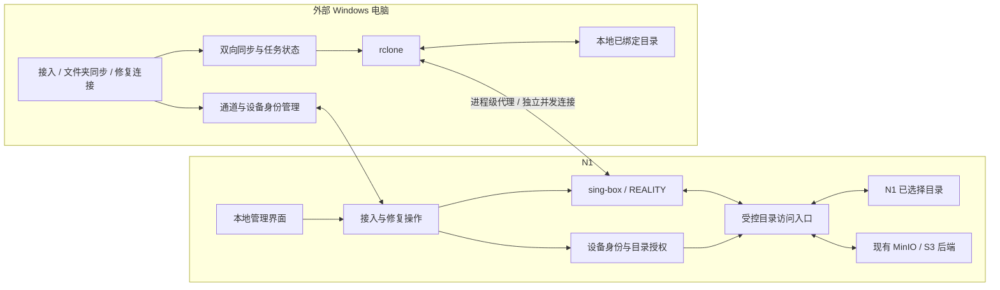

# Syncraft 开发计划（本次确认稿）

版本：评审稿 1.0  
日期：2026-10-19  
状态：待用户确认；本文件不表示需求已全部获批或代码已实现。  
适用源码：C:\Users\Tong_hp\Projects\Syncraft\work\singbox-folder-sync-mvp  
核对基线：HEAD a4c948d，包含本次开始前已有的工作区修改。

## 1. 本次要确认的产品定义

Syncraft 是部署在家中 N1 与外部 Windows 电脑之间的双向文件夹同步工具。N1 开放指定目录，外部电脑通过一次接入建立本地目录与 N1 目录的同步关系，两端的新增、修改和按策略允许的删除可以相互传播。

sing-box 的 VLESS/REALITY 与 rclone 并发传输构成底层传输方案。普通使用者不需要配置 VLESS、REALITY、MinIO、bucket、线程数、远端内部路径或同步空间。工具负责准备配置、启动组件、检查实际数据访问、自动修复可恢复故障；自动恢复不了连接时，允许重新生成通道配置码，客户端导入后继续原同步工作。

本次任务只形成开发计划。实现、真实数据迁移、部署、提交、推送与发布另按后续任务执行。

### 1.1 用户已确认的需求

| 编号 | 用户已确认内容 | 计划采用的约束 |
|---|---|---|
| R01 | 联通家宽存在上传白名单策略；普通直传约 3–5 Mbps，测速/网盘可约 50 Mbps | 作为本项目场景事实，不继续争论白名单是否存在 |
| R02 | sing-box 伪装加并发的真实链路验证已经通过 | 技术路线成立；不再以重复可行性论证作为开发前置条件 |
| R03 | N1 开放指定文件/目录给外部电脑同步 | 文件夹是首版主要配置单位，单文件可放入受控目录 |
| R04 | 外部电脑修改需要回写 N1 | 双向同步是核心能力，不收窄为下载或单向备份工具 |
| R05 | 现项目设置繁琐、难用，底层实现细节应隐藏 | 建立双向同步时只做接入、身份确认、选择目录等必要操作 |
| R06 | 隐藏细节后，工具应能诊断并自行解决可恢复故障 | 设置统一检查、修复和结果确认流程 |
| R07 | 应有重新配置入口，生成新接入配置后可以继续原同步工作 | 换码保持原目录、原任务、原同步基准；禁止变相新建任务 |
| R08 | 两种码拆开：通道配置码用于建立通道，身份验证码用于确认身份 | 分别定义生命周期和权限边界 |
| R09 | 本次确认开发计划 | 本文区分已确认需求与待确认设计建议 |

R02 的依据是用户说明。本次未获取测速原始报告，也未连接 N1 或工作电脑重做验证；不补写具体吞吐、测试时间或已通过的其他场景。后续仅记录已有成功配置并做改动后的性能回归。

### 1.2 建议随本次计划确认的设计默认值

以下为设计建议，不是用户已经明确逐项确认的要求：

| 决策 | 建议值/规则 |
|---|---|
| D01 首轮交付范围 | N1 与一台外部 Windows 电脑完成可靠双向同步；支持多组目录绑定。后台保留多设备模型，同一目录多台外部电脑写入需额外协调验收后开放 |
| D02 N1 目录接入 | 新建同步关系直接选择 N1 现有普通目录；首选受控本地 WebDAV 文件服务适配，MinIO/S3 保留为旧任务兼容后端 |
| D03 首次接入 | 输入通道配置码 → 首次身份验证码 → 选择已授权 N1 文件夹及本地目录 → 开启同步 |
| D04 日常与修复 | 正常同步无需再次输入码。已绑定设备更换通道配置码时使用原设备身份，身份仍有效就不重复验证码 |
| D05 自动同步 | 默认客户端运行期间按 60 秒间隔检查，支持“立即同步”、暂停及退出到托盘；扫描未结束时合并后续触发，不重叠运行 |
| D06 冲突与删除 | 冲突默认保留双方版本；删除传播默认经过可恢复目录，建议保留 30 天；异常大量删除暂停处理 |
| D07 身份验证 | 身份验证码是短时、一次性、绑定接入请求的授权；成功后保存独立设备凭据，建议用设备密钥完成后续身份确认 |
| D08 版本策略 | 新增独立版本的接入协议和任务模型；不在既有 Protocol v1/profile 中悄悄改变字段含义，旧任务先保持兼容运行 |

D02 在 P2 有明确兼容性闸门。若选定适配器不能满足元数据、并发和写入安全要求，先提交该技术点的替代决策，不把有缺陷的适配器直接推入后续开发。

## 2. 当前实现与本次改动依据

以下只描述本次实际读取到的源码或文档，不代表线上部署现状，也不把设计文档视为已实现能力。

| 已确认现状 | 位置 | 对新计划的影响 |
|---|---|---|
| 客户端通过 sing-box 代理执行 rclone，存在上传、下载、bisync 分支 | src/core/rclone.js；src/core/singbox.js | 复用传输与进程运行能力，保留进程级代理边界 |
| 仓库锁定 sing-box 1.13.14、rclone 1.74.3，N1 Dockerfile 对应锁定版本 | client/resources/bin/win32/binaries.lock.json；server/appliance.Dockerfile | 适配器和恢复参数先对锁定版本验证；不顺便升级工具链 |
| 默认状态为 vless-tcp-none，代码另支持 REALITY | src/core/serverAdmin.js | 实施前记录用户已验证的实际配置；新用户主流程不暴露协议菜单，不以无 TLS 默认值替代已验证配置 |
| 重新导入 profile 会刷新已有 job，并保留本地目录、计划等用户字段；有导入失败恢复机制 | client/src/clientServer.js:890、966 | 可复用导入基础，但要扩展为持久化的重配事务 |
| bisync 初始化状态及工作目录以 syncJobFingerprint 为索引，指纹包含端点、代理端口、线程等 | client/src/clientServer.js:1479、1850 | 连接参数与同步基准耦合，必须先解开，才能保证换码续同步 |
| 当前 rclone 构建逻辑只对单向 destructiveSync 注入恢复目录；bisync 分支主要加 check-access/resilient | src/core/rclone.js:68、74；client/src/clientServer.js:1484 | 双向删除备份、异常恢复与状态保护需要专项实现 |
| 当前 job 使用 S3 endpoint、bucket、prefix；profile 同时包含 tunnel/storage/heartbeat 等 | src/core/profileProtocol.js:200；src/core/serverAdmin.js:1391 | 两码与目录适配需要清晰的新协议；新旧导入不能混淆 |
| 存在同步空间、成员和 MinIO 权限配置代码，但有 shared/per-device-space 模式分支 | src/core/serverAdmin.js；src/minioProvisioner.js；src/core/minioPolicy.js | 旧模式不能直接被当成新设备身份或目录隔离已经完成 |
| 现有文档仍将冲突处理描述为摘要和手工比对 | docs/SOFTWARE_DESIGN_SPEC.md | 新计划补齐冲突处理和恢复界面，不只显示错误文本 |
| 已有健康探针、配置监督器和发布工具 | src/core/setupReadiness.js；src/core/applianceHealth.js；server/sing-box-supervisor.sh；package.json | 复用检查与配置应用机制，补统一业务操作和客户端实测回执 |

本次开始前已有 9 个已修改文件，以及两份未跟踪的旧评审文档；当前计划作为独立新文件加入，不覆盖这些改动。实施 P0 必须重新记录工作区，不能把历史改动自动回退、提交或合并。

旧文件的处理：
- docs/PRODUCT_LOGIC_UI_REDESIGN_PLAN.md 保留为历史方案；其中“一个完整导入码完成全部接入”的流程在本计划确认后由两码流程替代。
- docs/SYNC_ID_PRODUCT_REQUIREMENT.md 与 docs/SYNC_ID_SECURITY_IMPLEMENTATION_PLAN.md 中的稳定内容身份、授权隔离原则可以复用；普通用户不再把“填写同步 ID”作为主操作。
- docs/protocol/05-profile-import.md 对 profile 顶层字段的描述与当前源码已有差异，P1 同步校准代码、接口合同和 schema，不能直接复制旧文档作为新协议依据。
- 本计划确认后，以 R01–R09 和最终确认的 D01–D08 作为本轮开发基线；旧文档冲突处先标注替代关系，再随实现更新。

## 3. 目标架构与职责

职责划分：
- 通道管理只负责连接方式、配置版本和健康证据；设备授权决定谁可访问哪个目录。
- 同步引擎管理两端差异、同步基准、冲突、删除恢复和任务调度，不以“隧道已启动”代替同步成功。
- 目录访问入口把普通文件夹或旧 S3 内容映射为受控后端，执行设备授权、路径边界及撤销；不能只靠界面隐藏路径。
- 修复操作负责检查顺序、有限重试、结果核对和操作恢复，不另造一套凭据或文件移动规则。
- 所有数据传输保持只影响 Syncraft/rclone 进程的网络设置，不要求切换全局代理或 TUN。

### 3.1 N1 普通目录的落地路线

建议以 rclone serve webdav 的本地目录服务作为新目录后端首选，客户端使用对应 rclone WebDAV vendor。数据端口只监听本机/受控容器网络，经受控入口和 VLESS 到达，不另开公网文件端口。

这是一项待 P2 验证的实现选择。官方资料支持服务端目录读写及 rclone vendor 的修改时间扩展；并发分段读取、稳定校验、缓存新鲜度、写入完成语义仍须使用锁定版本做端到端验证。服务端默认匿名选项不能用于产品部署，认证和授权必须由本工具明确配置。

目录注册同时建立稳定 rootId 和挂载健康标记。服务启动和每次扫描验证标记、挂载、读写权限及可用空间。目录为空、磁盘未挂载、路径被替换均不能自动解释为“文件全被删除”，修复程序也不能自动重建丢失标记来绕过检查。

目录部署的安装、health/readiness 和发布审计同时改为按实际启用的后端检查，不能继续把未启用的 MinIO 当成必需依赖。rclone 参数按后端构建，S3 专用字段不混入普通目录任务。

新建文件夹同步不需要用户先导入 MinIO。旧 MinIO 内容继续通过 S3 适配器访问，不把 MinIO 内部数据目录当普通文件夹开放，也不静默搬迁对象数据。

### 3.2 首版范围

- 主平台为现有 N1/Linux 服务端和 Windows 桌面客户端。
- 支持 N1 与一台外部电脑双向修改、多组非重叠文件夹、自动检查、立即同步、暂停、冲突处理、删除恢复和换码续同步。
- 同一组目录同时只有一轮实际同步；同一 N1 目录不得被互不协调的外部客户端同时执行双向任务。
- 不承诺逐字节实时同步。首版使用串行扫描与增量同步，可在后续增加文件变化触发并保留周期核对。
- 不以数据库、虚拟机磁盘、持续写入的邮件库、正在运行的应用状态作为普通文件同步的一致性承诺；检测到传输中持续变化的文件应推迟并提示。
- 云中转、通用代理管理、多人实时编辑、移动端、新的安装器形态均不列本轮交付内容。

## 4. 两种码与长期身份

### 4.1 通道配置码

职责：提供 N1 身份、当前公网入口、协议/REALITY 参数、配置版本和建立受限连接所需的引导材料。不得内含目录数据访问凭据或通过一个布尔值自授读写权限。

建议采用显式版本与类型标记，避免与旧 SyncKey 混用；具体前缀由 P1 合同统一确定。码中有引导凭据时按敏感凭据保护，设置有效期和可撤销记录，日志只记录脱敏操作标识。

未验证身份时，引导通道只允许访问配对接口。不能借助其扫描 N1 内网、访问 MinIO、读取目录或作为通用代理。使用独立受限入站或经过锁定版本验证的用户路由规则，并在目录入口再次验证身份。

N1 的长期服务身份用于验证后续新配置码的来源。首次信任来自用户通过已信任的 N1 管理页面取得配置码；后续服务身份变化必须明确提示，不能只因为码可解析就覆盖已绑定服务。

### 4.2 身份验证码

职责：批准当前接入请求中的这台外部电脑加入指定文件夹。验证码本身是一次性授权，不是长期设备身份。

建议流程：客户端先提交设备公钥和随机接入请求，N1 管理端展示待接入设备；管理员选择可同步的文件夹并生成验证码，验证码绑定该请求、该设备公钥和该目录授权。客户端输入后完成绑定。两个码不能跨 N1 或跨邀请拼接。

身份验证码建议有效期 10 分钟；通道配置码的未配对引导授权建议有效期 24 小时。验证次数受邀请、设备和来源限速约束；过期、作废、重复兑换和错误设备兑换均被拒绝。超时结果通过请求 ID 查询，不能重复创建设备或消费另一份验证码。

普通流程不要求每次启动或每次同步输入验证码。身份丢失、主动撤销或重新绑定设备时才再次验证。

### 4.3 设备身份和稳定同步关系

建议使用标准设备密钥的挑战签名证明身份，私钥保存在客户端受保护的凭据存储中，服务端保存公钥；具体算法及密钥存储实现由 P1 封版，复用标准库，不自行设计加密算法。

| 对象 | 作用 | 生命周期 |
|---|---|---|
| serverId | 识别同一 N1 服务实例 | 不随通道重配改变 |
| deviceId / device credential | 识别已授权电脑及验证密钥 | 可撤销，恢复身份时有明确记录 |
| shareId + rootId | 识别逻辑同步文件夹和实际内容根 | 改通道不改变；换根需迁移验证 |
| relationId | 绑定 shareId、deviceId 和客户端本地根 | 目录或设备重新绑定有显式操作 |
| channelRevision | 通道配置版本 | 可更新 |
| credentialRevision | 设备数据访问凭据版本 | 可轮换 |
| baselineEpoch | 当前可信双向同步基准 | 只有受控初始化/迁移才改变 |

设备已被管理员停用时，自动修复与配置码均不能重新启用设备。更换通道配置码不等于撤销已配对设备；设备撤销必须同时落实在通道、会话和目录数据访问层。

## 5. 双向同步规则

下列为建议随计划确认的首版产品行为。

| 场景 | 默认处理 |
|---|---|
| 新的本地空目录 | 预览 N1 内容，建立初始基准后进入双向同步 |
| 两端首次都有文件 | 先对比并展示差异；独有文件合并，同路径不同内容先保留双方并让用户确认，不能默认“较新者覆盖” |
| 一端新增或修改，另一端未修改 | 传到另一端；成功校验后提交本轮基准 |
| 同一路径两端都有不同修改 | 保留双方版本并标注来源，创建冲突项；不默认按系统时间判输赢 |
| 一端删除，另一端未修改 | 按删除策略传播，并保存可恢复副本 |
| 一端删除，另一端同时修改 | 按冲突处理，优先保存修改内容；不以删除直接覆盖修改 |
| 批量删除、访问标记丢失、目录异常为空 | 暂停危险操作，先核对挂载与根身份 |
| 同步时文件仍在写入或被锁定 | 有限重试/推迟该项，并显示待处理状态 |
| 改名、大小写变化、中文与空格 | 按后端和 Windows 语义核对；无法安全表达的路径明确列为阻断项 |
| 多次点击、定时与手动同时触发 | 合并到同一任务/队列，不启动重复 bisync |
| 断网、退出、异常断电 | 保护最后可信基准，恢复后核对执行日志；状态不可信则进入恢复预览 |
| 正常停止 | 优先温和停止并等待引擎退出；超时才终止并标记中断状态 |

删除保护建议初值：可恢复副本保留 30 天；单次计划删除超过 100 项，或删除不少于 10 项且超过本轮原有文件数的 10% 时要求确认；确认为空的新目录初始化不使用该百分比规则。上述数值是产品建议和策略配置，不是法规、性能实测或用户现成要求。空间不足时先暂停会丢失恢复副本的写入，不自动清空仍在保留期内的版本。

恢复能力覆盖已由 Syncraft 留存的版本。其他程序直接在 N1 磁盘上删除、覆盖而尚未留存的版本，不能承诺凭同步日志恢复；需要时接入已有磁盘快照/备份，不能把同步等同于完整历史备份。

“断线继续”首版要求保留任务、跳过已成功且未变化的文件，并安全重试未完成文件。单个未完成文件能否按字节续传由所选后端实测决定；不得把 rclone 重试描述成所有情况下均支持字节续传。

## 6. 换码后继续原同步的实现要求

### 6.1 分开三种判断

- 连接配置指纹：地址、端口、REALITY 参数、密钥、代理端口等；变化时重建连接。
- 执行参数版本：线程、限速、重试等；在安全边界应用，不改变同步基准。
- 同步语义/内容版本：文件根、过滤范围、比较方式、后端语义等；变化时进行预览和迁移判断。

不能再用当前包含全部字段的 syncJobFingerprint 同时承担运行互斥、配置复用、bisync 初始化与持久工作目录定位。

bisync 工作目录以 relationId 持久定位，并验证本地根、远端 rootId 与 baselineEpoch。rclone 自身的远端别名和路径字符串也会影响内部状态命名，必须使用关系内稳定的远端别名，并对实际 listing/锁/工作目录进行测试；只替换外层索引并不能证明引擎状态已可继续使用。

### 6.2 正常通道重配

1. N1 管理端对原设备/原关系执行“检查并重新配置”，持久化 operationId。
2. 检查原目录、身份授权、组件和已验证网络配置；完成安全修复，生成与校验候选配置。
3. 在可控时机应用配置并确认版本，失败则恢复上一可用版本。不能在写入过程中无提示更换通道。
4. 为原关系生成新通道配置码，保留 shareId、rootId、deviceId、relationId。
5. 客户端“修复连接”导入新码，使用原设备身份响应挑战；只有身份也丢失/失效时才要求身份验证码。
6. 客户端验证同一 N1、同一关系、同一内容根以及权限；新通道执行目录读取、受控临时文件写入/清理探针，并查询实际读写结果。
7. 保存可恢复快照，更新配置、凭据、运行时进程及调度状态，确认所有步骤成功再切换为当前配置；崩溃后根据事务日志续做或回滚。
8. 使用原同步基准进行扫描并继续。保留本地目录、任务名称、过滤项、计划、历史、冲突记录及恢复副本。
9. 服务端收到新配置启用确认后，按轮换策略撤销旧设备通道凭据；不能因一次响应丢失留下两套永久有效配置或把客户端锁死。

### 6.3 不可静默续接的情况

- 新码属于其他 N1、其他目录或其他设备。
- rootId 缺失、磁盘被替换、数据集实际上迁入新 bucket/prefix。
- 本地或引擎同步基准损坏、无法证明列举结果完整。
- 过滤范围或比较语义变化，可能把既有内容误判为删除。
- 新权限不允许回写，或设备已被撤销。

这些情况保留原文件及状态，进入“核对原同步关系/恢复预览”，不自动新建空目录、不批量覆盖、不自动执行 bisync --resync。若确需迁移，先核对清单和数据一致性，再受控生成新基准。

## 7. 自检、自修与重新配置

### 7.1 统一检查顺序

客户端组件与本地目录 → N1 公网入口/隧道握手 → 设备身份与授权 → 文件服务与根标记 → 目录实际读写 → 同步基准与待处理数据。

N1 本地健康、管理 API 可达、隧道监听、外部电脑实际文件访问分别记录。N1 无法代替外部客户端证明公网可用；“已生成配置码”“N1 自检通过”“外部验证通过”是不同结果。

### 7.2 故障动作表

| 故障 | 自动动作 | 不能恢复时给用户的操作 |
|---|---|---|
| 临时断网/DNS 异常 | 有限重试、退避，恢复后重查数据访问 | “网络暂不可达”，保留任务并显示最后成功时间 |
| 客户端 sing-box 退出/端口占用 | 检查进程归属、重启本工具进程或安全选择新本地端口 | “修复连接”；不能终止未知占用进程 |
| N1 组件退出/配置未应用 | 校验候选配置，按版本应用并探测，失败恢复上一版本 | N1 “检查并重新配置” |
| 地址/通道参数已失效 | 已验证身份且管理面可用时获取新版本；不可达时使用新配置码 | 客户端“输入新的通道配置码” |
| 目录访问凭据失效 | 原身份仍有效时重新签发受限凭据，验证后切换 | 身份也失效时才再次输入身份验证码 |
| 磁盘未挂载、满盘、权限变化 | 检查根和挂载，停止危险写入 | 明确显示待处理磁盘/目录，修复后重新检查 |
| 冲突、大量删除、状态不可信 | 保留数据并暂停相关任务/危险项 | “查看冲突”“恢复文件”“核对同步状态” |
| 公网转发/路由器入口不可达 | 只做可证实的探测与重试 | 指出公网入口问题，不声称重发码能修好路由器 |
| 设备被撤销 | 停止新任务并撤销会话/访问 | 需要管理员重新授权，不自动启用 |

自动修复每一故障轮最多建议 3 次主动恢复，仍失败进入冷却与人工操作，不循环重启、不不断重发码。自动恢复不清空文件、不重置同步基准、不重置 N1 长期服务身份、不创建新的空 bucket 替换旧数据。

所有修复动作支持幂等请求 ID、步骤日志、超时后查询和进程重启后恢复。候选配置校验失败、版本不一致或探针失败不能显示“已修复”。

## 8. 两端界面与用户路径

### 8.1 N1 管理端

主入口：文件夹、设备、连接与修复。

- 文件夹：选择服务器可见的目录、设置展示名称、选择允许的设备、查看同步/磁盘状态；底层存储映射在高级诊断。
- 接入设备：生成通道配置码，显示设备接入请求，选择可同步目录并给出身份验证码。
- 连接与修复：显示“检查中/自动修复中/需重新接入/需处理目录”等结果，一个主要操作为“检查并重新配置”。
- 设备详情：目录授权、最近成功同步、需要处理的冲突、重新配置、停用设备。
- 安装时一次性登记允许发布的主机父目录并映射到容器；页面只能选择这些可见目录，不能暗示能访问容器外任意主机路径。

### 8.2 Windows 客户端

首次：粘贴通道配置码 → 展示 N1 名称和接入状态 → 首次身份验证码 → 选择已授权文件夹与本地目录 → 首次差异确认 → 开启同步。

日常首页：N1 文件夹 ↔ 本地文件夹、自动同步开关、立即同步/暂停、当前速度和进度、最近成功时间、冲突/待处理项。两端方向明确显示，正常双向任务无需用户反复选择“上传/下载”。

修复：首页异常直接展示“自动修复中”及结果；需要新码时就地进入“修复连接”，说明会继续哪一个已有任务。导入成功后自动核对并恢复，不要求重新选择本地目录或新建任务。

高级诊断保留组件、脱敏日志、版本、配置摘要和导出入口。错误面向用户说明原因、是否已修复和下一步，不把 VLESS/S3 错误文本直接作为唯一提示。

## 9. 开发阶段和交付闸门

阶段按依赖顺序执行，每阶段交付一段可演示流程。表中的接口、模块名均为拟议设计，不是现有实现。

| 阶段 | 主要工作 | 可评审交付物 | 进入下一阶段的条件 |
|---|---|---|---|
| P0 基线与需求封版 | 记录既有工作区；保存已验证的通道与并发参数的受保护基线；确定 D01–D08；梳理旧任务/数据根 | 范围清单、基线清单、样例数据集、现有测试基线 | 不把用户已完成的性能可行性验证重新列为未完成 |
| P1 稳定身份与协议 | server/device/share/root/relation 模型；两码和接入状态；稳定别名/基准定位；新旧 schema 与合同 | 协议合同、状态迁移图、带验证的模型与迁移预览 | 换线程/端点不重置关系；换数据根被阻止；代码、schema、文档一致 |
| P2 N1 普通目录适配 | WebDAV 首选方案、loopback 文件服务、目录入口认证/授权、挂载标记、元数据与读写校验 | N1 测试目录与 Windows 的读写样机、协议选择记录 | 锁定版本并发/mtime/校验/写入完成/目录隔离通过；不得用“能列文件”替代 |
| P3 首次接入到双向样例 | 最小两端 UI；通道配置码→受限通道→验证码→设备绑定→目录绑定→样例 bisync | 首条完整双向业务流程，含一次 N1 修改和一次客户端回写 | 未验证身份不能读写；双向正确；只使用隔离样例数据 |
| P4 自动修复与换码续同步 | 分层探针、配置版本、回滚、幂等修复操作、设备挑战、配置导入事务、原基准续接 | 一键重新配置、客户端修复入口、故障注入报告 | 原任务/目录/基准保留；掉响应和崩溃可恢复；不会错误接受换根 |
| P5 双向数据安全 | 首次合并、冲突版本选择、删除恢复、删除阈值、断电/丢盘/文件写入中保护 | 冲突处理页、恢复页、异常同步行为测试 | 新增/修改/删除/删除修改冲突/中断矩阵全部通过；此阶段前不用于唯一真实数据 |
| P6 日常使用与迁移 | 自动检查与托盘、计划队列、状态一致性、旧 profile/任务迁移和状态保护 | 简化界面、迁移预览/报告、兼容模式、用户帮助 | 普通流程无底层字段；旧任务不被静默改变或丢弃 |
| P7 真实验收与交付 | N1+工作电脑真实双向操作；修复/换码/冲突/回滚演练；性能回归；包与合同检查 | 可复现验收记录、桌面包/服务端包、升级回退说明 | 第 12 节全部必要项目通过，明确哪些是样机测试、哪些是真实链路结果 |

依赖：P0 → P1 → P2 → P3 → P4 → P5 → P6 → P7。P3 已包含最小可用界面，P6 是日常体验完善；不等所有底层模块做完才第一次演示用户流程。

不先给未经测算的日历工期。P0 完成工作区基线与 P2 适配器风险核对后，再据实际工作项给排期；本次确认范围、顺序和验收标准，不承诺虚构天数。

## 10. 拟议代码与合同改造位置

| 职责 | 复用/改造位置 | 计划输出 |
|---|---|---|
| 稳定关系与版本化模型 | src/core/profileProtocol.js、serverAdmin.js、protocolSchemas.js | 将连接材料、身份、目录授权、同步关系拆开；旧解析器兼容 |
| 两码接入与设备身份 | src/server.js、client/src/profileImport.js、clientServer.js | 独立接入类型、挑战、兑换、重试查询、撤销 |
| 目录后端 | src/core/storage.js、src/minioProvisioner.js、server/rootfs、Compose/appliance | 普通目录适配器、旧 S3 适配器、受控目录入口与监督 |
| 通道配置生命周期 | src/core/singbox.js、server/sing-box-supervisor.sh、setupReadiness.js、applianceHealth.js | 生成/校验/应用/运行/外部确认分离，候选配置失败恢复 |
| 同步与基准 | src/core/rclone.js、client/src/clientServer.js、store.js、paths.js | relationId 工作目录、稳定远端别名、事务日志、可恢复版本 |
| 自动修复 | 在现有进程/检查基础上形成独立协调模块 | 分层诊断、动作策略、有限重试、持久操作与结果汇总 |
| 两端 UI | public/app.js、client/public/app.js 和对应 HTML | 首次接入、日常同步、修复连接、冲突恢复的完整流程 |
| 合同与交付 | docs/INTERFACE_CONTRACT.md、docs/API_MATRIX.md、docs/protocol、scripts/lib/runtimeContracts.mjs 等实际合同工具 | 新协议、机器 schema、兼容和发布验证同步更新 |

先以接口和行为划分职责，再决定是否拆文件。不能在现有 clientServer.js 继续直接堆叠所有修复与迁移逻辑，也不因本计划为新模块预设空壳目录。

建议新增操作合同：
- 生成通道配置、创建/查看待接入请求、验证身份、设备挑战/续期、查询授权目录。
- 注册/检查同步关系、读取运行计划、执行与温和停止同步。
- 执行检查修复、查询操作进度、签发同关系新配置、提交客户端新版本启用回执。
- 查看和解决冲突、列出和恢复已留存版本、预览旧任务迁移。

各合同明确请求 ID、权限主体、输入版本、可重试性、持久化副作用和结果查询。具体 URL 在 P1 封版，不把本计划中的动词直接当作当前 API。

## 11. 兼容迁移与回退

1. 在旧数据目录之外建立受保护快照，记录 profile/jobs/secret refs、设备和空间映射、rclone 状态与配置版本；日志不含原始秘密。
2. 扫描旧任务，逐项生成迁移预览：原本地根、原远端数据身份、新 relationId、能否复用基准、哪些需要人工核对。
3. 对相同数据根、后端和引擎语义，测试后导入既有 bisync listings/工作目录。验证不同引擎别名时也能定位正确状态。
4. 旧状态无法安全对应时，原任务继续兼容运行或保持暂停；不能自动重跑 resync 来伪造迁移成功。
5. 通道码、身份验证码与旧 SyncKey 明确区分，新导入界面不把旧离线 profile 当成新设备身份证明。
6. MinIO→普通目录属于内容迁移，需要独立清单、复制校验和切换；只换码不等同于完成数据迁移。
7. 迁移操作有版本和日志，失败可恢复旧客户端元数据及服务配置。新版本已同步到两端的文件更改不能仅靠回退二进制自动撤销；文件恢复使用保存的版本和明确恢复操作。
8. 首版只提供预览和受控迁移，不能自动清理旧目录、旧配置或备份。

## 12. 验收矩阵

下列为待实施的测试和验收，不表示本次已经执行。

| 编号 | 场景 | 必须观察到的结果 |
|---|---|---|
| A01 | 全新 Windows 接入 | 仅需通道码、首次验证码、文件夹选择和首次差异确认；无需手填底层字段 |
| A02 | 只有通道配置码 | 能到受限配对接口，不能列举/读取/写入任何同步目录或扫描内网 |
| A03 | 验证码过期、重放、跨设备/跨 N1 拼接 | 被拒绝且不额外创建设备或授权 |
| A04 | 正常两端新增与修改 | N1→电脑、电脑→N1 的目录清单和内容哈希符合预期 |
| A05 | 两端同时修改、删除与修改竞争 | 双方内容被保留，用户有明确处理入口，无静默丢失 |
| A06 | 正常删除与恢复 | 删除按策略传播，留存副本可恢复，恢复后可再次同步 |
| A07 | N1 磁盘掉挂载/根标记丢失 | 停止危险变更，不把空目录传播为全量删除 |
| A08 | 杀掉本工具 sing-box 或短暂断网 | 有限自动恢复，任务保持，已完成且未变化文件不全量重传 |
| A09 | 新通道码更新地址、端口、REALITY/凭据 | 不改 relationId、rootId、baselineEpoch，无新建任务/重新初始化提示 |
| A10 | 修改线程、限速和代理本地端口 | 生效后仍使用同一同步基准 |
| A11 | 新码指向不同内容根/空 bucket/其他服务 | 阻止静默续同步，保留原任务和文件 |
| A12 | 重配中断电、请求响应丢失、重复点击 | 可查询并续做/回退，不产生重复设备、重复目录或半提交状态 |
| A13 | 数据凭据撤销与设备停用 | 新访问被拒绝，自动修复不重新授权；其他设备不受无关影响 |
| A14 | 文件服务满盘、拒绝写入、路径越界 | 真实报错，不显示已修复；越权和逃逸操作失败 |
| A15 | 批量删除超过策略 | 执行前暂停并展示范围，可取消，不绕过门槛继续 |
| A16 | 同步中退出/重启 Windows 与 N1 | 最后可信状态可恢复；不可信状态进入恢复预览 |
| A17 | 旧任务兼容及迁移失败 | 原目录映射、状态和可回退材料保留，未迁移任务清晰可见 |
| A18 | 真实链路性能回归 | 与用户已验证配置在相同端点/数据集/相近条件下比较，分别记录两方向；不再擅自要求重证 20 Mbps 门槛 |
| A19 | 多任务与自动调度 | 非重叠目录任务按队列运行；手动、计划和重配不并发改同一引擎状态 |
| A20 | 脱敏和交付检查 | 日志、诊断、进程参数和发布包不泄露两类码、设备私钥或存储秘密 |

性能回归在 P0 登记实际可用基线：配置版本、文件集、总耗时、平均吞吐、N1/客户端负载。数值和允许退化范围在有记录后确定，不把用户未提供的具体测速数字补成“已验收”。新增目录适配改变存储路径，只做该改动所需的回归，不重新否定既有技术可行性。

未来多台外部电脑写入同一目录的额外闸门：服务端会话租约/冲突版本检测/过期会话 fencing、设备离线后重连、多个客户端删除传播及恢复全部通过。客户端各自的本地锁不足以证明跨设备协调完成；N1 本地其他程序修改也仍需冲突检测。

## 13. 测试和交付执行规则

- 本次只校核计划文档与引用，不运行生产同步、不生成接入码、不修改部署。
- 实施时先运行当前仓库适用测试形成 P0 基线；按变更执行合同、身份授权、存储适配、同步状态和故障注入测试。
- 使用现有 node 测试体系与隔离目录，不把真实唯一数据当故障注入样本。
- P7 执行适用的 pnpm test、audit:compose、audit:release、preflight:release 及真实桌面/服务端 smoke；命令名以实施时 package.json 为准。
- 测试全绿不替代人工走完首次接入、后台同步、冲突处理与重新配置全流程。
- 发布材料包含：变更说明、两码使用说明、同步/删除规则、兼容迁移、恢复方法、已知限制和真实环境结果。
- 开发里程碑以交付物和验收结果记录，不以测试数量、文档数量或版本名替代可用性。
- 不自动提交、推送、发布或删除历史数据；后续按用户授权执行对应动作。

## 14. 本次确认范围

确认本计划，表示确认：
1. R01–R09 是本轮需求依据；sing-box 伪装和并发的可行性不重新立项论证。
2. 首版围绕可靠双向文件夹同步、两个码、隐藏配置、自修与同关系换码续同步。
3. 接受或修订 D01–D08 的产品默认值，以及 P2 的目录适配技术闸门。
4. 按 P0–P7 顺序推进；A01–A20 是阶段和最终验收依据。
5. 本计划确认后才能作为实施基线；当前文件仍是评审稿，不能提前写成“开发完成”或“验证通过”。

## 15. 资料与可核查来源

当前仓库证据：
- [README](../README.md)
- [传输构建](../src/core/rclone.js)
- [sing-box 客户端配置](../src/core/singbox.js)
- [客户端接入与同步运行](../client/src/clientServer.js)
- [profile 与任务模型](../src/core/profileProtocol.js)
- [服务端签发与授权模型](../src/core/serverAdmin.js)
- [现有 MinIO 授权实现](../src/minioProvisioner.js)
- [当前协议合同](INTERFACE_CONTRACT.md)
- [既有重设计方案](PRODUCT_LOGIC_UI_REDESIGN_PLAN.md)
- [旧同步 ID 需求](SYNC_ID_PRODUCT_REQUIREMENT.md)
- [旧同步 ID 安全计划](SYNC_ID_SECURITY_IMPLEMENTATION_PLAN.md)
- [当前软件设计说明](SOFTWARE_DESIGN_SPEC.md)

官方技术资料（2026-10-19 查阅；实际支持能力以仓库锁定二进制验证为准）：
- [rclone serve webdav](https://rclone.org/commands/rclone_serve_webdav/)：本地/远端目录服务与认证选项，不能把默认无认证服务直接部署为数据入口。
- [rclone WebDAV 后端](https://rclone.org/webdav/)：rclone vendor 与修改时间扩展；普通 WebDAV 的元数据能力存在差异。
- [rclone bisync](https://rclone.org/bisync/)：双向同步、首次基准、冲突和恢复机制；具体参数在锁定版本验证后使用。
- [sing-box 路由规则](https://sing-box.sagernet.org/configuration/route/rule/)：认证用户等路由匹配机制；受限引导通道的隔离仍需配置与越权测试。
