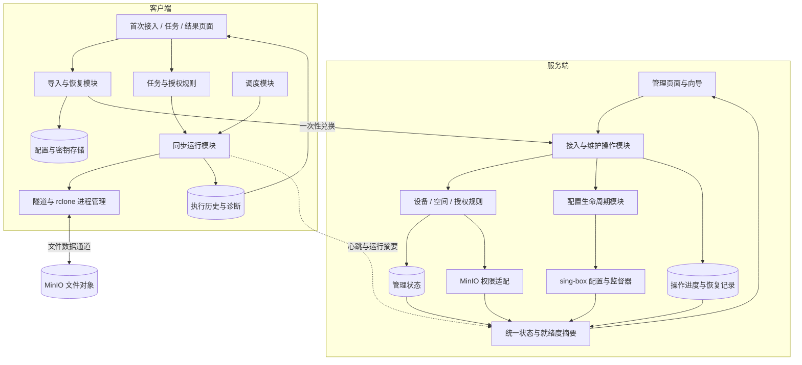
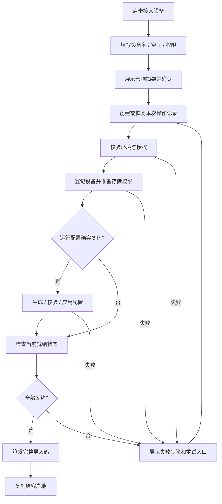
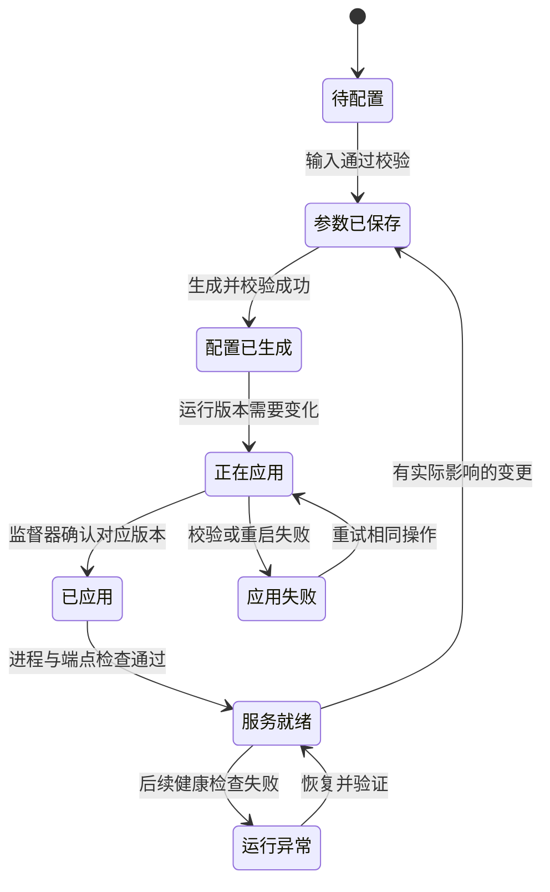
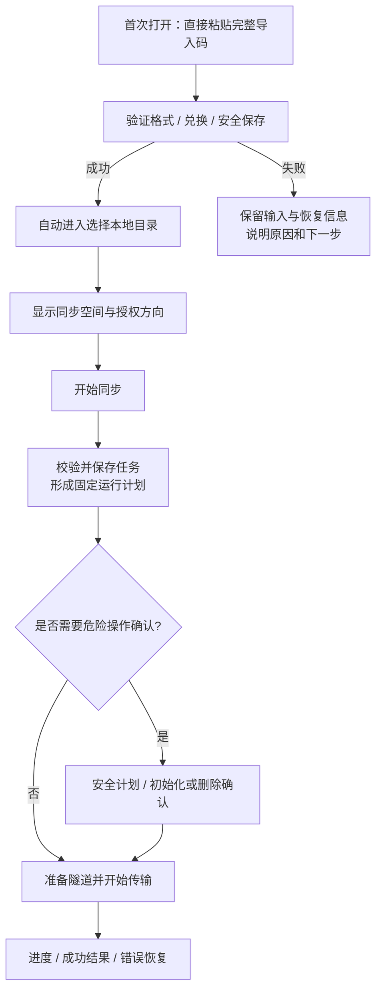

# Syncraft 功能、业务逻辑与 UI 重设计方案

版本：评审稿 1.0  
日期：2026-09-16  
范围：方案设计；不实施业务代码、不变更部署、不迁移用户数据。

## 1. 依据、目标与范围

### 1.1 证据与设计建议

**已确认事实：** 当前项目由 Windows Electron 客户端、本地 Node 运行时、服务端 Node 控制台、sing-box、rclone 和 MinIO/S3 组成。主要调用路径及问题见 [架构评估](ARCHITECTURE_REVIEW_2026-09-16.md)。本方案以该工作区的实际代码为依据，不把历史设计文档中尚未实现的功能当成现有能力。

**用户明确反馈：** 导入码表示过多；页面操作缺少响应与后续跳转；自动配置反复提示重启应用；双端操作过于复杂。

**下文的流程、模块、页面和验收目标均为建议，尚未实现。** “现有”表示已经在代码中看到对应能力；“重组”表示重新组织已有能力；“补充”表示需要实现的新逻辑或新入口。

### 1.2 产品目标

让管理员回答“谁可以同步什么”，让客户端用户回答“同步到哪个本地目录”。配置生成、权限准备、进程启动、运行确认由系统衔接。

服务端主流程：**准备环境 → 接入设备 → 复制完整导入码 → 查看设备状态**。

客户端主流程：**粘贴导入码 → 选择目录 → 确认范围 → 开始同步**。

### 1.3 本轮边界

- 保留上传、下载、双向同步、定时计划、带宽限制、历史、诊断、设备控制及存储管理能力。
- 普通用户入口只突出完整导入码。短码和 URI 保留兼容，移入高级区域。
- 延续现有客户端、服务端及外部工具部署形态；在进程内部重新划分职责。
- 客户端同时执行一个实际同步任务。已有多任务数据保留，增加明确的任务选择入口；多任务并行不纳入本轮。
- 客户端仍以一份当前服务端授权配置为主。多服务器、多空间同时在线管理属于后续扩展，不能仅靠新增页面暗示已经支持。
- 远程文件浏览、在线编辑、分享下载链接和自动更新不是本轮新增目标。

## 2. 功能提取与重新归类

| 功能组 | 现有能力 | 新入口与处理方式 | 性质 |
| --- | --- | --- | --- |
| 管理登录 | 管理 Token 登录、锁定 | 保留独立登录页，认证失败停留原操作上下文 | 重组 |
| 服务环境 | 存储参数、端点探测、隧道参数、配置生成与应用 | 合并为首次设置向导；日常在“设置”维护 | 重组与补充 |
| 同步空间 | 空间创建、用途、设备成员角色、存储目标绑定 | “同步空间”独立管理；物理 bucket/prefix 默认隐藏 | 重组 |
| 设备接入 | 注册设备、签发一次性 SyncKey、准备存储权限 | 合并为“接入设备”业务操作，自动完成必要的隧道应用 | 重组与补充 |
| 设备维护 | 在线状态、最近同步、启用、停用、删除 | 设备列表与详情；有影响的变更统一执行并显示结果 | 重组 |
| 导入码 | 短码、长码、URI、一次性兑换与恢复 | 正常发码仅显示完整码及一个复制按钮；其它表示折叠 | 重组 |
| 客户端接入 | 在线兑换、离线 profile 兼容、安全保存 | 首次页面直接导入，完成后进入目录选择 | 重组 |
| 同步任务 | 上传、下载、双向、任务保存、运行与停止 | 首页选择目录与授权方向；“开始同步”自动保存有效任务 | 重组与补充 |
| 多任务 | 已有 jobs 与调度器 | 增加任务切换/列表入口；明确一次只执行一个任务 | 补充入口 |
| 自动执行 | 手动、间隔、每天、启动时 | 任务的“自动同步”折叠区域；修改计划后重新计算运行时间 | 重组与修正 |
| 同步安全 | 镜像确认、删除上限、安全计划、双向初始化与恢复目录 | 常规同步简洁；危险行为在相应阶段集中确认 | 重组 |
| 网络与性能 | 隧道启停、并行参数、限速 | 自动管理隧道；限速在任务高级设置，其余在诊断/管理员策略中 | 重组 |
| 运行反馈 | 文件、速度、进度、最近结果、心跳 | 首页显示业务结果；详细进程状态在诊断页 | 重组 |
| 故障支持 | 日志、历史、组件检测、脱敏诊断包 | “历史与诊断”；错误旁给出下一步和导出入口 | 重组 |
| 存储维护 | bucket 刷新、创建、启停、清空、删除空 bucket | 设置中的高级维护；保留危险操作确认 | 重组 |
| 发布与运维 | 构建、校验、部署脚本、升级说明 | 保留开发运维流程；产品页面不显示不可用的更新按钮 | 重组 |

功能不会因为从主页面移走而被视为删除。新增空间编辑/移除、任务删除等能力需要单独定义行为与数据影响，不沿用当前页面中未经实现验证的文案。

## 3. 统一业务模型

| 名称 | 唯一含义 | 不再混用的概念 |
| --- | --- | --- |
| 服务端 | 提供授权管理与文件存储访问的服务 | 不能把管理 URL、VLESS 地址和 S3 endpoint 混称“服务器地址” |
| 设备 | 一个受管理的客户端身份 | 不等于一次授权码，也不等于一条同步任务 |
| 同步空间 | 管理员划定的逻辑文件范围与用途 | 不直接等同于 bucket 或某个物理目录 |
| 授权 | 设备在空间中的角色、允许方向和删除权限 | 界面可选项不是最终授权依据 |
| 完整导入码 | 携带服务端地址的一次性兑换凭据 | 不等于密码，也不表示配置已在客户端生效 |
| 客户端配置 | 兑换获得并在本地保存的身份、隧道和存储材料 | 不等于用户填写的本地任务 |
| 同步任务 | 本地目录、当前授权、方向、计划及高级选项 | 与一次执行记录区分 |
| 同步执行 | 某次任务运行的快照、进程、进度和结果 | 修改任务不应中途改变已经开始的执行 |
| 业务操作 | 一次接入、配置应用或授权变更的完整过程 | 不用某个底层 HTTP 请求成功代表整个操作完成 |

界面统一用“导入码”，在高级协议信息中注明 SyncKey；使用“同步空间”表达用户可访问的内容。代码中的 user/device 命名兼容可逐步处理，先保证界面术语统一。

## 4. 重组后的总体逻辑



这是职责划分图，不代表新增独立服务器或将每个框部署成独立服务。实际文件传输继续由 rclone 与 sing-box 完成。

## 5. 服务端业务流程

### 5.1 首次设置

页面只展示当前需要完成的步骤，已完成步骤可以返回修改。

1. **服务入口**：填写给客户端使用的管理服务地址；展示检测结果。高级区域分别维护隧道公网地址、端口和协议。
2. **存储连接**：填写必要的存储参数并检测。缺字段、端点不可达和权限不足分别说明，不把“保存成功”显示成“存储可用”。
3. **接入第一台设备**：填写设备名，选择现有同步空间或创建所需空间，确定权限。
4. **完成配置**：统一准备授权、生成配置、校验并应用，然后确认运行就绪。成功才进入导入码交付页。

新部署先登记第一台设备，再统一应用最终配置，避免先应用空用户配置、登记设备后又要求返回重启。首次流程与日常接入共用业务操作，避免两套规则。

### 5.2 日常接入设备



操作约束：

- 一次点击对应一个操作标识；重复点击、轮询与重试关联同一操作，避免重复建设备或发码。
- 同名设备不能静默解释为新设备。明确提示“为已有设备重新授权”或要求修改名称。
- 应用新隧道配置可能短暂影响已有连接，放在操作开始前的影响摘要中确认一次。
- 授权准备失败、配置未应用或运行未就绪时，显示“接入未完成”，不交付看似可用的导入码。
- 页面刷新后按操作标识恢复进度。不能只把未完成状态留在浏览器内存中。
- 网络超时先查询操作结果，不能立即重发创建请求并签发另一枚码。
- 重新发码、作废旧未兑换码的策略应由授权模块明确管理；不假定重新发码已经能撤销被兑换的客户端配置。

### 5.3 配置生命周期

分别记录“期望参数、已生成配置版本、已应用版本、当前健康证据”。



- 参数不变时不置为待应用，不无意义重启。
- “自动配置”改为明确的“检测并完成配置”，该动作覆盖补全、生成、校验、必要应用和结果刷新。
- 手工补全、预览、写文件和重启保留在高级维护；各自只声明真实完成的阶段。
- 应用版本一致不等于网络一直健康；运行异常也不等于配置从未应用。
- 所有页面使用同一份摘要，不让向导、顶部状态和设备页各算一套结论。

## 6. 客户端业务流程

### 6.1 首次使用



- 普通导入不进入设置抽屉，导入后自动清空输入中的凭据并进入目录页。
- 授权方向只有一个时展示只读文字；有多个时才出现选择控件。
- 没有授权方向与无法获取授权是不同状态，不能都回退成任意方向可选。
- “开始同步”校验并保存本次有效任务，不要求先找“保存任务”再找“开始”。“仅保存”作为次级操作保留。
- 对普通单向复制，主页面已经清楚展示目录、空间和方向，不强制用户先阅读 rclone 命令。
- 镜像删除、首次双向初始化、冲突处置保留必要确认，不用减少保护来简化页面。
- 导入成功后如果还有旧任务，明确显示它们是否适用于新授权。运行中导入新配置应先停止或等本次结束，不能悄悄切换正在传输的身份或目标。

### 6.2 日常同步

首页优先展示最近使用任务、本地目录、空间、方向、最近结果和“开始同步”。同步期间主按钮变为“停止同步”；停止中显示“正在停止”，待进程退出后才恢复开始入口。

计划任务位于“自动同步”折叠区域。修改时间/间隔即重新计算下次执行；刷新页面不能重新触发已消费的“启动时运行”。已有多个任务通过任务选择器进入，运行冲突给出正在执行的任务，不并发启动另一套配置。

### 6.3 运行约束

- 手动、定时、双向初始化经过同一运行模块；共享隧道、rclone 配置和 bisync 工作目录的操作受统一互斥控制。
- 每次执行只使用一个已验证计划，包含授权版本、目录、方向和隧道配置指纹。
- 隧道复用前比较配置指纹，不能仅判断进程存在。
- 方向、空间目标与删除权限在执行入口校验。MinIO 策略负责存储端实际授权，页面只是表达已授予的权限。
- 本地配置提交要支持异常中断恢复，不能只依赖进程仍活着时的 catch 回滚。

## 7. UI 信息架构

### 7.1 服务端导航

```text
Syncraft 管理
├─ 概览              当前是否可用、待处理操作、近期设备
├─ 设备              设备列表、详情、接入入口
├─ 同步空间          空间、用途与成员概况
└─ 设置
   ├─ 服务与存储     普通配置入口
   └─ 高级维护       原始参数、仓库维护、手动应用、诊断
```

“接入设备”是醒目的业务按钮，不再把“SyncKey”作为用户必须理解的独立导航概念。首次设置是未就绪时的引导状态，完成后退出；后续异常在概览提醒，不把所有用户重新送回首次向导。

### 7.2 客户端导航

```text
Syncraft
├─ 同步              当前任务、目录、范围、进度、开始/停止
├─ 历史              最近执行、结果、错误与恢复入口
└─ 设置与诊断        更换导入码、组件、日志、导出、高级参数
```

首次打开直接进入“连接服务端”。已接入用户直接进入“同步”。现有任务切换放在同步页内，不增加独立技术术语导航。

## 8. 页面布局方案

以下是信息布局草图，不代表已经实现的页面或现场截图。

### S1 服务端概览

```text
┌────────────────────────────────────────────────────────┐
│ Syncraft 管理                            [接入设备]     │
├────────────┬───────────────────────────────────────────┤
│ 概览       │ 服务状态：可用 / 待配置 / 异常              │
│ 设备       │ 一句话说明原因                 [处理问题]  │
│ 同步空间   │                                           │
│ 设置       │ 在线设备  ·  正在同步  ·  待处理操作        │
│            │                                           │
│            │ 近期设备                                  │
│            │ 设备名称   当前任务   最近结果   [详情]     │
│            │                                           │
│            │ 最近操作：设备接入 / 配置应用 / 失败重试   │
└────────────┴───────────────────────────────────────────┘
```

展示规则：每条提醒给出一个处理入口。无异常时不堆满配置字段。操作进行中可以返回概览查看，不把状态寄托在短暂弹出的消息上。

### S2 接入设备

```text
┌────────────────────────────────────────────────────────┐
│ ← 设备             接入一台设备                         │
│ ① 设备与范围   →   ② 配置与验证   →   ③ 交付导入码     │
│                                                        │
│ 设备名称       [例如：办公室电脑                     ]  │
│ 同步空间       [选择空间 ▼]       [新建空间]            │
│ 本设备权限     [根据空间用途提供必要选项             ]  │
│                                                        │
│ 本次结果：这台设备可向“工作文档”上传文件。              │
│ 如需应用新配置，将短暂重连现有隧道。                    │
│                                                        │
│ 高级设置 ▸ 有效期 / 默认同步参数                         │
│                                  [取消] [完成接入]     │
└────────────────────────────────────────────────────────┘
```

验证阶段原地显示“检查环境、准备授权、应用配置、确认就绪”四个步骤。失败步骤保留，显示原因与“重试此操作”，不谎报整条流程成功。

交付阶段：

```text
接入已完成
设备：办公室电脑    空间：工作文档    方向：上传

完整导入码
[ SFSC1-……                                           ]
[复制导入码]

在目标客户端粘贴即可；有效期与一次性说明。
[查看设备]                              高级兼容方式 ▸
```

短码、服务端地址、URI 放在“高级兼容方式”中。“测试兑换会消耗码”放在高级诊断，不与复制按钮并列。

### S3 同步空间

列表显示名称、用途、成员数量、最近活动和“详情”。创建时先选择用途，再填写名称与必要成员信息：

- 备份：面向向服务端保存文件的设备。
- 分发：写入设备发布内容，读取设备下载。
- 协作：需要上传、下载或双向能力；说明多设备并发修改的处理边界。

不把角色、用途和方向作为三组互相独立的选项。用途与角色共同决定可授予方向，最终展示成用户能理解的说明。现有空间的用途和权限不得在升级中静默更改。

### C1 客户端首次接入

```text
┌─────────────────────────────────────────────┐
│ Syncraft                       [帮助与诊断] │
│                                             │
│ 连接你的同步空间                            │
│ 粘贴管理员给你的完整导入码。                │
│                                             │
│ [                                         ] │
│ [                   导入码                ] │
│ [                                         ] │
│                                             │
│ [连接并继续]                                │
│ 高级兼容导入 ▸                              │
└─────────────────────────────────────────────┘
```

导入中按钮显示阶段并禁止重复提交；错误显示在输入框旁。过期码提示获取新码，网络结果未知进入恢复查询，避免一概提示“重新生成”。成功后自动到 C2。

### C2 客户端同步首页

```text
┌────────────────────────────────────────────────────────┐
│ Syncraft        同步   历史               [设置与诊断]  │
├────────────────────────────────────────────────────────┤
│ 当前任务 [工作文档 ▼]                 最近结果：已完成 │
│                                                        │
│ 本地文件夹                                             │
│ [D:\工作文档                                  ] [选择] │
│                                                        │
│ 同步范围                                               │
│ 本地文件夹 → 工作文档空间                               │
│ 方向：上传（由管理员授权）                              │
│                                                        │
│ 自动同步 ▸       高级选项 ▸                             │
│                                                        │
│ [开始同步]       仅保存                                 │
├────────────────────────────────────────────────────────┤
│ 本次同步：正在检查文件 / 传输中 / 已完成 / 失败          │
│ 进度条   已传输 / 总量   速度   当前文件                 │
│                              [查看本次详情] [停止同步] │
└────────────────────────────────────────────────────────┘
```

扫描阶段不知道总量时显示“正在检查文件”，不伪造百分比。界面不可达显示“状态未知”，保留最后观测配置与历史，不能继续断言“正在同步”或“组件故障”。

### C3 历史与诊断

历史列表先给时间、任务、结果、文件量摘要；详情展开错误与恢复建议。日志、组件路径、协议版本、命令预览放在诊断页。错误恢复入口从发生问题的位置可达，不要求用户先找日志再猜测要去哪个页面。

### 8.1 视觉建议

双端使用一致的中性浅色背景、深色文字和一个蓝绿色主色。绿色表达已验证成功，黄色表达待处理，红色表达已确认失败，灰色表达未知；每种颜色同时有文字说明。

主操作始终突出，次级操作使用低强调样式。以 14–16 px 正文、清晰字段标签和约 40–44 px 控件高度作为设计起点，最终按 Windows 桌面窗口与浏览器实际验证。这些数值是设计建议，不是引用某项标准。

## 9. 统一交互规则

| 场景 | 执行期间 | 成功以后 | 失败以后 |
| --- | --- | --- | --- |
| 首次环境设置 | 显示当前检测/配置步骤 | 自动进入接入设备 | 停留失败步骤，保留有效输入 |
| 接入设备 | 主按钮忙碌、可查看操作进度 | 自动展示完整导入码 | 显示已完成与失败部分，可恢复 |
| 客户端导入 | 输入区域显示兑换与保存进度 | 自动进入目录选择并聚焦目录操作 | 错误就地显示，按类型恢复 |
| 保存普通设置 | 当前按钮忙碌 | 原页面显示保存结果 | 原页面修正，不丢草稿 |
| 开始同步 | 校验、准备、运行分阶段显示 | 原地进入运行状态 | 展示可执行的下一步 |
| 停止同步 | 显示停止中、禁用重复操作 | 进程退出后恢复开始按钮 | 显示仍未停止及诊断入口 |
| 设备停用/删除 | 确认影响后执行 | 刷新列表及相关状态 | 保留操作记录，避免部分成功被掩盖 |

统一约束：

1. 只有完整业务操作完成才显示整体成功；部分成功必须具体说明。
2. 第一次使用的步骤自动前进，常规编辑不强制跳转。
3. 网络超时不等于操作失败，页面可继续查询同一操作。
4. 后台轮询不覆盖用户尚未提交的输入，不抢夺正在编辑的焦点。
5. 成功、失败与重连后统一刷新状态和就绪度，旧请求不能覆盖新结果。
6. 正在进行的操作有持久的页面位置，关键结果不只出现在短暂 Toast 中。
7. 只对可能删除数据、变更授权或中断连接的操作做必要确认；同一业务操作不逐步骤重复确认。
8. 安全提示说明具体影响和下一步，不在普通流程展示原始技术错误栈。

## 10. 模块提取建议

| 模块 | 应独立负责的工作 | 调用者无需再处理的细节 |
| --- | --- | --- |
| 接入操作模块 | 校验、设备登记、授权准备、配置应用、签发、重试恢复 | 不再由多个按钮按正确顺序手工串联 |
| 配置生命周期模块 | 参数版本、文件版本、运行版本、应用与探测 | 不再各处直接置 restartRequired |
| 设备与授权模块 | 空间、成员、角色、方向、凭据和撤销 | 不再由 UI 与执行入口分别推导权限 |
| 导入模块 | 解析、兑换绑定、原子提交、失败恢复 | 不再分别修改 profile/jobs/secrets 后猜测一致性 |
| 任务模块 | 合法任务、授权绑定、范围预览、保存与修改 | 运行模块不接收随意拼接的表单对象 |
| 运行模块 | 固定运行计划、排他执行、准备、停止、结果 | 手动与定时不再各自维护执行规则 |
| 调度模块 | 下次执行、启动时消费、冲突与错过执行策略 | 页面刷新不再改变执行决定 |
| 状态摘要模块 | 配置状态、运行状态、健康证据与最近结果 | 每个页面不再独立解释相同字段 |
| 存储与工具适配 | JSON/未来存储事务、MinIO、监督器、rclone | 业务模块不负责子进程与 HTTP 的细节 |

提取顺序以业务操作为单位，不按文件行数机械拆分。HTTP 层只承担鉴权、输入解析和结果转换。UI 只承担输入、进度与导航。

跨 MinIO、配置文件和进程的操作不能假设具有数据库式整体回滚。设计应包含持久步骤记录、幂等执行、失败补偿和启动后状态核对；锁只保护必须一致的状态提交，避免用长时间外部操作阻塞所有心跳。

## 11. 异常与恢复矩阵

| 情况 | 用户看到什么 | 系统处理原则 |
| --- | --- | --- |
| 存储连不上 | 存储连接失败，保留配置 | 未通过就绪检查，不进入导入码交付 |
| sing-box 校验失败 | 配置校验失败，标出需修正内容 | 保留旧可用版本，不报整体成功 |
| sing-box 重启后不就绪 | 应用失败，当前运行版本与下一步 | 记录实际版本；按可验证的恢复策略处理 |
| 页面等待超时 | 仍在确认操作结果 | 用操作标识继续查询，不重复创建 |
| 页面刷新/关闭 | 重新打开可见未完成操作 | 从持久记录恢复，不只依赖浏览器变量 |
| 导入码已过期/已使用 | 获取新的导入码 | 明确终态错误，不无限重试同一码 |
| 兑换响应丢失 | 正在恢复导入 | 使用既有兑换绑定机制核实，避免重复消费 |
| 本地保存失败 | 配置未完成，显示修复入口 | 保持旧配置完整，恢复信息可持久化 |
| 任务运行中更换配置 | 提示等待完成或停止后切换 | 不热替换本次执行快照 |
| 计划变化 | 显示新的下次执行时间 | 重算计划；已消费 startup 不因刷新重放 |
| 同步失败 | 本次失败原因、是否可以重试 | 保留历史及诊断，清楚区分停止与失败 |
| 多设备写同一空间 | 明确协作冲突提示 | 空间级并发与冲突策略完成验证前，不承诺自动无冲突合并 |

## 12. 分阶段落地计划（本次不执行）

### 阶段 A：冻结产品流程与页面结构

交付：功能清单、术语表、状态定义、上述页面的可点击设计稿。评审必须走完“新服务端→第一台客户端首次同步”和“已有服务端新增设备”两条旅程。

### 阶段 B：提取操作与状态模块

交付：接入操作、配置生命周期、统一状态摘要及持久恢复逻辑。用业务层测试覆盖重复请求、超时、部分成功、崩溃恢复和无变化配置。

### 阶段 C：重做两端主界面

交付：服务端接入向导与完整码交付、客户端直接导入与目录选择、统一按钮状态与错误恢复。高级功能迁移到对应入口，已有数据保持可访问。

### 阶段 D：统一同步与调度规则

交付：执行入口授权校验、运行计划、任务互斥、隧道指纹复用、计划重算及必要安全确认。验证旧任务与旧 profile 的兼容规则。

### 阶段 E：兼容迁移与真实环境验收

交付：数据备份与恢复说明、旧版本兼容策略、升级验证和真实传输报告。代码或单元测试通过不能替代真实网络、进程重启和文件完整性验证。

不先承诺工期数字。每阶段通过本身的验收再进入下一阶段；阶段间保留可恢复的版本和数据快照。

## 13. 验收标准

1. 新用户只看到一个主要导入码，不需要理解短码、长码和 URI 的区别。
2. 管理员可沿一个流程完成第一台设备接入，不返回技术设置页重复点重启。
3. 配置没有实际变化时重复提交，不产生新的重启要求。
4. 应用成功后，向导、顶部提示与概览使用一致的最新状态。
5. 每个主按钮都有执行中反馈；连续点击不会重复创建相同业务操作。
6. 首次客户端导入成功后直接进入目录选择，不要求手动退出设置。
7. 普通单向复制不要求先查看 rclone 命令；危险同步仍有范围与风险确认。
8. 不允许的方向在执行入口被拒绝；空授权不能降级成全方向可选。
9. 修改计划后展示与实际使用的下次运行一致；已执行的 startup 不因刷新再次触发。
10. 新配置不会继续复用配置指纹不匹配的旧隧道。
11. 页面刷新、响应丢失和中途失败可以恢复到可解释的业务状态。
12. 现有 profile、任务、历史与用户文件不会因 UI 重组被删除或静默重绑。
13. 完整导入码、S3 凭据和隧道密钥不进入公开日志、截图示例或诊断摘要。
14. 通过真实环境的完整用户旅程、失败重试、停止恢复与文件结果核验。

## 14. 后续评审时需要定下的少量产品选择

建议默认方案如下，本次无需先回答才能使用此方案：

- **多任务界面：** 首页显示当前任务，列表作为切换入口；保持单任务执行。
- **协作模式：** 保留明确入口，首次双向初始化说明风险；并发冲突策略单独验收。
- **兼容输入：** 完整导入码为唯一主入口，短码/URI/离线 profile 保留高级兼容。
- **自动应用影响：** 在接入/变更开始前告知可能短暂重连，确认后系统完成内部步骤。

以上选择均不要求立即改变既有用户的授权或同步方向。
